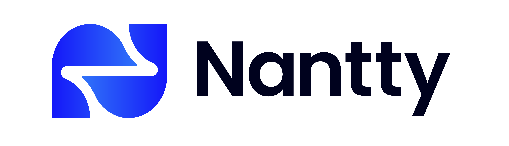

<div align="center">

<picture>
  <source media="(prefers-color-scheme: dark)" srcset="docs/assets/brand/nanttyLockupOnDark.png" />
  
</picture>

# Nantty

A social network and a marketplace in one, built for African buyers, sellers and creators, starting with Nigeria.


</div>

> [!NOTE]
> Nantty is **pre-launch**. The public marketing landing pages are deployed as static Cloudflare Pages sites. The product apps and API/backend are not a production service; they run in mock mode or against a developer's local backend. The AWS Terraform is a blueprint and has not been applied. Production payments still require approved live Flutterwave configuration and provider confirmation.

## What it is

- **Social:** feed, clips, stories, comments, follows, mentions and end-to-end encrypted chat.
- **Live:** live streams on LiveKit, with guests, battles, gifts and Nantty Points. Creators can go live from the mobile app, from the browser in Studio (WHIP), or from OBS.
- **Marketplace:** stores, products, carts grouped by seller, seller-run shipping, orders, returns, disputes and reviews. The seller dashboard is an e-commerce back office; it has no in-store register.
- **Money:** Flutterwave is the only payment provider. In Nigeria each user's money sits in their own Flutterwave payout subaccount, and escrow is a lock on the buyer's own balance, so Nantty never holds customer money. Outside Nigeria there is no escrow: buyers pay the seller directly, and nobody can sell until they are identity-verified.
- **Profiles:** a personal account can own one store **or** one business page (never both), plus one brand.
- **Creators and ads:** gifts, creator subscriptions, affiliates, an ads revenue share, an Ads Manager and boosts.
- **Widgets:** iOS and Android home-screen widgets, and an embeddable web widget for stores and products.

Prices are in [docs/pricing.md](docs/pricing.md). Every amount in the system is `{ amountMinor, currency }`.

## Repository map

```text
apps/
  mobile/      Expo app (iOS, Android), including the home-screen widgets
  webapp/      buyer and viewer web app, with the /embed and /oembed widget routes
  developer/   public business integration console (service-backed API work pending)
  sandbox/     isolated API testing portal shell (sandbox services pending)
  studio/      creator studio: lives, browser go-live (WHIP), replays, comments, analytics
  seller/      seller dashboard
  ads/         Ads Manager
  admin/       staff console
  web/         marketing site
services/
  typescript/  Fastify gateway and services; Prisma-backed data services
  go/          platform/ libraries, modules/ (17 domain modules), deployables/ (6 binaries)
  elixir/      realtime: Phoenix WebSocket fan-out
  python/      intelligence: ranking, recommendations, ads, risk and moderation scores
  contracts/   gRPC protos (buf), event JSON Schemas and the AsyncAPI document
  scripts/     API smoke tests, browser e2e, backend lint checks
packages/      chatCrypto (E2EE), contracts, shared-types, designTokens, webKit, emailTemplates, eslintConfig
infra/
  local/       Docker Compose: Postgres + PostGIS, Valkey, RabbitMQ, LocalStack, SeaweedFS, LiveKit, OTel
  aws/         Terraform for ECS Fargate (written, never applied)
scripts/       localMode/ (mock or backend switch), localStack/ (backend:up/down, seed, checks)
security/      audit reports and security test suites (regression, attacks, fuzz, race, resilience)
docs/          architecture, database, integrations, legal, plans, handoff notes
```

## Quick start

You need Node 26.13+, pnpm 11+ and Docker. The real backend also needs Go 1.26; Elixir 1.19 is only needed for realtime (chat and live sockets), and Python 3.14 with uv only for the intelligence service.

```bash
pnpm install
```

### Mock mode (no backend)

```bash
pnpm mode:mock
pnpm --filter @nantty/webapp dev       # http://localhost:3500
pnpm --filter @nantty/mobile dev       # Expo
pnpm --filter @nantty/developer dev    # http://localhost:3700
pnpm --filter @nantty/sandbox dev      # http://localhost:3800
```

The Developer and Sandbox workspaces are separate web applications. Their current routes are responsive, branded foundations with explicit disconnected states; they do not yet create credentials, call the public business API, or simulate successful sandbox requests. See [docs/architecture/messenger-and-business-messaging.md](docs/architecture/messenger-and-business-messaging.md) for the service/security boundary and remaining acceptance gates.

The cross-product implementation status, repository boundaries, prioritized backlog and current blockers are tracked in [docs/master](docs/master/README.md). Organization management is partially connected in source; this does not mean Developer APIs, billing, webhooks or Sandbox execution are live.

Each app's demo sign-ins are shown on its sign-in page in mock mode.

### Real backend

```bash
pnpm backend:up          # infra, migrations, every service on 127.0.0.1, demo seed
pnpm mode:backend        # point every app at the gateway on :8080, mocks off
pnpm backend:check       # signs in as the demo buyer and checks the main paths
pnpm --filter @nantty/webapp dev
# ...
pnpm mode:mock
pnpm backend:down
```

The demo accounts, phone testing and LiveKit set-up are in [docs/runningLocally.md](docs/runningLocally.md). One-time codes go to `.data/localStack/logs/goIdentity.log`. Locally, go-money talks to a fake Flutterwave server; never put live `FLWSECK-` keys in a local env file.

The development machine has 15 GB of RAM: run one dev server, build or test suite at a time.

## Common commands

| Command | What it does |
| --- | --- |
| `pnpm mode:mock` / `mode:backend` / `mode:status` | Switch every app (or `-- --app <name>`) between mocks and the gateway; show the current mode |
| `docker compose -f compose.yml up --build -d` | Run the full backend as containers, including service migrations; Linux host networking is used for this local-only stack ([details](docs/localDockerCompose.md)) |
| `pnpm backend:up` / `backend:down` | Start or stop the existing mixed local stack (`-- --full` adds OpenSearch, ClickHouse; `-- --lan` exposes it to a phone) |
| `pnpm backend:check` / `backend:seed` | Check the running stack; re-run the idempotent demo seed |
| `pnpm backend:infra:up` / `backend:infra:down` / `backend:reset` | Infra containers only; `reset` also deletes the volumes |
| `pnpm backend:dev:<service>` | Run one service from source: `identity`, `commerce`, `money`, `live`, `ads`, `trust`, `gateway`, `social`, `media`, `notifications`, `search`, `support` |
| `pnpm backend:test:go` | Go unit and integration tests |
| `pnpm backend:test:<service>` | `gateway`, `social`, `notifications`, `support` tests; `realtime` runs in Docker |
| `pnpm backend:test:smoke` | API smoke suite against a running stack |
| `pnpm backend:lint` | 300-line limit for backend files, no raw SQL in TypeScript |
| `pnpm --filter @nantty/<app> test:contracts` | Mock and API contract tests for webapp, studio, seller, ads and admin |
| `pnpm typecheck`, `pnpm lint`, `pnpm lint:styles` | Workspace type check, ESLint, stylelint |
| `pnpm check:no-mocks` / `check:no-mocks:mobile` | Fail if a production build contains mock code |
| `pnpm backend:rabbitmq:definitions` | Regenerate the RabbitMQ definitions from `infra/local/rabbitmq/topology.json` |

## Documentation

- [docs/architecture/system.md](docs/architecture/system.md): system overview (services, data ownership, events, money flow, auth, realtime, deployment).
- [docs/architecture/README.md](docs/architecture/README.md): the topic documents.
- [docs/runningLocally.md](docs/runningLocally.md): mocks or the real backend, demo accounts, phones, LiveKit.
- [services/README.md](services/README.md) and [services/fastifyPlatformMigration.md](services/fastifyPlatformMigration.md): running each service; the shared code layout.
- [docs/integrations/flutterwaveMigration.md](docs/integrations/flutterwaveMigration.md): the payments design.
- [docs/README.md](docs/README.md): every document, one line each.
- [SECURITY.md](SECURITY.md): security rules and how to report a vulnerability.

## Contributing

Nantty is a private, owner-led project. Read [services/fastifyPlatformMigration.md](services/fastifyPlatformMigration.md) and [SECURITY.md](SECURITY.md) first. House rules: backend files stay at 300 lines or fewer, almost no comments, TypeScript services use Prisma (CI blocks raw SQL outside the documented search-query exception), and Go services use ent + Atlas with narrowly reviewed parameterized SQL where required (for example, the ledger outbox). Money uses integer minor units, and events are named `<entity>.<pastTense>` with a JSON Schema.

## Licence and contact

All rights reserved; no licence has been chosen yet. Contact addresses are in [docs/emailAddresses.md](docs/emailAddresses.md). Report security issues privately to [security@nantty.com](mailto:security@nantty.com), never in a public issue.
