<div align="center">

<picture>
  <source media="(prefers-color-scheme: dark)" srcset="docs/assets/brand/zudomartLockupOnDark.svg" />
  
</picture>

# Zudomart

**Africa-first social commerce: shop, create, go live, get paid, protected by escrow.**

Nigeria first. One account to follow creators, watch clips and lives, buy from real sellers, and pay safely.

<br />


<br />


<br /><br />


</div>

---

> [!NOTE]
> Zudomart is **pre-launch**. Every client app is built and runs end to end on in-process mock data by default. The polyglot backend under `services/` is being built and wired domain by domain, runs locally only, and nothing is deployed to AWS yet. The [Status and roadmap](#status-and-roadmap) section says exactly what is real.

## Contents

| | | |
| --- | --- | --- |
| [What Zudomart is](#what-zudomart-is) | [Architecture](#architecture) | [Pricing](#pricing) |
| [Product pillars](#product-pillars) | [Tech stack](#tech-stack) | [Security and privacy](#security-and-privacy) |
| [Screens](#screens) | [Repository layout](#repository-layout) | [Status and roadmap](#status-and-roadmap) |
| [The apps](#the-apps) | [Zudojs structure and naming](#zudojs-structure-and-naming) | [Contributing](#contributing) |
| | [Getting started](#getting-started) | [Documentation index](#documentation-index) |
| | [Environment variables](#environment-variables) | [License](#license) and [Contact](#contact) |

---

<a id="what-zudomart-is"></a>

##  What Zudomart is

Zudomart is a social network and a marketplace in one app, built for African buyers, sellers and creators, starting with Nigeria.

- **Social first.** A feed, short clips, stories, chat and lives, so people discover products the way they discover everything else: from people they follow.
- **Commerce built in.** Product posts carry a shop tag, carts group items by seller, sellers run their own shipping, and buyers pay through Paystack.
- **Trust as the product.** Escrow holds the buyer's money until delivery is confirmed (or 3 days after delivery). Unverified stores can only sell through escrow.
- **Fair money.** **0% commission** on products. Sellers pay an escrow fee only when escrow is used, and creators earn from gifts, subscriptions and an ads revenue share.
- **Currency is never hardcoded.** The server resolves the viewer's country and currency (NGN, GHS, KES, ZAR, GBP, EUR, USD, falling back to USD). Every amount is `{ amountMinor, currency }`.

---

## Product pillars

<table>
<tr>
<td width="50%" valign="top">

###  Social

- Home feed, full-screen clips (one video per swipe), stories, posts with up to 10 media
- Threaded comments, video replies to comments, reshares, bookmarks and saved collections
- `@mentions` in posts, comments and group chats (`@all` for groups), with notifications
- Private profiles with follow requests; searchable follower lists that respect privacy
- Chat with Chats / Requests / Spam folders, server-enforced message-request settings, blocking, per-chat mute
- End-to-end encryption **designed** on the Signal protocol (per-device keys); not built yet
- Streaks: +1 per day when both people send, an hourglass before the day ends, monthly restores, 100-day milestones
- Post composer and clip composer with tagged people (notified, removable by the tagged person) and bottom sheets for pickers and settings
- Scoped search: search inside a profile, a chat, saved items or the Mart, not only globally
- Branded downloads: saved clips carry the Zudomart badge and an animated end card with the Call and response symbol
- Reports for posts, users, messages and conversations; chat evidence is submitted from the reporter's device with consent

</td>
<td width="50%" valign="top">

###  Live

- Live streams for creators of every kind (talk, music, gaming); products are optional
- TikTok-style gifts: about 25 gifts in 4 tiers, combos, quantities, full-screen premium gifts
- Multi-guest lives (up to 10 streamers) and coin battles, with an optional "winner takes all"
- **ZudoPoints**: engagement and gift points that feed per-stream, global, country and category rankings. Points are never money
- **Studio** (web) for creators: manage lives, overlays for OBS, comments and pinned products
- Live ads only when the creator opts in

</td>
</tr>
<tr>
<td valign="top">

###  Marketplace

- Mart home with sticky category tabs and rotating banners, categories, collections, brands and "Official Store" badges for verified brands
- Cart grouped by seller; shipping is charged once per seller order group, never per item
- Seller-run shipping: destinations by country, state and LGA, fees, free thresholds, recomputed on the server
- Escrow by default, or direct payment for verified stores when the buyer chooses it
- Disputes pause the escrow timer; reviews and seller success rates
- Store rewards funded by the seller (store credit redeemable only at that seller). Platform cashback and referrals were removed

</td>
<td valign="top">

###  Creators

- A Personal profile is upgraded to creator status through the Creator Program (auto-approve, manual review, or not eligible, with a progress checklist)
- Earnings from gifts (admin-set tiers up to 70%), creator subscriptions (creator keeps 80% of net) and an ads revenue share
- "Zudomart doesn't pay for views; it shares eligible monetization revenue." AI-generated content earns a lower share
- "Get paid" payout onboarding in the app and Studio; one payout identity for someone who is both seller and creator

</td>
</tr>
<tr>
<td valign="top">

###  Trust and safety

- Checkmarks: **Blue** for Personal (creator or not), **Gold** for Business and Brand after KYB, **Black** for Government with two-admin vetting
- Moderation queues, chat-report queue (child safety is urgent), copyright and IP claims, audio matching hints
- Suspensions with appeals; Python may suggest, an admin always decides
- Admin console with department roles, fine-grained permissions, MFA, step-up auth and a full audit trail
- Verification: Blue, Gold and Black checkmarks with a clear review status; paid plans carry renewals and free trials, with reminders before a renewal
- **Legal admin**: versioned Terms, Privacy, Cookie policy and Community guidelines, with re-acceptance for material changes

</td>
<td valign="top">

###  Ads and  Seller dashboard

- **Ads Manager**: campaigns, ad sets, audiences, billing and reports. Ads take the native shape of their slot (mart tiles, feed posts, between clips, promoted lives). In-app boosts for individuals
- An ad decision engine separate from feed ranking, with frequency caps and fraud filtering
- **Seller dashboard**, the "seller operating system": products, inventory, orders, returns, delivery, wallet and escrow, staff (existing Zudomart users), marketing, reports
- **Free for every seller.** Plans only gate extra features: **Free ₦0**, **Pro ₦5,000/mo**, **Business ₦15,000/mo** (paid plans include Gold after KYB). No in-store register

</td>
</tr>
</table>

---

<a id="screens"></a>

##  Screens

Real screens from the mobile design, shown on the marketing site (`apps/web/public/screens`). Demo data, licensed media.

<table>
<tr>
<td align="center" width="20%">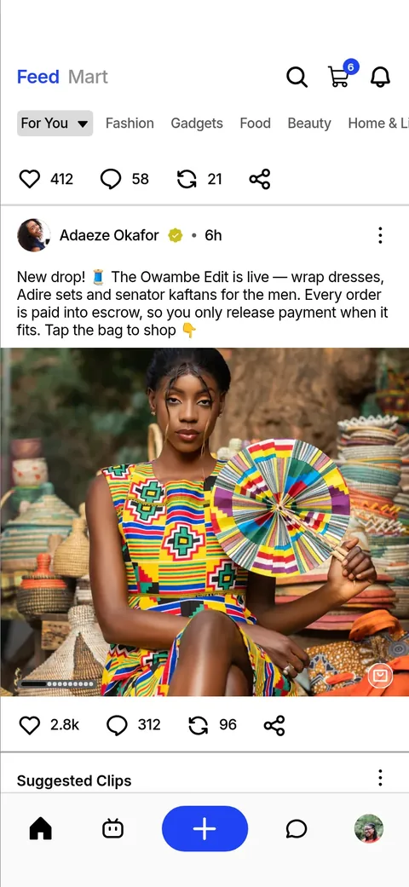<br /><sub><b>Home feed</b><br />Posts, product tags, social proof</sub></td>
<td align="center" width="20%">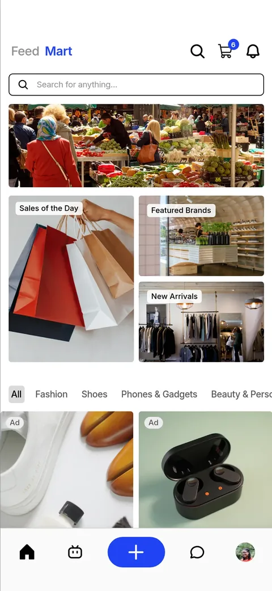<br /><sub><b>Mart</b><br />Deals, brands, native ad tiles</sub></td>
<td align="center" width="20%">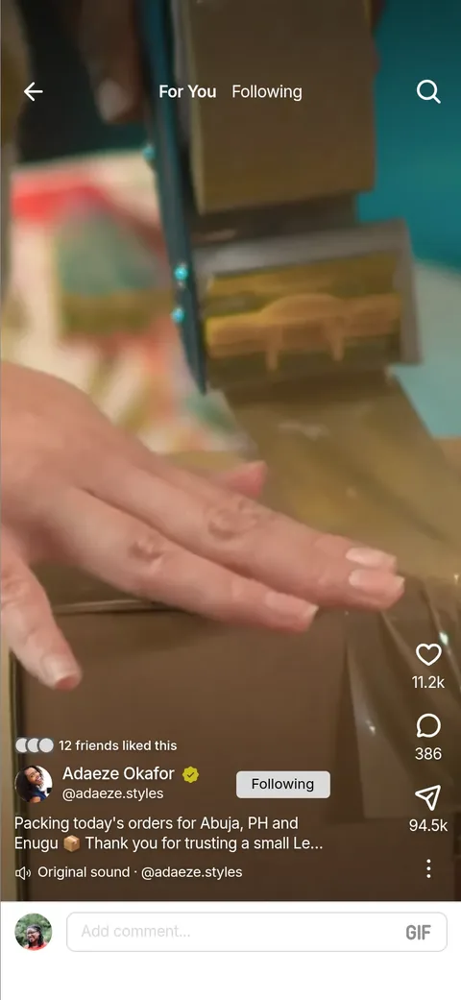<br /><sub><b>Clips</b><br />Full-screen, one per swipe</sub></td>
<td align="center" width="20%"><br /><sub><b>Live</b><br />Watch, comment, gift, shop</sub></td>
<td align="center" width="20%">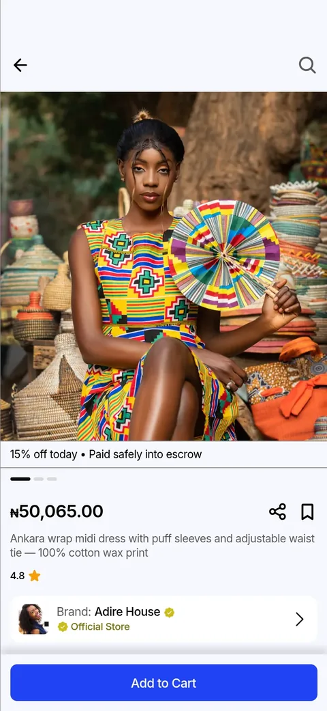<br /><sub><b>Product</b><br />Brand, Official Store, escrow</sub></td>
</tr>
<tr>
<td align="center">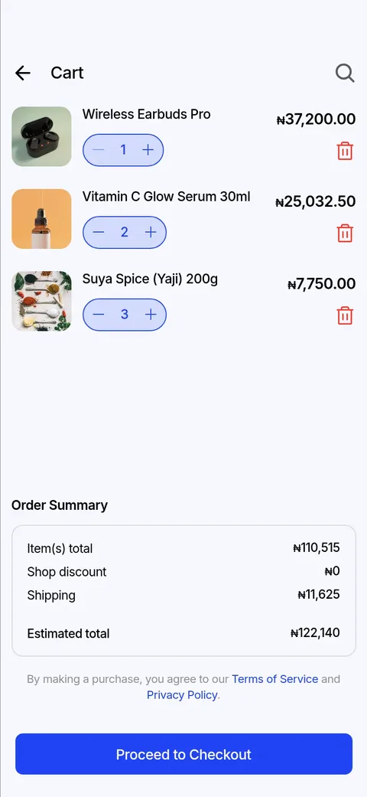<br /><sub><b>Cart</b><br />Totals computed on the server</sub></td>
<td align="center">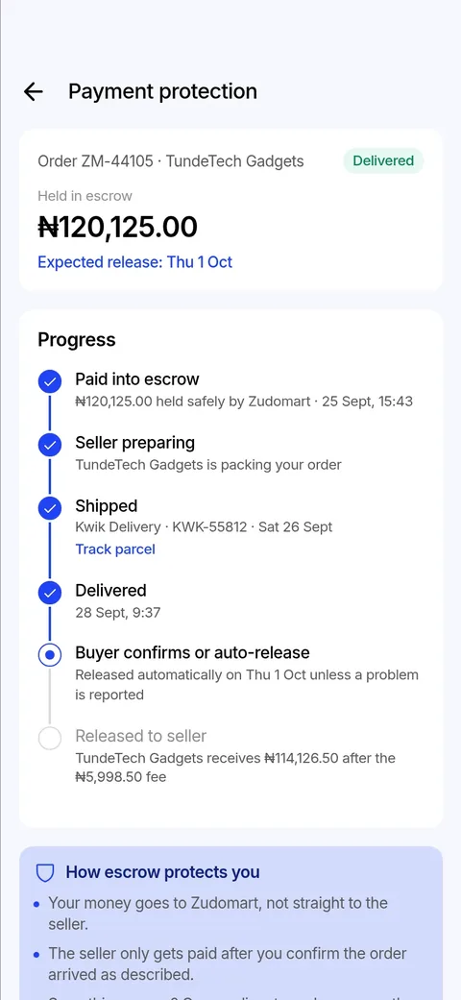<br /><sub><b>Payment protection</b><br />Escrow timeline to release</sub></td>
<td align="center">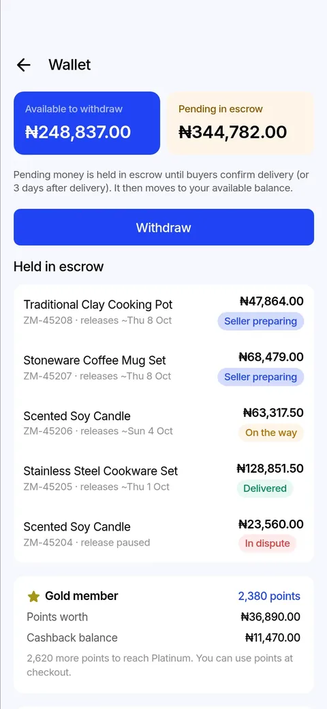<br /><sub><b>Seller wallet</b><br />Available vs in escrow</sub></td>
<td align="center">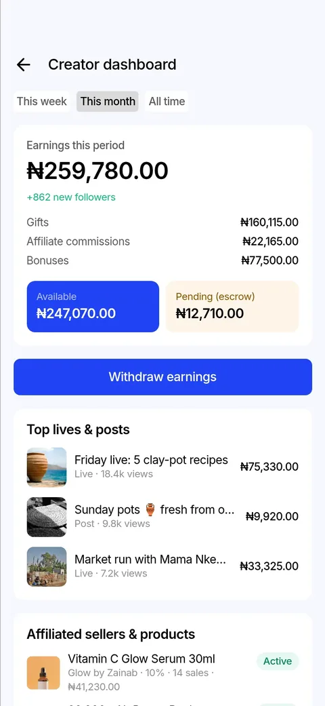<br /><sub><b>Creator dashboard</b><br />Gifts and earnings</sub></td>
<td align="center">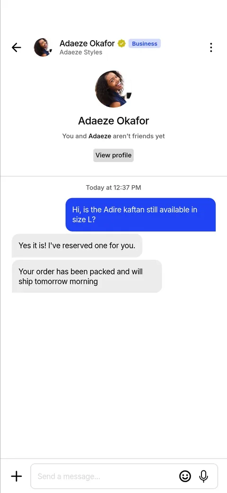<br /><sub><b>Chat</b><br />Buyer and seller messaging</sub></td>
</tr>
</table>

<sub>Only light-mode captures exist so far. Dark mode is designed (mobile follows Figma's neutral greys, web apps use the navy-tinted tokens in `packages/designTokens`); see [docs/darkModePlan.md](docs/darkModePlan.md).</sub>

---

<a id="the-apps"></a>

##  The apps

| App | Path | Domain | Local port | Who it is for | Status |
| --- | --- | --- | --- | --- | --- |
| **Mobile** | [`apps/mobile`](apps/mobile) | iOS and Android | Expo | Everyone: feed, clips, lives, mart, chat, wallet, small seller area | UI built (92 screens), mock data by default |
| **Web app** | [`apps/webapp`](apps/webapp) | to be decided | 3500 | Buyers and viewers on the web, guest browsing | UI built, mock data by default |
| **Studio** | [`apps/studio`](apps/studio) | `studio.zudomart.com` | 3600 | Creators running lives, OBS overlays | UI built, mock data by default |
| **Seller dashboard** | [`apps/seller`](apps/seller) | `dashboard.zudomart.com` | 3200 | Sellers and their staff (88 pages) | UI built, mock data by default |
| **Ads Manager** | [`apps/ads`](apps/ads) | `ads.zudomart.com` | 3300 | Advertisers and agencies | UI built, mock data by default |
| **Admin** | [`apps/admin`](apps/admin) | `admin.zudomart.com` | 3400 | Zudomart staff: trust, money, legal, support, config | UI built, mock data by default |
| **Marketing site** | [`apps/web`](apps/web) | `zudomart.com` | Next default | Public landing, sellers page, legal pages | Built (static, no API) |
| **Intelligence** | [`services/python/intelligence`](services/python/intelligence) | internal only | 8090 | Ranking, recommendations, ads, fraud and risk scores | Built (stateless scoring), not yet called in production paths |

<details>
<summary><b>What each Next.js app shares</b></summary>

- A **BFF** (`src/app/bff/[...path]/route.ts`): the browser only talks to its own origin, tokens live in `__Host-` httpOnly cookies (15 min access, 30 day refresh), mutations carry an HMAC CSRF token bound to the session.
- `src/proxy.ts` (Next 16 middleware) guards routes; security headers and CSP in each `next.config.ts`.
- Shared packages: `@zudomart/design-tokens` (light and dark tokens), `@zudomart/web-kit` (wordmark, skeletons, empty and error states), `packages/emailTemplates` (React Email, sent through AWS SES).

</details>

---

<a id="architecture"></a>

##  Architecture

Principle: **design boundaries for scale, deploy minimal infrastructure first.** One Postgres with a schema per owning service, a transactional outbox into RabbitMQ, ECS/Fargate before Kubernetes, and no Kafka on day one.

### System overview

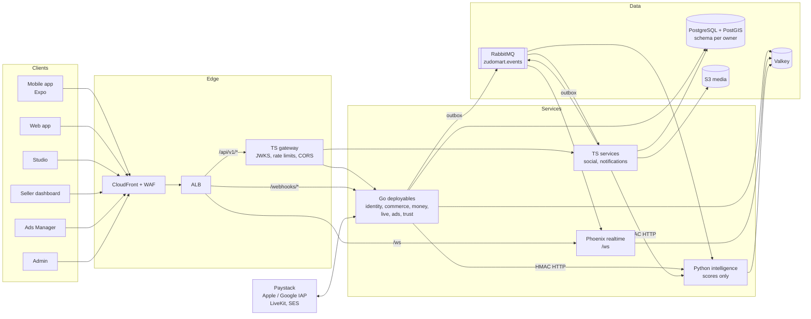

Python returns scores (risk, moderation, ranking). Go and TypeScript make the deterministic allow / hold / review / reject decision and fall back to deterministic logic when Python is slow or down.

### Service map and domain ownership

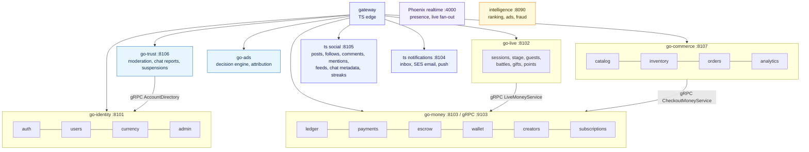

| Owner | Writes (one Postgres schema each) | Why grouped |
| --- | --- | --- |
| go-identity | `auth`, `users`, `currency`, `admin` | low write volume, shared session and JWKS concerns |
| go-commerce | `catalog`, `inventory`, `orders`, `analytics` | order, order group and stock reservation commit in one transaction |
| go-money | `ledger`, `payments`, `escrow`, `wallet`, `creators`, `subscriptions` | every balance change commits in one transaction (role `svc_money`) |
| go-live | `live` | hot, latency-sensitive state machine |
| go-ads | `ads` | separate scaling and billing cadence |
| go-trust | `moderation` | async, queue-driven |
| TS services | `social`, `notifications` (Prisma) | social orchestration and IO integrations |
| Phoenix | none | realtime fan-out only |
| Python | none (Redis features only) | scores only, never reads the product database |

Modules never import each other. They talk through narrow ports, events or internal gRPC.

### Event flow

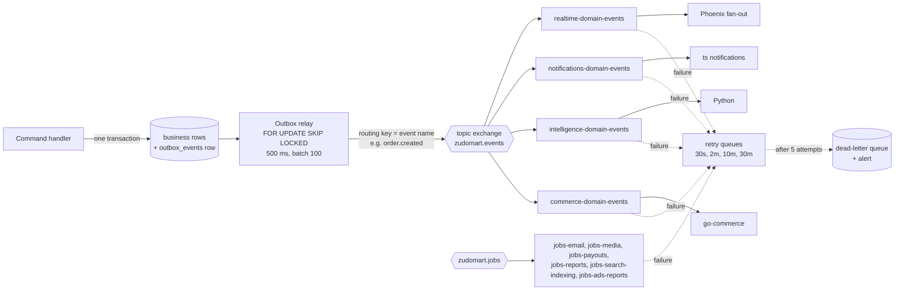

- Event names are `<entity>.<pastTense>` (`account.registered`, `gift.sent`, `escrow.released`). Each has a JSON Schema in `services/contracts/events` and an AsyncAPI 3 entry.
- Envelope: `{ id, type, source, subject, schemaVersion, occurredAt, data }`. Consumers are idempotent on the event id.
- Quorum queues, one least-privilege RabbitMQ user per service. Amazon MQ for RabbitMQ in production. Kafka/MSK only when a trigger fires (sustained > ~5k events/s or long replay needs).

### Money flow (Paystack)

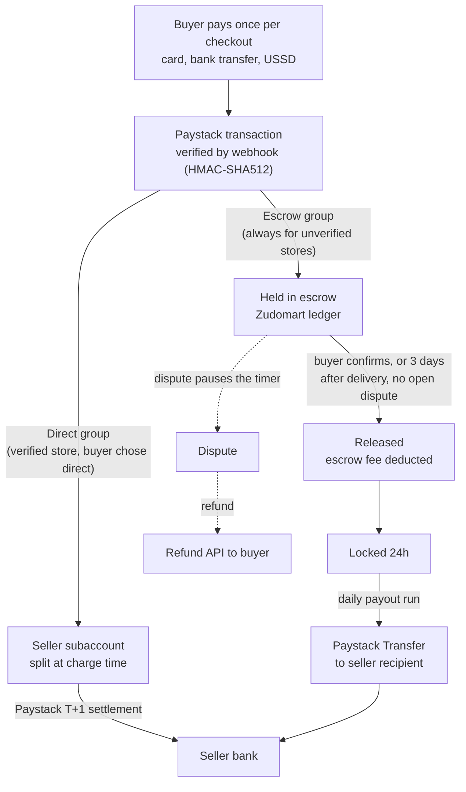

| Path | Zudomart fee | Processing | Who pays |
| --- | --- | --- | --- |
| Escrow order group | **1.5%** escrow fee on the seller-group total incl. shipping (**1%** on the Business plan); no fee on refunded amounts | Paystack fee (1.5% + ₦100, capped at ₦2,000, ₦100 waived under ₦2,500) | Seller, deducted at payout, shown as two lines |
| Direct order group | none | Paystack fee only | Seller |
| Buyer | none | none | - |
| Commission on products | **0%** | - | - |

The **go-money ledger is the single financial truth**: append-only journal entries (database triggers refuse UPDATE and DELETE), balanced per currency, integer minor units, idempotency keys stored in Postgres. Paystack balances are reconciliation evidence, never shown as anyone's wallet. Coins are a separate unit priced per channel (web, iOS, Android); digital goods inside the mobile apps use Apple IAP / Google Play Billing.

<details>
<summary><b>Seller balance states and open questions</b></summary>

`inEscrow → locked (24h) → available → payoutRequested → paid`. Refunds after release take from pending, then available, then book a debt repaid from future credits, so no balance goes negative.

Open with Paystack (see [docs/integrations/paystack.md](docs/integrations/paystack.md)): whether escrow can be held in a per-seller subaccount with manual settlement (path E1). The launch path (E2) keeps escrow in Zudomart's Paystack balance and pays sellers by Transfer after release plus the 24h lock, which needs legal review. Per-plan escrow fee wiring (Business 1%) is still pending in go-money.

</details>

### Live architecture planes

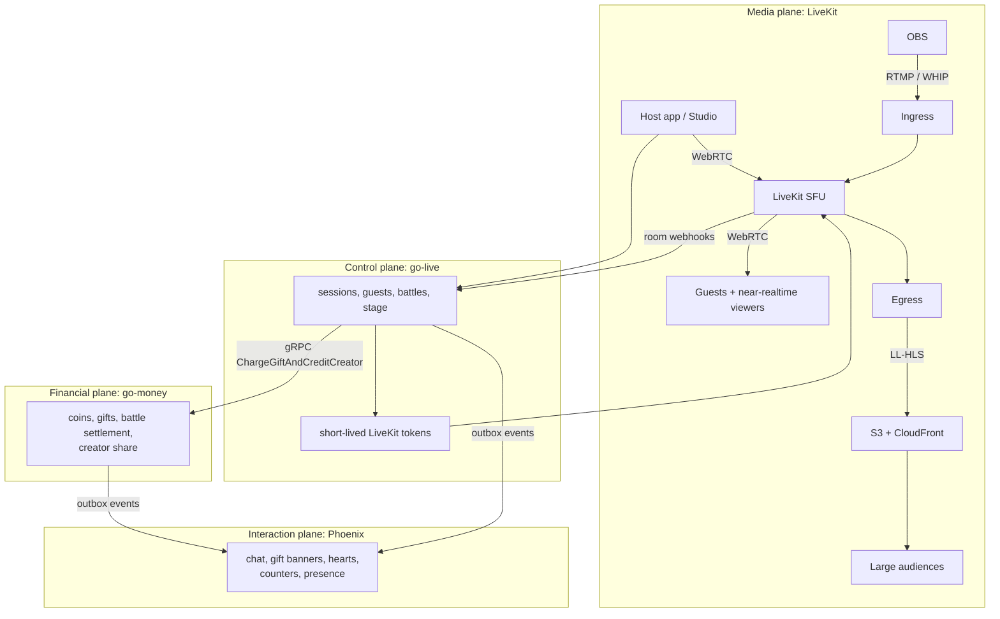

Go owns the money; Phoenix only fans out `gift.sent` with asset keys. Likes are aggregated server-side and gift banners are batched so popular rooms stay watchable.

### Data ownership overview

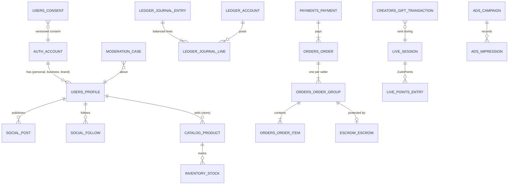

Entity prefixes name the owning schema. The full ERDs per domain are in [docs/database/schema.md](docs/database/schema.md) and [docs/architecture/database.md](docs/architecture/database.md).

### Deployment on AWS (planned)

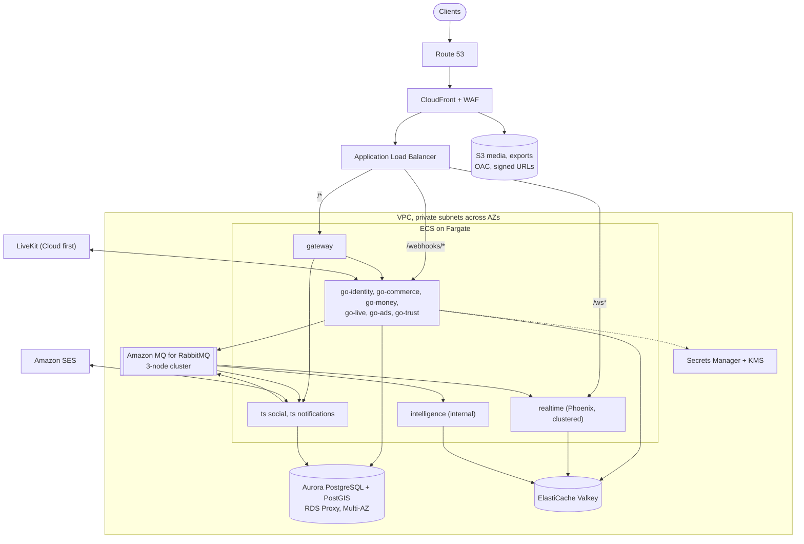

Terraform module layout lives in [infra/aws/README.md](infra/aws/README.md); **nothing is applied yet**. go-money deploys blue/green with a canary; the rest roll with ECS circuit breakers. OpenSearch, ClickHouse, read replicas, EKS and MSK each wait for a stated trigger metric.

---

<a id="tech-stack"></a>

##  Tech stack

| Layer | Choice |
| --- | --- |
| Mobile | Expo SDK 57, React Native 0.86, React 19, React Navigation 7, TanStack Query 5 (persisted cache), Zustand 5, expo-sqlite message history |
| Web | Next.js 16 (App Router, BFF route handlers), React 19, TanStack Query, CSS Modules, stylelint |
| Edge | TypeScript gateway on Zudojs (`@zudojs/http`): JWKS verification, CORS, rate limits, upstream routing |
| Core services | Go 1.26, ent + Atlas (schema as code, generated migrations), gRPC via buf, distroless images |
| Social and IO | TypeScript (Zudojs) with Prisma |
| Realtime | Elixir, Phoenix 1.8 (raw JSON WebSocket at `/ws`, PubSub, Presence) |
| Intelligence | Python 3.14, FastAPI, uv |
| Data | PostgreSQL 17 + PostGIS (Aurora in production), Valkey 9 |
| Messaging | RabbitMQ 4 (Amazon MQ in production), transactional outbox |
| Media | SeaweedFS locally, S3 + CloudFront in production, LiveKit for live video |
| Payments | Paystack (cards, bank transfer, USSD, subaccount splits, transfers), Apple IAP, Google Play Billing |
| Email | React Email templates (`packages/emailTemplates`), AWS SES |
| Observability | OpenTelemetry, OTel collector, Jaeger locally, CloudWatch planned |
| Tooling | pnpm 11 workspace, Node 24, TypeScript 7, Docker Compose, GitHub Actions |

---

<a id="repository-layout"></a>

##  Repository layout

```text
zudomart/
├── apps/
│   ├── mobile/          Expo app (iOS, Android); Figma specs in design/
│   ├── webapp/          buyer web app + BFF
│   ├── studio/          creator live studio + BFF
│   ├── seller/          seller dashboard + BFF (apiContract.md)
│   ├── ads/             Ads Manager + BFF (apiContract.md)
│   ├── admin/           admin console + BFF (apiContract.md)
│   ├── web/             marketing site
│   ├── intelligence/    Python scoring service (apiContract.md)
│   └── gift/            gift animation drafts (assets only)
├── services/
│   ├── go/              go.work: platform/ libraries, modules/<service>/, deployables/ (6 binaries)
│   ├── typescript/      gateway/, social/, notifications/
│   ├── elixir/realtime/ Phoenix realtime
│   ├── contracts/       buf protos, event JSON Schemas, AsyncAPI 3
│   ├── scripts/         CI checks and test runners
│   └── zudojsStructure.md
├── packages/            designTokens, webKit, emailTemplates, contracts, shared-types
├── infra/
│   ├── local/           docker-compose, Postgres bootstrap, RabbitMQ topology, LocalStack, LiveKit, OTel
│   └── aws/             Terraform layout (README only, not applied)
├── docs/                architecture, database, integrations, plans, pricing, changelog
├── SECURITY.md
└── package.json         workspace scripts (backend:*, lint:styles, ...)
```

---

<a id="zudojs-structure-and-naming"></a>

##  Zudojs structure and naming

Every backend stack (Go, TypeScript, Elixir, Python) uses the same Zudojs layout, so anyone who knows one service can find their way around any other. Full spec: [services/zudojsStructure.md](services/zudojsStructure.md).

<details>
<summary><b>Service layout</b></summary>

```text
<serviceName>/
├── src/
│   ├── app.<ext>  server.<ext>  container.<ext>
│   ├── configs/  constants/  databases/  enums/  errors/  events/
│   ├── integrations/  interfaces/  jobs/  loaders/  loggers/
│   ├── middlewares/  repositories/  routes/  types/  utils/
│   └── modules/<moduleName>/
│       ├── <moduleName>.module.<ext>
│       ├── commands/<commandName>/<commandName>.command.<ext> + .handler.<ext>
│       ├── queries/<queryName>/<queryName>.query.<ext> + .handler.<ext>
│       ├── controllers/  services/  repositories/  validators/
│       ├── dtos/  models/  events/  routes/
└── tests/  (mirrors src/)
```

</details>

| Rule | Example |
| --- | --- |
| File names are `<name>.<kind>.<ext>` | `verifyOtp.command.go`, `upstreamDispatch.handler.ts`, `domainEvent.router.ex` |
| Multi-word names are camelCase, folders too | `commands/verifyOtp/`, `deployables/goMoney/` |
| Python is the one exception (importable snake_case + kind) | `feed_ranking_service.py` |
| Go tests keep the `_test.go` suffix | `credentials.validator_test.go` |
| Long, self-explanatory function names | `RotateRefreshTokenAndDetectReuse`, `calculateCartTotalsInKobo` |
| Tool-generated files keep tool names | Atlas migrations, `atlas.sum`, `go.mod`, `mix.exs`, Dockerfiles |

---

<a id="getting-started"></a>

##  Getting started

### Prerequisites

| Tool | Version |
| --- | --- |
| Node.js | 24 or newer |
| pnpm | 11 or newer |
| Docker + Compose | recent (Elixir runs in the `elixir:1.19` image, no local install needed) |
| Go | 1.26 |
| Python + uv | 3.14 (only for `services/python/intelligence`) |

### 1. Install

```bash
git clone https://github.com/oyinlola-tech/zudomart.git
cd zudomart
pnpm install
```

### 2. Run a front end on mock data (no backend needed)

```bash
pnpm --filter @zudomart/webapp dev     # http://localhost:3500
pnpm --filter @zudomart/seller dev     # http://localhost:3200  (demo password on the sign-in page)
pnpm --filter @zudomart/ads dev        # http://localhost:3300
pnpm --filter @zudomart/admin dev      # http://localhost:3400
pnpm --filter @zudomart/studio dev     # http://localhost:3600
pnpm --filter @zudomart/web dev        # marketing site
pnpm --filter @zudomart/mobile dev     # Expo
```

### 3. Start the local backend

```bash
pnpm backend:up                 # Postgres + PostGIS, Valkey, RabbitMQ, LocalStack (SES), SeaweedFS, LiveKit, OTel, Jaeger
pnpm backend:dev:identity       # go-identity      :8101 (auth, users, currency, admin)
pnpm backend:dev:gateway        # gateway          :8080
pnpm backend:dev:social         # ts social        :8105
pnpm backend:dev:notifications  # ts notifications :8104
pnpm backend:dev:live           # go-live          :8102
pnpm backend:dev:money          # go-money         :8103, gRPC :9103
pnpm backend:dev:trust          # go-trust         :8106
pnpm backend:dev:commerce       # go-commerce      :8107
pnpm backend:down               # stop  (backend:reset also wipes volumes, backend:logs follows logs)
```

One-time codes are written to the go-identity log in development (`AUTH_OTP_DELIVERY=log`, refused in production). Traces: http://localhost:16686. RabbitMQ management: http://127.0.0.1:15672.

> [!TIP]
> The machine this was built on has 15 GB of RAM. Run heavy work one at a time (one dev server, build or test run), and stop the Docker stack when you are done.

### 4. Switch from mocks to the real API, one domain at a time

Mocks stay the default. A request goes to the gateway only when its path starts with a listed prefix; everything else keeps using mocks. Full checklist and order: [docs/integrations/frontendWiring.md](docs/integrations/frontendWiring.md).

| App | Prefix variable | Global mock flag | API base URL |
| --- | --- | --- | --- |
| mobile | `EXPO_PUBLIC_REAL_API_PREFIXES` | `EXPO_PUBLIC_USE_MOCKS` | `EXPO_PUBLIC_API_URL` (`http://localhost:8080`) |
| webapp | `WEBAPP_REAL_API_PREFIXES` | `WEBAPP_USE_MOCKS` | `WEBAPP_API_URL` |
| studio | `STUDIO_REAL_API_PREFIXES` | `STUDIO_USE_MOCKS` | `STUDIO_API_URL` |
| seller | `SELLER_REAL_API_PREFIXES` | `SELLER_USE_MOCKS` | `SELLER_API_URL` |
| ads | `ADS_REAL_API_PREFIXES` | `ADS_USE_MOCKS` | `ADS_API_URL` |
| admin | `ADMIN_REAL_API_PREFIXES` | `ADMIN_USE_MOCKS` | `ADMIN_API_URL` |

```bash
EXPO_PUBLIC_REAL_API_PREFIXES=/api/v1/auth,/api/v1/users,/api/v1/locale,/api/v1/currencies,/api/v1/geo,/api/v1/business-categories
WEBAPP_REAL_API_PREFIXES=/api/v1/auth,/api/v1/users,/api/v1/locale,/api/v1/currencies,/api/v1/geo,/api/v1/business-categories
```

Expo inlines `EXPO_PUBLIC_*` at bundle time, so restart Metro after a change. Point a phone at `http://<your-ip>:8080`.

### 5. Test and check

| Command | What it runs |
| --- | --- |
| `pnpm backend:test:go` | Go unit + integration tests (integration tests skip when the compose Postgres is down) |
| `pnpm backend:test:gateway` / `:social` / `:notifications` | TypeScript service tests |
| `pnpm backend:test:realtime` | Phoenix tests in Docker |
| `pnpm backend:check` | 300-line file limit and no raw SQL in TypeScript |
| `pnpm lint:styles` | stylelint over every CSS Module and the web-kit styles |
| `cd apps/mobile && npx jest` | mobile contract tests (mock responses vs per-endpoint schemas) |
| `pnpm --filter @zudomart/<app> test:contracts` | contract tests for webapp, studio, seller, ads, admin |
| `pnpm typecheck` | TypeScript across the workspace |

---

<a id="environment-variables"></a>

##  Environment variables

Only `*.example` files are committed. Production secrets come from AWS Secrets Manager. Anything in `apps/mobile` or a `NEXT_PUBLIC_*` variable is public.

| File | Highlights |
| --- | --- |
| [`services/go/.env.example`](services/go/.env.example) | `APP_ENV`, `HTTP_ADDRESS`, per-module `<MODULE>_DATABASE_URL` + `_DATABASE_SCHEMA` (role `svc_<module>`), `AUTH_SIGNING_KEY_ENCRYPTION_KEY`, `AUTH_ONE_TIME_CODE_PEPPER`, `AUTH_GOOGLE_CLIENT_IDS`, `AUTH_APPLE_CLIENT_IDS`, `RABBITMQ_URL`, `LIVEKIT_*`, `MONEY_GRPC_ADDRESS`, `MONEY_INTERNAL_GRPC_TOKEN`, `PAYSTACK_SECRET_KEY`, `DATA_ENCRYPTION_KEY`, `ESCROW_INSPECTION_PERIOD`, `SELLER_CREDIT_HOLD_PERIOD`, `COIN_CHANNEL_FEE_BPS`, `OTEL_EXPORTER_OTLP_ENDPOINT` |
| `services/typescript/gateway/.env.example` | `PORT`, `CORS_ORIGINS`, `AUTH_JWKS_URL`, `AUTH_TOKEN_ISSUER`, `AUTH_TOKEN_AUDIENCE`, `UPSTREAM_*_URL`, `RATE_LIMIT_MAX_PER_MINUTE` |
| `services/typescript/{social,notifications}/.env.example` | Prisma database URL and schema, RabbitMQ, SES (LocalStack locally) |
| [`apps/mobile/.env.example`](apps/mobile/.env.example) | `EXPO_PUBLIC_API_URL`, `EXPO_PUBLIC_USE_MOCKS`, `EXPO_PUBLIC_REAL_API_PREFIXES` |
| [`apps/webapp/.env.example`](apps/webapp/.env.example) (and studio, seller, ads, admin) | `<APP>_API_URL`, `<APP>_USE_MOCKS`, `<APP>_REAL_API_PREFIXES`, `<APP>_SESSION_SECRET`, `NEXT_PUBLIC_*` site URLs |
| [`services/python/intelligence/.env.example`](services/python/intelligence/.env.example) | `INTELLIGENCE_SHARED_SECRET` (HMAC requests), `INTELLIGENCE_REDIS_URL`, model registry and signing secret, rate limits |

<sub>`services/go/.env.example` still lists legacy `BACHS_*` keys from an abandoned provider; they are being removed (see [docs/checkoutPaymentFlowPlan.md](docs/checkoutPaymentFlowPlan.md) section 12).</sub>

---

<a id="pricing"></a>

##  Pricing

Recommended Nigeria launch defaults from [docs/pricing.md](docs/pricing.md). Every price is an admin-editable setting stored as `amountMinor` (kobo); none is hardcoded in a UI. The owner still has to confirm them.

| Product | Web (Paystack) | In app (Apple / Google) | Yearly (web, 20% off) |
| --- | --- | --- | --- |
| Blue Essential (no badge: account protection, edit window) | ₦1,000/mo | ₦1,200/mo | ₦9,600 |
| **Blue Verified** (the blue checkmark) | **₦2,500/mo** | **₦2,900/mo** | ₦24,000 |
| Blue Premium (badge, fewer ads, 6 streak restores, boost credit) | ₦4,500/mo | ₦5,500/mo | ₦43,200 |
| Seller Free | ₦0 | web only | - |
| Seller Pro (Gold after KYB) | ₦5,000/mo | web only | ₦48,000 |
| Seller Business (Gold, 1% escrow fee) | ₦15,000/mo | web only | ₦144,000 |
| Gold-only (brands that don't sell) | ₦3,000/mo (₦2,550 with an active Blue) | web only | ₦28,800 |
| Black (government) | ₦50,000/mo | web only, invoiced | ₦480,000 |
| **Commission on products** | **0%** | - | - |
| Escrow fee (seller pays) | 1.5% of the seller-group total incl. shipping; 1% on Business | - | - |
| Buyer fee | ₦0 | - | - |

<details>
<summary><b>Creators, coins and ads</b></summary>

| Item | Price |
| --- | --- |
| Creator subscription bands | Supporter ₦500, Fan ₦1,000, Superfan ₦2,000, VIP ₦5,000 (web); creator keeps 80% of net |
| Coins (1 coin is not ₦1; net value about ₦10 per coin) | 100 coins: ₦1,000 web, ₦1,200 Android, ₦1,500 iOS (₦1,200 under Apple's Small Business Program) |
| Gift creator share | admin tiers 50%, 60%, 70% |
| Coin transfers | 25% platform fee |
| Ads | ₦500 CPM floor, ₦1,000 minimum daily budget |
| Boosts | ₦1,000 / 1 day, ₦3,000 / 3 days, ₦7,000 / 7 days, ₦15,000 / 7 days wider reach |

</details>

---

<a id="security-and-privacy"></a>

##  Security and privacy

Zudomart is **designed for NDPA 2023 and GDPR (where applicable)**. It does not claim compliance with any law or standard; privacy texts and retention periods need review by qualified counsel.

| Area | Approach |
| --- | --- |
| Accounts | argon2id passwords; 15-minute EdDSA access tokens; refresh tokens stored hashed, rotated on use, reuse revokes the session; signing keys encrypted at rest and rotated every 30 days |
| One-time codes | 5-minute, single-use, peppered hash, locked after 5 failures; responses never reveal whether an account exists |
| Staff | separate staff tokens, password + TOTP, step-up tokens for sensitive actions, superadmins bootstrapped from the CLI, every admin action audited |
| Money | integer minor units only; prices recomputed on the server; paid only after a verified webhook or verify call; `Idempotency-Key` on every money-moving route; append-only ledger |
| Data | every body, query and param validated, unknown fields rejected; no string-built SQL; bank details AES-256-GCM encrypted; logs redact passwords, tokens, codes, card and bank data |
| Cards | card numbers are only entered on Paystack's hosted page; a saved card is a provider token in the device keystore, confirmed with biometrics |
| Privacy | versioned consents (never one boolean), server-enforced privacy settings, data export and account deletion with grace periods, per-category retention flagged for legal review |
| Supply chain | pnpm with `minimumReleaseAge`, blocked exotic sub-dependencies, strict build scripts, frozen lockfile in CI |

The latest audit, with findings and fixes, is in [security/audit/reports/FINAL_SECURITY_AUDIT.md](security/audit/reports/FINAL_SECURITY_AUDIT.md). Fixes include JWT verification inside every service, webhook replay protection, per-route rate limits and stricter upload checks.

Report a vulnerability privately by email (see [SECURITY.md](SECURITY.md) and [Contact](#contact)), never in a public issue.

---

<a id="status-and-roadmap"></a>

##  Status and roadmap

<details open>
<summary><b>What is real today</b></summary>

| Area | Status |
| --- | --- |
| Mobile, web app, Studio, seller, ads, admin | UI built; runs on in-process mocks by default; per-domain switch to the real gateway is in place |
| Marketing site | built |
| Auth (register, login, OTP, refresh rotation, password reset, Google/Apple, sessions) | built in go-identity and served through the gateway |
| Users, currency, admin RBAC, privacy and data rights | built in go-identity, being wired to the clients |
| Money core (ledger, payments with the Paystack adapter, escrow, wallet, coins, creators) | code in go-money, being migrated from the abandoned provider to Paystack; needs human financial review before go-live |
| Live (sessions, guests, battles, gifts, points, LiveKit tokens) | code in go-live, not wired to the clients yet |
| Commerce, ads, trust, social, notifications, realtime | code landing in their services; not wired to the clients yet |
| Intelligence | stateless scoring service built; deterministic fallbacks first |
| AWS | not deployed; Terraform layout only |
| End-to-end chat encryption | designed, not built |

</details>

**Phased plan** (from [docs/architecture/improvementReport.md](docs/architecture/improvementReport.md)):

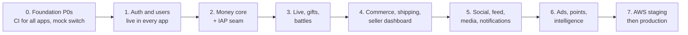

<details>
<summary><b>Top open items before launch</b></summary>

- **Security P0s:** services verify JWTs themselves instead of trusting gateway headers; Paystack webhook HMAC with replay protection; per-route login and OTP rate limits in Valkey plus WAF rules; Phoenix topic authorization; upload pipeline (size and type policy, malware scan, moderation before publish, private KYC bucket).
- **Money:** idempotency keys in Postgres in the same transaction as the write; gift rows owned by go-money; status and escrow on the order group; Paystack escrow model (E1 vs E2) confirmed; per-plan escrow fee; App Store and Play receipt verification before any mobile coin sales.
- **Consent enforcement** before personalization, ads and analytics ingestion.
- **Operations:** outbox dead-letter handling, trace ids in the event envelope, frontend tests and the six Next apps in CI, Terraform for staging.
- **Contract drift** between mobile/web mocks and the new services: switch one domain at a time with contract tests.
- **Product decisions pending:** final prices, CBN and licensing questions for escrow, streak restore perks, the web app domain.

</details>

---

<a id="contributing"></a>

##  Contributing

Zudomart is a private, owner-led project. If you have been invited to contribute:

1. Read [services/zudojsStructure.md](services/zudojsStructure.md), [SECURITY.md](SECURITY.md) and the doc for the domain you touch.
2. Branch from `main`; never push to `main` directly.
3. Keep each change small and switch one domain at a time.

| Rule | Detail |
| --- | --- |
| Comments | Almost none. Only a non-obvious *why*. No docblocks restating code, no section banners |
| File size | Every backend file is 300 lines or fewer (generated code excluded). `pnpm backend:check` enforces it |
| Persistence | TypeScript: Prisma only. Go: ent + Atlas. No raw or hand-written SQL (the exceptions are tool-generated migrations and the hand-written grants migration) |
| Naming | `<name>.<kind>.<ext>`, camelCase multi-word names, long self-explanatory functions |
| API shape | errors `{ message, code, issues? }`; lists `{ data, nextCursor }`; every route declares its permission and denies by default |
| Money | `{ amountMinor, currency }`, never floats, never a hardcoded NGN |
| Icons | vector icons only; emojis are allowed only as user content (keyboard, reactions, user text) |
| Changelog | any change to `apps/mobile` gets an entry in [docs/CHANGELOG.md](docs/CHANGELOG.md) on the day it lands |
| Events | `<entity>.<pastTense>` with a JSON Schema and AsyncAPI entry |

---

<a id="documentation-index"></a>

##  Documentation index

| Topic | Documents |
| --- | --- |
| Start here | [Architecture index](docs/architecture/README.md), [Inventory (what exists)](docs/architecture/inventory.md), [Improvement report](docs/architecture/improvementReport.md) |
| System | [System](docs/architecture/system.md), [Backend](docs/architecture/backend.md), [Frontend](docs/architecture/frontend.md), [Events](docs/architecture/events.md), [Realtime and live](docs/architecture/realtime.md), [Media](docs/architecture/media.md), [Search](docs/architecture/search.md), [Recommendations](docs/architecture/recommendations.md), [Analytics](docs/architecture/analytics.md) |
| Money and commerce | [Payments](docs/architecture/payments.md), [Marketplace](docs/architecture/marketplace.md), [Checkout and payout plan](docs/checkoutPaymentFlowPlan.md), [Paystack review](docs/integrations/paystack.md), [Pricing](docs/pricing.md) |
| Database | [Database index](docs/database/README.md), [Domains](docs/database/domains.md), [Schema ERDs](docs/database/schema.md), [Indexes](docs/database/indexes.md), [Transactions](docs/database/transactions.md), [Migrations](docs/database/migrations.md), [Partitioning](docs/database/partitioning.md), [Backup and recovery](docs/database/backup-recovery.md) |
| Trust and ops | [Security](docs/architecture/security.md), [Privacy](docs/architecture/privacy.md), [Fraud](docs/architecture/fraud.md), [Observability](docs/architecture/observability.md), [DevOps](docs/architecture/devops.md), [Disaster recovery](docs/architecture/disaster-recovery.md), [SECURITY.md](SECURITY.md) |
| Backend services | [services/README.md](services/README.md), [Zudojs structure](services/zudojsStructure.md), [Backend plan](docs/backendPlan.md), [Service map](docs/architecture/microservicesPlan.json), [AWS layout](infra/aws/README.md) |
| Front ends | [Frontend wiring](docs/integrations/frontendWiring.md), [Working plans](docs/plans.md), [Dark mode plan](docs/darkModePlan.md), [Changelog](docs/CHANGELOG.md) |
| API contracts | [Seller](apps/seller/apiContract.md), [Ads](apps/ads/apiContract.md), [Admin](apps/admin/apiContract.md), [Intelligence](services/python/intelligence/apiContract.md), [Seller README](apps/seller/README.md), [Intelligence README](services/python/intelligence/README.md) |

---

## License

All rights reserved. A license has not been chosen yet; until one is added, no permission is granted to use, copy, modify or distribute this code.

<a id="contact"></a>

##  Contact

Every Zudomart address is on the company domain. The full list, with who reads each one and the DNS setup, is in [docs/emailAddresses.md](docs/emailAddresses.md).

- Help with an order or account: [support@zudomart.com](mailto:support@zudomart.com)
- Security reports: [security@zudomart.com](mailto:security@zudomart.com) (also in `/.well-known/security.txt`)
- Privacy and the Data Protection Officer: [privacy@zudomart.com](mailto:privacy@zudomart.com)
- Press and partnerships: [press@zudomart.com](mailto:press@zudomart.com), [partnerships@zudomart.com](mailto:partnerships@zudomart.com)
- Everything else: [hello@zudomart.com](mailto:hello@zudomart.com)

<p>

&nbsp;

</p>

<sub>Coming soon to iPhone and Android; the badges link to the store listings once they are live. Apple and the Apple logo are trademarks of Apple Inc., registered in the U.S. and other countries and regions. App Store is a service mark of Apple Inc. Google Play and the Google Play logo are trademarks of Google LLC. Badge sources: <a href="apps/web/public/storeBadges/NOTICE.md">NOTICE</a>.</sub>

<div align="center">
<br />

<br />
<sub>Zudomart. Built in Nigeria for Africa.</sub>
</div>
