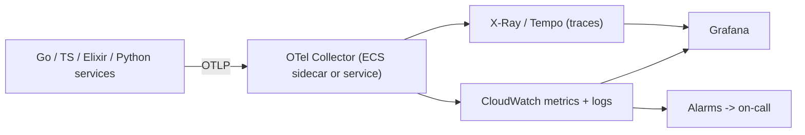
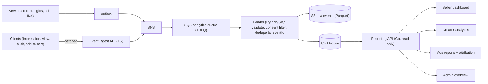

# Analytics architecture

As of 2026-10-03. Sources: `inventory.md` (section 6 infra, 4 events), `docs/backendPlan.md` (analytics rows, 4.3.8), `services/python/intelligence/apiContract.md` section 6. Labels: EXISTING, MOCK-ONLY, PROPOSED, OPTIONAL FUTURE.

Two separate systems with different owners and failure modes.

| | Operational analytics | Product / business analytics |
| --- | --- | --- |
| Question | Is the platform healthy? | What are users, sellers, creators and advertisers doing? |
| Data | metrics, traces, logs | immutable business events, joined with DB snapshots |
| Tools | OpenTelemetry, CloudWatch, Grafana (PROPOSED) | events pipeline, ClickHouse, report API (PROPOSED) |
| Retention | days to weeks (logs), 13 months (metrics rollups) | months to years, with deletion on consent withdrawal |
| Consumers | engineers, on-call | seller/creator/admin dashboards, finance, ads |

## 1. What exists

| Item | Status | Evidence |
| --- | --- | --- |
| Go OTLP/gRPC trace exporter (opt-in via `OTEL_EXPORTER_OTLP_ENDPOINT`) and per-request tracing middleware | EXISTING | `services/go/platform/telemetry` |
| otel-collector + Jaeger in local compose | EXISTING (local) | `infra/local/otel/collector.yaml`, compose |
| Elixir `telemetry.ex` metrics definitions only | EXISTING | `services/elixir/realtime` |
| Gateway tracing, metrics backend, log shipping, dashboards, alarms | ABSENT | inventory 6 |
| ClickHouse in local compose (profile `analytics`) | EXISTING (local) | `infra/local/docker-compose.yml` |
| Event envelope + 3 auth event schemas | EXISTING | `services/contracts/events` |
| Python `POST /v1/events` ingestion, Parquet feature logs | EXISTING | `services/python/intelligence` |
| Seller/creator/admin/ads analytics screens | MOCK-ONLY | `apps/seller`, `apps/ads`, `apps/admin` |
| Pipeline, ClickHouse schemas, reporting module (`analytics` Go module is an 11-line skeleton) | ABSENT / PROPOSED | `services/go/modules/analytics` |

## 2. Operational analytics

| Signal | Minimum set | Status |
| --- | --- | --- |
| Metrics (RED per route) | request rate, error rate, p50/p95/p99 latency; DB pool usage; outbox backlog age; SQS `ApproximateAgeOfOldestMessage` and DLQ depth per queue; Phoenix connections, mailbox size, event lag; Python timeout and fallback rate; ledger invariant check (sum of entries is zero) | PROPOSED |
| Traces | W3C `traceparent` from gateway through services and into event envelope (add field) so a gift is traceable from tap to animation | Go side EXISTING; gateway and propagation PROPOSED |
| Logs | structured JSON (slog EXISTING), request id, account id hash, no PII or tokens | partly EXISTING |
| SLOs | feed p95 under 400 ms, checkout success rate, gift-to-animation p95 under 2 s, search p95 under 300 ms | PROPOSED |

## 3. Product and business analytics

| Concern | Design | Status |
| --- | --- | --- |
| Event contract | versioned JSON Schema per event, envelope `{id,type,version,occurredAt,source,subject,data}`; client events carry `surface`, `rankingRequestId`, `experimentAssignments` (as in `apiContract.md` section 6) | envelope EXISTING; most events PROPOSED |
| Consent | loader drops events lacking `analytics` consent; aggregated non-personal form kept otherwise; pseudonymous user key, salted | PROPOSED |
| Dedupe | `eventId` unique; ClickHouse `ReplacingMergeTree` plus loader window | PROPOSED |
| Money | analytics never defines money; amounts come from ledger events (int64 minor + currency). Reports label "reporting, not accounting". Ledger remains source of truth | PROPOSED |
| Storage | raw to S3 Parquet (replayable); curated tables in ClickHouse partitioned by month; materialized views for daily rollups | PROPOSED, ClickHouse local only |
| Seller analytics | `GET /seller/analytics/{sales,products,customers,traffic,marketing}?from&to&granularity&compare` per `backendPlan.md` 4.3.8; plan-gated history (`analyticsHistoryDays` in `planFeatures.config.ts`) | MOCK-ONLY UI, backend PROPOSED |
| Creator analytics | `GET /creators/me/analytics/gifts`, `/supporters`, `/streams/:liveId` (go reporting module) | PROPOSED |
| Post analytics | owner-only `GET /posts/:id/analytics`, 403 for non-owners | PROPOSED |
| Ads attribution | impression, click and conversion events keyed by `adId` + click id; windows (for example 7-day click, 1-day view) configured per account; reporting reads attributed rows; budget enforcement stays in go-ads/Redis, not ClickHouse | PROPOSED (`AdConversionEvent` in legacy Prisma as reference) |
| Live | per-minute gift and viewer aggregates from `gift.sent`, `live.viewerCountChanged` | PROPOSED |

## 4. Protect the primary

| Rule | Detail |
| --- | --- |
| Never run heavy aggregates on the primary Aurora writer | enforce with a separate DB role `svc_reporting` (read-only, `statement_timeout` 5 s, `idle_in_transaction_session_timeout`) pointed at the reader endpoint |
| Interim (MVP, before ClickHouse) | Aurora read replica serves seller dashboard and reports through the same reporting API contract. Pre-aggregate daily rollups into a `reporting` schema table on a schedule; cap date ranges; paginate exports; run CSV/PDF exports as async jobs on `jobs-reports` writing to S3 with a signed URL |
| Trigger to move to ClickHouse | more than about a few thousand orders per day, or report p95 over 2 s on the replica, or traffic/impression analytics needed (`backendPlan.md` line 659), or replica lag over 5 s from reporting load |
| Replica caveat | replica lag: reports show an "as of" timestamp; never use the replica for read-your-writes flows (checkout, wallet balance) |

## 5. Recommendations

| # | Problem | Current | Why it matters | Recommendation | Complexity | Risk | Priority |
| --- | --- | --- | --- | --- | --- | --- | --- |
| A1 | No metrics, alarms or dashboards | traces opt-in only, no backend | cannot detect checkout or ledger failures | OTel collector in ECS, RED metrics middleware, alarms on DLQ depth, outbox age, 5xx. **MVP** | Medium | Low | P1: real money paths ship without visibility otherwise |
| A2 | Reporting could hit the primary | no reporting role or replica plan | slow dashboards degrade checkout | `svc_reporting` role on reader endpoint; rollup tables. **MVP** | Low | Low | P1 |
| A3 | Event taxonomy undefined | 3 events | pipeline cannot be built | publish an event catalogue (name, version, owner, PII flags, consent class) next to the AsyncAPI file. **MVP** | Medium | Low | P1 |
| A4 | No trace propagation across async hops | envelope has no trace id | gift or order debugging across services is guesswork | add `traceId` to envelope and log it. **MVP** | Low | Low | P2 |
| A5 | ClickHouse pipeline | local container only | premature without volume | build when triggers in section 4 hit. **Scale stage** | High | Medium | P3 |
| A6 | Consent-aware ingestion | consent model ABSENT | analytics on non-consenting users | loader consent filter, see `recommendations.md` RC1. **MVP** | Medium | High if skipped | P1 |
