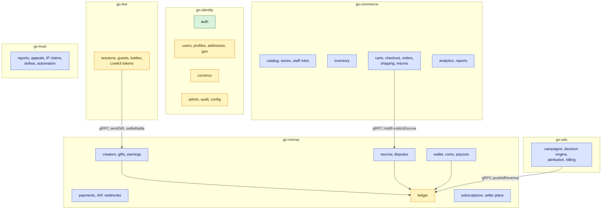
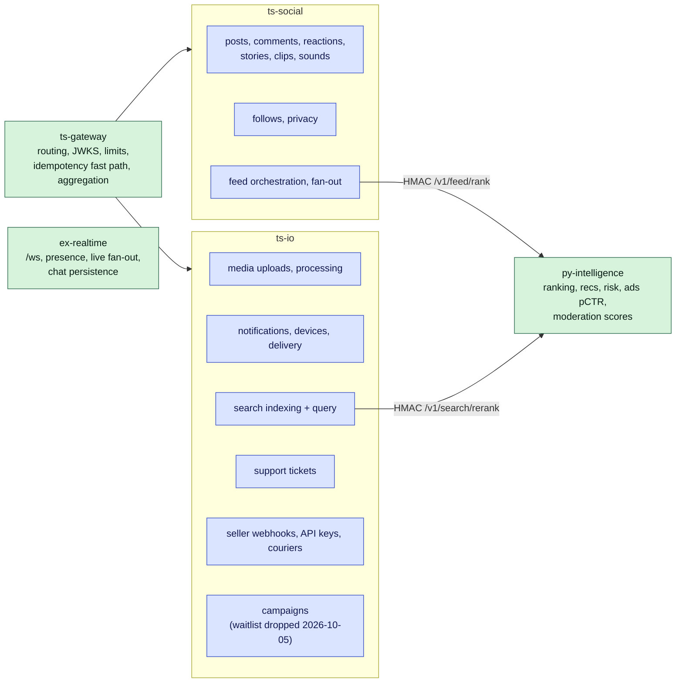

# Backend architecture

> **Dated design document.** The status labels below describe the repo when this was written; much that is marked PROPOSED or ABSENT has since been built. For the current system see [system.md](system.md); where the two disagree, the code wins. Where this document says SNS or SQS, read RabbitMQ: the event bus is RabbitMQ (Amazon MQ in AWS), and the SNS/SQS adapters are unused.

As of 2026-10-03. Labels: **EXISTING** · **MOCK-ONLY** · **PROPOSED** · **OPTIONAL FUTURE** (see [README.md](README.md)). Facts: [inventory.md](inventory.md). Service map source: [microservicesPlan.json](microservicesPlan.json), `docs/backendPlan.md`. Code layout rule: [services/zudojsStructure.md](../../services/zudojsStructure.md).

## 1. Service map and domain ownership

### 1.1 Go deployables (money and core state machines)



Green = serving routes (`services/go/modules/auth`). Yellow = ent schema and Atlas migrations present, no routes (`modules/{users,currency,admin,ledger,live}/internal/{ent,migrations}`, uncommitted work in progress). Blue = 11-line skeleton module.

### 1.2 TypeScript, Elixir, Python



`ts-social` and `ts-io` are the two TS deployables recommended here (grouping the 8 plan services); splitting further is a deploy change.

### 1.3 Deployable inventory

Updated 2026-10-11 to match the code. The `ts-social` / `ts-io` grouping above was not adopted: TypeScript runs as five separate services.

| Deployable | Modules | Status | Scaling signal (ECS) | Key dependencies |
| --- | --- | --- | --- | --- |
| go-identity | auth, users, currency, admin | EXISTING, routed by the gateway (`services/go/deployables/goIdentity`) | CPU, p99 login latency | Postgres `auth/users/currency/admin`, Valkey, RabbitMQ, Smile ID |
| go-commerce | catalog, inventory, orders, analytics (skeleton) | EXISTING, routed by the gateway | CPU, checkout p99 | Postgres `catalog/inventory/orders`, go-money gRPC |
| go-money | payments, wallet, ledger, escrow, subscriptions, creators | EXISTING, routed by the gateway; gRPC on 9103 | CPU, DB lock wait | Postgres money schemas, Flutterwave (sole provider), Apple and Google IAP |
| go-live | live | EXISTING, routed by the gateway | CPU, active rooms | Postgres `live`, LiveKit, Valkey, go-money gRPC |
| go-ads | ads | EXISTING, routed by the gateway | decision QPS | Valkey, intelligence, go-money gRPC |
| go-trust | moderation | EXISTING, routed by the gateway | queue depth | intelligence trust queues |
| gateway | routing, auth, edge controls | EXISTING (`services/typescript/gateway`) | RPS | JWKS from go-identity, Valkey |
| social | posts, comments, follows, feeds, chat, messaging keys, streaks | EXISTING (`services/typescript/social`) | RPS, feed p95 | Postgres `social`, intelligence |
| notifications, search, media, support | one service each | EXISTING (`services/typescript/*`) | queue depth, RPS | SES, Expo push, S3, ClamAV, ffmpeg, Postgres FTS |
| realtime | sockets, presence, live and chat fan-out | EXISTING, RabbitMQ consumer (`services/elixir/realtime`) | socket count per task | RabbitMQ `realtime-domain-events`, go-live and social for topic access |
| intelligence | scoring modules | EXISTING (`services/python/intelligence`), called by search, social, support, go-ads, go-trust and go-identity | RPS, CPU | Valkey features, Parquet logs |

## 2. Code layout (target, all stacks)

Owner rule: every backend uses the Zudojs layout and naming in [services/zudojsStructure.md](../../services/zudojsStructure.md). Files are `<name>.<kind>.<ext>`, camelCase (Python is the one snake_case exception), 300 lines max, almost no comments. The current snake_case Go files are being converted; the tree below is the target.

```
services/go/deployables/goMoney/            (one per deployable: goIdentity, goCommerce, goMoney, goLive, goAds, goTrust)
└── src/
    ├── app.go  server.go  container.go
    ├── configs/goMoney.config.go
    ├── integrations/flutterwave*.integration.go (charges, wallets, transfers, refunds, disputes, webhooks)  sqs.integration.go
    ├── jobs/escrowAutoRelease.job.go  trialBalance.job.go
    ├── middlewares/requireIdempotencyKey.middleware.go
    ├── generated/ent/                       (ent codegen output)
    └── modules/
        └── ledger/
            ├── ledger.module.go
            ├── commands/postBalancedJournalEntry/postBalancedJournalEntry.command.go + .handler.go
            ├── queries/getLedgerAccountBalance/getLedgerAccountBalance.query.go + .handler.go
            ├── controllers/ledger.controller.go
            ├── repositories/journalEntry.repository.go
            ├── validators/journalEntry.validator.go
            ├── dtos/journalEntry.dto.go
            ├── events/journalEntryPosted.event.go
            ├── routes/ledger.routes.go
            └── migrations/                  (Atlas output keeps tool names)
tests/                                       (mirrors src/, files <name>.<kind>_test.go)
```

| Stack | Root | Module example | Package / naming notes |
| --- | --- | --- | --- |
| Go | `services/go/deployables/<deployable>/src` + shared `services/go/platform` | `modules/live/commands/sendGift/sendGift.handler.go` | package = lowercased folder (`package sendgift`); ent in `src/generated/ent` |
| TypeScript | `services/typescript/<service>/src` | `modules/posts/commands/createPost/createPost.command.ts` | barrels `index.ts`; Prisma only, no raw SQL |
| Elixir | `services/elixir/realtime/lib/realtime/` | `modules/live/events/domainEvent.router.ex` | module names stay idiomatic (`Realtime.Topics.TopicAuthorizer`); tests `<name>.<kind>_test.exs` |
| Python | `services/python/intelligence/src` (moving from `services/python/intelligence`) | `modules/risk/services/risk_scoring_service.py` | snake_case with kind suffix (importability) |

## 3. Service ownership matrix

| Domain | Owner module | Deployable | Schema | Writes | Sync API consumers | Status |
| --- | --- | --- | --- | --- | --- | --- |
| Accounts, sessions, OTP, JWKS | auth | go-identity | `auth` | auth only | gateway, realtime, all Go (JWKS) | EXISTING |
| Profiles, usernames, addresses, geo, blocks, consents | users | go-identity | `users` | users | commerce (addresses), social | partial |
| Staff, audit, platform config | admin | go-identity | `admin` | admin (audit via event or gRPC from all) | admin BFF | partial |
| Exchange rates | currency | go-identity | `currency` | currency | commerce, money | partial |
| Stores, products, variants, categories, store roles | catalog | go-commerce | `catalog` | catalog | live (pinning), ads, search | PROPOSED |
| Stock, locations, movements | inventory | go-commerce | `inventory` | inventory | orders (same deployable) | PROPOSED |
| Carts, checkout, order groups, shipping profiles, returns | orders | go-commerce | `orders` | orders | money, seller BFF | PROPOSED |
| Payments, refunds, provider webhooks, IAP | payments | go-money | `payments` | payments | orders, wallet | PROPOSED |
| Ledger accounts, journal entries | ledger | go-money | `ledger` | ledger only (others call `postBalancedJournalEntry`) | every money module | partial |
| Wallets, coins, payout accounts, payouts | wallet | go-money | `wallet` | wallet | mobile, seller | PROPOSED |
| Escrow, disputes | escrow | go-money | `escrow` | escrow | orders | PROPOSED |
| Gifts, creator earnings, affiliations | creators | go-money | `creators` | creators | live (gRPC) | PROPOSED; see finding F1 |
| Nantty Points (engagement and gift points only, never money; referral and purchase loyalty/cashback removed) | live | go-live | `live` | points entries | rankings API | EXISTING in go-live; the go-money `rewards` module was deleted |
| Plans, entitlements, subscriptions | subscriptions | go-money | `subscriptions` | subscriptions | gateway (entitlement cache), catalog | PROPOSED |
| Live sessions, guests, battles, live products | live | go-live | `live` | live | Phoenix (events), money | partial |
| Ads, impressions, attribution | ads | go-ads | `ads` | ads | feed (slot fill), money | PROPOSED |
| Moderation, IP claims, strikes | moderation | go-trust | `moderation` | moderation | social, catalog (takedown events) | PROPOSED |
| Posts, comments, reactions, follows, feed | social, feed | ts-social | `social`, `feed` | ts-social | users, notifications | PROPOSED |
| Media, notifications, search, support, integrations | media, notifications, search, support, integrations | ts-io | own schemas | ts-io | all | PROPOSED |
| Chat, presence | realtime | ex-realtime | `realtime` | realtime | mobile, webapp, seller inbox | transport EXISTING, chat PROPOSED |
| Scores, features | intelligence | py-intelligence | Redis + Parquet (+ `intelligence` schema later) | intelligence | social, commerce, money, ads | EXISTING |

## 4. API design audit

| Area | Current (EXISTING unless noted) | Target | Gap / action | Priority |
| --- | --- | --- | --- | --- |
| Public REST | `/api/v1/*` everywhere; gateway prefix routing (`upstream.routes.ts`); go auth 8 routes | Same paths; gateway route table grows per module | Add routes as modules land; remove dead `/api/v1/auth/sessions` prefix or implement it | P2 |
| Versioning | Path `/api/v1`; event envelope `version` field; Python `/v1` | Path major only; additive changes within v1; events versioned per type (`.v1` schema file) | Document deprecation window (one mobile release cycle min) | P2 |
| WebSocket | Raw JSON `/ws`, first-frame auth within 10 s, 64 KB frames, max 50 subs (`client_socket.ex`) | Keep; add `seq` per topic, browser tickets | Gap recovery relies on `seq` which no producer sets | P1 |
| Internal gRPC | Protos only (`services/contracts/proto/{account_directory,live_money,money}.proto`), no server/client; no gRPC wiring in Go platform | gRPC for go-live -> go-money, go-commerce -> go-money; deadlines 300 ms; mTLS not needed inside VPC if JWT/service token verified | Add `platform/grpcserver` with deadlines, auth interceptor, OTel | P1 |
| Webhooks inbound | ABSENT in services; the old monolith has verifier | Verify signature on raw body before parse, store `webhook_events(provider, provider_event_id UNIQUE)`, ack 200 fast, process via SQS | Build in payments before any money route | P0 |
| Webhooks outbound | PROPOSED (ts-io integrations) | HMAC `X-Zudomart-Signature`, timestamp, backoff 24 h, DLQ, replay | | P2 |
| Pagination | Go `CursorPage {data,nextCursor,total?}` (`platform/httpserver/cursor.page.go`), unused; mobile drops `nextCursor` (`apiClient.service.ts:65`); ads `{items,...}`, admin `{items,page,...}` (MOCK-ONLY) | `{data,nextCursor,total?}`; admin tables `{data,page,pageSize,total}`; opaque base64 cursor of `(sort key, id)` | Fix mobile unwrap and ads/admin envelopes before wiring | P1 |
| Filtering / sorting | Not specified in services | Query params `?status=&from=&to=&sort=-createdAt`; whitelist per endpoint; each sort has a matching composite index ending in `id` | Add a shared validator helper | P2 |
| Idempotency | `platform/idempotency`: Redis store, `^[A-Za-z0-9_-]{8,128}$`, response replay (`require_idempotency_key.middleware.go`); not mounted on any route. Ads mock allows <=256 | Gateway fast path + durable unique `(scope, key)` in the owner's tx; 422 on body mismatch, 409 in flight; TTL 24 h, 7 d money | Redis-only is not durable for money: add DB uniqueness (e.g. `gift_transactions(sender_id, idempotency_key)` already exists) | P0 for money routes |
| Rate limits | Gateway in-memory 600/min/instance; Python token bucket | Redis buckets per `backendPlan.md` 5.5 + WAF per-IP | Login/OTP/reset buckets missing | P0 |
| Auth | EdDSA JWT 15 min, JWKS, refresh rotation + reuse detection, argon2id (`modules/auth`) | Same; staff audience + MFA; Go services verify JWT, not forwarded headers | Staff login, sessions list, password reset absent | P0 (header trust), P1 (staff) |
| Errors | `{code,message,issues?[{path,message}]}` (`platform/httpserver/api.error.go`) | Same everywhere incl. TS; Python `{error:{code}}` stays internal | Map Python errors at callers | P3 |
| Validation | Go strict JSON decode (unknown fields rejected), input validation tests in auth | Schema validation at every boundary; validators folder per module | Enforce in every new module | P2 |
| Money fields | `platform/money` minor units | `{amountMinor:int64, currency}`; coins integer `COIN` | | - |

### 4.1 Sync / async / event-driven per major API

| API | Mode | Why |
| --- | --- | --- |
| Login, refresh, OTP verify | Sync | User waits; side effects (`account.loggedIn`) via outbox |
| OTP send | Sync accept, async delivery (`jobs-email` / SMS queue) | Provider latency off the request path |
| Feed page | Sync (gateway -> ts-social -> Python with deterministic fallback, 150 ms budget) | Read path |
| Post create | Sync write; async fan-out, moderation scoring, search indexing, notifications | Writes cheap, side effects heavy |
| Follow / like / save | Sync write; event-driven counters, points, notifications | |
| Media upload | Sync session + presigned S3 parts; async processing job | Large bytes never through services |
| Cart, shipping quote | Sync | |
| Checkout | Sync (go-commerce reserves stock, creates order groups, calls go-money gRPC to create payment intent) | Totals must be exact at commit |
| Payment confirmation | Event-driven from verified webhook -> `payment.succeeded` -> orders, escrow | Never trust client redirect |
| Escrow release / refund | Sync command (admin/buyer) or scheduled job; ledger in one tx | Money |
| Gift send | Sync go-live validates then gRPC go-money posts ledger (one tx); event `gift.sent` -> Phoenix fan-out, points, analytics | 201 must reflect committed money |
| Battle settle | Scheduled job in go-live (Postgres `due_at` poller) -> idempotent gRPC to go-money | Survives restarts |
| Payout | Async job (`jobs-payouts`), Step Functions only for multi-step runs | Provider transfer is slow and retried |
| Ad slot decision | Sync, p99 < 50 ms, empty slot on failure | |
| Ad impressions | Async batch ingest, idempotent on event id | High volume |
| Seller reports / exports, data export | Async job, `202 {exportId}`, signed S3 URL | |
| Account deletion | Async workflow with grace period | Multi-service |
| Chat message send | Sync REST persist (ex-realtime) -> socket push | Durable first, push at-most-once |

## 5. Findings

### F1. Gift money and points sit in the go-live schema

| Field | Value |
| --- | --- |
| Problem | `gift_transaction`, `gift_goal`, `points_entry`, `points_rule` are ent entities in `services/go/modules/live/src/databases/schema` |
| Current | `gift_transaction` carries `ledger_transaction_id`, coin amounts and `sender_coin_balance_after`; ledger lives in `modules/ledger` (go-money). Plan says gifts belong to go-money (`backendPlan.md` 4.1) and points stay in go-live (never money) |
| Why it matters | go-live cannot debit coins and write the gift row in one transaction with the ledger (different deployable, schema and DB role). Either money is posted without the gift row or vice versa, or a saga is needed on the hottest money path |
| Recommendation | Move `gift_transaction` and `gift_goal` to go-money (`creators` schema), posted in the same tx as the ledger; go-live exposes `assertRecipientOnStage` and receives `gift.sent`. Points stay in go-live and never touch the money ledger. Keep `battle` scores in go-live derived from `gift.sent` events, with final settlement recomputed from go-money rows. Same-tx writes across go-money schemas (`ledger`, `creators`, `wallet`, `escrow`) need one go-money connection role with write grants on each of them; per-module `svc_<module>` roles in `create-databases.sh` do not allow that today |
| Complexity | M (schemas exist, no handlers yet, so moving now is cheap) |
| Risk | Low now; high once handlers are written |
| Priority | **P0**: decides whether the ledger stays the single financial truth |

### F2. Forwarded identity headers are trusted

Resolved: Go services now verify the access token themselves (`services/go/platform/jwtauth`), and TypeScript services accept forwarded identity only with the gateway's HMAC signature. See [system.md](system.md) section 7.

### F3. Idempotency is Redis-only and unmounted

| Field | Value |
| --- | --- |
| Problem | Redis eviction or failover loses keys; no route uses the middleware |
| Current | `platform/idempotency` |
| Why it matters | Double charge on retry after Redis loss |
| Recommendation | Keep Redis as fast path; durable unique `(principal, route, key)` in the owning tx (table `idempotency_records` per money schema or unique key on the business row) |
| Complexity | S |
| Risk | Low |
| Priority | **P0** for every money route |

### F4. No gRPC plumbing despite protos

| Field | Value |
| --- | --- |
| Problem | `live_money.proto` still has no server/client; the auth-account-directory and ledger-money gRPC links exist, but there is no shared interceptor set for deadline, auth or tracing |
| Recommendation | `services/go/modules/auth/src/integrations/accountDirectoryGrpcServer.integration.go` and `services/go/modules/ledger/src/loaders/moneyGrpc.loader.go`, plus a client factory with 300 ms default deadline, retry only on `UNAVAILABLE` for idempotent calls, service JWT, OTel |
| Complexity | S |
| Risk | Low |
| Priority | **P1**: blocks gifts and checkout |

### F5. Envelope drift across frontends

`{data,nextCursor}` vs ads/admin `items` and mobile unwrap. Fix in clients before wiring (`backendPlan.md` 5.1). **P1**: silent pagination loss on mobile.

## 6. Topology triggers (not planned now)

| Option | Trigger that would justify it |
| --- | --- |
| Split a module into its own deployable | Module needs a different scaling curve (e.g. >5x CPU of siblings) or a separate on-call/release cadence |
| EKS instead of ECS | Need for daemonsets/custom schedulers, > ~150 services, or ECS quotas hit |
| Service mesh | > ~20 services with cross-team mTLS/traffic-policy needs that SG + JWT cannot express |
| Separate DB cluster for a domain | Writer CPU > 60% sustained after query tuning, or a domain (ads events, chat) dominates IOPS |
