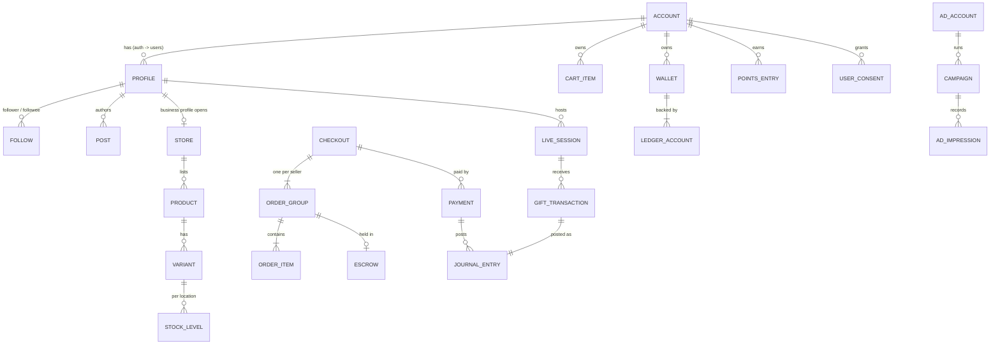
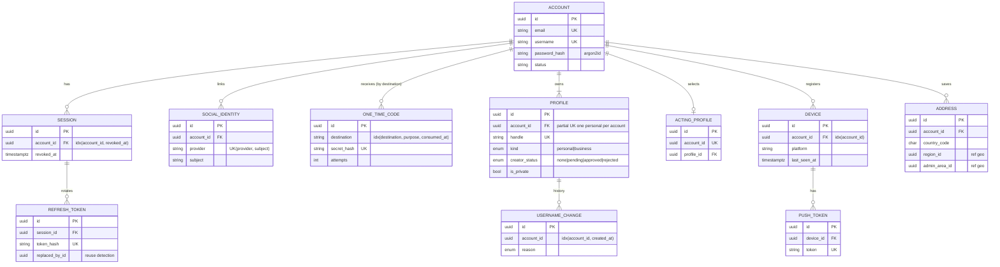
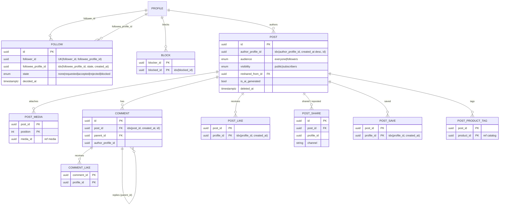
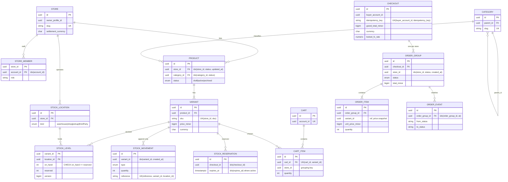
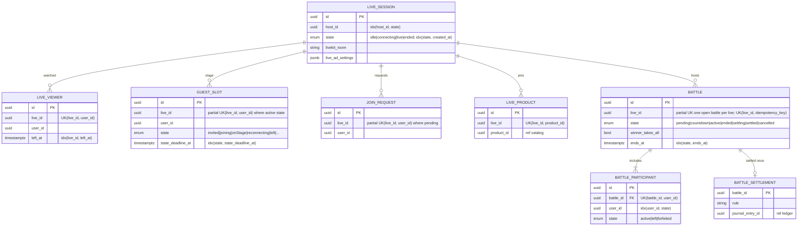
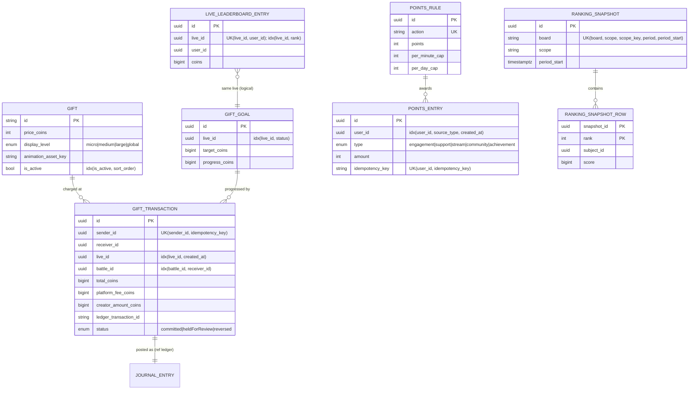
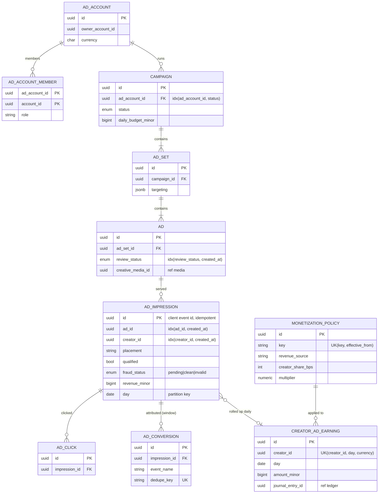
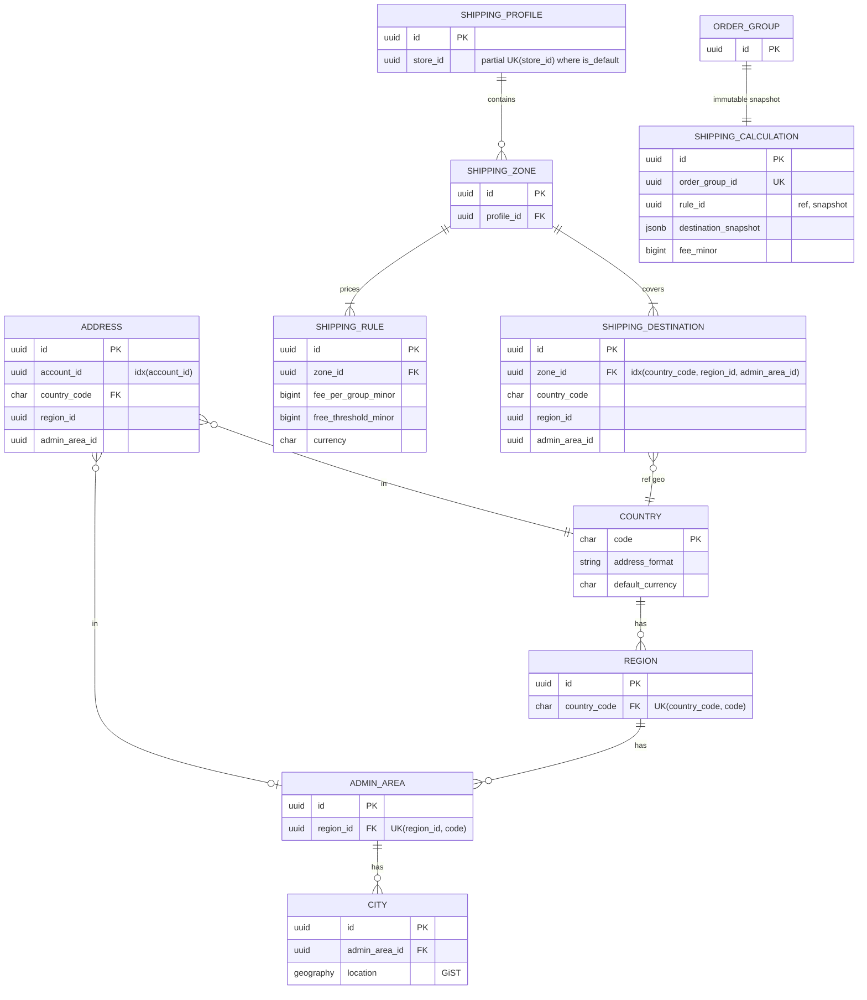
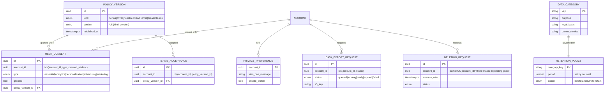

# Database architecture

> **Dated design document.** The status labels below describe the repo when this was written; much that is marked PROPOSED or ABSENT has since been built. For the current system see [system.md](system.md); where the two disagree, the code wins.

> **Creator = personal account upgrade (owner, 2026-10-03).** A creator account is the user's personal account turned into a creator account, not a separate profile. Profile types are Personal, Business/Brand and Government; `creatorStatus` (`none|pending|approved|rejected`) lives on the Personal profile and is set to `approved` when the Creator Program application is approved. It unlocks Creator Studio, going live, monetisation and earnings. Blue applies to the Personal profile whether or not it is creator-enabled.

As of 2026-10-03. Labels: **EXISTING** · **MOCK-ONLY** · **PROPOSED** · **OPTIONAL FUTURE**. Facts: [inventory.md](inventory.md) section 3.

Fixed decisions: one Aurora PostgreSQL + PostGIS cluster, one schema per owning service, one `svc_<service>` login role per service, read-only grants to others through `nantty_readers` (granted per table in the owner's migration). Only the owner writes. Money is `int64` minor units + ISO currency; coins are integer `COIN`; points are never money. ent + Atlas for Go, Prisma for TS.

| Fact | Status | Evidence |
| --- | --- | --- |
| 21 schemas + roles, `nantty_readers`, `REVOKE CREATE ON SCHEMA public` | EXISTING (local) | `infra/local/postgres/create-databases.sh` |
| `auth` schema: account, session, refresh_token, one_time_code, signing_key, social_identity, outbox_event | EXISTING, serving | `services/go/modules/auth/src/databases/schema` |
| `users`, `admin`, `currency`, `ledger`, `live` ent schemas + Atlas migrations | EXISTING (serving) | `services/go/modules/<m>/src/{databases/schema,migrations}` |
| Everything else | PROPOSED; the old monolith's Prisma schema (124 models) is the reference spec | |

ERD conventions: PK, FK, UK markers; quoted text lists key indexes or constraints. Cross-schema FKs are **logical only** (no DB constraint across owners); they are drawn but labelled `ref`. Every table also has `created_at`; omitted.

## 1. Domain overview

## 2. Users, profiles, sessions, devices

Status: ACCOUNT, SESSION, REFRESH_TOKEN, SOCIAL_IDENTITY, ONE_TIME_CODE EXISTING (`auth`); PROFILE, ACTING_PROFILE, USERNAME_CHANGE EXISTING WIP (`users`); DEVICE, PUSH_TOKEN, ADDRESS PROPOSED. Staff accounts/sessions/challenges are EXISTING WIP in `admin` (separate audience; not drawn).

## 3. Social graph

Status: PROPOSED (`social` schema, ts-social). Reference: the old monolith's Prisma schema `Follow`, `Post`, `PostLike`, `Comment`, `CommentLike`, `Block`. Counters (`like_count`, `follower_count`) are denormalised columns updated by event consumers, never `COUNT(*)` on read. Blocking overrides every follow state; `BLOCK` is owned by users and read by social via grant.

## 4. Marketplace

Status: PROPOSED. Schemas: `catalog` (store, member, category, product, variant), `inventory` (location, level, movement, reservation; ABSENT even in the old monolith), `orders` (cart, checkout, order group, item, event). Cart rows key on `store_id` so the cart API groups by seller. Inventory and orders share the go-commerce deployable so reservation + order creation commit in one tx (one tx across two schemas owned by the same deployable; today each module has its own `svc_<module>` role, so go-commerce needs one connection role with write grants on both, or the reservation must become a sync call. Decide before orders is built).

## 5. Payments, ledger, escrow, wallets, payouts

```mermaid
erDiagram
  PAYMENT ||--o{ PAYMENT_ATTEMPT : tries
  PAYMENT ||--o{ REFUND : refunded
  WEBHOOK_EVENT }o--o| PAYMENT : confirms
  ESCROW ||--o{ ESCROW_MOVEMENT : "hold, release, refund"
  WALLET ||--|{ LEDGER_ACCOUNT : "available, pending, coins"
  LEDGER_ACCOUNT ||--o{ JOURNAL_LINE : posts
  JOURNAL_ENTRY ||--|{ JOURNAL_LINE : "balanced (sum dr = sum cr)"
  JOURNAL_ENTRY ||--o| JOURNAL_ENTRY : reverses
  PAYOUT_ACCOUNT ||--o{ PAYOUT : "paid to"
  PAYOUT ||--o{ JOURNAL_ENTRY : posts
  FEE_RULE ||--o{ JOURNAL_LINE : "computes fee lines"
  RECONCILIATION_RUN ||--o{ RECONCILIATION_BREAK : finds
  PAYMENT {
    uuid id PK
    uuid checkout_id "ref orders"
    string provider
    string provider_reference "UK(provider, provider_reference)"
    bigint amount_minor
    char currency
    enum status
  }
  PAYMENT_ATTEMPT {
    uuid id PK
    uuid payment_id FK
    string outcome
  }
  REFUND {
    uuid id PK
    uuid payment_id FK
    string idempotency_key UK
    bigint amount_minor
    enum status
  }
  WEBHOOK_EVENT {
    uuid id PK
    string provider "UK(provider, provider_event_id)"
    string provider_event_id
    timestamptz processed_at
  }
  ESCROW {
    uuid id PK
    uuid order_group_id UK
    enum state "held|released|refunded|disputed"
    timestamptz auto_release_at "idx(state, auto_release_at)"
  }
  ESCROW_MOVEMENT {
    uuid id PK
    uuid escrow_id FK
    uuid journal_entry_id FK
  }
  WALLET {
    uuid id PK
    string owner_type "UK(owner_type, owner_id, currency)"
    string owner_id
    char currency
  }
  LEDGER_ACCOUNT {
    uuid id PK
    string code "UK(code, currency)"
    char currency
    enum kind "asset|liability|equity|revenue|expense"
    bigint balance_minor "CHECK >= 0 unless allowed"
    bigint version
  }
  JOURNAL_ENTRY {
    uuid id PK
    string reference UK
    uuid reverses_entry_id UK
    string kind "idx(kind, posted_at)"
  }
  JOURNAL_LINE {
    uuid id PK
    uuid entry_id FK "UK(entry_id, line_number)"
    uuid account_id FK "idx(account_id, created_at)"
    enum direction "debit|credit"
    bigint amount_minor
  }
  PAYOUT_ACCOUNT {
    uuid id PK
    string owner_id
    bytea account_number_enc "encrypted, masked"
  }
  PAYOUT {
    uuid id PK
    uuid payout_account_id FK
    string idempotency_key UK
    enum status "requested|approved|processing|paid|failed"
  }
  FEE_RULE {
    uuid id PK
    string key "UK(key, effective_from)"
    int bps
  }
  RECONCILIATION_RUN {
    uuid id PK
    string provider "idx(provider, window_starts_at)"
  }
  RECONCILIATION_BREAK {
    uuid id PK
    uuid run_id FK
    enum kind
    timestamptz resolved_at
  }
```

Status: LEDGER_ACCOUNT, JOURNAL_ENTRY, JOURNAL_LINE, RECONCILIATION_RUN/BREAK EXISTING WIP (`services/go/modules/ledger/src/databases/schema`); the rest PROPOSED (`payments`, `wallet`, `escrow` schemas; reference the old monolith `Payment`, `WebhookEvent`, `Escrow`, `LedgerAccount`, `LedgerEntry`, `PayoutAccount`, `Withdrawal`). Balances change only by journal lines in the same tx, with `SELECT ... FOR UPDATE` on the affected ledger accounts in a fixed order (by id) to avoid deadlocks, plus `version` check. Detailed money flows: [payments.md](payments.md).

## 6. Livestream

Status: all but BATTLE_SETTLEMENT EXISTING WIP (`services/go/modules/live/src/databases/schema/*`, migration `create_live_tables`); BATTLE_SETTLEMENT PROPOSED (belongs in go-money, keyed `battle-settle:{battleId}`). `state_deadline_at` / `ends_at` indexes support the Postgres due-time poller so timers survive restarts.

## 7. Gifts and Nantty Points

Status: GIFT, GIFT_TRANSACTION, GIFT_GOAL, POINTS_RULE, POINTS_ENTRY, LIVE_LEADERBOARD_ENTRY EXISTING WIP **in the `live` schema** (`gift.schema.go`, `gift_transaction.schema.go`, `points.schema.go`); RANKING_SNAPSHOT PROPOSED. Recommendation (P0, [backend.md](backend.md) F1): move GIFT, GIFT_TRANSACTION, GIFT_GOAL to go-money `creators` so the coin debit, gift row and ledger entry commit in one tx; move POINTS_* and ranking snapshots to `rewards`. `POINTS_ENTRY` currently has no idempotency unique constraint; add `UK(user_id, idempotency_key)` because points are awarded by at-least-once event consumers.

## 8. Ads

Status: PROPOSED (`ads` schema; reference 22 `Ad*` Prisma models in the old monolith). `AD_IMPRESSION` is the highest-volume OLTP table: range-partition by `day` from the start (monthly partitions, drop/archive after attribution window + dispute window), and move raw events to ClickHouse when it lands.

## 9. Shipping and geo

Status: PROPOSED. Geo + addresses: `users` schema (go-identity); shipping profiles/zones/rules + calculation: `orders` schema (go-commerce). Most specific destination wins (admin area, then region, then country), resolved with one indexed query. Fees are per seller order group, never per item.

## 10. Privacy

Status: ABSENT/PROPOSED (`backendPlan.md` 4.7). Owner: users (go-identity). Consents are versioned and append-only; latest row wins (read through a `current_consents` view or cached projection). These tables support privacy obligations; they do not by themselves make the platform compliant, and retention periods are not set here.

## 11. Ownership matrix

| Schema | Owner (deployable) | Read access (grant) | Write | Events produced | Events consumed |
| --- | --- | --- | --- | --- | --- |
| `auth` | auth (go-identity) | users, admin (account directory) | auth | `account.registered`, `account.loggedIn`, `session.refreshTokenReuseDetected` | `account.deletionRequested` |
| `users` | users (go-identity) | all (profiles, addresses, consents, blocks) | users | `profile.updated`, `user.blocked`, `consent.updated`, `account.deletionRequested` | `account.registered` |
| `admin` | admin (go-identity) | none | admin | `platformConfig.changed` | audit-worthy events from all |
| `currency` | currency (go-identity) | commerce, money, ads | currency | `exchangeRate.updated` | - |
| `catalog` | catalog (go-commerce) | live, ads, social, search, orders | catalog | `product.published/updated/unpublished`, `store.created` | `moderation.actionTaken` |
| `inventory` | inventory (go-commerce) | orders, catalog | inventory | `stock.adjusted`, `stock.lowDetected` | `order.cancelled`, `refund.completed` (restock) |
| `orders` | orders (go-commerce) | money, analytics | orders | `order.placed/paid/shipped/delivered/completed/cancelled` | `payment.succeeded/failed`, `escrow.released` |
| `payments` | payments (go-money) | orders (status) | payments | `payment.succeeded/failed`, `refund.completed` | provider webhooks |
| `ledger` | ledger (go-money) | admin (read), analytics | ledger only | `journalEntry.posted`, `reconciliation.mismatchFound` | - (sync API only) |
| `wallet` | wallet (go-money) | admin | wallet | `coins.purchased`, `payout.requested/paid/failed` | `payment.succeeded` (coin packs) |
| `escrow` | escrow (go-money) | orders, admin | escrow | `escrow.held/released/refunded`, `dispute.opened/resolved` | `order.delivered`, `order.completed` |
| `creators` | creators (go-money) | live, studio analytics | creators | `gift.sent`, `gift.goalCompleted`, `creatorEarnings.credited` | `battle.ended` (settle) |
| `rewards` | rewards (go-money) | social, live | rewards | `points.awarded` | `gift.sent`, `post.liked`, `user.followed`, `order.completed` |
| `subscriptions` | subscriptions (go-money) | gateway, catalog | subscriptions | `subscription.started/cancelled`, `sellerPlan.changed` | `payment.succeeded` |
| `live` | live (go-live) | creators, social, search | live | `live.started/ended`, `guest.*`, `battle.*` | `gift.sent` (scores) |
| `ads` | ads (go-ads) | analytics | ads | `ad.impressionRecorded`, `ad.conversionRecorded`, `campaign.activated` | `consent.updated`, `post.created` |
| `moderation` | moderation (go-trust) | social, catalog, live | moderation | `content.reported`, `moderation.actionTaken` | `post.created`, `media.ready` |
| `social`, `feed` | ts-social | users, moderation, search | ts-social | `post.created/deleted`, `comment.created`, `post.liked`, `user.followed` | `moderation.actionTaken`, `user.blocked` |
| `media`, `notifications`, `search`, `support`, `integrations`, `campaigns` | ts-io | as needed | ts-io | `media.ready/failed`, `notification.delivered` | most domain events |
| `realtime` | ex-realtime | users (membership) | realtime | `message.created` | live/gift/battle/notification events |

## 12. Reliability

| Area | Recommendation | Stage | Priority |
| --- | --- | --- | --- |
| Backups / PITR | Aurora continuous backup, 35-day PITR; daily snapshot copied to a second region and a separate backup account (AWS Backup vault lock) | MVP | **P0** (ledger is the only financial truth) |
| Restore drills | Quarterly restore to a scratch cluster + trial-balance check; document RTO 1 h / RPO 5 min targets | MVP | P1 |
| Multi-AZ | Writer + 1 reader in another AZ (failover target, not for read traffic at first) | MVP | P0 |
| Connection pooling | RDS Proxy per cluster (Fargate scale-outs x `pgxpool` size would exhaust `max_connections`); pgbouncer only if RDS Proxy pinning hurts (session-level `SET`) | MVP | P1 |
| Pool sizing | Per task `max_conns` = 10 default; total across tasks < 70% of `max_connections` | MVP | P1 |
| Migrations | Atlas versioned (EXISTING: embedded and applied at service start via `postgres.ApplyPendingMigrationsFromEmbeddedDirectory`). Move apply to a one-off ECS task in the deploy pipeline with `atlas migrate lint` in CI (destructive-change and backward-compat analyzers) | MVP | **P1**: auto-apply at start races across N tasks and runs DDL under app credentials |
| Expand / contract | 1) add nullable column/table, 2) dual-write, 3) backfill in batches, 4) switch reads, 5) drop in a later release. Indexes `CREATE INDEX CONCURRENTLY` (Atlas `-- atlas:txmode none`). `lock_timeout = 5s` on migration sessions | MVP | P1 |
| Read replicas | Only when a trigger fires: analytics/report queries > 10% writer CPU, or replica lag-tolerant read RPS > writer capacity. Never for read-after-write paths (checkout, wallet) | Near term | P3 |
| Slow query monitoring | `pg_stat_statements`, Performance Insights, `log_min_duration_statement = 250ms`, `auto_explain` sampled; weekly top-20 review | MVP | P1 |
| Index hygiene | Alert on unused indexes (`pg_stat_user_indexes.idx_scan = 0` after 30 days) and seq scans on tables > 1M rows | Near term | P2 |
| Large tables | Partition `ad_impressions`, `points_entries`, `stock_movements`, `journal_lines` (by month) once > 50M rows or vacuum time hurts | Scale stage | P2 |
| Outbox growth | Delete published rows older than 7 days in batches (job); keep index `(published_at, created_at)` (EXISTING) | MVP | P1 |
| Sharding | Not planned. Trigger: writer at > 70% CPU sustained after tuning, vertical limit (largest Aurora class) within 6 months, or a single schema > 5 TB. First step is moving a hot schema (ads events, chat) to its own cluster, not sharding | Scale stage | P3 |
