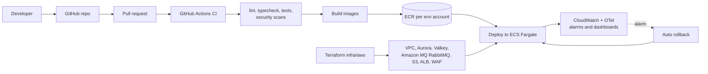
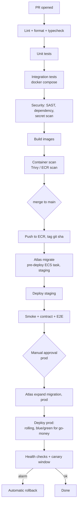

# DevOps architecture

> **Dated design document.** The status labels below describe the repo when this was written; much that is marked PROPOSED or ABSENT has since been built. For the current system see [system.md](system.md); where the two disagree, the code wins.

As of 2026-10-03. Labels: **EXISTING** (cite path), **PROPOSED**, **OPTIONAL FUTURE**. Nothing in `infra/aws` is applied; everything AWS here is PROPOSED.

## 1. What exists today

| Item | Status | Evidence |
| --- | --- | --- |
| Backend workflow: file-length and no-raw-SQL checks; Go build/vet/race tests; TS service typecheck/tests; Elixir/Python jobs; migration lint and container checks | EXISTING (source configuration; actual CI runs are separate evidence) | `.github/workflows/backend.yml` |
| Frontend workflow: path-filtered Next app typecheck/lint/style/contract tests/build/no-mock checks; mobile typecheck/lint/tests/no-mock check; shared-package changes fan out | EXISTING | `.github/workflows/frontend.yml` |
| Security, deploy and Android workflows | EXISTING: dependency/secret/container scanning; staging/production deploy pipeline gated on configured AWS vars; Android build workflow is manually gated | `.github/workflows/security.yml`, `.github/workflows/deploy.yml`, `.github/workflows/androidApk.yml` |
| Scripts | EXISTING | `services/scripts/{check-backend-file-lengths,check-no-raw-sql-in-typescript,test-go-workspace,test-realtime-in-docker}.sh` |
| Dockerfiles: 6 Go (distroless nonroot), gateway, realtime, `services/python/intelligence` | EXISTING | `services/go/deployables/*/Dockerfile` |
| Local stack: Postgres/PostGIS 17, Valkey 9, RabbitMQ 4 (management UI 127.0.0.1:15672, definitions from `infra/local/rabbitmq`), LocalStack (SES only), SeaweedFS, LiveKit, OTel collector, Jaeger; ports on 127.0.0.1 | EXISTING | `infra/local/docker-compose.yml` |
| Go migrations embedded; money-service startup migration disabled; go-money migrations run in a separate pre-deploy ECS task | EXISTING in source/workflow; AWS resources and staging execution unverified | `services/go/deployables/goMoney/ledgerMigration.go`, `services/go/modules/ledger/src/loaders/moneyModule.loader.go`, `.github/workflows/deploy.yml` |
| Terraform layout | EXISTING source blueprint; no live apply/deployment verified | `infra/aws/modules/**`, `infra/aws/envs/**`, `infra/aws/README.md` |
| Remaining CI/deployment gaps | No single end-to-end browser workflow across all apps; local/preproduction checks do not prove AWS resources exist. Frontend workflow builds Next apps but has no separate deploy job for the product applications; landing-page hosting is separate. AWS deployment remains conditional on configured environment variables and has not been verified against live staging resources. | `.github/workflows/frontend.yml`, `.github/workflows/deploy.yml`, `infra/aws/README.md` |

## 2. DevOps architecture

Rules: CI authenticates to AWS with GitHub OIDC (no stored keys); one deploy role per environment account; Terraform state in S3 with locking, one state per environment; `plan` posted on PR, `apply` from main only after approval.

## 3. CI/CD pipeline

| Stage | Detail | Status |
| --- | --- | --- |
| Lint / format / typecheck | Go format/vet; app/service-specific TypeScript typecheck and lint; mobile typecheck/lint; Elixir and Python checks are path-filtered in backend workflow | EXISTING in workflow configuration; execution depends on changed-path filters |
| Conventions | file-length and no-raw-SQL | EXISTING |
| Unit | Go race tests, TS service and app tests, Python and Elixir tests | EXISTING in workflow configuration; coverage varies by package |
| Integration | `docker compose up` Postgres, Valkey, RabbitMQ, LocalStack (SES); per-service ent + Atlas against real DB | auth only EXISTING |
| SAST | `semgrep` (TS/Go/Python), `gosec` via golangci-lint, CodeQL | PROPOSED |
| Dependencies | `govulncheck` EXISTING; `pnpm audit --prod`, `pip-audit`, `mix deps.audit`, Dependabot/Renovate | partly PROPOSED |
| Secret scan | gitleaks on PR diff and full history weekly | PROPOSED |
| Build | Docker buildx, cache; SBOM (syft); image tag = git sha, immutable ECR tags | PROPOSED |
| Container scan | Trivy fail on HIGH/CRITICAL with fix available; ECR scan on push | PROPOSED |
| IaC scan | `terraform validate`, `tflint`, `checkov` | PROPOSED |
| Migration check | `atlas migrate lint` against `atlas_dev` DB; fail on destructive change not marked contract phase | PROPOSED |
| Deploy | ECS rolling (min healthy 100%, max 200%, circuit breaker with rollback) for all but go-money; CodeDeploy blue/green with canary 10% for 5 min and alarm hooks for go-money (ledger) | PROPOSED |
| Rollback | ECS circuit breaker plus CloudWatch alarms (5xx rate, p99, ledger imbalance); schema stays expand-compatible so image rollback is safe | PROPOSED |

## 4. Environments

| Concern | local | dev | staging | prod |
| --- | --- | --- | --- | --- |
| AWS account | none (Docker RabbitMQ, LocalStack SES) | shared `nantty-dev` | `nantty-staging` | `nantty-prod` (all in an AWS Organization) |
| Data | compose volumes, synthetic seed | synthetic | synthetic or masked, never prod copies | real |
| Secrets | `.env` from `*.example`, throwaway keys | Secrets Manager (dev) | Secrets Manager (staging) | Secrets Manager (prod), separate KMS keys |
| Payment providers | test/sandbox | sandbox | sandbox | live keys, only in prod account |
| Config | `.env.example` | Terraform vars | Terraform vars | Terraform vars, reviewed |
| Access | developer machine | all engineers via SSO | engineers via SSO | few, break-glass, MFA, read-only default |
| Deploy | manual | auto on merge | auto on merge | manual approval |
| Egress | open | open | restricted | allow-list |

Guarantee that local cannot reach prod: (1) separate AWS accounts with no cross-account roles from dev/local to prod; (2) prod DB and Valkey in private subnets with no public endpoint, reachable only via SSM from approved roles; (3) prod secrets exist only in the prod account, no copy in CI variables or repo; (4) the Go config reader refuses `DOMAIN_EVENTS_TOPIC_ARN` ARNs from another account via an `ENVIRONMENT` check (PROPOSED, a startup assertion) and production mode already refuses log OTP delivery (EXISTING); (5) CI deploy roles trust only the branch/environment claim in the GitHub OIDC token.

## 5. Migrations

| Rule | Detail |
| --- | --- |
| Tool | Atlas versioned migrations from ent schemas, one directory per module (EXISTING for auth, live) |
| Current money-service path | `go-money --migrate-money` runs embedded payment, wallet, ledger, escrow, subscription and creator migrations in a separate pre-deploy task using `svc_migrator`; normal money-service startup rejects migration-on-start. Deployment waits for task success before rollout. Local integration tests that create isolated schemas may apply migrations directly. |
| Remaining prerequisite | AWS role/ownership/grants, task definition and secret wiring, and real staging execution are not verified. The migration task and deployment workflow are source-configured; Terraform apply or a passing mocked runner test is not evidence that AWS resources exist. |
| Expand / contract | Release N: add nullable column / new table / dual-write. Release N+1: backfill, switch reads. Release N+2: drop old. No rename or drop in the same release as code that stops using it |
| Locks | `SET lock_timeout`, `CREATE INDEX CONCURRENTLY` (separate non-transactional file), batch backfills |
| Down files | exist but are not used in prod; rollback = roll back image, keep expand schema |
| Prisma (TS) | same rules; `prisma migrate deploy` in the same pre-deploy task |

## 6. AWS mapping and why

| Service | Used for | Why (and why not the alternative) | Status |
| --- | --- | --- | --- |
| Route 53 | DNS, health checks, failover records | native alias to CloudFront/ALB, cheap | PROPOSED |
| CloudFront | media and static CDN, edge TLS, WAF attach | cut media egress and latency; OAC keeps S3 private; signed URLs for paid media | PROPOSED |
| WAF | managed rules, rate rules on auth | blocks commodity attacks before the gateway | PROPOSED |
| ALB | HTTP + WebSocket ingress to gateway, realtime, BFFs | simplest L7 for Fargate; raised idle timeout for `/ws` | PROPOSED |
| ECS Fargate | all 11 deployables | no node management, no K8s ops burden for a small team; per-task IAM | PROPOSED (owner decision) |
| ECR | image registry with scan on push, immutable tags | same account as runtime, replication to DR region | PROPOSED |
| Aurora PostgreSQL + PostGIS | single cluster, schema per service | owner decision; PITR, Multi-AZ failover, read replica; one cluster keeps cost and ops low | PROPOSED |
| ElastiCache Valkey | cache, rate limit, idempotency, nonces, presence | managed, Multi-AZ, cheaper than Redis OSS licensing | PROPOSED |
| S3 | media, exports, KYB docs, Parquet, backups | durable, versioned, lifecycle rules | PROPOSED |
| Amazon MQ for RabbitMQ (RabbitMQ adopted, owner, 2026-10-03) | domain event fan-out (`nantty.events`) and job queues (`nantty.jobs`), quorum queues with retry queues and DLQs | **cluster deployment** (3 brokers across AZs, `mq.m7g.large` prod / single-instance `mq.m7g.medium` staging), **private subnets only**, no public accessibility, security group allows 5671 from ECS task SGs only; TLS (`amqps`), one user per service from Secrets Manager; definitions imported via the management API on deploy; same broker family as local Docker | RabbitMQ EXISTING locally, Amazon MQ PROPOSED |
| SES feedback SNS → SQS | bounce/complaint feedback only | SES cannot publish to RabbitMQ; one small SQS queue `notifications-ses-feedback` | PROPOSED |
| Secrets Manager + KMS | secrets, rotation, envelope keys | per-task injection, audited | PROPOSED |
| IAM | task roles, OIDC deploy roles | least privilege per service | PROPOSED |
| VPC, private subnets, NAT, endpoints | network isolation | private app/data subnets; start with one NAT per AZ for prod, one total for staging; add S3, SQS (SES feedback), ECR, Secrets Manager, KMS, Logs endpoints to cut NAT data cost; Amazon MQ sits inside the VPC | PROPOSED |
| CloudTrail | API audit, org trail | forensic baseline | PROPOSED |
| CloudWatch | logs, metrics, alarms, dashboards | zero extra ops; OTel collector sidecar exports traces to X-Ray (see `observability.md`) | PROPOSED |
| Step Functions | payout runs, dispute timelines only if real orchestration | avoid until needed | OPTIONAL FUTURE |
| LiveKit | media plane (Cloud first, self-host later) | owner decision | PROPOSED |

### 6.1 ALB routing and provider webhooks

| Priority | Path | Target | Why |
| --- | --- | --- | --- |
| 20 | `/ws*` | realtime target group (idle timeout raised) | WebSocket |
| 100 | everything else | gateway target group | auth, rate limit, upstream routing |

Webhooks enter through the gateway. Its `/webhooks/` route sends only `POST` to go-money, forwards the request body as the exact received bytes (no JSON re-parse or re-serialisation) and passes the `verif-hash` header through, so go-money checks it before parsing the raw body (pinned by the gateway test `webhook passthrough`). The gateway skips guest rate limits on these routes, and the WAF refuses `/webhooks/flutterwave` requests without a `verif-hash` header, rate-limits that path, and blocks any `/internal` path.

Service-to-service HTTP goes through an internal ALB (host rule `<service>.svc.<env>.nantty.internal`), which also gives the distroless Go images a health check. This design replaces the earlier ALB rule straight to go-money: go-money deploys with CodeDeploy blue/green, which swaps target groups on one listener, so a public rule on a second listener would keep pointing at the standby group after a swap. The old `/api/v1/payments/webhooks/*` paths are not routed. Flutterwave is the only payment provider (owner, 2026-10-11): the endpoint is `https://api.nantty.com/webhooks/flutterwave`, set on the Flutterwave dashboard (v3 webhooks, PSA funding hook enabled) for live and test modes, with the `verif-hash` secret in `FLUTTERWAVE_WEBHOOK_HASH`.

## 7. NOT yet

| Technology | Do not adopt until | Trigger metric |
| --- | --- | --- |
| MSK (Kafka) or RabbitMQ streams | outbox + RabbitMQ queues cannot meet needs | sustained > 5,000 events/s on one queue, or need for replay > 14 days of ordered per-key streams for 3+ consumers, or broker CPU/memory alarms despite scaling the instance size |
| EKS / Kubernetes | Fargate limits hit | > 40 services, or need for daemonsets/GPUs/custom schedulers, or Fargate cost > 2x equivalent EC2 at steady load |
| Service mesh | mTLS/traffic policy needed beyond SGs | compliance requires mTLS between services, or canary routing needed across > 10 services (try ECS Service Connect first) |
| OpenSearch | Postgres FTS + trigram insufficient | search p95 > 300 ms at > 50 qps on catalog > 1M products, or ranking features needing BM25 + vectors |
| ClickHouse | analytics queries hurt OLTP or Parquet/Athena too slow | > 50M events/day, or dashboard queries p95 > 10 s on Aurora replica |
| Multi-region active-active | single-region DR RTO unacceptable or regulatory | contractual RTO < 15 min, or > 15% revenue outside one region's latency reach |
| Database sharding | single writer saturated | writer CPU > 70% sustained after read replicas and index work, or table > 1 TB with unpartitionable access |

## 8. Testing architecture

| Layer | Scope | Tooling | Where | Status |
| --- | --- | --- | --- | --- |
| Unit | pure domain: splits, pricing, state machines, money allocation | go test (table tests), vitest, pytest, ExUnit | PR | partial |
| Property | ledger postings always balance, never negative | `rapid` or `testing/quick` | PR | PROPOSED |
| Integration | service + Postgres + Valkey + RabbitMQ | compose / Testcontainers | PR | auth only |
| API | HTTP black-box per service from OpenAPI | `go-http-handler-testing` style, schemathesis | PR | PROPOSED |
| DB | constraints, grants, role permissions, migrations on a copy of prior schema | Atlas lint, SQL tests | PR | PROPOSED |
| Contract | every frontend mock route (`apps/*/src/mocks`) matches a backend OpenAPI operation; events validated against `services/contracts/events/schemas` | custom runner using mocks as consumer fixtures | PR | PROPOSED |
| Frontend | component and BFF route tests | vitest + Testing Library, jest (mobile) | PR | 0 today |
| E2E | signup, post, follow, chat, buy coins, gift, battle, checkout, fulfil, payout; ends with trial balance 0 | Playwright (web), Maestro (mobile) | staging | PROPOSED |
| Load | checkout, gift bursts, feed, 1,000 live viewers | k6, LiveKit load tester | staging nightly | PROPOSED |
| Security | IDOR, refresh reuse, webhook signature, idempotency conflict, enumeration; ZAP baseline | ported from the old monolith's security tests, OWASP ZAP | PR + nightly | PROPOSED |
| Migration | apply all migrations to empty DB and to previous release snapshot, run expand-compat tests against N-1 image | Atlas + CI | PR | PROPOSED |
| Failure / chaos | kill Redis, reboot a RabbitMQ broker, 500 from Python, payment provider timeout, DB failover | toxiproxy, AWS FIS in staging | staging weekly | PROPOSED |

### Must pass before prod (financial flows)

| # | Gate |
| --- | --- |
| 1 | Ledger property tests: balanced, no negative wallet, no float anywhere (int64 minor units) |
| 2 | Concurrency test: 100 parallel gift/withdraw requests cannot overdraw; idempotent replay returns the original response |
| 3 | Webhook tests: bad signature rejected, duplicate event processed once, out-of-order handled |
| 4 | Provider sandbox E2E for top-up, checkout, refund, payout, including failure and timeout paths |
| 5 | Reconciliation job against provider statement in staging with zero unexplained difference |
| 6 | Trial balance = 0 after the full E2E run; ledger imbalance alarm tested by injecting an imbalance |
| 7 | Authorization tests: IDOR on wallet, order, store, payout; admin step-up required |
| 8 | Migration expand/contract verified against previous release; rollback rehearsed |
| 9 | Load test meets SLOs in `observability.md` (gift p99 300 ms, checkout availability) |
| 10 | Restore drill completed within RTO in the last 90 days (`disaster-recovery.md`) |
| 11 | Security scans clean of HIGH/CRITICAL; secrets scan clean |

## 9. Recommendations

### D1. CI coverage and regression gaps
- **Status:** the original 2026-10-03 finding is partly resolved. Current backend, frontend, mobile and security workflow files provide path-filtered checks and builds, including shared-package fan-out, but configuration is not proof of a successful run and app coverage varies.
- **Remaining work:** add or maintain browser-level end-to-end tests for critical account, checkout, seller and admin flows; review path filters when new packages/services are added; inspect actual CI results before releases.
- **Evidence:** `.github/workflows/backend.yml`, `frontend.yml`, `security.yml`.

### D2. Move migrations out of service startup
- **Status:** partly resolved. The six money schemas use `go-money --migrate-money` with `svc_migrator` before rollout; normal money-service startup migration is disabled. Other Go schemas still migrate at service startup, and Prisma migrations are not included in a single all-owner staging gate.
- **Remaining work:** implement and verify the complete 21-owner staging migration orchestration described in [staging-migration-runbook.md](../database/staging-migration-runbook.md); confirm AWS role, secret and task configuration in isolated staging.
- **Evidence:** `services/go/deployables/goMoney/ledgerMigration.go`, `.github/workflows/deploy.yml`.

### D3. Stand up staging Terraform first
- **Status:** the old “README only” claim is superseded: `infra/aws` now contains Terraform modules and environment configuration. No live application or AWS state was inspected here; the repo still does not prove that Terraform was applied or that staging resources are operational.
- **Remaining work:** validate and plan the intended staging configuration, provision only after explicit approval, and complete deployment/runtime smoke tests. No cloud changes are made by this documentation update.

### D4. Contract-test harness using mocks as fixtures
- **Problem:** `packages/contracts` has no consumers; mocks drift from backend (`backendPlan.md` 2.13).
- **Recommendation:** one script that loads each app's mock registry and diffs against generated OpenAPI; run in CI, allow-list known gaps and shrink it.
- **Complexity:** M. **Risk:** low. **Priority: P2**, becomes P1 once the second service ships routes.
- **Tag:** Near term.

### D5. Fix outbox poison handling
- **Problem:** failed outbox batch retries forever with no attempt counter (`platform/events/outbox.relay.go`).
- **Recommendation:** add `attempts` and `dead_at` columns, alarm on dead rows. See `observability.md`.
- **Complexity:** S. **Risk:** low. **Priority: P2.**
- **Tag:** Near term.
