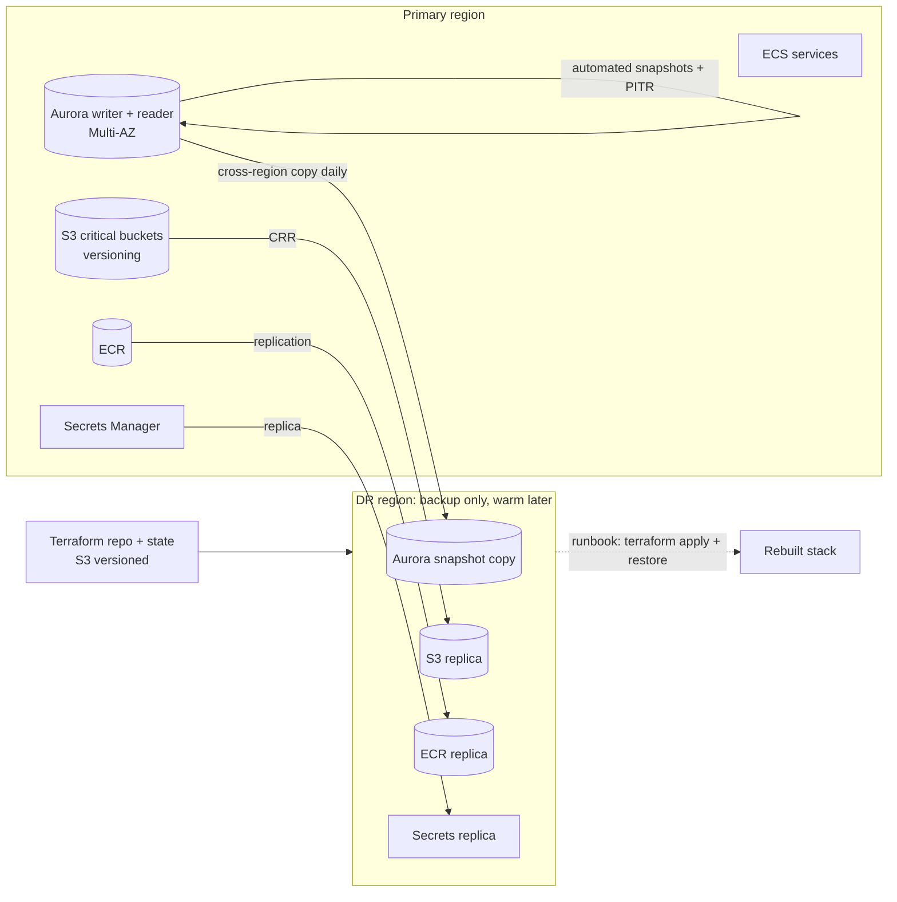

# Disaster recovery architecture

As of 2026-10-03. Everything here is **PROPOSED**; no AWS infrastructure is applied (`infra/aws/README.md`). Targets are starting points for owner confirmation, not commitments.

## 1. DR architecture

Strategy: **backup and restore with IaC rebuild** (pilot light is OPTIONAL FUTURE). Multi-region active-active is explicitly deferred (trigger in `devops.md` s7).

## 2. RPO / RTO by tier

| Tier | Components | RPO | RTO | Mechanism |
| --- | --- | --- | --- | --- |
| 0 Money and identity | `ledger`, `payments`, `auth` schemas, signing keys | <= 5 min (PITR), zero loss on AZ failure (Multi-AZ synchronous storage) | 1 h AZ/instance failure automatic (< 5 min failover); 4 h region loss | Aurora Multi-AZ, PITR 35 d, cross-region snapshot copy |
| 1 Commerce | catalog, orders, inventory, wallet-adjacent | <= 15 min | 4 h | same cluster, same restore |
| 2 Social and live | posts, messages, live state, points | <= 1 h | 8 h | same cluster; live sessions are ephemeral, in-flight lives end |
| 3 Derived | Valkey, search index, ClickHouse, features, Parquet | rebuildable, no RPO | 24 h to rebuild | replay events / reindex |
| Media | S3 uploads, processed, exports | <= 15 min (replication lag) | 4 h (serve from replica via CloudFront origin failover) | S3 versioning + CRR for uploads and KYB; processed media is regenerable |
| Stateless compute | ECS tasks, gateway | 0 | 30 min | Terraform + ECR image in DR region |

Rule: Tier 0 is restored and verified before anything else starts.

## 3. Backup and replication

| Asset | Control | Status |
| --- | --- | --- |
| Aurora | automated backups with PITR 35 d (prod), daily snapshot copied to DR region under DR KMS key, monthly snapshot retained 12 months, deletion protection on, `skip_final_snapshot=false` | PROPOSED |
| S3 critical (uploads, KYB docs, exports) | versioning, MFA-delete optional, Object Lock (governance) for KYB and ledger exports, CRR to DR bucket, lifecycle for noncurrent versions | PROPOSED |
| S3 regenerable (processed media, Parquet) | versioning only; rebuild from originals/events | PROPOSED |
| Valkey | not a source of truth; snapshots optional for faster warm-up; nothing money-critical lives only here (idempotency keys also persisted for money endpoints) | PROPOSED |
| RabbitMQ (Amazon MQ cluster) | quorum queues replicated across 3 AZ brokers; topology from `definitions.json` (re-importable); messages are not backed up, durability from the outbox: unpublished rows replay after restore, events lost in flight are re-published by outbox replay (`published_at = NULL` by id range); DLQ moved back after fix. RabbitMQ adopted (owner, 2026-10-03) | Amazon MQ PROPOSED, outbox EXISTING in auth/live |
| Secrets | Secrets Manager replica secrets in DR region; KMS multi-region keys for signing-key encryption key | PROPOSED |
| Infra | Terraform in git, state in versioned S3 + lock table, state bucket replicated | PROPOSED |
| Images | ECR cross-region replication, immutable tags | PROPOSED |
| Audit logs | CloudTrail and audit exports to Object Lock bucket in a separate log-archive account | PROPOSED |
| Deletion ledger | `(account_id, erased_at)` replayed after restore so erased data does not return (`privacy.md`) | PROPOSED |

## 4. Runbooks (to be written, none exist)

| # | Scenario | Key steps |
| --- | --- | --- |
| 1 | Aurora instance or AZ failure | verify automatic failover; check connection pool recovery; confirm outbox relay resumes; check replica lag |
| 2 | Data corruption or bad deploy | pause writers (scale go-money to 0 first); restore PITR to a new cluster at time T-1; compare; promote via endpoint swap or targeted row repair; replay outbox; reconcile ledger vs provider |
| 3 | Region loss | declare; `terraform apply envs/production-dr`; restore latest snapshot in DR region; restore secrets replicas; deploy images from replicated ECR; point Route 53; verify Tier 0 checks; open traffic in order: auth, read paths, checkout, money |
| 4 | Credential or key compromise | rotate signing key (forces JWKS update, short access TTL bounds impact), revoke sessions, rotate secrets, review CloudTrail |
| 5 | Payment provider outage | enable degraded mode (below), queue retries, no manual ledger edits |
| 6 | Poison queue / DLQ growth | pause consumer, inspect `<queue>.dlq` in the management UI (`x-zudomart-last-error` header), fix, move messages back to `<queue>` |
| 7 | S3 object loss or malicious delete | restore previous version; CRR copy |
| 8 | Restore drill | quarterly into an isolated account; validate trial balance 0, row counts, auth login; record achieved RPO/RTO |

Post-restore invariants (automated check script, PROPOSED): trial balance = 0; no negative wallets; every paid order has a payment and ledger entry; outbox has no gap between last published id and DB; no session older than restore point accepted without re-validation.

## 5. Dependency failure matrix

Class: **Critical** (core flow stops or must fail safe), **Important** (degraded but working), **Optional** (feature hidden).

| Dependency | Class | Detection | Graceful degradation | Never do |
| --- | --- | --- | --- | --- |
| Aurora writer | Critical | health, failover event | Multi-AZ failover under 5 min; reads from reader meanwhile; browse/catalog served from cache and CDN; writes return 503 with `Retry-After`; clients queue non-money actions (offline queue EXISTING in mobile) | accept writes into memory |
| Aurora reader | Important | replica lag alarm | route reads to writer within limits; feeds degrade to cached pages | |
| Valkey | Important (Critical for rate limit on auth) | connection errors | cache miss falls back to DB with request coalescing; rate limit fails **closed** on auth routes and open elsewhere; idempotency for money endpoints falls back to a DB unique key; presence and typing stop; Python nonce store fails closed (EXISTING 503) | skip idempotency on money routes |
| RabbitMQ | Important | publish confirm failures, connection loss, queue depth/age | outbox keeps rows, relay retries (EXISTING); clients reconnect with backoff; a single broker loss is absorbed by quorum queues (2 of 3); business transaction already committed; jobs delayed; realtime loses live updates, clients poll REST (plan 5.6 recovery path) | drop events or publish before commit |
| Python intelligence | Optional | timeout (budget 100-200 ms), breaker | feed uses deterministic ranking (follow graph + recency + trending cache); ads deterministic eligibility, empty slot if engine fails; risk score unavailable means go-money applies conservative thresholds (hold, lower limits), never auto-approve high-value | block checkout on a missing score for low-risk amounts only if policy says so, otherwise hold |
| Phoenix realtime | Important | `/healthz`, socket count | purchases, orders, REST unaffected; chat and live viewers fall back to polling `?after=`; gifts still settle in ledger, animations replay from state on reconnect | let Phoenix decide any money state |
| Payment provider (Flutterwave, the only provider since 2026-10-11) | Critical for payments | provider error rate, webhook lag | single provider at launch (the provider interface leaves room for a second one): hide the pay button with a message, keep browse and cart; pending payments reconciled by polling provider after recovery; coin purchases through IAP continue | mark paid without provider verification |
| LiveKit | Important | room API errors | existing lives show reconnecting state, new lives disabled with banner; commerce unaffected | |
| Search (Postgres FTS now, OpenSearch later) | Important | query errors | fall back to Postgres trigram/FTS; category browse and browse feed remain | |
| Object storage (S3/CloudFront) | Important | 5xx on origin | CDN serves cached; CloudFront origin group fails over to replica; uploads queued client-side (upload queue EXISTING in mobile); text content continues | |
| Email / SMS (OTP) | Important for signup/reset | provider errors | secondary provider, in-app OTP via push, login via existing sessions unaffected; retry with backoff; raise OTP resend cooldown messaging | log OTPs in prod (blocked EXISTING) |
| Push (APNs/FCM) | Optional | send errors | in-app notification list and realtime still work; retry with TTL | |
| Secrets Manager / KMS | Critical at start | task start failure | running tasks hold secrets in memory, so already running services continue; new tasks fail to start, deployments halt; avoid scale-in during incident | |
| Auth service (go-identity) | Critical | health | existing access tokens valid up to 15 min via JWKS cached by gateway/Go/Phoenix, so other services keep serving; JWKS cache TTL long with stale-if-error; new login blocked | |
| Gateway | Critical | ALB health | multi-task, multi-AZ; CloudFront serves static; BFFs return a maintenance page | |

Core principle: the marketplace read path (browse, product pages, orders view) depends on Aurora and the CDN only; Python, Phoenix, search, and push are never on the checkout critical path.

## 6. Recommendations

### DR1. Idempotency fallback persisted in Postgres for money endpoints
- **Problem:** `platform/idempotency` is Redis only (`services/go/platform/idempotency`).
- **Why it matters:** a Valkey flush or failover could allow a duplicated charge or payout on retry.
- **Recommendation:** go-money writes `(key, request_hash, response)` in the same transaction as the ledger posting under a unique constraint; Redis becomes a fast path.
- **Complexity:** S. **Risk:** low. **Priority: P0**, financial correctness must not depend on cache survival.
- **Tag:** MVP.

### DR2. Make JWKS and signing-key availability survive an identity outage
- **Problem:** verifiers fetch JWKS from go-identity.
- **Recommendation:** verifiers cache keys with stale-if-error for at least the key overlap period; Phoenix already has a key cache (EXISTING `jwks_key_cache.ex`); confirm gateway and `jwtauth` behave the same and test it.
- **Complexity:** S. **Risk:** low. **Priority: P1**, auth is a dependency of everything.
- **Tag:** MVP.

### DR3. Enable PITR, deletion protection, and snapshot copy in the first Aurora module
- **Problem:** defaults are forgotten when backups are bolted on later.
- **Recommendation:** make them non-optional Terraform defaults in `aurora-postgres`; quarterly restore drill in staging.
- **Complexity:** S. **Risk:** low. **Priority: P1**, first real data (accounts) will exist at staging.
- **Tag:** MVP.

### DR4. Region-loss warm standby
- **Problem:** RTO 4 h region loss relies on rebuild.
- **Recommendation:** OPTIONAL FUTURE: pilot-light (Aurora Global Database secondary, minimal ECS) when contractual RTO < 1 h or monthly money flow justifies about 2x infra cost.
- **Complexity:** L. **Risk:** medium. **Priority: P3**, trigger: revenue or SLA requirement.
- **Tag:** Scale stage.

### DR5. Provider-agnostic payment interface with a second provider
- **Problem:** one provider outage halts payments.
- **Recommendation:** keep the Flutterwave adapter behind the capability interfaces with fake-API tests (`paymentsTesting/fakeFlutterwave*`); add a second provider only if Flutterwave availability requires it. Flutterwave retries a webhook 3 times, 30 minutes apart, so the sweepers (verify by reference) and the daily reconciliation cover anything longer.
- **Complexity:** M. **Risk:** medium. **Priority: P2**, ship with one, design for two.
- **Tag:** Near term.
