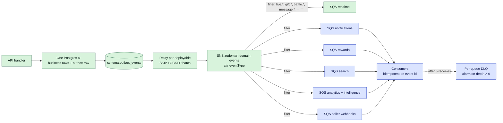
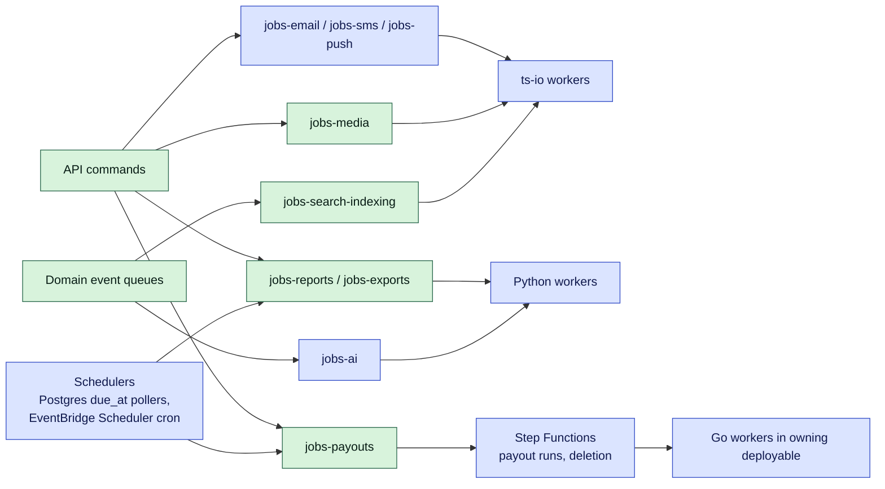

# Events and background jobs

As of 2026-10-03. Labels: **EXISTING** · **MOCK-ONLY** · **PROPOSED** · **OPTIONAL FUTURE**. Facts: [inventory.md](inventory.md) section 4.

## 1. What exists

| Piece | Status | Evidence |
| --- | --- | --- |
| Outbox table per module schema `(id, event_type, subject, payload jsonb, published_at)`, index `(published_at, created_at)` | EXISTING in `auth` (serving) and `users`, `admin`, `currency`, `ledger`, `live` (WIP) | `services/go/modules/*/internal/ent/schema/outbox_event.schema.go` |
| Outbox write in the same tx as the business change | EXISTING (auth) | `modules/auth/internal/application/outbox.events.go` |
| Relay: poll 500 ms, batch 100, `FOR UPDATE SKIP LOCKED`, mark published after publish | EXISTING | `platform/events/outbox.relay.go`, `EntOutboxStore` in each module |
| SNS publisher, `PublishBatch` of 10, `eventType` message attribute | EXISTING | `platform/events/sns.publisher.go` |
| Envelope `{id,type,source,subject,version,occurredAt,data}` | EXISTING | `platform/events/event.envelope.go`, `services/contracts/events/schemas/envelope.v1.json` |
| JSON schemas: `account.registered`, `account.loggedIn`, `session.refreshTokenReuseDetected`, `exchangeRate.updated` | EXISTING | `services/contracts/events/schemas` |
| SNS standard topic + 4 consumer queues (no filter policy) + 5 job queues, DLQ after 5 receives, visibility 60 s | EXISTING (LocalStack) | `infra/local/localstack/create-topics-and-queues.sh` |
| Consumers: only Phoenix (`realtime-domain-events`, 10k-id in-memory dedupe) | EXISTING | `services/elixir/realtime/lib/realtime/events/sqs_consumer.ex` |
| Go SQS consumer + job enqueue helpers | EXISTING, no callers | `platform/events/sqs.queue.go` |
| DLQ consumer, replay tool, alarms | ABSENT | |

## 2. Event flow

Rules:

- Topic naming `<entity>.<pastTense>`, camelCase entity, versioned by schema file `<name>.v<N>.json`. Breaking change = new version published side by side until consumers move.
- Delivery is at least once. Every consumer stores processed event ids (`processed_events(consumer, event_id) PK` in its own schema, in the same tx as its side effect) or makes the write naturally idempotent (unique key).
- Ordering is **not** guaranteed by the standard SNS topic. Events that need order carry `aggregateVersion` (per subject, monotonically increasing); consumers drop stale versions. Live UI ordering uses `seq` per topic set by Phoenix.
- Payloads carry ids and the fields consumers need to act; no PII beyond ids (Python receives opaque ids only).

### 2.1 Financial events are never lost

| Layer | Guarantee | Status |
| --- | --- | --- |
| Producer | Money change and outbox row commit together, or neither | EXISTING pattern (auth); PROPOSED for go-money |
| Relay | Row stays unpublished until SNS acks the whole batch; retried every tick | EXISTING. Gaps: no attempt counter, a poison row (e.g. > 256 KB payload) blocks forever at the head of the queue; partial batch failure republishes already-sent rows (OK under at-least-once) |
| Transport | SNS -> SQS durable; DLQ after 5 receives | EXISTING locally |
| Consumer | Dedupe on event id in the consumer's tx | PROPOSED (only Phoenix dedupes, in memory) |
| Recovery | DLQ alarm, `redrive` tool, outbox replay by id range (`published_at = NULL` reset) | PROPOSED |
| Truth | Ledger is the truth; events are notifications. Nightly trial balance and provider reconciliation catch anything events missed | PROPOSED (`reconciliation` schema EXISTING WIP in `modules/ledger`) |

Required relay changes (**P1**): add `attempts`, `last_error`, `next_attempt_at` columns; move rows over N attempts to `outbox_dead` with an alarm; publish in `created_at` order but skip rows whose `next_attempt_at` is in the future; emit relay lag metric (`now - min(created_at) where published_at is null`), alarm at 60 s.

## 3. Event catalog

Durability: **F** financial (outbox + DLQ + replay + reconciliation, never dropped) · **D** durable domain (outbox + DLQ) · **B** best effort (high volume, loss tolerated, may bypass outbox via batched direct ingest). Ordering: **none**, **subject** (per aggregate, via `aggregateVersion`), **room** (per live, via Phoenix `seq`).

| Event | Producer | Consumers | Dur. | Order | Key payload fields | Status |
| --- | --- | --- | --- | --- | --- | --- |
| `account.registered` | auth | users (create personal profile), notifications (welcome), analytics | D | none | accountId, username, countryCode | EXISTING |
| `account.loggedIn` | auth | trust (risk), analytics | B | none | accountId, sessionId, ipHash, deviceId | EXISTING |
| `session.refreshTokenReuseDetected` | auth | notifications (security alert), trust | D | none | accountId, sessionId | EXISTING |
| `account.deletionRequested` | users | every owner of personal data, notifications | D | subject | accountId, requestId, executeAfter | PROPOSED |
| `account.deleted` | users | all (erase/anonymize done), search, analytics | D | subject | accountId, requestId | PROPOSED |
| `profile.updated` | users | search, social (denormalised names) | D | subject | profileId, changedFields, aggregateVersion | PROPOSED |
| `consent.updated` | users | analytics, ads, intelligence, notifications | D | subject | accountId, type, granted, policyVersionId, aggregateVersion | PROPOSED |
| `product.published` / `product.updated` / `product.unpublished` | catalog | search, intelligence, live (pins), seller webhooks | D | subject | productId, storeId, status, aggregateVersion | PROPOSED |
| `product.viewed` / `clicked` / `liked` / `saved` / `shared` / `addedToCart` / `removedFromCart` / `searched` | gateway/catalog (batched ingest) | analytics, intelligence, rewards (liked, shared) | B | none | actorId?, productId, sessionId, surface, occurredAt | PROPOSED |
| `cart.checkedOut` | orders | analytics, intelligence | D | none | checkoutId, buyerId, groupCount | PROPOSED |
| `order.placed` | orders | notifications (seller), analytics, seller webhooks | D | subject | orderGroupId, checkoutId, storeId, totalMinor, currency | PROPOSED |
| `order.paid` | orders (on payment.succeeded) | escrow, inventory (commit), notifications, webhooks | F | subject | orderGroupId, paymentId, totalMinor, currency | PROPOSED |
| `order.shipped` / `order.delivered` / `order.completed` / `order.cancelled` | orders | escrow (release timer), inventory (release on cancel), rewards (completed), notifications, webhooks | F (completed, cancelled) / D | subject | orderGroupId, fromStatus, toStatus, actor, aggregateVersion | PROPOSED |
| `payment.succeeded` / `payment.failed` | payments | orders, wallet (coin packs), subscriptions, notifications | F | subject | paymentId, purpose, referenceId, amountMinor, currency, provider | PROPOSED |
| `refund.requested` / `refund.completed` | payments | orders, escrow, inventory (restock), notifications | F | subject | refundId, paymentId, orderGroupId?, amountMinor, currency | PROPOSED |
| `escrow.held` / `escrow.released` / `escrow.refunded` | escrow | orders, wallet, store-rewards (earn or reverse seller-funded store credit), notifications | F | subject | escrowId, orderGroupId, amountMinor, currency, journalEntryId | PROPOSED |
| `payout.requested` / `payout.paid` / `payout.failed` | wallet | notifications, admin queue, webhooks | F | subject | payoutId, ownerId, amountMinor, currency, providerReference? | PROPOSED |
| `journalEntry.posted` | ledger | analytics, reconciliation | F | none | entryId, reference, kind, lines[{accountCode, direction, amountMinor, currency}] | PROPOSED |
| `coins.purchased` | wallet | rewards, analytics | F | subject | purchaseId, accountId, coins, paymentId | PROPOSED |
| `gift.sent` | live (go-live outbox, after go-money commits the charge) | realtime (room fan-out), live (battle score), rewards, analytics, intelligence (risk) | F | room | giftTransactionId, liveId, battleId?, senderId, receiverId, giftId, quantity, totalCoins, comboId, comboCount | EXISTING (go-live producer, Phoenix router EXISTING) |
| `giftTransaction.committed` | creators (go-money outbox, same tx as the ledger entry) | analytics, rewards, reconciliation | F | subject | giftTransactionId, liveId, battleId?, senderId, creditedUserId, totalCoins, platformFeeCoins, creatorAmountCoins, journalEntryId | EXISTING (money-side fact; go-live publishes the realtime `gift.sent`, never the other way round) |
| `gift.goalProgressed` / `gift.goalCompleted` | creators | realtime | D | room | goalId, liveId, progressCoins, targetCoins | PROPOSED |
| `live.started` / `live.ended` | live | realtime, social (feed card), notifications (followers), search, rewards (leaderboard snapshot) | D | subject | liveId, hostId, category, startedAt/endedAt | PROPOSED |
| `guest.invited` / `guest.joined` / `guest.left` / `guest.removed` / `guest.muted` | live | realtime | D | room | liveId, slotId, userId, state | PROPOSED (router EXISTING) |
| `battle.started` / `battle.scoreUpdated` / `battle.ended` | live | realtime; creators (settle on ended) | D (ended: F) | room | battleId, liveId, scores[], winnerUserIds, endReason | PROPOSED |
| `battle.settled` | live (go-live outbox, after go-money settles) | realtime, notifications, analytics | F | subject | battleId, rule, transfers[], journalEntryId | EXISTING (go-live producer) |
| `battleSettlement.completed` | creators (go-money outbox, same tx as the settlement entry) | analytics, reconciliation | F | subject | battleId, ruleApplied, winnerUserId, payouts[], transfers[], journalEntryId | EXISTING (money-side fact; keep both events) |
| `post.created` / `post.deleted` | ts-social | feed fan-out, moderation, search, notifications (mentions), intelligence | D | subject | postId, authorProfileId, audience, mediaIds, isAiGenerated | PROPOSED |
| `comment.created` / `post.liked` / `post.shared` / `post.saved` | ts-social | notifications, rewards, intelligence, counters | B (liked/saved) / D | none | postId, actorProfileId | PROPOSED |
| `user.followed` / `user.unfollowed` / `follow.requested` / `follow.accepted` | ts-social | feed, notifications, rewards, intelligence | D | subject | followerId, followeeProfileId, state, aggregateVersion | PROPOSED |
| `user.blocked` | users | social, realtime (membership), feed | D | subject | blockerId, blockedId | PROPOSED |
| `content.reported` | moderation | moderation queue, intelligence (classify) | D | none | reportId, subjectType, subjectId, reason | PROPOSED |
| `moderation.actionTaken` | moderation | social, catalog, live, ads, notifications | D | subject | caseId, subjectType, subjectId, action, aggregateVersion | PROPOSED |
| `media.uploaded` / `media.ready` / `media.failed` | ts-io media | social, catalog, moderation (scan), ads | D | subject | mediaId, ownerId, purpose, variants[] | PROPOSED |
| `message.created` | ex-realtime | realtime fan-out, notifications (offline push) | D | subject (conversation) | messageId, conversationId, senderId, clientMessageId | PROPOSED (router EXISTING) |
| `notification.created` | ts-io notifications | realtime (`user:*`) | B | none | notificationId, accountId, kind | PROPOSED (router EXISTING) |
| `ad.impressionRecorded` / `ad.clicked` | go-ads (batched ingest) | analytics, intelligence (fraud), ads attribution | B raw, F once qualified and charged | none | impressionId, adId, campaignId, creatorId?, placement, qualified | PROPOSED |
| `ad.conversionRecorded` | go-ads | analytics, campaign reports | D | none | conversionId, impressionId, eventName, dedupeKey | PROPOSED |
| `exchangeRate.updated` | currency | commerce, money, ads | D | none | base, quote, rate, effectiveAt | EXISTING schema |

Webhook-to-seller events (`order.*`, `inventory.lowStock`, `product.updated`, `payout.paid`, `review.created`) are re-shaped by ts-io integrations from the domain events above; they are a public contract and versioned separately.

## 4. Queue technology comparison

Assumed launch traffic: < 500 domain events/s peak, gift bursts of a few thousand/s in a hot room, team of a few backend engineers.

| Option | Traffic fit | Ordering | Durability | Replay | Ops burden | Cost at launch | Team fit |
| --- | --- | --- | --- | --- | --- | --- | --- |
| **SNS + SQS** | Effectively unlimited (standard) | None (standard); FIFO = per group, 300 TPS/group default (high-throughput mode higher) | Multi-AZ, DLQ redrive | No log replay; replay from outbox or DLQ redrive | Lowest (serverless) | Lowest, pay per request | Already coded (`platform/events`, Elixir SigV4 client) |
| EventBridge | ~10k events/s soft quota per region | None | Multi-AZ, DLQ per target | Archive + replay built in | Low | ~2x SNS per event | Good for rule routing, cross-account, SaaS sources |
| Kafka / MSK | Very high | Per partition | Replicated log | Full replay by offset | High (brokers, partitions, consumer groups, upgrades), MSK Serverless lowers it | Highest fixed cost | Needs Kafka experience |
| Redis Streams | High, memory-bound | Per stream | Weak (memory, AOF); failover can lose acks | Limited by retention memory | Medium | Uses existing ElastiCache | Fine for ephemeral fan-out, not for money |
| RabbitMQ (Amazon MQ) | Medium-high | Per queue | Quorum queues durable | No (streams plugin aside) | Medium-high | Broker instances | No existing code |

**Recommendation:** SNS standard topic + SQS per consumer (with filter policies) for domain events, SQS per job type for work, behind the existing `DomainEventPublisher` / `JobQueue` interfaces. Add EventBridge only for cross-account or third-party routing. Outbox is the replay source.

Migration triggers to MSK (any one, sustained):

| Trigger | Threshold |
| --- | --- |
| Throughput | > 5k events/s sustained, or SNS/SQS cost > MSK Serverless cost for 2 consecutive months |
| Replay | More than one new consumer per quarter needs historical backfill beyond what outbox retention (7 days) or ClickHouse provides |
| Ordering | Need for strict per-key ordering at > 300 msg/s per key that `aggregateVersion` cannot handle |
| Stream processing | Real-time joins/windows (ads pacing, fraud) outgrow Redis + workers |

Because publishers are behind an interface, the switch replaces the relay's publisher and each consumer's source; business code is untouched.

### 4.1 Topology gaps

| Field | Value |
| --- | --- |
| Problem | Subscriptions have no filter policy, so every queue receives every event; AsyncAPI says they filter |
| Current | `create-topics-and-queues.sh` subscribes with `RawMessageDelivery=true` only |
| Why it matters | Cost and noise grow linearly with event types x consumers; consumers must parse and discard |
| Recommendation | Add `FilterPolicy` on the `eventType` message attribute per subscription (the publisher already sets it; raw delivery does not prevent attribute-based filtering). Mirror in Terraform |
| Complexity | S |
| Risk | Low (missed event types are visible in tests) |
| Priority | P2 |

| Field | Value |
| --- | --- |
| Problem | Plan wants SQS FIFO with `MessageGroupId = liveId` for gift ordering (`backendPlan.md` 4.1.0), but the topic is SNS standard, which cannot deliver to FIFO queues |
| Current | Standard topic |
| Why it matters | Order assumptions in Phoenix (combo counts, scores) would silently break |
| Recommendation | Do not depend on transport order. Producer sets `comboCount` and `aggregateVersion`; Phoenix stamps `seq` per topic on push; scores are absolute values, not deltas. Use FIFO only if a later consumer truly needs it, via a separate SNS FIFO topic |
| Complexity | S |
| Risk | Low |
| Priority | P1 (before the gift path is built) |

## 5. Background jobs

Queue names `jobs-email`, `jobs-media`, `jobs-reports`, `jobs-payouts`, `jobs-search-indexing` EXISTING locally (no producers or workers). Everything else PROPOSED.

Defaults for all jobs unless the row says otherwise: SQS visibility timeout = 6x p99 run time; retries via redrive `maxReceiveCount = 5` with exponential backoff by `ChangeMessageVisibility` (30 s, 2 m, 10 m, 30 m, 2 h); DLQ alarm at depth > 0; job id = idempotency key.

| Job | Producer | Queue | Worker | Retry / backoff | DLQ | Idempotency | Failure handling |
| --- | --- | --- | --- | --- | --- | --- | --- |
| Email | auth (OTP), notifications, exports | `jobs-email` | ts-io (SES) | default; SES throttling -> backoff | `jobs-email-dlq` | `(template, recipientHash, dedupeKey)` 24 h | Bounce/complaint webhooks suppress address |
| OTP SMS | auth | `jobs-sms` | ts-io (SMS provider) | 2 tries within 60 s only (code expires 5 min) | yes | OTP id | Fall back to email if allowed; never retry after expiry |
| Push | notifications | `jobs-push` | ts-io (FCM/APNs) | default | yes | notification id | Invalid token -> delete device token |
| Media processing (images to AVIF/WebP, video HLS transcode, poster/thumbnails, metadata strip) | media `media.uploaded` | `jobs-media` | ts-io dispatch -> AWS Elemental MediaConvert (video) / sharp worker (images) | 3 tries, long visibility (15 min) | yes | `mediaId + variant` (overwrite same S3 key) | `media.failed` event, user sees retry; poison files quarantined |
| AI processing (moderation classify, product attributes, AI-content flag) | `media.ready`, `post.created` | `jobs-ai` | Python | default | yes | `subjectId + modelVersion` | Missing score -> deterministic policy "review" queue, never auto-approve on failure |
| Recommendations / feature building | analytics events | `intelligence-domain-events` | Python | default | yes | event id | Stale features acceptable; ranking falls back to deterministic |
| Search indexing | `product.*`, `post.*`, `profile.updated`, `live.*` | `jobs-search-indexing` | ts-io | default | yes | `entityId + aggregateVersion` (skip older) | Nightly full reindex from Postgres reconciles drift |
| Analytics ingest | all D/B events | `analytics-domain-events` | Python -> Postgres read model, ClickHouse later | default | yes | event id (ClickHouse `ReplacingMergeTree`) | Drop events without analytics consent at ingest |
| Fraud scoring | gift, coin purchase/transfer, payout, order | event queues | Python `/v1/risk/score` via caller | 2 tries | yes | `subjectType + subjectId` | High score -> hold (`heldForReview`) by Go policy; score unavailable -> payouts hold, gifts proceed |
| Moderation | `content.reported`, AI flags | `moderation-domain-events` | go-trust | default | yes | report id | SLA alarm on queue age |
| Payouts | wallet (approved withdrawals), scheduled runs | `jobs-payouts` | go-money via Step Functions | provider-aware: retry only on network/5xx; never on "pending" without a status query | yes | payout id = provider reference | Query provider before any retry; failed -> reverse journal entry, notify; manual queue in admin |
| Escrow auto-release, stock reservation expiry, battle timers, subscription renewals | owning Go module | Postgres `due_at` poller with `SKIP LOCKED` (leader-free) | owning deployable | poller retries next tick | `attempts` column + alert | entity id + target state | Reconcile on startup; alarm if overdue > 5 min |
| Seller reports / exports | seller BFF | `jobs-reports` | Python (pandas/openpyxl) -> S3 | 3 tries | yes | export id | Status `failed` with reason; signed URL 15 min |
| Ads (attribution rollups, creator earnings, budget pacing reset) | cron hourly/daily | `jobs-ads` | go-ads | default | yes | `(creatorId, day)` | Re-run day is safe (upsert); earnings posted once by unique ledger reference |
| Leaderboards / rankings | cron hourly; `live.ended` | `jobs-rankings` | go-money rewards | default | yes | `(board, scope, period)` snapshot upsert | Redis rebuilt from Postgres on miss |
| Data exports (privacy) | users `POST /privacy/exports` | `jobs-exports` | Step Functions fan-out to each owner, assembled by Python | per step 3 tries | yes | request id | Partial failure -> status `failed`, user notified, retry allowed |
| Account deletion | users after grace period | Step Functions | each owner erases/anonymizes, emits ack | per step 5 tries | yes | request id + service | Ledger/tax/KYB rows anonymized per retention policy, not deleted; incomplete after 7 d -> alarm |
| Reconciliation, trial balance | cron nightly | `jobs-payouts` (or own) | go-money | default | yes | `(provider, window)` | Mismatch -> `reconciliation.mismatchFound`, page finance on-call |
| Outbox cleanup | cron daily | in-process | each deployable | next run | n/a | delete by `published_at < now() - 7d` | batch 5k rows |

## 6. Priorities

| # | Item | Priority | Reason |
| --- | --- | --- | --- |
| 1 | Consumer-side durable dedupe (`processed_events`) before any money consumer ships | P0 | At-least-once delivery would double-credit points, store credit, escrow transitions |
| 2 | Relay attempts/dead-letter + lag alarm | P1 | One bad row stalls every event from that deployable, including financial ones |
| 3 | Do not rely on transport ordering for gifts/battles | P1 | Standard SNS cannot feed FIFO; build gift path on versions/seq |
| 4 | Event JSON Schemas for the 21 live/gift/battle types Phoenix already routes | P1 | Router consumes types that no contract defines (`domain_event_router.ex`) |
| 5 | DLQ consumer + redrive runbook + alarms in Terraform | P1 | DLQs exist but nobody looks at them |
| 6 | SNS filter policies | P2 | Cost/noise |
