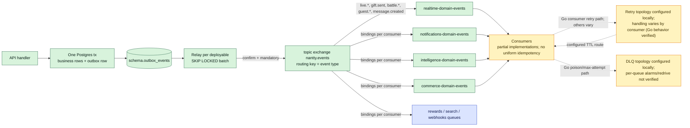
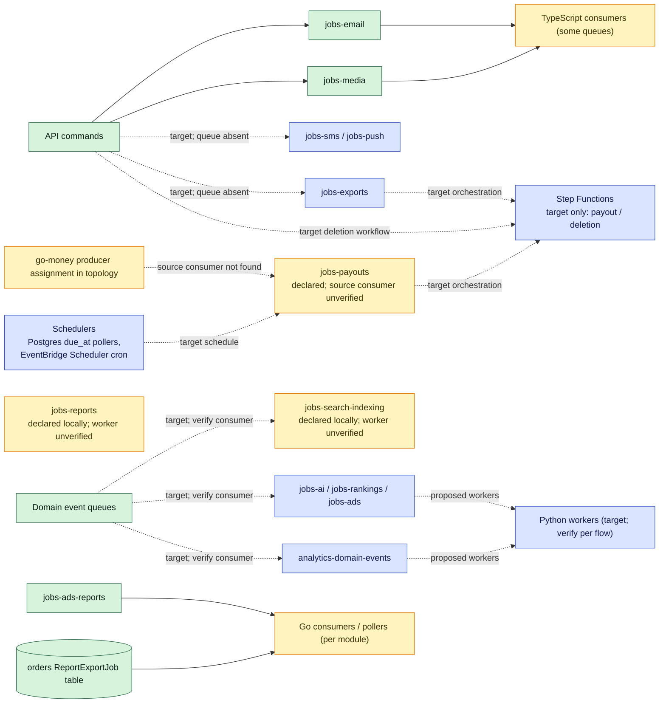

# Events and background jobs

> **Implementation status snapshot: 2026-11-04.** This document records both the intended architecture and the code verified in this repository. “Configured” means source/configuration exists; it does not prove that infrastructure has been applied or that production traffic uses it. For current deployed state, consult deployment records. When a status conflicts with code, code wins.

**RabbitMQ is the current code/configuration default** (local Docker; Amazon MQ Terraform exists). The SNS/SQS adapter remains as a compatibility option. The implementation is mixed: schemas and topology are broader than the uniformly implemented retry, deduplication, and operations controls. Labels: **IMPLEMENTED** · **PARTIAL** · **PROPOSED** · **NOT VERIFIED**. Facts: [inventory.md](inventory.md) section 4.

## 1. What exists

| Piece | Status | Evidence |
| --- | --- | --- |
| Outbox schema | IMPLEMENTED in 16 Go modules; producer and relay behavior varies by module. All 16 schemas now include attempt/backoff/stuck-event fields; schema fields alone do not prove migrations are deployed or that relay code uses them. | `services/go/modules/*/src/databases/schema/outboxEvent.schema.go` and module migrations |
| Outbox write in the same transaction as the business change | IMPLEMENTED in many producers, including auth, catalog, currency, live, orders, payments and users; not asserted as universal without checking each producer. | Module `src/events/outbox.event.go` and transactional producer call sites |
| Shared relay: 500 ms poll, batch default 100, `FOR UPDATE SKIP LOCKED`, publish then mark successes | IMPLEMENTED, but retry policy implementations differ. The generic relay backs off in-process. The durable `OutboxRelayStore` implementation is defined under ledger and is wired by ledger, escrow, creators, payments, subscriptions and wallet; it persists attempt count, next-attempt time, last error and a stuck-event timestamp while continuing retries. Ads, Admin, Currency, Auth, Inventory, Live, Moderation, Users, Catalog and Orders independently persist retry state in their Ent relays: first retry after 2 seconds, exponential backoff capped at 15 minutes, and a stuck-event log marker after 10 attempts and every 10 attempts thereafter; they continue retrying and do not move rows to separate dead tables. This is durable persistence across all 16 module schemas, not a uniform cross-module operational contract. | `services/go/platform/events/outbox.relay.go`; `services/go/modules/ledger/src/events/outbox.event.go`; relay wiring in the six named modules; implementation, regression test and additive migration for Ads, Admin, Currency, Auth, Inventory, Live, Moderation, Users, Catalog and Orders under `services/go/modules/{ads,admin,currency,auth,inventory,live,moderation,users,catalog,orders}` |
| RabbitMQ publisher: confirm channel, `mandatory`, persistent, routing key = `eventType`, `message_id` = envelope id, `type` = event type, `traceparent` + `x-nantty-subject` headers; batch fails on any nack/return so outbox rows stay unpublished | IMPLEMENTED | `platform/events/rabbitmq.publisher.go`, social `rabbitMqDomainEventPublisher.integration.ts` |
| Bus selection `EVENT_BUS=rabbitmq` (default) or `sqs` (old SNS/SQS adapters kept for rollback), `RABBITMQ_URL` per service user | IMPLEMENTED | `platform/events/messageBus.factory.go` |
| Envelope `{id,type,source,subject,schemaVersion,occurredAt,data}` | IMPLEMENTED. `schemaVersion` is the actual field name (not `version`). The ledger and orders money-event consumers validate required fields, UUID id, positive schema version, timestamp, object data and reject unknown envelope fields as poison. The v1 event-type pattern accepts camelCase entity names used by live events. | `services/go/platform/events/event.envelope.go`, `services/contracts/events/schemas/envelope.v1.json`, `services/go/modules/ledger/src/loaders/moneyDomainEvents.loader.go`, `services/go/modules/orders/src/services/moneyEvents.service.go` |
| Event JSON schemas and contract check | IMPLEMENTED for a broad catalog. `pnpm backend:events:contracts` checks schema JSON and `$id`/filename consistency, AsyncAPI schema references and message/eventType consistency, and reports unreferenced payload schemas and queue routing keys without schemas. The current local baseline is 270 AsyncAPI messages, 362 schemas, 0 structural errors, and 105 coverage warnings (91 unreferenced payload schemas and 14 queue bindings without payload schemas). The checker does not prove producer emission, runtime payload validation, or consumer behavior. | `services/contracts/events/schemas`; `services/contracts/events/asyncapi.yaml`; `infra/local/rabbitmq/topology.json`; `scripts/checkEventContracts.mjs`; `scripts/checkEventContracts.test.mjs` |
| RabbitMQ topology | IMPLEMENTED as local definitions, including `money-domain-events`; topology source and generated definitions are configuration, not proof of an applied broker. | `infra/local/rabbitmq/topology.json` → `generateDefinitions.mjs` → `definitions.json` |
| Consumers | PARTIAL across the platform. Realtime dedupe is in-memory and bounded; intelligence has Redis claims; notifications has event ingestion and delivery dedupe. The Orders consumer rejects malformed envelopes, invalid order IDs, unsupported event types, missing release/retry timestamps, scheduled-refund payloads without a positive amount/currency, and settled-refund payloads without a positive amount/valid currency. Settled-refund currency and cumulative amount are checked against the locked order before refund effects. This is targeted validation, not general JSON Schema enforcement. Every event type currently bound to Orders' local `commerce-domain-events` queue maps to an event-aware handler that claims a receipt in the same orders-database transaction as its order effects (eight event families, including dispute resolution). Inventory confirmation precedes the payment-order transaction, and stock release follows a full-refund transaction via the closed-order sweep; these remain service boundaries, not distributed transactions. The go-money dispatcher now rejects a valid envelope with no registered handler as poison instead of acknowledging it without effects, but it still lacks general durable per-handler dedupe. Local bindings and source behavior do not establish deployed consumer wiring. | `services/go/modules/orders/src/services/moneyEvents.service.go`; `services/go/modules/orders/src/services/orderPayment.service.go`; `services/go/modules/orders/src/services/orderRefund.service.go`; `services/go/modules/orders/src/services/orderCompletion.service.go`; `services/go/modules/orders/src/services/refundRecords.service.go`; `services/go/modules/orders/src/services/stockRelease.service.go`; `services/go/modules/inventory/src/services/reservationSettle.service.go`; `services/go/modules/ledger/src/loaders/moneyDomainEvents.loader.go`; consumer implementations |
| Admin queue and consumer-registration monitoring | IMPLEMENTED in the Go API and admin console; NOT VERIFIED against a running production broker. `GET /api/v1/admin/event-operations/queues` is protected by `events:read`, and `/operations/events` shows queue counters plus sanitized registrations from RabbitMQ's consumer list API. Registration data includes queue, ack-required, prefetch and exclusive flags; consumer tags and channel/connection metadata are omitted. Consumer inventory can degrade independently from queue counts. This is broker registration, not handler health or proof of message progress. Response parsing is size-bounded and rejects malformed arrays, trailing JSON, invalid queue names and negative counters. It does not report per-service outbox lag or provide replay/redrive controls. The API uses a monitoring-tagged user with empty vhost resource permissions. Local definitions include this user; AWS requires the controlled bootstrap script after broker creation. | `services/go/modules/admin/src/modules/eventOperations`; `apps/admin/src/app/(console)/operations/events/page.tsx`; `apps/admin/src/components/operations/eventOperationsWorkspace.tsx`; `infra/local/rabbitmq/generateDefinitions.mjs`; `infra/aws/modules/messaging/bootstrapMonitoringUser.mjs`; `infra/aws/README.md` |
| DLQ operations | PARTIAL. RabbitMQ DLQ topology and general broker alarms exist. Queue counters are visible through the Admin API, but no repository-owned DLQ redrive tool or verified per-queue DLQ alarm/runbook exists; manual broker recovery remains. | `infra/local/rabbitmq/topology.json`; `infra/aws/modules/observability/main.tf`; `services/go/modules/admin/src/modules/eventOperations`; deployment/runbook configuration |

## 2. Event flow

Diagram key: green means source code or local configuration exists (not proof of deployment); amber means partial or unverified; blue means proposal.

Contract conventions and current limitations:

- The target topic naming convention is `<entity>.<pastTense>` with a camelCase entity and a versioned schema file `<name>.v<N>.json`. Existing event names do not all follow this convention. For breaking changes, publish a new version side by side until consumers have migrated.
- Delivery is at least once. Durable deduplication in the same transaction as each consumer's side effect is the target, not a system-wide current guarantee. Most orders money-event paths check/apply/insert `processed_events` non-atomically; eight event families now use a transaction-scoped receipt for order-database effects, including escrow refund settlement. Payment events still cross an inventory-service boundary before the orders transaction; retry safety depends on inventory confirmation being idempotent. Full refund stock release occurs after the orders transaction and depends on the closed-order sweep for crash recovery.
- Ordering is **not** guaranteed end to end (a quorum queue is FIFO, but retries, redeliveries and competing consumers can reorder). Some flows use `aggregateVersion` or Phoenix `seq`; neither is a universal producer/consumer guarantee. Add and verify version checks for each flow that depends on ordering.
- Payloads should minimize personal data and carry only what each consumer needs. Do not assume all event payloads contain IDs only; inspect each event schema and producer before approving sensitive fields.

### 2.1 Financial event safety: target guarantees and current status

| Layer | Guarantee | Status |
| --- | --- | --- |
| Producer | Many producers commit business rows and their outbox row in one transaction | IMPLEMENTED in multiple modules; coverage needs module-by-module verification |
| Relay | Successful publications are marked; failures remain pending | PARTIAL. The shared durable store used by ledger, escrow, creators, payments, subscriptions and wallet, plus the independent Ent relays in Ads, Admin, Currency, Auth, Inventory, Live, Moderation, Users, Catalog and Orders, persist retry state and continue retrying. The generic relay still has process-level backoff, and the implementations differ in policy/operations; stuck markers are not separate dead tables. Relay-lag visibility, consistent operator recovery, and deployment evidence remain outstanding. |
| Transport | RabbitMQ topology defines persistent quorum queues and retry/DLQ routes | IMPLEMENTED in local definitions; applied production topology NOT VERIFIED |
| Consumer | Durable idempotency per consumer, atomic with its side effect | PARTIAL platform-wide. All event types in the local Orders queue binding use atomic receipts for their order-database effects. Payment-event inventory confirmation and post-refund stock release are separate service effects with retry/sweep recovery, not one distributed transaction. The go-money dispatcher has no shared durable dedupe. Other consumers use different mechanisms; do not assume exactly-once processing. |
| Recovery | Per-queue DLQ alert/redrive and safe outbox replay procedures | PARTIAL/NOT VERIFIED. Manual RabbitMQ management recovery exists; no repository-owned redrive tool or standard outbox replay command was found. |
| Truth | Ledger integrity checks and provider reconciliation provide independent checks | PARTIAL. Code exists for ledger integrity/reconciliation; operational schedule, alert routing and production execution are NOT VERIFIED. |

Required relay work (**P1**): unify retry policy and retry eligibility across the shared store and ten independently implemented Ent relays; expose relay lag; route stuck-event alerts to an operated destination; and define a safe operator replay/dead-letter workflow. All implementations continue retrying and preserve rows, but do not mistake the `dead_lettered_at` stuck marker for a separate dead-letter store. Do not discard financial events after a retry threshold: preserve them for repair and reconciliation.

Required financial-consumer work (**P0**, partially implemented): persist a consumer-scoped event receipt in the same database transaction as its database effects for every financial handler. The eight event families currently bound to the local Orders queue meet this requirement for their order-database effects: release scheduling/failure, scheduled refund, release completion, dispute lifecycle, payment receipt, and settled refund events. This covers release/retry timestamps and timeline; scheduled-refund record and timeline; order completion, completion outbox events and store-credit entries; dispute status/timeline/outbox changes; payment state/outbox changes; and refunded amount/status, refund records, timeline and store-credit effects. Dispute resolution restores an order from `disputed` to its pre-dispute state after a partial refund; full-refund/release outcomes may transition the order first, in which case resolution does not overwrite the terminal result. Payment inventory confirmation occurs before the orders transaction. Full-refund inventory release occurs after it, with the Orders closed-order sweep as a retry mechanism; actual production sweep scheduling/health remains NOT VERIFIED. The go-money dispatcher and other consumers do not yet have a general atomic receipt guarantee. Where an effect crosses a service/provider boundary, use an idempotency key and transactional outbox/inbox handoff, or an explicit reconciliation/recovery state; a pre-effect receipt in one service alone is unsafe. Acceptance requires duplicate concurrent delivery and crash/retry tests that assert ledger/order/inventory/store-credit invariants from database state, plus tests proving a failed handler remains retryable. The overall financial-consumer layer remains PARTIAL.

Current Orders re-delivery status (code-reviewed; broader database-backed crash/recovery reproduction pending): `MoneyEventHandler.Handle` retains a pre-check and trailing receipt insert, but each event type currently bound to the local `commerce-domain-events` queue routes to an event-aware method that claims its unique receipt inside the order transaction. Duplicate delivery skips the corresponding order-database effect, and a failed transaction rolls the receipt back. The covered event families are `escrow.releaseScheduled`, `escrow.releaseFailed`, `escrow.refundScheduled`, `escrow.released`, dispute lifecycle events, `escrow.held` / `directPayment.received`, and settled escrow refunds. For `escrow.released`, the transaction covers order completion, its outbox event and any resulting store-credit entry; dispute events cover status changes and transition events; settlement refunds cover refund status/amount, refund records, timeline and store-credit changes. `dispute.resolved` restores the prior order state after partial-refund resolution; when settlement already moved the order to refunded/completed, the restoration path does not overwrite that terminal result. Settlement-refund envelopes are rejected as poison when the refunded amount is nonpositive, currency is malformed/mismatched, or cumulative refund exceeds the order total; these checks prevent the order refund amount from being capped while refund records/credits use a larger value. Payment events confirm inventory before entering the orders transaction. Inventory `Confirm` locks reservation rows, accepts already-confirmed rows and updates only active rows, so retrying the same local reservation confirmation is idempotent; there is no distributed transaction across inventory and orders. For a full refund that releases stock, the orders transaction commits first and an order sweep later releases stock for closed orders still marked reserved. A crash in that interval relies on the sweep, whose production scheduling/health is not verified here. Atomic receipt semantics apply only to the currently bound events' orders-database effects—not exactly-once processing outside the orders database or a guarantee for future/unbound events. Postgres-backed integration tests assert concurrent duplicate delivery for release scheduling, scheduled refunds, release completion, dispute open/close/resolution, payment receipt, and partial/full/post-payout refunds; sequential replay for release failure; and receipts plus state/timeline/outbox invariants. Other crash/recovery invariants remain untested.

## 3. Event catalog

Durability describes the target contract, not a guarantee shared by every current producer/consumer: **F** financial (outbox + DLQ + replay + reconciliation, never dropped) · **D** durable domain (outbox + DLQ) · **B** best effort (high volume, loss tolerated, may bypass outbox via batched direct ingest). Ordering: **none**, **subject** (per aggregate, via `aggregateVersion`), **room** (per live, via Phoenix `seq`). Status means a producer or consumer was found in code/tests; it does not mean every listed consumer is bound or deployed.

The catalog combines implemented events and target proposals. Event names under different casing/spelling are not aliases: consumers and integrations must use the exact producer name shown. Rows marked **PROPOSED** have no producer found in the current source review.

| Event | Producer | Consumers | Dur. | Order | Key payload fields | Status |
| --- | --- | --- | --- | --- | --- | --- |
| `account.registered` | auth | users (create personal profile), notifications (welcome), analytics | D | none | accountId, username, countryCode | IMPLEMENTED |
| `account.loggedIn` | auth | trust (risk), analytics | B | none | accountId, sessionId, ipHash, deviceId | IMPLEMENTED |
| `session.refreshTokenReuseDetected` | auth | notifications (security alert), trust | D | none | accountId, sessionId | IMPLEMENTED |
| `account.deletionRequested` / `account.deletionCancelled` / `account.deletionExecuted` | users | owning services, notifications, search/support consumers | D | subject | accountId, requestId/referenceId, executeAfter/executedAt | IMPLEMENTED; current names differ from former `account.deleted` proposal |
| `profile.updated` | users | search and other profile projections | D | subject | profile/account identifiers, changed fields | IMPLEMENTED for current profile/business-profile producers; payloads vary by producer |
| `consent.granted` / `consent.withdrawn` | users | consent-aware consumers | D | subject | accountId, consent type, policy/policyVersion | IMPLEMENTED; replaces former `consent.updated` proposal |
| `businessVerification.approved` / `businessVerification.revoked` | users | payments (seller-verification projection) | F | subject | accountId; approval also requires goldEligible and goldCheckmarkGranted; revocation requires documentKind and reason | IMPLEMENTED; payments validates UUID account IDs and required contract fields before applying verification state. Runtime validation is consumer-specific rather than general JSON Schema enforcement |
| `verificationCase.decided` / `checkmark.revoked` | users | payments (refresh payout verification level) | F | subject | accountId plus event-specific decision or revocation fields | IMPLEMENTED; payments rejects blank accountId as poison before refreshing the payout verification level. It does not apply general schema validation to every otherwise-unused field |
| `product.published` / `product.updated` / `product.unpublished` | catalog | search, intelligence and downstream catalog consumers | D | subject | productId, storeId, status | IMPLEMENTED for current catalog flows; schema presence alone does not imply every consumer is bound |
| `product.viewed` / `product.clicked` / `product.addedToCart` / `product.removedFromCart` / `search.performed` / `seller.viewed` | catalog (interaction ingest) | intelligence, seller traffic analytics and other configured consumers | B | none | actorId?, productId/storeId, sessionId, surface, occurredAt | IMPLEMENTED; current allowlist differs from the broader proposal |
| `cart.checkedOut` | orders | analytics, intelligence | D | none | checkoutId, buyerId, groupCount | PROPOSED; no producer found |
| `orderGroup.created` | orders | notifications and downstream order consumers | D | subject | orderGroupId, checkout/payment details | IMPLEMENTED; current producer name, not `order.placed` |
| `orderGroup.paid` | orders | go-money affiliate handling, notifications and downstream order consumers | F | subject | orderGroup/payment details, currency and attributed line items | IMPLEMENTED; creators records eligible attributed sales as awaiting completion. Its consumer rejects malformed order/account identifiers, currency, or attributed lines as poison instead of acknowledging them as no-ops; an empty attribution list is valid. Current producer name, not `order.paid` |
| `orderGroup.shipped` / `orderGroup.delivered` / `orderGroup.completed` / `orderGroup.statusChanged` | orders | go-money affiliate handling, notifications and order consumers | F where money effects occur; otherwise D | subject | orderGroupId, status/transition details; completed also carries currency and attributed line items | IMPLEMENTED; creators validates completed-event financial/attribution fields before commission release, and validates status transitions before void handling. Empty attributed lines are valid; malformed payloads are poison. Current event family differs from former `order.*` proposal |
| `orderGroup.deliveryAttemptFailed` | orders (seller fulfillment, same transaction as attempt/timeline update) | notifications (buyer in-app/push only) | D | subject | orderGroupId, storeId, buyerAccountId, sellerAccountId, reference, attempts, actorKind | IMPLEMENTED; seller note is excluded from the outbox payload |
| `payment.succeeded` / `payment.failed` | payments | notifications and subscribed money workflows | F | subject | paymentId, purpose, referenceId, amount/currency, provider | IMPLEMENTED; confirm each consumer binding and purpose-specific handler |
| `paymentRefund.requested` / `paymentRefund.succeeded` / `paymentRefund.failed` | payments | go-money, notifications and refund workflows | F | subject | refund/payment IDs, amount/currency, status | IMPLEMENTED; current names differ from former `refund.*` proposal. Payments retries stale provider-error claims and recovers a stale first-attempt claim with no provider ID/failure text; the recovered attempt reconciles by provider refund reference before resubmission when the provider supports lookup. Providers without lookup capability leave an unknown result for manual confirmation rather than blind automatic resubmission. Postgres-backed recovery regressions cover a crash before the provider call and a provider-accepted refund not yet recorded locally; both assert provider lookup and single refund accounting, and the accepted-refund case asserts no duplicate provider submission. Provider-specific lookup consistency and deployed retry-worker health remain NOT VERIFIED |
| `escrow.held` / `escrow.releaseScheduled` / `escrow.releaseFailed` / `escrow.refundScheduled` / `escrow.released` / `escrow.partiallyRefunded` / `escrow.refunded` / `escrow.clawedBack` / `escrow.chargeback` / `escrow.underReview` | escrow | orders, creators (affiliate reversal for settled refunds), wallet views and configured downstream money/notification consumers | F | subject | escrow/order IDs, amount/currency, status; release events include retry/deadline details | IMPLEMENTED; schemas, notification registry and fixtures cover all 10 escrow outbox event names found in producer code. Orders validates settled refund amount/currency against the order and rejects nonpositive or over-total settlements as poison; creators validates escrow/order IDs, status, positive original and cumulative refunded amounts, matching valid currencies, and refund not exceeding escrow amount before reversing affiliate commissions. These are targeted consumer validations, not full schema enforcement. `commerce-domain-events` binds `escrow.releaseFailed` and `escrow.clawedBack` to the orders handler, matching its retry/settlement cases. Notifications sends the seller a payout-delay notice for `escrow.releaseFailed`; it explicitly consumes `escrow.releaseScheduled` without another notice because `orderGroup.delivered` already tells the buyer when to confirm; `escrow.chargeback` sends a neutral payment-status update to buyer and seller because the payload does not identify the provider outcome. Orders sends unsupported event types to poison-message handling instead of silently recording them as processed. Contract presence and bindings are source-verified; runtime schema enforcement, deployed topology and complete consumer fan-out are NOT VERIFIED. `escrow.refundScheduled` has a distinct payload from the shared settlement payload |
| `directPayment.received` | escrow | orders (`commerce-domain-events`) | F | subject (order ID) | escrow/order snapshot, paymentReference, paidFromWallet | IMPLEMENTED; escrow emits in its transaction and local topology binds orders. Orders commits its event receipt with paid-state/outbox effects after inventory confirmation; deployed binding and full crash-recovery behavior are NOT VERIFIED |
| `dispute.opened` / `dispute.closed` / `dispute.resolved` | escrow | orders (`commerce-domain-events`) | F | subject (dispute ID) | disputeId, orderId, escrowId, status, buyer/seller/store IDs, reason | IMPLEMENTED in source/local topology; escrow emits lifecycle events in its database transaction and Orders applies them with transaction-scoped receipts. Resolution restores the prior order status after a partial refund, while settled refund/release events retain their final order status. The orders consumer currently uses `orderId` from payload (not the envelope subject); broad payload validation and deployed consumer binding are NOT VERIFIED |
| `payout.requested` / `payout.completed` / `payout.failed` | orders admin relay / wallet | audit, notifications and downstream payout consumers | F | subject | withdrawalId, ownerId, amount/currency, provider reference/status | PARTIAL; request is relayed to the admin audit service and wallet emits completed/failed, but the exact proposal names/consumer fan-out are not uniform |
| `journalEntry.posted` | ledger | analytics, reconciliation | F | none | entryId, reference, kind, lines[{accountCode, direction, amountMinor, currency}] | PROPOSED; no producer found |
| `coinPurchase.completed` | wallet | rewards, analytics | F | subject | purchase/account IDs, coins, paymentId | IMPLEMENTED; current event name, not `coins.purchased` |
| `gift.sent` | live (go-live outbox, after go-money commits the charge) | realtime (room fan-out), live (battle score), rewards, analytics, intelligence (risk) | F | room | giftTransactionId, liveId, battleId?, senderId, receiverId, giftId, quantity, totalCoins, comboId, comboCount | IMPLEMENTED (go-live producer; downstream consumers vary) |
| `giftTransaction.committed` | creators (go-money outbox, same tx as the ledger entry) | analytics, rewards, reconciliation | F | subject | giftTransactionId, liveId, battleId?, senderId, creditedUserId, totalCoins, platformFeeCoins, creatorAmountCoins, journalEntryId | IMPLEMENTED (money-side fact; go-live publishes the realtime `gift.sent`, never the other way round) |
| `goal.progressed` / `goal.completed` | live | realtime | D | room | goal/live IDs, progress and target | IMPLEMENTED; current event names, not `gift.goalProgressed` / `gift.goalCompleted` |
| `live.started` / `live.ended` | live | realtime; other consumers only where explicitly bound | D | subject | liveId, hostId, category, startedAt/endedAt | IMPLEMENTED (producer and integration tests); downstream fan-out is partial/configured separately |
| `guest.invited` / `guest.joined` / `guest.left` / `guest.removed` / `guest.muted` | live | realtime | D | room | liveId, slotId, userId, state | IMPLEMENTED (producer/router; payload variants include invited and reconnecting events) |
| `battle.started` / `battle.scoreUpdated` / `battle.ended` | live | realtime; creators settle through a separate money-side event | D (settlement: F) | room | battleId, liveId, scores[], winnerUserIds, endReason | IMPLEMENTED; money settlement is separately emitted as `battle.settled` / `battleSettlement.completed` |
| `battle.settled` | live (go-live outbox, after go-money settles) | realtime, notifications, analytics | F | subject | battleId, rule, transfers[], journalEntryId | IMPLEMENTED (go-live producer; consumer coverage is not uniform) |
| `battleSettlement.completed` | creators (go-money outbox, same tx as the settlement entry) | analytics, reconciliation | F | subject | battleId, ruleApplied, winnerUserId, payouts[], transfers[], journalEntryId | IMPLEMENTED (money-side fact; keep both events) |
| `post.created` / `post.updated` / `post.deleted` | TypeScript social | feeds, moderation, search and downstream consumers | D | subject | postId, authorProfileId, audience, mediaIds | IMPLEMENTED; consumer bindings differ by event |
| `comment.created` / `post.liked` / `post.shared` / `post.reshared` / `content.saved` | TypeScript social | notifications, counters and downstream consumers | B/D depending on event | none | postId, actorProfileId | IMPLEMENTED; actual event names differ from `post.saved` proposal |
| `follow.created` / `followRequest.created` / `followRequest.accepted` / `follow.rejected` / `follow.removed` | TypeScript social | search, notifications and downstream consumers | D | subject | followerId, followeeProfileId, state | IMPLEMENTED; names differ from former `user.followed` / `follow.*` proposal |
| `block.created` / `block.removed` | TypeScript social | search, realtime membership and feeds | D | subject | blockerId, blockedId | IMPLEMENTED; current names differ from `user.blocked` |
| `report.created` | TypeScript social | moderation queue, intelligence/classification | D | none | reportId, subjectType, subjectId, reason | IMPLEMENTED; not named `content.reported` |
| `moderation.actionTaken` | moderation | social, catalog, live, ads, notifications | D | subject | caseId, subjectType, subjectId, action, aggregateVersion | PROPOSED; no producer found |
| `media.uploaded` | TypeScript media | downstream media consumers | D | subject | mediaId, ownerId, purpose, variants[] | IMPLEMENTED; `media.ready` / `media.failed` remain unverified as emitted events |
| `message.created` | TypeScript social | realtime fan-out, notifications (offline push) | D | subject (conversation) | messageId, conversationId, senderId, clientMessageId | IMPLEMENTED; realtime router handles it, while production fan-out must be verified separately |
| `notification.created` | TypeScript notifications | realtime (`user:*`) | B | none | notificationId, accountId, kind | IMPLEMENTED (producer/router) |
| `ad.impressionRecorded` (includes `Clicked`) | go-ads | analytics, intelligence (fraud), ads attribution | B raw, F once qualified and charged | none | impressionId, adId, campaignId, creatorId?, placement, qualified, clicked | IMPLEMENTED; click is a field, not a separate `ad.clicked` event |
| `ad.conversionRecorded` | go-ads | analytics, campaign reports | D | none | conversionId, impressionId, eventName, dedupeKey | PROPOSED; no producer found |
| `exchangeRate.updated` | currency | configured money/commerce consumers | D | none | base, quote, rate, effectiveAt | IMPLEMENTED producer; verify consumer bindings and deployed topology |
| `creatorApplication.approved` | users | creators (default-tier enrollment); payments (creator connected-account onboarding) | F | subject | accountId, handle | IMPLEMENTED; both creators and payments reject a missing/blank accountId as poison before invoking downstream services, preventing the creators empty-ID no-op and payments' email-verification no-op from acknowledging malformed events. The two effects remain separate and do not share a distributed transaction |
| `creatorSubscription.paid` / `creatorSubscription.refunded` | subscriptions | creators (`money-domain-events`) | F | subject (subscription) | subscriptionId, chargeId, creatorId, amount/share or recovered/shortfall money | IMPLEMENTED; the creators event boundary rejects missing identifiers, paid references that do not match the charge, invalid amounts, mismatched/invalid currencies, negative or overflowing refund totals, and creator share above gross as poison. Creator earnings rely on unique earning references and the refund path marks the corresponding earning reversed; there is no general per-handler receipt in the dispatcher, so transactional/idempotency guarantees must be checked at each effect owner |
| `adCreatorEarnings.posted` | ads | creators (`money-domain-events`) | F | subject | creatorUserId, currency, amountMinor, batchId, idempotencyKey | IMPLEMENTED; creators rejects missing identity/batch, idempotency keys that do not bind the batch and creator, invalid currency or nonpositive amount as poison. Ledger reference `ads-revenue-share:<idempotencyKey>` makes journal posting replay-safe; earning insertion is in the same transaction and uses the same reference. Deployed queue wiring remains NOT VERIFIED |

Webhook-to-seller events (`order.*`, `inventory.lowStock`, `product.updated`, `payout.paid`, `review.created`) are a separate public contract re-shaped by ts-io; for example, the internal wallet event is `payout.completed`, not `payout.paid`. Webhook names must not be treated as internal domain event names.

## 4. Queue technology comparison

Assumed launch traffic: < 500 domain events/s peak, gift bursts of a few thousand/s in a hot room, team of a few backend engineers.

| Option | Traffic fit | Ordering | Durability | Replay | Ops burden | Cost at launch | Team fit |
| --- | --- | --- | --- | --- | --- | --- | --- |
| **RabbitMQ (Amazon MQ, chosen)** | Tens of thousands msg/s on a 3-node cluster, far above launch | FIFO per queue (retries reorder) | Quorum queues (Raft, 3 replicas), publisher confirms, at-least-once dead-lettering | No log replay (streams possible later); replay from outbox or DLQ move | Medium: managed brokers, patching by AWS; we own topology and alarms | 3 x mq.m7g.large about the price of a small RDS; no per-request cost | Same broker locally (Docker) and in AWS, no LocalStack; topic routing, per-queue retries/DLQ, delays and priorities without AWS-specific glue; mature clients for Go, TS, Elixir, Python |
| SNS + SQS (previous) | Effectively unlimited | None (standard) | Multi-AZ, DLQ redrive | No log replay | Lowest (serverless) | Lowest, pay per request | AWS-only; LocalStack drift; 15 min max delay; filter policies per subscription |
| EventBridge | ~10k events/s soft quota per region | None | Multi-AZ, DLQ per target | Archive + replay built in | Low | ~2x SNS per event | Good for cross-account/SaaS routing |
| Kafka / MSK | Very high | Per partition | Replicated log | Full replay by offset | High | Highest fixed cost | Needs Kafka experience |
| Redis Streams | High, memory-bound | Per stream | Weak (memory, AOF) | Limited by memory | Medium | Uses existing ElastiCache | Ephemeral fan-out only, not money |

**Decision (owner, 2026-10-03): RabbitMQ.** One durable topic exchange `nantty.events` (routing key = event name), one durable quorum queue per consumer service bound to the keys it needs (replaces SNS→SQS fan-out and filter policies), and a direct exchange `nantty.jobs` with one quorum queue per job type. All behind the unchanged `DomainEventPublisher` / `JobQueue` / `QueueConsumer` interfaces; the SNS/SQS adapters stay behind `EVENT_BUS=sqs` until the cut-over is proven, then get deleted. The outbox remains the replay source.

### 4.1 Topology (source model and generated definitions)

| Element | Definition |
| --- | --- |
| Source of truth | `infra/local/rabbitmq/topology.json` is the custom source model; `pnpm backend:rabbitmq:definitions` runs `generateDefinitions.mjs` to produce RabbitMQ `definitions.json`. Local Docker mounts that generated artifact. The backend integration workflow now regenerates `definitions.json` and requires a clean `git diff` before importing it into the disposable broker, preventing stale checked-in definitions from passing CI. This is workflow-source evidence; a successful run of the new check is **NOT YET VERIFIED**. AWS topology import is **BLOCKED** until an AWS-safe converter/importer exists: `topology.json` is not RabbitMQ's definitions format, and generated `definitions.json` has local-only user hashes. No automated deployment importer was found; the Terraform management-API security-group rule is not an importer. Whether any AWS topology/permissions were previously applied is **NOT VERIFIED**. |
| Exchanges | `nantty.events` topic (alternate exchange `nantty.unrouted` fanout → `unrouted-events`, TTL 24 h, max 100k, drop-head), `nantty.jobs` direct, `nantty.retry` topic, `nantty.dlx` direct |
| Work queue `<q>` | quorum, `x-dead-letter-exchange=nantty.dlx`, `x-dead-letter-routing-key=<q>.dlq`, `x-dead-letter-strategy=at-least-once`, `x-overflow=reject-publish`; bound to `nantty.retry` with key `<q>` (return path) |
| Retry queues | `<q>.retry.30s`, `.2m`, `.10m`, `.30m`: quorum, `x-message-ttl`, dead-letter back to `nantty.retry` with key `<q>`; bound with their own name. Per-tier queues avoid head-of-line blocking of per-message TTL; no delayed-message plugin |
| Dead-letter queue | `<q>.dlq` quorum, bound to `nantty.dlx` |
| Consumer behavior | These are per-implementation behaviors, not a uniform platform contract. The Go RabbitMQ consumer implements manual ack, configured prefetch, confirmed retry publishing through delay tiers, poison-message rejection, and requeue if retry publishing fails. TypeScript, Python, and other consumers have their own handling. Durable idempotency is not universal; see §1 and §2. Deployed behavior is **NOT VERIFIED**. |
| Delayed jobs | `JobQueue` delay = publish to the largest retry tier ≤ delay (handlers that need exact timing re-defer, e.g. `email.sendIfUnread`) |
| Least privilege | The local topology generator assigns per-service users and scoped `configure`/`write`/`read`/retry permissions. The [AWS runbook](../../infra/aws/README.md) blocks direct cloud import pending an AWS-safe importer. Actual AWS users, grants, and permissions are **NOT VERIFIED**. |
| Outside the bus | SES bounce/complaint feedback stays AWS-native (SES → SNS → SQS `notifications-ses-feedback`, optional `SQS_SES_FEEDBACK_QUEUE_URL`) because SES cannot publish to RabbitMQ; it carries no domain events |
| Connections | Reference pattern, not a platform-wide guarantee. Go and TypeScript clients have source implementations for named connections, consumer channels, reconnect/backoff, and shutdown; verify each service's channel ownership and lifecycle independently. Deployed connection behavior is **NOT VERIFIED**. |

| Field | Value |
| --- | --- |
| Problem | Plan wanted FIFO with `MessageGroupId = liveId` for gift ordering (`backendPlan.md` 4.1.0) |
| Current | Quorum queues are FIFO per queue but retries, redeliveries and competing consumers reorder |
| Recommendation | Do not depend on transport order. Producer sets `comboCount` and `aggregateVersion`; Phoenix stamps `seq` per topic on push; scores are absolute values, not deltas. Use single-active-consumer on a dedicated queue only if a consumer truly needs order |
| Priority | P1 before relying on transport ordering for gifts or battles; the gift feature exists, but queue ordering is not a guarantee. |

## 5. Background jobs

Diagram key: green means source code or local configuration exists (not proof of deployment); amber means partial or unverified; blue means proposal.

Job queues (`nantty.jobs`, routing key = queue name) declared in the local topology: `jobs-email`, `jobs-media`, `jobs-reports`, `jobs-payouts`, `jobs-subscription-billing`, `jobs-catalog-import`, `jobs-search-indexing`, `jobs-ads-reports`, `intelligence-trust-advisory`, `intelligence-trust-content-scores`, `intelligence-trust-live-safety`, `intelligence-trust-bot-scores`, `jobs-live-frames`, and `jobs-live-audio`. These are local declarations, not proof of worker health or a deployed broker. The following names used in the target table are absent from current topology: `jobs-sms`, `jobs-push`, `jobs-ai`, `jobs-exports`, `jobs-rankings`, `jobs-ads`, and `analytics-domain-events`. A declared queue alone does not prove a consumer exists. The intelligence-to-trust advisory path is configured separately; see topology bindings and service code.

The following are target defaults, not a global guarantee: quorum queue, manual ack, prefetch 20; five attempts with backoff through retry queues; then `<queue>.dlq`; alerting on non-empty DLQs; job id (`message_id`) as an idempotency key; and bounded consumer timeouts. Retry, worker, and alert behavior must be verified per queue before treating these as active controls. The table labels each row with evidence status; deployed queue health, permissions, and consumer fan-out remain **NOT VERIFIED**.

| Job | Producer | Queue / trigger | Worker | Status against source | Retry / idempotency / failure notes |
| --- | --- | --- | --- | --- | --- |
| Email | auth, notifications | `jobs-email` | notifications service consumer | **IMPLEMENTED in source for event-template and support-ticket mail**; see [notificationDelivery.md](notificationDelivery.md). Queue topology, migrations, SES delivery, and live operation still need deployment verification. | Normal event-template mail is queued and bounded to four attempts with an admin alert/read endpoint; OTP address-verification overrides remain synchronous. SES feedback is a separate AWS-native path. At-least-once provider ambiguity remains. |
| OTP SMS | auth | `jobs-sms` | SMS provider worker | **PROPOSED: queue absent** | Retry limits, expiry, fallback, and token idempotency are design requirements, not active controls. |
| Push | notifications | `jobs-push` | FCM/APNs worker | **PROPOSED: queue absent** | Token invalidation and delivery dedupe are not established for this queue. |
| Media processing | media events/jobs | `jobs-media` | TypeScript media consumer and handlers | **PARTIAL: queue, consumer, and handlers exist**; this does not verify every listed transformation or AWS MediaConvert integration | Attempt handling is handler-specific; the proposed three-try/quarantine contract is not universal. |
| AI processing | `media.ready`, `post.created` (target) | `jobs-ai` | Python | **PROPOSED: queue absent** | Moderation/product enrichment workflow is a target, not a queue consumer. |
| Recommendations / feature building | domain events | `intelligence-domain-events` | Python intelligence consumer | **PARTIAL: event queue/service wiring exists**; complete feature coverage and production operation are not verified | Retry/dedupe are consumer-specific; ranking fallback is not a universal guarantee. |
| Search indexing | product/post/profile/live events (target) | `jobs-search-indexing` | search worker | **NOT VERIFIED: queue declared; matching worker wiring not established in this review** | Nightly full-reindex schedule and drift reconciliation are not verified. |
| Analytics ingest | all D/B events (target) | `analytics-domain-events` | analytics pipeline | **PROPOSED: queue absent** | Postgres/ClickHouse ingestion, consent filtering, and dedupe are design notes, not current queue behavior. |
| Fraud scoring | gift, coin, payout, order (target) | caller/API; no job queue established | Python risk endpoint | **PARTIAL / NOT VERIFIED end-to-end**: an HTTP scoring component is not evidence of queued delivery or consistent enforcement | Scoring failure and hold/proceed policy must be verified at each caller. |
| Moderation | `report.created`, AI flags | trust-domain queue(s) | Go moderation/trust consumers | **PARTIAL: local trust queues and source consumers exist**; per-queue alarms, health, and full event fan-out are not verified | Retry and queue-age SLA are per-consumer/deployment checks. |
| Payouts | wallet/withdrawal workflows (target) | `jobs-payouts` | Go money consumer (target) | **NOT VERIFIED: topology assigns this queue to `go-money`, but no matching source consumer was found**; Step Functions orchestration is also not established | Provider idempotency, retry safety, reversals, and manual review require workflow-specific evidence. |
| Escrow release, stock expiry, battle timers, subscription renewals | owning Go modules | database pollers and/or `jobs-subscription-billing` | owning deployable | **PARTIAL: source pollers/workers exist in some modules; not one shared queue contract** | Verify each schedule, locking, stale-work recovery, and alert independently; do not infer a common retry policy. |
| Seller reports / exports | orders API | database-backed `ReportExportJob`; `jobs-reports` is separately declared | Go orders report-export runner | **PARTIAL: source job model and runner exist; claimed Python/S3 worker is not supported by this code path** | Runner polls queued rows in batches of five; no generic RabbitMQ retry/DLQ behavior is implied. |
| Ads scheduled reports | ads module | `jobs-ads-reports` | Go ads report consumer | **PARTIAL: queue, producer/sweeper, and consumer exist**; this is scheduled-report delivery, not the proposed `jobs-ads` attribution/earnings pipeline | Do not infer creator earnings or budget-pacing jobs from this queue. |
| Leaderboards / rankings | cron/events (target) | `jobs-rankings` | rewards worker | **PROPOSED: queue absent** | Snapshot upsert and Redis rebuild behavior are design requirements only. |
| Privacy data exports | users `POST /privacy/exports` (target) | `jobs-exports` | Step Functions/Python fan-out | **PROPOSED: queue absent; orchestration not verified** | Request lifecycle, partial failure/retry, and signed-download behavior need implementation evidence. |
| Account deletion orchestration | users after grace period (target) | Step Functions | owning services | **NOT VERIFIED as a Step Functions workflow**; deletion events/source handling are distinct from that orchestration claim | Retention exceptions, acknowledgements, alarms, and workflow retries are not established here. |
| Reconciliation / trial balance | scheduled job (target) | `jobs-payouts` or dedicated queue | Go money | **NOT VERIFIED as the described nightly queue workflow** | Reconciliation implementation and paging/escalation must be checked independently. |
| Outbox cleanup | scheduled retention job (target) | none found | none found | **PROPOSED / NOT IMPLEMENTED in reviewed source** | No daily cleanup, seven-day retention, or 5,000-row batch implementation was found. Do not assume published outbox rows are pruned. |

## 6. Priorities

| # | Item | Priority | Reason |
| --- | --- | --- | --- |
| 1 | Durable consumer idempotency for financial effects, with effect and dedupe state atomic per owning store | P0 | Broker delivery is at least once. All event types in the local Orders queue binding now have atomic receipts for Orders-database effects; go-money still lacks general atomic per-handler dedupe, and cross-service effects require separate idempotency/recovery. |
| 2 | Standardize outbox retry policy and add relay-lag visibility across modules | P1 | Durable persisted retry now exists in the six shared-store modules and ten independent Ent relays. Policies remain duplicated; relay-lag visibility, verified alert delivery, and operator recovery remain incomplete. |
| 3 | Do not rely on transport ordering for gifts/battles | P1 | Retries and redeliveries reorder; retain aggregate versions/room sequence where needed. |
| 4 | Extend the new contract check to compare router-accepted and producer-emitted event names | P1 | The current check catches broken schema references and event/header mismatches, but producer and consumer name coverage still needs source-aware extraction; schema existence is not proof of active producer coverage. |
| 5 | DLQ redrive runbook/tool and per-queue operational alert validation | P1 | DLQs exist; recovery remains manual and deployed alarm coverage is not verified. |
| 6 | Verify deployed RabbitMQ topology and service permissions | P1 | Source topology and Amazon MQ Terraform exist, but deployment records were not available in this code review. |
| 7 | Verify the RabbitMQ definitions drift check on its first CI run | P1 | The workflow now regenerates the artifact and fails on drift before broker import; the new workflow execution and current checked-in artifact parity still need CI evidence. |
