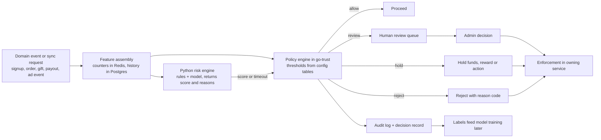
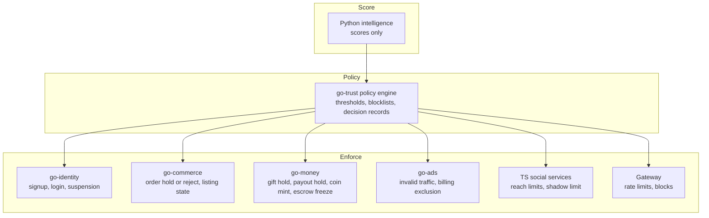
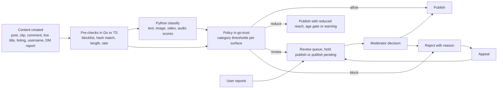
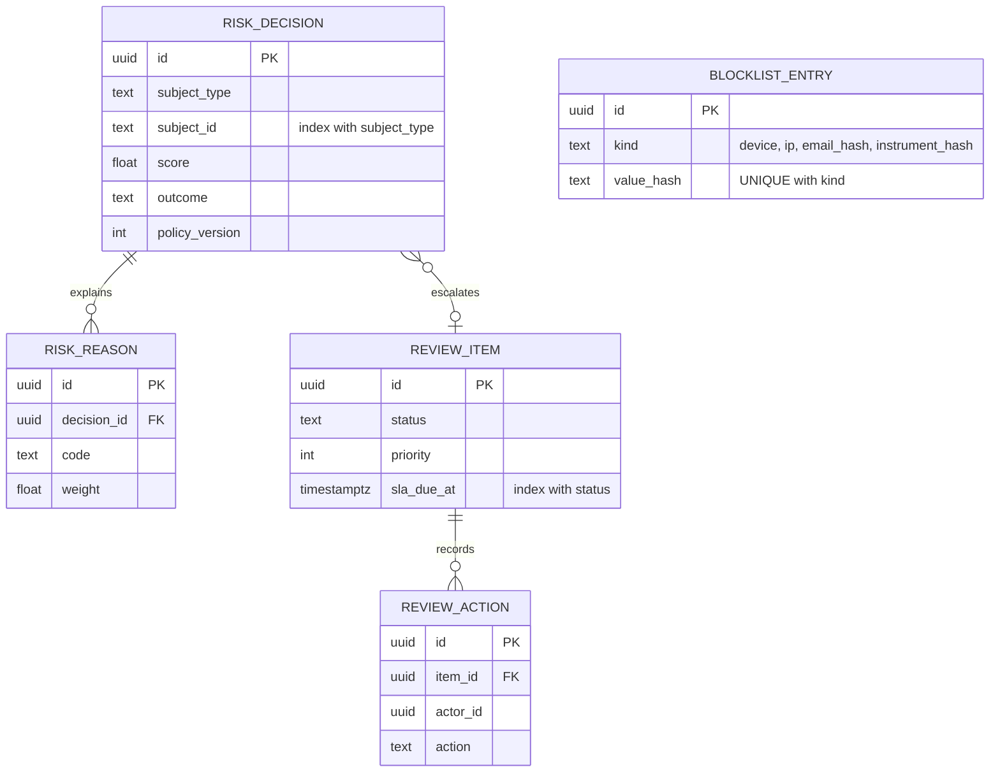

# Fraud, trust and moderation architecture

Status date: 2026-10-03. Labels: **EXISTING**, **MOCK-ONLY**, **PROPOSED**, **OPTIONAL FUTURE**.

## 1. What exists today

| Item | State | Evidence |
| --- | --- | --- |
| Python risk scorer: `POST /v1/risk/score`, subjects `order, payout, account_event, coin_purchase, coin_transfer, gift`; returns `score`, `level` (low, medium, high), `recommended_action` (allow, review, hold_for_manual_review), `reasons[{code, weight}]`, `rule_score`, `model_score` | EXISTING, tested in pytest, **no caller** | `services/python/intelligence/src/modules/risk/dtos/risk_scoring_dto.py`, `services/risk_scoring_service.py` |
| Python receives opaque ids and HMAC-signed requests | EXISTING | `services/python/intelligence/apiContract.md` section 2 |
| `go-trust` deployable and `moderation` module | EXISTING skeleton, routeless | `services/go/cmd/go-trust`, `services/go/modules/moderation` |
| Fraud tables, review queue, policy engine, thresholds | PROPOSED, none exist (inventory section 3 "fraud: none") | `microservicesPlan.json` |
| Moderation models (`ModerationReport/Case/Decision/Appeal`, `AccountSuspension`, `Automation*`) | PROPOSED in Go; reference in Prisma | `apps/api/prisma/schema` |
| Admin moderation, ads review, ip-claims, support, verification pages | MOCK-ONLY | `apps/admin` |
| `HELD_FOR_REVIEW` gift status | EXISTING in proto | `live_money.proto` |
| Rate limiting | Gateway global, in-memory only; none per endpoint in Go | inventory section 7 |
| Python moderation classifiers | **ABSENT**; no audio/video/text classifier module | `services/python/intelligence/src/modules` (12 modules, none for moderation) |

## 2. Pipeline

Principle: **Python returns scores. Go or TS deterministic policy decides. Enforcement stays in the service that owns the action.**

| Design rule | Detail |
| --- | --- |
| Two modes | **Sync advisory** for payment-adjacent decisions: bounded budget (50 ms plan figure), result used if it arrives, else deterministic default. **Async** for everything else: event to SQS to Python, score written back as a `risk_signal`, policy runs on the signal |
| **Python is never in the critical path of a payment** | Every call has a hard timeout and a circuit breaker. On timeout, error or 503 the policy uses a **deterministic default**: rule-only checks in Go (amount limits, velocity counters, new-account caps, new-destination cooling-off). Defaults err toward `hold` for payouts and high-value orders, and toward `allow` with low caps for small gifts. Payments never wait on a model |
| Decision record | Every decision stores subject, inputs hash, score, reasons, policy version, outcome, actor (system or admin) |
| Thresholds | In a config table with a version, editable by admin with audit; no thresholds in Python |
| Fail-safe asymmetry | Money leaving the platform fails closed (hold). Money entering or low-value social actions fail open with caps |
| Privacy | Python receives hashed or opaque ids only; signals respect consent where required (policy `advertising`, `personalization`); no legal compliance claims |

### 2.1 Policy decision table (PROPOSED defaults, tune from data)

| Python level | Recommended action | Policy outcome (typical) | Override rules in Go |
| --- | --- | --- | --- |
| low | allow | allow | Hard caps still apply (velocity, limits) |
| medium | review | allow + flag, or review for high value | High-value subject always review |
| high | hold_for_manual_review | hold or reject | Known-bad device or blocklist: reject without waiting for score |
| timeout or error | none | deterministic rules only | Payout: hold if new destination or above cap |

## 3. Signals per abuse type

| Abuse type | Key signals | Score subject / path | Decision and enforcement point | Owner |
| --- | --- | --- | --- | --- |
| Fake accounts | signups per device and IP per day, anonymizing network, disposable email or phone, OTP failure rate, device-account count, time to first action | `account_event` (signup, login, changes) EXISTING subject | go-identity gates signup, OTP and posting limits; new-account restrictions; reject or step-up verification | go-identity + go-trust |
| Fake engagement (likes, follows, comments, views) | burst rate per actor, follower-follow reciprocity rings, same device many accounts, account age, engagement without watch time | async events to Python, no EXISTING subject (add `engagement`) | Social services discount or drop events from flagged actors in counters and ranking; shadow-limit | TS social + go-trust |
| Bots and scraping | request rate, header and timing patterns, missing device attestation, repeated failures | gateway rate limit, `account_event` | Gateway per-route limits (P1 gap), CAPTCHA or attestation step-up, block | Gateway |
| Payment fraud (cards, stolen instruments) | amount vs history, new payment instrument, failed attempts per day, shipping vs account country, device-account count, buyer and seller share device | `order`, `coin_purchase` EXISTING | go-commerce policy before payment init; go-money before releasing escrow or minting coins; hold or reject | go-commerce, go-money |
| Gift abuse and laundering | gift bursts to one receiver, sender-receiver device overlap, new sender spending whole purchase, circular gifting, refunded-purchase coins | `gift`, `coin_transfer` EXISTING | go-money sets `HELD_FOR_REVIEW`, holds creator credit or battle settlement; admin can reverse | go-money + go-live |
| Promo abuse | shared device or payment instrument across accounts using one promo or store credit, code velocity, credit-then-refund | `order` | go-commerce reverses store credit on refund; revoke promo | go-commerce |
| Refund abuse (marketplace) | refund rate per buyer, item-not-received claims vs tracked delivery, serial disputes, dispute win rate | `order`, new `refund_request` subject | Dispute service flags buyer; escrow stays frozen pending review; buyer limits | go-money, go-commerce |
| Ad fraud and fake views | invalid traffic: same device clicks, impossible click-to-view timing, datacenter IP, view without playback, spend spikes | async to Python ads quality (new); ad events | go-ads excludes invalid events from billing and counters; credits back advertisers; suspends advertiser or placement | go-ads |
| Creator monetization abuse | self-gifting via alt accounts, coin cycling, inflated live viewers, gift farming rings, content policy strikes | `gift`, `payout`, viewer anomaly signals | Payout hold, creator program suspension, earnings freeze | go-money + go-trust |
| Marketplace abuse | counterfeit and prohibited listings, price anomalies, fake shipping, seller dispute rate, new-seller high-value orders, off-platform payment lures in messages | `order`, `payout` (seller_dispute_rate EXISTING signal), moderation | Listing review queue, seller tier (longer escrow hold), payout hold, suspension | go-commerce + go-trust |
| IAP refund abuse | refund notifications per account, spend-then-refund pattern, coins spent before refund, multiple accounts per store identity | `coin_purchase` plus store notification events | go-money: negative balance, block gifting and cash-out until cleared, flag or ban after N refunds (config) | go-money |
| Payout fraud and account takeover | payout destination changed recently, new device or country, failed OTP, refund and dispute rate, lifetime earnings vs request | `payout`, `account_event` (payout_destination_change) EXISTING | Step-up auth, cooling-off hold, admin approval above cap | go-money + go-identity |

## 4. Where decisions are enforced

Enforcement is local: go-trust returns a decision and reason code; the owning service applies it inside its own transaction. go-trust never writes another service's tables. Latency-critical paths (gifts, checkout) may embed a **library copy** of the deterministic rules (same config version) so a go-trust outage does not block them; this is a PROPOSED optimization and the default fallback described above.

## 5. Human review queue

| Aspect | Design (PROPOSED) |
| --- | --- |
| Queue item | `review_item {id, subject_type, subject_id, reason_codes, score, priority, status, assignee, created_at, sla_due_at}` with an index on `(status, priority, sla_due_at)` |
| Sources | Policy outcome `review` or `hold`, user reports, moderation `review`, IAP refund thresholds, payout holds |
| Admin UI | `apps/admin` moderation, commerce (payouts, disputes), ads review pages exist as MOCK-ONLY; add a single unified queue with filters by type and SLA |
| Actions | Approve, reject, reverse, suspend, request verification, escalate; every action requires reason, writes audit, and calls the owning service (not direct DB) |
| Controls | Role-based, step-up for money actions, four-eyes for payout releases above a cap, decisions feed labels |
| Appeals | Users appeal moderation decisions and suspensions (`ModerationAppeal` model); SLA configured |
| Metrics | Queue age, decisions per reviewer, overturn rate, precision of auto-holds |

## 6. Moderation pipeline

| Aspect | Detail |
| --- | --- |
| Classifier | **ABSENT** today. Needs a Python module or an external provider behind an interface; model choice is open. Start with text blocklist + hash matching + report-driven review, then add classifiers |
| Live | Viewer reports plus sampled frames (Rekognition) and optional audio (Transcribe). go-trust decides: severe and very confident means blur and pause for viewers, never an automatic end or ban; moderators confirm in the Live incidents queue. See [liveSafety.md](liveSafety.md) |
| Marketplace | Listing text and images scored on create and edit; prohibited categories blocked deterministically |
| Failure | Classifier timeout means `review` for risky surfaces (live, ads, listings) or publish-then-scan for ordinary posts; never block publishing on a classifier outage for low-risk text |
| Ads | Ads review is a separate policy path (`apps/admin` ads review, MOCK-ONLY) |
| Regions | Policy thresholds are per surface and per country config; legal requirements are for counsel to define |

## 7. Data model (PROPOSED, `trust` schema owned by go-trust)

## 8. Recommendations

| # | Problem | Current | Why it matters | Recommendation | Complexity | Risk | Priority |
| --- | --- | --- | --- | --- | --- | --- | --- |
| 1 | No policy engine or fail-safe defaults; Python risk has no caller | Scorer exists, go-trust is a skeleton | The first gift, coin purchase or payout would ship with no risk control | Build the deterministic policy (limits, velocity, cooling-off, holds) in Go first; add Python as advisory with timeouts. Gate money features on this | M | High | P0, money cannot go live without it |
| 2 | Python could become a dependency of payments | Plan says advisory but nothing enforces it | An outage would stop checkout and payouts | Hard timeout, circuit breaker, deterministic default, and a test that kills Python during a payment e2e | S | High | P0, availability of money paths |
| 3 | IAP refund abuse has no tracking | No IAP code | Store refunds are free money for abusers | Record store refunds per account and device; thresholds in config; negative-balance rules | S | Medium | P1, ship with the coin store |
| 4 | No per-route rate limits or bot controls | Gateway global in-memory limit only | Fake accounts, OTP abuse and scraping | Redis-backed per-route limits on auth, OTP, gifts, checkout; device attestation later | M | High | P1, MVP security gap (inventory section 7) |
| 5 | No moderation classifier | None | Illegal or unsafe content, store review risk | Reports + blocklist + hash matching first; classifier behind an interface in Near term | L | High | P1, user-generated content needs a report-and-takedown path before launch |
| 6 | Missing risk subjects for engagement, ads quality, refund requests | Eight subjects exist | Fake engagement and ad fraud are unscored | Add subjects (`engagement`, `ad_event`, `refund_request`) with contracts first | M | Medium | P2, Near term |
| 7 | Streaming scale for fraud features | Redis counters + Postgres | Premature | Keep counters in Redis; consider ClickHouse features only when the nightly feature job exceeds its window or Postgres replica load breaches budget. No Kafka until sustained event rate exceeds what SQS fan-out and the outbox publisher can deliver within the SLA | M | Low | P3, Scale stage |
