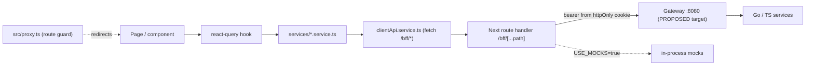
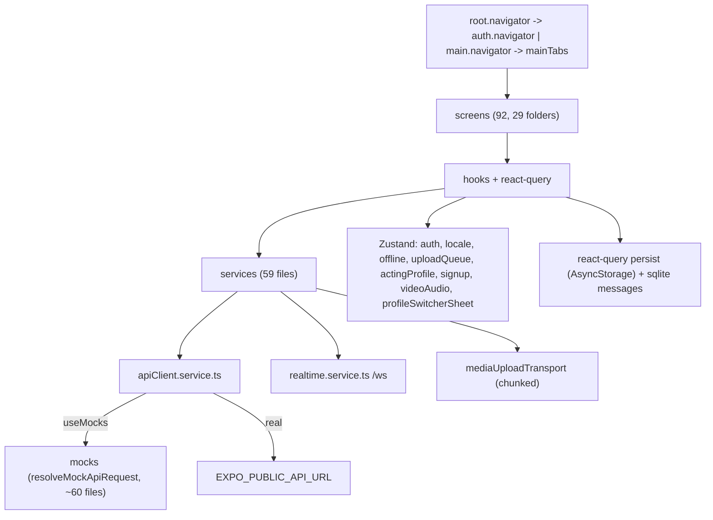

# Frontend architecture

> **Dated design document.** The status labels below describe the repo when this was written; much that is marked PROPOSED or ABSENT has since been built. For the current system see [system.md](system.md); where the two disagree, the code wins.

As of 2026-10-03. Sources: `inventory.md` (section 1), spot checks of `apps/*`. Labels: EXISTING (code), MOCK-ONLY (UI works on in-process mocks), PROPOSED, OPTIONAL FUTURE.

## 1. Apps at a glance

| App | Stack | Rendering | Backend today | Status |
| --- | --- | --- | --- | --- |
| `apps/webapp` (buyer web) | Next 16.3, React 19.3, TanStack Query 5, Zustand 5 | 21/21 pages `"use client"`; 7 BFF route handlers | mocks (`WEBAPP_USE_MOCKS=true`) | EXISTING UI, MOCK-ONLY data |
| `apps/mobile` | Expo ~57, RN 0.86, React Navigation 7, TanStack Query 5 + persistence, Zustand 5 (8 stores) | native | mocks (`EXPO_PUBLIC_USE_MOCKS`, default true); real path only for auth | EXISTING UI, MOCK-ONLY data |
| `apps/seller` | Next 16.3, hooks only (no react-query, no zustand) | Server Component page shells (0/88 `"use client"`), 203 client files | mocks | EXISTING UI, MOCK-ONLY |
| `apps/studio` | Next 16.3, TanStack Query, Zustand | mostly CSR | mocks | EXISTING UI, MOCK-ONLY |
| `apps/ads` | Next 16.3 | Server shells | mocks (`mockHandlerRegistry.mock.ts`) | EXISTING UI, MOCK-ONLY |
| `apps/admin` | Next 16.3 | Server shells; MFA, passkey, step-up BFF routes | mocks | EXISTING UI, MOCK-ONLY |
| `apps/web` | Next 16.3 | Server components, 6 pages, no BFF | none | EXISTING |

Shared packages: `@nantty/design-tokens` and `@nantty/web-kit` (webapp, studio, ads, admin) are used. `@nantty/contracts` and `@nantty/shared-types` have **no consumers** (inventory 1.4).

## 2. Web request flow (webapp pattern, repeated in studio/seller/ads/admin)

| Layer | What it does | Evidence | Status |
| --- | --- | --- | --- |
| `proxy.ts` | Next 16 middleware. No session cookie: redirect `/welcome?next=`. Missing cached viewer or access cookie: redirect `/bff/auth/access-refresh`. Public paths: welcome, login, signup, forgot/reset password. Matcher excludes `bff`, `_next/static` | `apps/webapp/src/proxy.ts` | EXISTING |
| BFF catch-all | Origin + `sec-fetch-site` + HMAC `x-csrf-token` check on mutations; reads cookies; lazily renews session; forwards allow-listed headers (<=256 chars) and body (size-capped, 413); on 401 exchanges refresh token once and retries; on failure clears every session cookie | `apps/webapp/src/server/gateway.service.ts` | EXISTING |
| Cookies | `__Host-` prefix in prod: `zd_at` (15 min), `zd_rt` (30 d), `zd_sid`, `zd_viewer`; httpOnly, sameSite lax. Tokens never reach JS | `apps/webapp/src/config/sessionCookies.config.ts` | EXISTING |
| Mock switch | `*_USE_MOCKS` env flag, one flag per app, **all-or-nothing** | `apps/*/.env.example` | EXISTING |
| Gateway target | env examples point to `http://localhost:3000` (legacy monolith), gateway is `:8080` and proxies only `/api/v1/auth/*` | inventory 1.1, gaps 7, 10 | EXISTING (drift) |

### 2.1 Feature modules (webapp pages vs backend)

| Module | Web (EXISTING pages) | Services (`apps/webapp/src/services`) | Backend |
| --- | --- | --- | --- |
| auth | welcome, login, signup, forgot/reset | `auth`, `socialSignIn` | go-identity auth EXISTING; password reset, social login routes ABSENT |
| feed, posts | `/`, `analytics/post/[postId]` | `feeds`, `posts` | PROPOSED (`ts.social`, `ts.feed`) |
| marketplace, products, categories | `/`, `category/[id]`, `collections/[c]`, `product/[id]`, `explore` | `products`, `categories`, `stores` | PROPOSED (`go-commerce`) |
| cart, checkout, orders | `cart`, `checkout`, `orders`, `orders/[id]` | `carts`, `orders`, `payments` | PROPOSED |
| messaging | `chats`, `chats/[conversationId]` | `messages` | PROPOSED (Phoenix + persistence) |
| notifications | `notifications` | `notifications` | PROPOSED |
| profile, settings, privacy | `me`, `user/[userId]`; consent section | `users`, `privacy` | PROPOSED (consent model ABSENT) |
| search | `explore` | `search` | PROPOSED, see `search.md` |
| creator | `creator` | `creatorProgram` | PROPOSED |
| wallet, live, gifts, ads, business | **no web page**; wallet/live/gifts live in mobile and studio; business in seller; ads in `apps/ads` | n/a | PROPOSED |

## 3. Cross-cutting behaviour

| Concern | Web (webapp) | Mobile | Notes |
| --- | --- | --- | --- |
| SSR vs CSR | CSR everywhere (21/21 `"use client"`); only the BFF and `proxy.ts` run on the server | native | Seller/ads/admin use Server Component shells with client islands |
| Query defaults | `staleTime 30s`, `gcTime 5 min` (`appProviders.tsx`); shell queries (cart, conversations) 20 s | default 30 s, `gcTime` 24 h, `retry 1`, `networkMode offlineFirst`; per-prefix `staleTime` table (feed 1 m, products 5 m, categories 1 h, messages 0) (`cache/queryClient.config.ts`) | EXISTING |
| Persistence | none | AsyncStorage persister, `maxAge` 24 h, `buster` = app version, **allow-list** of persistable prefixes (`isQuerySafeToPersistOnDevice`); messages in expo-sqlite (`cache/messageHistory.database.ts`) | EXISTING |
| Prefetching | none found | none found | Gap, see recommendations |
| Cursor pagination | `useInfiniteQuery` + IntersectionObserver on `/` and `productCollectionBrowser` | `useInfiniteQuery` in 7 files, FlatList/FlashList in 27 | Envelope `{data,nextCursor}`; **mobile unwraps `payload.data ?? payload` and drops `nextCursor`** (`apiClient.service.ts:65`) |
| Optimistic updates | `onMutate` in `feed/postCard.tsx` (like), `settings/consentChoicesSection.tsx` | `onMutate` for follow (product, brand, store), `hooks/useProductLike.hook.ts`; offline mutation queue (`cache/offlineMutationExecutor.util.ts`) | EXISTING |
| Idempotency | n/a | `Idempotency-Key` header sent from `apiClient.service.ts` | server side wired on the money and creation routes that require it (`services/go/platform/idempotency`); coverage varies by route |
| Error / loading / empty | `@nantty/web-kit` `Skeleton`, `EmptyState`, `ErrorState`; Next `error.tsx`/`loading.tsx`: webapp 2/1, studio 2/1, ads 2/2, admin 2/1, seller 1/0, web 1/0 | `components/ui/{errorState,skeleton,listSkeleton}` | seller has no `loading.tsx` |
| Realtime | none in webapp | `/ws` client, heartbeat 25 s, 60 s missed-heartbeat close, backoff 1-30 s with jitter, mock emitter when mocks on (`apps/mobile/src/services/core/realtime.service.ts`) | see `realtime.md` |
| Media upload | via BFF `/bff/*` | chunked upload queue (`PUT /media/uploads/:id/chunks/:i`, `X-Chunk-Sha256`), `uploadQueue` store | see `media.md` |
| Reduced motion | n/a | `hooks/useReducedMotionPreference.hook.ts` | EXISTING |
| Tokens | httpOnly cookies | `utils/secureStorage.util.ts` | EXISTING |

## 4. Mobile architecture

Notes: 401 triggers a single in-flight refresh (`refreshing` promise) then retry; failed refresh signs the user out. Request timeout 15 s. Each service file branches on `apiConfig.useMocks` or relies on `apiClient`'s global branch.

## 5. Mock to real switch

Status (3 Oct): per-domain `*_REAL_API_PREFIXES` switches now exist in every app, see [frontendWiring.md](../integrations/frontendWiring.md). The text below is the original problem statement.

| Item | Detail |
| --- | --- |
| Current | All-or-nothing flag; mobile also has ad hoc `apiConfig.useMocks` checks in `payments.service.ts`, `media.service.ts`, `realtime.service.ts`, live gift adapters |
| Why it matters | Backend arrives one domain at a time (auth first). With one flag, enabling auth on real forces every other call real and broken |
| Recommendation | Add `REAL_API_PREFIXES` (comma list, e.g. `/api/v1/auth,/api/v1/users`) to each app. In the BFF and `apiClient.service.ts`, route a request to the real gateway if its path starts with a listed prefix, else to the mock. Retire the flag per domain when its contract test passes |
| Complexity / Risk | Low / Low (mock handlers stay in place) |
| Priority | **P1**: needed the moment the second backend domain ships; today only auth is real |

Recommended switch order (follows `backendPlan.md` phases, PROPOSED): auth, users/profile, catalog and cart and orders, money (wallet, payments), social (feed/posts/media), live + gifts, search, ads/admin.

## 6. Seller dashboard (`apps/seller`)

Contract: `apps/seller/apiContract.md` (EXISTING, ~1100 lines). Pages: 88. All data MOCK-ONLY.

| Module (nav) | Endpoint groups in `apiContract.md` | Future owner (PROPOSED) |
| --- | --- | --- |
| Access, plans, billing | `/seller/access`, `/seller/verification`, `/seller/subscription{,/plans,/checkout,/verify,/cancel,/resume}` | go-money (subscriptions), go-commerce |
| Catalog | `/seller/categories`, `/seller/products` (+publish, bulk, duplicate, barcodes, import/export, usage) | go-commerce |
| Inventory | `/seller/inventory/{levels,summary,locations,movements,reorder,adjustments,transfers}`, `/seller/suppliers` | go-commerce |
| Media | `/media/uploads` (init, chunks, complete), `/media/:id` | ts.media |
| Orders, returns, disputes | `/seller/orders/*` (accept, reject, status, fulfilment, cancel, notes, refunds), `/seller/returns/*`, `/seller/disputes/*` | go-commerce, go-money |
| Delivery, shipping | `/seller/delivery/*`, shipping configuration | go-commerce (sellers ship themselves) |
| Messages, customers | `/seller/orders/:id/conversation`, customers CRM | Phoenix/ts, go-commerce |
| Promotions, marketing, ads | promotions, marketing, ads summary (read-only) | go-commerce, go-ads |
| Reviews | reviews and reputation | go-commerce |
| Wallet, reports, dashboard, analytics | dashboard, reports, wallet/payouts, `/seller/analytics/*` | go-money, ClickHouse (see `analytics.md`) |
| Settings, staff, audit | locations, staff, audit log, security, API keys/webhooks, integrations | go-identity, go-commerce |
| Affiliates, brands | affiliates and creators, brand protection | go-commerce |

### 6.1 Plan gating and roles

| Mechanism | Detail | Evidence |
| --- | --- | --- |
| Plans | `free`, `pro`, `business`; 15 features in `minimumPlanByFeature` (e.g. `bulk_tools: pro`, `multiple_stores: business`, `advanced_permissions: business`); limits per plan (`maxActiveProducts`, `maxStaffSeats`, `maxLocations`, `analyticsHistoryDays`) | `apps/seller/src/config/planFeatures.config.ts` |
| Roles | `owner`, `manager`, `inventory`, `sales`, `accountant`; 26 permissions (`products:manage`, `wallet:withdraw`, `billing:manage`, ...). Owner-only: `billing:manage`, `wallet:withdraw`, `developer:manage` | `apps/seller/src/config/rolePermissions.config.ts` |
| Route permission map | method + path regex to permission (`rolePermissions.config.ts`, e.g. `/seller/subscription` is `signed_in`) | same |
| Enforcement | UI and BFF only today. **Server must re-check plan and role on every route** (PROPOSED, go-commerce). Client gating is UX, not security | |
| Drift | `backendPlan.md` mismatch 15 flagged POS-era roles (`cashier`, `pos:*`); the current role list above shows none, so re-verify before closing the item | inventory gaps 2 |

## 7. Studio, Ads, Admin (brief)

| App | Purpose | Notes |
| --- | --- | --- |
| Studio | Creator live control: login, lives, live detail, OBS overlay scenes (`overlay/[sceneId]`, `lives/[liveId]/overlay`). Needs `ingestUrl`, `streamKey`, `hlsUrl`, `state` from live session DTO | no `apiContract.md`; 6 BFF routes; maps to go-live (PROPOSED), LiveKit ingress |
| Ads | Ads Manager: accounts, campaigns, ad sets, ads, audiences, billing, reports, tools (events, experiments, rules) | `apiContract.md`; own envelope `{items,nextCursor,total}`; maps to go-ads (PROPOSED) |
| Admin | Staff console: users, moderation, commerce (orders, disputes, ledger, payouts, refunds), config (flags, plans, rules), audit; MFA, passkeys, step-up | `apiContract.md`; envelope `{items,page,pageSize,total}`; strict CSP via `contentSecurityPolicy.service.ts` |

## 8. Recommendations

| # | Problem | Current | Why it matters | Recommendation | Complexity | Risk | Priority |
| --- | --- | --- | --- | --- | --- | --- | --- |
| F1 | No per-domain mock switch | one `USE_MOCKS` flag per app | blocks incremental backend rollout | `REAL_API_PREFIXES` as in section 5 | Low | Low | P1: second real domain is imminent |
| F2 | Zero frontend tests, no CI for 6 Next apps and mobile | `pnpm test` runs nothing; only `typecheck` scripts | regressions invisible while swapping mocks for real APIs | CI job: typecheck + lint + build per app; Vitest + MSW unit tests for services and BFF guards; Playwright smoke for login/cart/checkout. **MVP** | Medium | Low | P1: contract drift is the main risk of the switch |
| F3 | Contract tests absent | envelope drift (`{data,nextCursor}` vs `{items,...}`), mobile drops `nextCursor` | silent pagination bugs | Generate TS types from `services/contracts` (OpenAPI/proto) and consume `@nantty/contracts` (today unused); add schema tests for each mock against the real contract. **MVP** | Medium | Low | P1 |
| F4 | Mobile drops `nextCursor` | `payload.data ?? payload` | infinite scroll cannot work against real API | return `{data,nextCursor}` from `apiClient`, fix before the feed switch. **MVP** | Low | Low | P1 |
| F5 | Env defaults point at port 3000 | `.env.example` | first real call hits wrong service | point to gateway `:8080`. **MVP** | Low | Low | P2 |
| F6 | webapp is 100% CSR | 21/21 `"use client"` | poor LCP/SEO for public product and profile pages | Server Components + `HydrationBoundary` prefetch for `product/[id]`, `user/[id]`, `category/[id]`; keep the rest CSR. **Near term** | Medium | Medium (cookie/BFF fetch on server) | P2 |
| F7 | No prefetch of next page or detail | none found | perceived latency | prefetch next cursor page on near-end intersection; prefetch detail on card hover/focus. **Near term** | Low | Low | P3 |
| F8 | Bundle and image weight not measured | no analyzer, no budgets found | slow low-end Android on 3G markets | `@next/bundle-analyzer`, route budgets in CI; `next/image` with CloudFront AVIF/WebP variants and `blurhash` (media module already emits blurhash); Expo `expo-image` with `cachePolicy`; code-split heavy live/studio components. **Near term** | Low | Low | P2 |
| F9 | Seller plan/role checks are client-side | config files only | bypass by direct API call | server-side enforcement from the same config exported as a contract. **MVP** | Medium | High if skipped | P0: money and data access depend on it once real |
| F10 | `seller` lacks `loading.tsx`; shared kit unused there | 1 `error.tsx`, 0 `loading.tsx` | blank screens on slow API | add `loading.tsx` per route group using web-kit | Low | Low | P3 |
