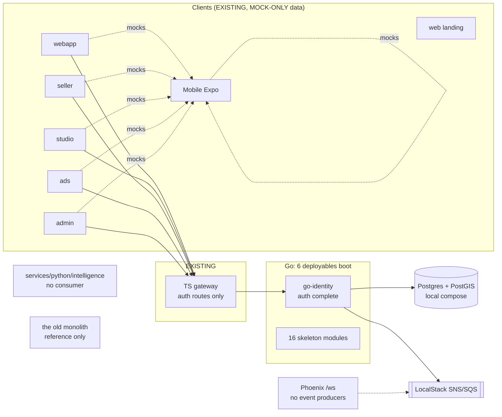

# Architecture improvement report

As of 2026-10-03. This report pulls together the findings from the 19 architecture docs in this folder and the factual audit in [inventory.md](./inventory.md). Labels: **EXISTING** (built), **MOCK-ONLY** (frontend contract with no backend), **PROPOSED** (planned), **FUTURE** (only when a trigger metric is hit).

Backend work was still in progress while this was written: identity, money core, and live/realtime. Items marked *in progress* are being built now and need re-checking when those batches land.

## A. Current architecture

The frontends are rich and run entirely on mocks. The backend has a solid foundation (platform libraries, outbox, JWKS auth, local stack, CI checks) with one finished domain (auth). Everything else is skeletons or in progress. No AWS infrastructure exists. See [inventory.md](./inventory.md).

## B. Recommended architecture

[system.md](./system.md) has the full diagrams. In short:

- CloudFront + WAF → ALB → TS gateway (public) → private ECS/Fargate services.
- Go deployables own all transactional truth: go-identity, go-commerce, go-money, go-live, go-ads, go-trust.
- TS services own social, feed and IO integrations. Phoenix owns realtime fan-out only. Python returns scores only.
- One Aurora PostgreSQL + PostGIS cluster with a schema per owner. Each deployable has a write role; other deployables get read-only grants.
- Outbox → SNS/EventBridge → per-consumer SQS queues with DLQs.
- Valkey for cache and ephemeral state. S3 + CloudFront for media. LiveKit for live video.
- OpenSearch and ClickHouse come later, fed from events.

## C. Change immediately (P0)

| # | Problem | Current | Why it matters | Recommendation | Cx | Risk | Priority reason |
|---|---|---|---|---|---|---|---|
| 1 | Gift money rows in the wrong schema | `gift_transaction`, goals and points tables in go-live's `live` schema | go-live can't commit a gift row in the same transaction as the go-money ledger, so a crash between the two leaves money and records disagreeing | `GiftTransaction` moves to go-money, written inside `ChargeGiftAndCreditCreator`. go-live keeps the catalog, goals and points, updated from `gift.sent` (*in progress*) | S | Low now, high later | Financial truth must have a single owner. It's cheap while no handlers exist |
| 2 | Idempotency only in Redis | Redis middleware, wired to no route | Losing or evicting Redis re-executes a payment, which double-charges | A unique idempotency key in Postgres in the same transaction as the business write; Redis only as a cache. Consumers dedupe on event id (*in progress*) | M | Low | Direct money loss scenario |
| 3 | Services trust gateway headers | Go reads plain `x-zudomart-*` headers | Any path that reaches a service without the gateway (misrouted ALB rule, internal SSRF) can impersonate any user | Each Go/TS service verifies the JWT via `platform/jwtauth`. Headers are only hints (*in progress*) | S | Low | Authentication bypass |
| 4 | No webhook verification | None in `services/**` | Forged Paystack/Flutterwave webhooks could mark orders paid | HMAC verification, timestamp window, event-id replay table (*in progress*) | S | Low | Money and order integrity |
| 5 | No auth rate limits | The gateway limit is in-memory and per instance; none on login/OTP/reset | Credential stuffing and OTP brute force; SMS/email cost abuse | Per-route limits in Valkey: login, OTP send/verify, reset, signup; plus WAF rate rules | S | Low | Account takeover |
| 6 | Realtime topic authorization | `live:*` and `battle:*` accept any authenticated user, `conversation:*` denies everyone, and 21+ event types have no schema or producer | Private rooms leak, chat can't work, and shapes drift from the mobile mocks | Authorize per topic against go-live and messaging membership. Add JSON Schemas for every routed event, sequence numbers and resync on reconnect | M | Medium | Privacy and correctness of live, gifts and battles |
| 7 | Upload security | No size cap, magic-byte check, malware scan or moderation gate, and no private KYC bucket | Malware hosting, illegal content distribution, ID document leaks | Presigned uploads with size and type policy, sniffing worker, ClamAV, moderation before publish, separate KMS-encrypted private bucket for KYC | M | Low | Legal and security exposure |
| 8 | App-store payment rules | No coin-pack channel, no IAP | Selling digital coins via Paystack inside the apps risks store rejection; one price across channels loses money after store fees | `CoinPack.channel` (ios/android/web) with separate pricing; server-side receipt verification; Apple/Google refund notifications claw back coins. No mobile coin sales until this exists (seam *in progress*) | M | Medium | Store compliance and revenue |
| 9 | Order status on the wrong entity | Status on the order | Multi-seller checkout needs a status per seller group for escrow, settlement and partial refunds | Status and escrow on `order_group`; the order becomes the checkout envelope | S | Low | Blocks correct escrow; cheap before commerce is built |
| 10 | Consent not enforced | Consent model was absent; ingestion has no consent check | Personal data used without a basis, which is an NDPA/GDPR risk | `user_consents` + server-side checks before personalization, ads and analytics ingestion (*in progress*) | M | Low | Legal exposure |

## D. Keep unchanged

- **Platform choices:** ent + Atlas, the platform libraries (money, idempotency, JWKS, outbox, redacting logger), argon2id, EdDSA keys with pre-publication rotation, and refresh-token reuse detection.
- **Data:** one Postgres cluster with schema ownership; outbox → SNS/SQS; ECS/Fargate.
- **Structure:** the 6 Go deployables, the Zudojs structure for every stack ([../../services/zudojsStructure.md](../../services/zudojsStructure.md)), and the `{data, nextCursor}` envelope.
- **Frontends:** the BFF pattern with httpOnly cookies and CSRF in the Next apps; the frontend mock contracts as the source for contract tests; the design tokens and web-kit packages.

## E. Postpone (with triggers)

| Item | Trigger to introduce |
|---|---|
| Kafka/MSK | More than about 5k events/s sustained, a need for long replay (days) across many consumers, or stream processing that SQS fan-out can't serve |
| EKS / service mesh | Over 30 services, or a need for custom scheduling or sidecars that ECS can't provide |
| OpenSearch | Postgres full-text p95 above 300 ms, or relevance features (typo tolerance, facets at scale) needed |
| ClickHouse | Analytics queries hurting the read replica, or seller/creator dashboards needing sub-second aggregates over months |
| Read replicas | Primary CPU above 60% from reads, or reporting load |
| Sharding / multi-region active-active | Primary write saturation after vertical scaling and partitioning, or a regulatory residency need |
| Advanced ML ranking | Enough interaction volume; deterministic ranking first |

## F. Biggest technical risks

1. Contract drift between the mobile/web mocks and the new services. Everything frontend was built mock-first, and [backendPlan.md](../backendPlan.md) lists 19+ mismatches.
2. Mobile drops `nextCursor`, so paging breaks as soon as real data arrives.
3. An all-or-nothing `USE_MOCKS` flag per app makes incremental wiring impossible. It needs a per-domain prefix switch.
4. Phoenix events have no schemas, so the realtime protocol isn't versioned.

## G. Biggest performance risks

| Risk | Fix | Stage |
|---|---|---|
| Gift and like fan-out in large rooms | Aggregate likes server-side (count per 500 ms), sample comments, and batch gift banners; Phoenix PubSub sharding per room | MVP |
| Feed and leaderboard queries on the primary | Valkey caches: leaderboard sorted sets (TTL 5 s, rebuilt from points), feed candidate lists (TTL 60 s) | Near term |
| Missing indexes on hot paths | Composite indexes per ERD in [database.md](./database.md) (`(user_id, created_at)`, `(live_id, score)`, `(seller_id, status)`); slow-query log + pg_stat_statements | MVP |
| Heavy seller analytics | Pre-aggregated daily tables now, ClickHouse later | Near term |
| Large web bundles and images | Route-level code splitting, next/image with AVIF/WebP, CloudFront caching | MVP |
| Synchronous media processing | Always async via SQS workers | MVP |

## H. Biggest security risks

The gateway-header trust, missing rate limits, unverified webhooks, upload pipeline gaps and topic authorization in Phoenix (C3–C7). Also: log redaction exists only in Go (`platform/logging`), so it must be extended to TS, Elixir and Python; migrations run at service start instead of as a gated pre-deploy task; secrets management on AWS isn't set up yet. See [security.md](./security.md).

## I. Biggest operational risks

- The outbox relay has no attempt counter or dead-letter state, so one bad row stalls every event from that deployable (P1).
- SNS standard topics can't feed FIFO queues, so gift ordering must rely on `aggregateVersion` and per-topic sequence numbers (P1).
- CI covers only Go, the gateway and realtime. There are no frontend tests, and the six Next apps aren't in CI.
- No AWS infrastructure code exists (`infra/aws` is a README), so there's no staging environment.
- Trace, request and correlation ids aren't yet in the event envelope or SQS attributes.

See [devops.md](./devops.md), [observability.md](./observability.md) and [disaster-recovery.md](./disaster-recovery.md).

## J. Migration plan

1. **Stabilise the foundation:** C1–C5, outbox DLQ, trace ids in the envelope, per-route rate limits, JWT verification in services.
2. **Wire auth + users end to end:** per-domain mock switch in every app, mobile `nextCursor` fix, contract tests generated from the mocks.
3. **Money core:** ledger, wallet, coins (web channel first), payments with webhooks, escrow; IAP seam.
4. **Live:** sessions, LiveKit tokens, gifts via go-money, guests and battles, Phoenix fan-out with schemas and authorization.
5. **Commerce:** catalog, inventory, seller-grouped cart, shipping rules, order groups, checkout; the seller dashboard switches to real.
6. **Social, feed and media:** posts, follows (private profiles), media pipeline with moderation, notifications.
7. **Ads, ZudoPoints rankings, intelligence:** deterministic ranking first, Python scores behind fail-safe defaults.
8. **AWS staging → production:** Terraform, ECS, Aurora, staging smoke tests, then manual production approval.

## K. Estimated phases

| Phase | Scope | Rough size |
|---|---|---|
| 0 | Foundation P0s, CI for all apps, mock switch | 1–2 weeks |
| 1 | Auth/users live in all apps | 1–2 weeks |
| 2 | Money core + IAP seam | 3–4 weeks |
| 3 | Live, gifts, battles | 2–3 weeks |
| 4 | Commerce + shipping + seller dashboard | 3–4 weeks |
| 5 | Social, feed, media, notifications | 3–4 weeks |
| 6 | Ads, points, intelligence | 3–4 weeks |
| 7 | AWS staging/production hardening | 2 weeks, overlapping |

These are agent-assisted estimates for a small team. Financial phases need a human review before go-live.

## L. Final technology stack

| Layer | Choice |
|---|---|
| Clients | Expo SDK 57 React Native; Next.js 16 (webapp, seller, studio, ads, admin, web) |
| Edge | CloudFront, WAF, ALB, TS (Zudojs) gateway |
| Core services | Go 1.26 with ent + Atlas (6 deployables) |
| Social/IO | TypeScript (Zudojs), Prisma for TS persistence |
| Realtime | Elixir/Phoenix (raw JSON `/ws`) |
| Intelligence | Python (FastAPI-style, snake_case-kind files) |
| Data | Aurora PostgreSQL + PostGIS, Valkey (ElastiCache) |
| Async | Transactional outbox → SNS/EventBridge → SQS (+ DLQ) |
| Media | S3, CloudFront, LiveKit (WebRTC/RTMP/HLS egress) |
| Later | OpenSearch, ClickHouse, MSK only when triggered |
| Ops | ECS/Fargate, ECR, Terraform, Secrets Manager, KMS, CloudWatch + OpenTelemetry |
| Payments | Paystack, Flutterwave, Apple IAP, Google Play Billing |

## M–P. Matrices, catalog and infrastructure map

These live in the domain docs so there's one copy of each:

- **M. Service ownership matrix:** [backend.md §3](./backend.md)
- **N. Database ownership matrix:** [database.md §11](./database.md)
- **O. Event catalog:** [events.md §3](./events.md)
- **P. Infrastructure map:** [devops.md](./devops.md) (AWS mapping + "not yet" list) and [system.md](./system.md)

## Caveats

- **Diagrams:** the 53 Mermaid diagrams across these docs were checked by hand only. mermaid-cli needs a headless browser that isn't available here, so render them in a Markdown viewer before relying on them.
- **Legal:** privacy, cookie and terms content and retention periods need review by qualified counsel. App-store payment rules change often, so re-check Apple guideline 3.1 and Google Payments policy before launch.
