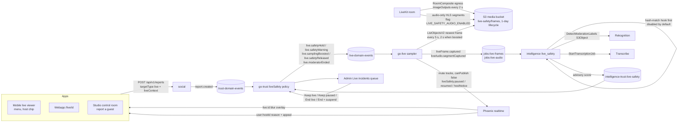

# Live-stream safety

Owner decisions (2026-10-04): users can report lives; AWS Rekognition checks sampled live frames, paired with AWS Transcribe for audio; when automated checks are very confident of a severe violation the stream is blurred and paused for viewers and moderators are alerted. A person always confirms the outcome. Automation never ends a live permanently and never bans or suspends anyone.

## 1. Flow

| Step | Owner | Detail |
| --- | --- | --- |
| Report | apps, social, go-trust | Reasons: child safety, self-harm, violence or dangerous acts (all urgent), nudity or sexual content, hate, harassment, scam, IP/copyright, other. Optional details. The app attaches `liveContext` (`offsetSeconds` into the live, `capturedAt`, a logical `frameRef`); go-trust swaps the logical reference for the nearest sampled frame within 60 s. Guests go through `requireAuthThen`; apps enforce a 60 s per-live cooldown and the existing hourly report limits apply server side (social 429, go-trust `MODERATION_REPORTS_PER_HOUR`). Self-harm shows support resources before and after sending |
| Sampling | go-live `RunLiveSafetySamplerUntilContextDone` | One RoomComposite egress per active live with image outputs only (JPEG, 640 px wide, capture every `LIVE_SAFETY_BOOSTED_FRAME_INTERVAL`). The sweep lists new objects after a per-live cursor and enqueues only the newest frame every `LIVE_SAFETY_FRAME_INTERVAL` (5 s), or every 2 s while `sampling_boost_until` is in the future. Stale frames (over 30 s old) are skipped. Replicas coordinate with conditional updates on `live_safety_states`, so each live is sampled once per tick. Capture stops when the live ends |
| Audio | go-live + intelligence | Behind `LIVE_SAFETY_AUDIO_ENABLED` / `INTELLIGENCE_LIVE_SAFETY_TRANSCRIBE_ENABLED` (both off). Audio-only HLS segments (30 s) go to S3; Transcribe batch jobs run per segment and the transcript is scored by the text moderation heuristics plus a self-harm phrase check |
| Scoring | intelligence `live_safety` | `RekognitionImageModerationModel` implements the image moderation interface and is registered only when AWS credentials resolve (`INTELLIGENCE_LIVE_SAFETY_REKOGNITION=auto`); NoSignal stays the default in dev and tests. Labels are reduced to the most specific ones, then mapped to categories. Scores are published with `advisoryOnly: true` |
| Decision | go-trust `liveSafety` | Policy below. Incidents and signals live in `moderation.live_safety_incidents` / `live_safety_signals` |
| Enforcement | go-live | Hold: persist state, mute every publisher and revoke `canPublish` (re-issued tokens stay publish-less while held), emit `liveSafety.paused` to viewers and `liveSafety.hostNotice` to the host. Release lifts both. `live.moderatorEnded` ends the live through the normal path, which emits `live.ended` |
| Review | admin | `/moderation/live-incidents`: urgent and paused first, latest and flagged frames with labels and confidence, transcript snippets, viewer reports, the host appeal. Actions are audited; End + suspend needs step-up |

Why egress image outputs rather than a server-side subscriber: it reuses the LiveKit egress already deployed for recordings, needs no media code in Go, survives go-live restarts and writes straight to S3 where Rekognition can read the frame without a download. Participant egress for the host track is cheaper than RoomComposite (no headless browser) and is the first optimisation if egress CPU becomes a cost driver.

## 2. Thresholds (go-trust decides, Python is advisory)

Severe categories: `child_safety`, `sexual_explicit`, `graphic_violence`, `self_harm`, `weapon_threat`, `gore`. Everything else (`sexual_suggestive`, `weapons` without violence, `hate_symbols`, `drugs`, `rude_gestures`, `gambling`, transcript categories) is non-severe.

| Signal | Action | Priority |
| --- | --- | --- |
| Hash match (CSAM provider) | Hold immediately, preserve evidence, open legal report | urgent |
| Severe, confidence ≥ 0.90 (≥ 0.80 when the host has ≥ 2 active strikes) | `live.safetyHold`: blur and pause for viewers | urgent |
| Severe, 0.70 – hold threshold | `live.safetyWarning`: on-screen warning for the host (2 min cooldown) + urgent queue | urgent |
| Non-severe ≥ hold threshold | Warn the host | high |
| Severe ≥ 0.50 or non-severe ≥ 0.70 | Queue for review, boost sampling | normal |
| Any viewer report | Open or update the incident, boost sampling for 10 min | reason-based: child safety, self-harm, violence urgent |
| Report surge: 5 reports in 3 minutes | Escalate to urgent, boost sampling | urgent |
| Repeat offences | Moderator decisions (Keep paused, End live, End + suspend) record a strike through the existing strike store; active strikes lower the hold threshold | |

Every threshold is configurable (`LIVE_SAFETY_*` in `services/go/.env.example`). Rekognition labels below `INTELLIGENCE_LIVE_SAFETY_REKOGNITION_MIN_CONFIDENCE` (50) are not returned. Content-score jobs that target a live never change live visibility; only the live safety policy and humans act on lives.

## 3. Cost per stream-hour (us-east-1 list prices, October 2026, estimate)

| Item | Volume per stream-hour | Cost |
| --- | --- | --- |
| Rekognition DetectModerationLabels | 720 frames at 5 s (1,800 while boosted) at $0.001 | $0.72 ($1.80 boosted); falls to $0.0006 – $0.00025 per image at volume tiers |
| LiveKit RoomComposite image egress | about 0.5 – 1 vCPU on the egress fleet | about $0.03 – $0.05 |
| S3 PUT (capture every 2 s), LIST and GET | 1,800 PUT, 720 LIST, 720 GET; 1-day lifecycle | about $0.013 |
| RabbitMQ jobs | 720 small messages | negligible |
| Transcribe batch (flag off by default) | 60 minutes at $0.024 | $1.44 |
| **Total** | frames only / frames + audio | **about $0.77 / $2.21** |

Levers: sample every 10 s when a live has fewer than N viewers, skip frames whose perceptual hash equals the previous frame, switch to participant egress, and keep audio on only for boosted or reported lives.

## 4. Child sexual abuse material (LEGAL REVIEW)

> **LEGAL REVIEW.** Everything in this section must be approved by counsel before it is enabled in any country. Reporting duties, retention periods and who may access evidence differ by jurisdiction (for example NCMEC CyberTipline reporting under 18 U.S.C. 2258A in the US, national hotlines and law-enforcement channels elsewhere, including Nigeria's Cybercrimes Act).

| Piece | Status |
| --- | --- |
| Hash-matching hook | `CsamHashMatchProvider` interface in `apps/intelligence/src/modules/live_safety/services/csam_hash_match_interface_service.py`. `INTELLIGENCE_LIVE_SAFETY_CSAM_HASH_MATCHING_ENABLED=false` by default; enabling it without a vetted PhotoDNA-style provider refuses to start. Matching runs before any other processor and a matched frame is never sent to Rekognition |
| Score | The score carries `hashMatch: true`, the provider name and match reference, no labels |
| Evidence preservation | go-trust copies the frame into the private KYC bucket under `trust-evidence/live/` with SSE-KMS, object-lock legal hold and a `classification=restricted-legal` tag. The go-trust role can write there but cannot read it back; access is for a dedicated legal role (to be created) only |
| Display | The admin queue never shows a hash-matched frame or its labels; it shows a restricted notice and asks the moderator to escalate to legal |
| Legal reporting | A `legal_reports` row (`pending_legal_review`) is written per incident. Submission to a hotline is a manual, counsel-approved workflow; no automated external report is sent |
| Retention | Original frames expire after 1 day by lifecycle. Evidence retention and deletion follow counsel's instruction, not product defaults |

## 5. Privacy and limits

- Frames and audio are processed for safety only, stored for at most one day unless preserved as evidence, and never used for recommendations or training without a separate decision.
- Rekognition does not estimate age, so it cannot detect child sexual abuse on its own; child safety relies on viewer reports, hash matching and human review.
- Classifiers make mistakes. A hold only pauses the live; the host sees why and can appeal once per incident, which moves it to the top of the queue.
- The blur overlay is backed by server-side enforcement (muted tracks and no publish permission), so a modified client cannot keep broadcasting to viewers.

## 6. Configuration and infrastructure

- RabbitMQ: `jobs-live-frames`, `jobs-live-audio` (go-live enqueues, intelligence consumes), `intelligence-trust-live-safety` (intelligence enqueues, go-trust consumes); `live-domain-events` binds the five go-trust decisions; `trust-domain-events` adds `live.ended`; realtime binds `liveSafety.*`. Regenerate with `node infra/local/rabbitmq/generateDefinitions.mjs`.
- Contracts: `services/contracts/events/schemas/{liveFrame.captured, liveAudio.segmentCaptured, liveSafetyScore.generated, live.safetyHold, live.safetyReleased, live.safetyWarning, live.samplingBoosted, live.moderatorEnded, liveSafety.paused, liveSafety.resumed, liveSafety.hostNotice}.v1.json` and `asyncapi.yaml`.
- IAM (least privilege, `infra/aws/modules/platform/deploy.tf`): go-live `s3:ListBucket` limited by `s3:prefix` to the capture prefixes; intelligence `rekognition:DetectModerationLabels`, `transcribe:Start/GetTranscriptionJob` on `transcription-job/live-safety-*`, read on capture prefixes and read/write on `live-safety/transcripts/*`; go-trust read on frames and write-only on `trust-evidence/live/*` with the KYC key. The LiveKit egress uploader needs `s3:PutObject` on `live-safety/frames/*` and `live-safety/audio/*`.
