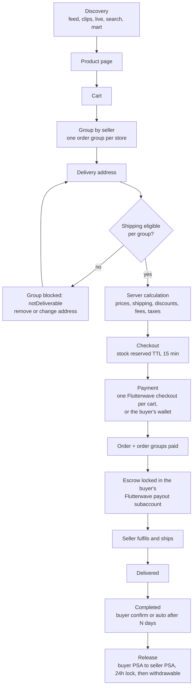
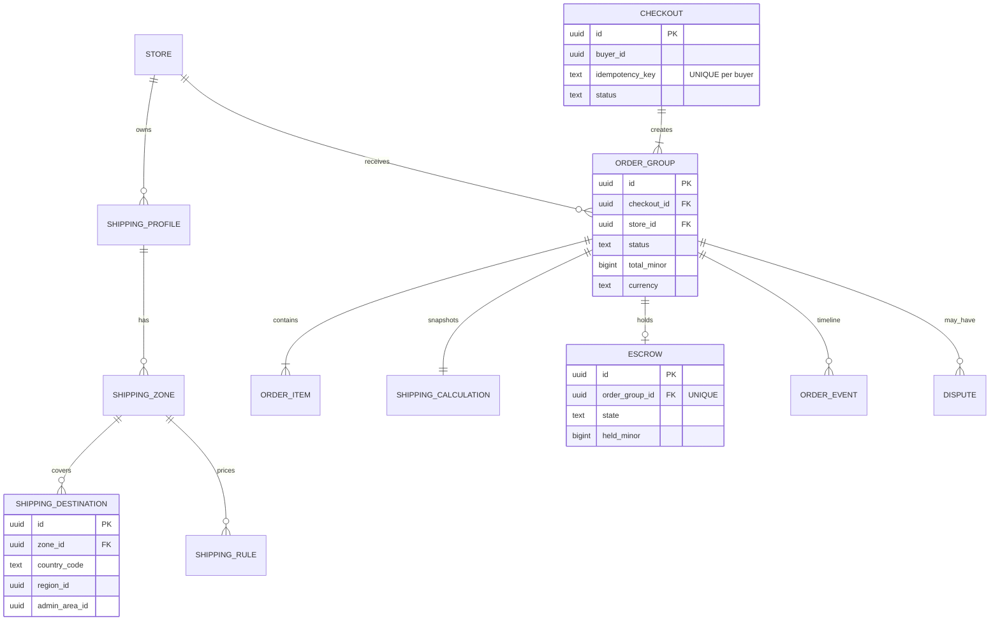
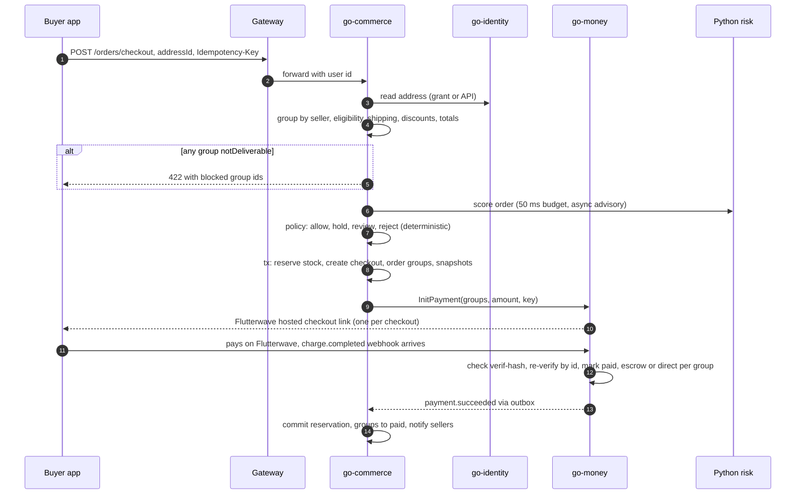
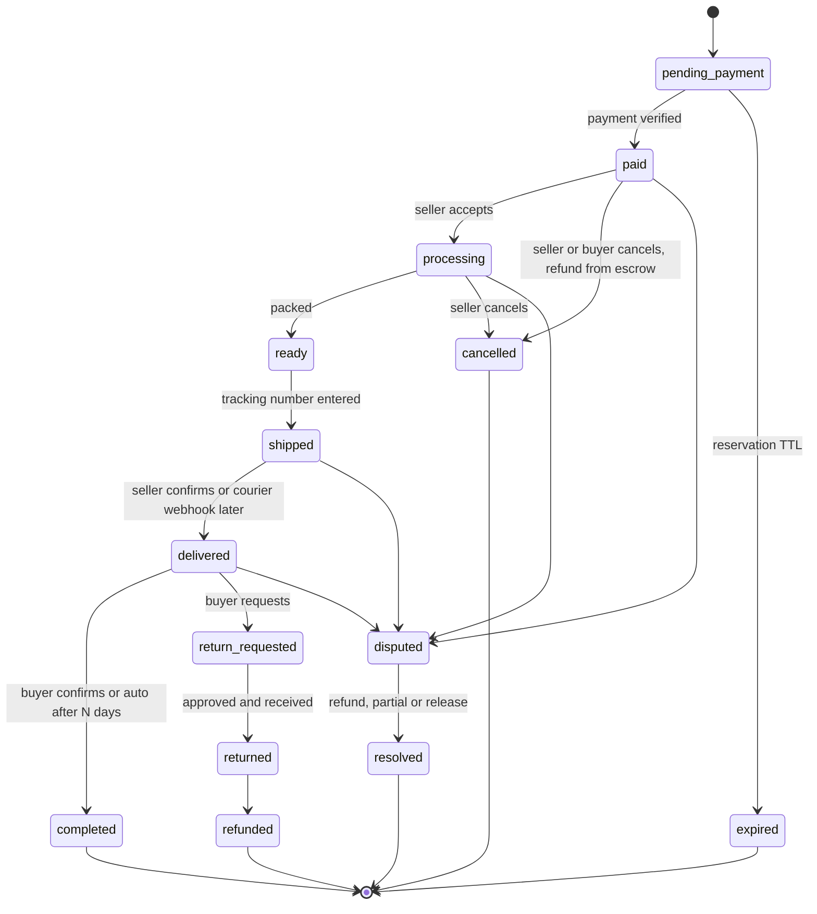
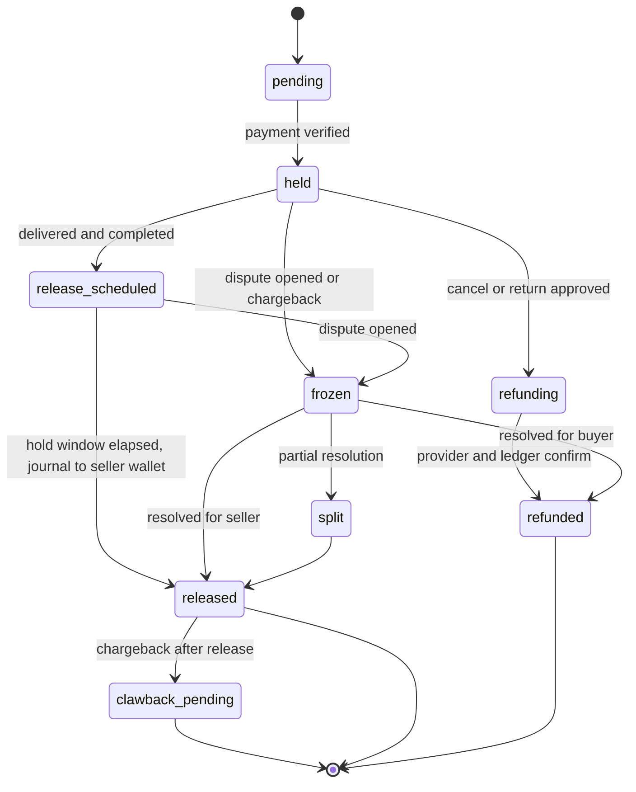

# Marketplace architecture

> **Dated design document.** The status labels below describe the repo when this was written; much that is marked PROPOSED or ABSENT has since been built. For the current system see [system.md](system.md); where the two disagree, the code wins.

Status date: 2026-10-03. Labels: **EXISTING**, **MOCK-ONLY**, **PROPOSED**, **OPTIONAL FUTURE**.

## 1. What exists today

| Item | State | Evidence |
| --- | --- | --- |
| go-commerce (catalog, inventory, orders modules) | EXISTING skeletons, routeless, no ent | `services/go/modules/{catalog,inventory,orders}` |
| Cart, checkout, order, escrow, dispute, shipping data model | PROPOSED in new services. Reference only in the monolith (Prisma `Checkout`, `Order`, `OrderItem`, `Escrow`, `Dispute`, `Address`) | the old monolith's Prisma schema, inventory section 3 |
| Escrow auto-release job | EXISTING in go-money (`RunAutoReleaseSweepUntilContextDone`) | `services/go/modules/escrow/src/app.go` |
| Buyer cart, checkout, orders, escrow, disputes screens | MOCK-ONLY | `apps/mobile/src/screens/{cart,checkout,orders,escrow,disputes}`, `apps/webapp` cart, checkout, orders |
| Seller dashboard: orders, products, inventory, delivery, wallet (escrow, settlements, withdraw), disputes, returns | MOCK-ONLY, 88 pages | `apps/seller` (inventory 1.1) |
| Shipping profiles, zones, rules | PROPOSED (`backendPlan.md` 4.6); seller delivery pages MOCK-ONLY | `apps/seller` delivery |
| Python intelligence ranking and order risk scoring | EXISTING service, not called | `services/python/intelligence/src/modules/{recommendations,risk}` |

## 2. End-to-end flow

All steps from G onward are server-authoritative. Everything in this diagram is PROPOSED in the new stack.

## 3. Seller-controlled shipping model (MVP)

There is **no Nantty logistics network in the MVP**. Sellers ship; the platform validates, calculates, shows and records.

| Rule | Detail |
| --- | --- |
| Charged per seller order group, never per item | One fee per group regardless of item count |
| Seller configuration | `ShippingProfile` > `ShippingZone` > `ShippingDestination` (country, region, LGA) > `ShippingRule` (`feePerOrderGroup`, `isFree`, `freeShippingThreshold`, `active`) |
| Matching | Most specific destination wins: LGA, then state, then country. No match means ineligible |
| Free shipping | Free destination, or group subtotal at or above the threshold; reason stored (`freeDestination` or `threshold`) |
| Ineligible destination | Only that group is blocked ("This seller does not currently ship to your selected location"). The buyer removes it or changes the address; other groups proceed |
| No address | Group shows `needsAddress` and the message to enter an address |
| Server recompute | At order creation the server recomputes prices, seller ids, grouping, totals, eligibility, fees, discounts and consent flags. Client values are ignored |
| Snapshot | Immutable `ShippingCalculation` row per order group (profile, zone, rule, destination snapshot, subtotal, fee, freeReason, calculatedAt) |
| Buyer messages | The messages above come from the server as codes plus text; clients localize by code |
| Addresses and geo | Owned by go-identity; go-commerce reads through read-only grants or API. Mobile address lacks `countryCode`, `postalCode`, normalized region ids (backendPlan mismatch 8) |
| Currency | All amounts `{amountMinor, currency}` in store currency; order stores a locked exchange rate when buyer currency differs |
| Later (OPTIONAL FUTURE) | Carrier integrations (DHL, UPS, local couriers) behind `ShippingMethod`; Nantty logistics only with a stated volume trigger. See [logisticsV2.md](logisticsV2.md) for the planned provider-delivery design (Chowdeck Relay first). |

### 3.1 Data model (PROPOSED)

Key indexes: `order_group(store_id, status, created_at)`, `order_group(buyer_id, created_at)`, `shipping_destination(zone_id, country_code, region_id, admin_area_id)`, unique `escrow(order_group_id)`, unique `checkout(buyer_id, idempotency_key)`. Ownership: orders and shipping in the `commerce` schema; escrow and ledger in the `money` schema (go-money), with read-only grants to commerce.

## 4. Checkout sequence

Failure handling: payment not completed within the reservation TTL releases stock and expires the checkout; a duplicate submit with the same key returns the same orders; webhook replay is processed once.

## 5. Order and order-group state machines

Orders are a container; **status lives on the order group** (one per seller), because escrow, shipping, refunds and settlement are per group.

Parent `Order` status is derived: all groups terminal means closed; any `disputed` group does not block other groups. Every transition writes an `OrderEvent {fromStatus, toStatus, actor{buyer|seller|staff|system|admin}, note, at}` and an outbox event. Transitions are conditional updates (`WHERE status = $from`).

## 6. Escrow state machine

> Flutterwave is the only payment provider (owner, 2026-10-11).

Provider flows, setup and open questions: `docs/integrations/flutterwaveMigration.md` (§3 and Appendix B). A multi-seller cart is one payment; each escrow group is locked in the buyer's payout subaccount (PSA) and released PSA → PSA to its seller.

Escrow is one row per order group, owned and mutated only by go-money.

| Rule | Detail |
| --- | --- |
| Release triggers | Buyer confirm-receipt, or auto-release 3 days after `delivered` (admin-configurable default; a dispute pauses the timer; auto-release job, reference `escrowAutoRelease.job.ts`) |
| Amounts | Commission stays in Nantty's main account (the split remainder); the seller gets the rest (split share for direct, transfer for escrow). Processing fee policy is a finance decision. Shipping fee follows the group to the seller. Computed in minor units, remainder to the platform |
| Where the money is | Escrow stays in the buyer's own Flutterwave payout subaccount, locked by the ledger; release moves it buyer PSA → seller PSA (the escrow fee goes to Nantty's main balance), then the 24h seller lock applies before withdrawal. Outside Nigeria (no PSA yet) sales use direct payment |
| Seller visibility | Wallet shows `escrow`, locked, pending transfer, `available`, payout requested, settling to your bank (direct) and debt per currency |
| Disputes | Opening a dispute freezes the escrow and pauses auto-release; admin resolves with refund, partial or release; every action audited. Refunds before release unlock the money in the buyer's PSA (or go back to the card on request); for a direct share already settled, or a chargeback after payout, the seller gets a debt that is netted from later payouts and turns direct mode off |
| Idempotency | Release, refund and split are journals with unique idempotency keys |

## 7. Where each app fits

| Surface | Role | State |
| --- | --- | --- |
| Mobile (`apps/mobile`) and webapp | Discovery, cart (grouped), address, checkout, order tracking, confirm receipt, disputes. Physical payments always via external provider | MOCK-ONLY |
| Seller dashboard (`apps/seller`, `dashboard.`) | Catalog, inventory, shipping profiles, accept/pack/ship with tracking, returns, disputes, wallet and payouts, promotions. E-commerce management only | MOCK-ONLY, remove POS-era roles |
| Admin (`apps/admin`) | Orders, disputes, refunds, ledger, payouts, escrow oversight | MOCK-ONLY |
| go-commerce | Catalog, stock reservation, cart, shipping calc, orders | PROPOSED |
| go-money | Flutterwave payments, escrow, seller balances, ledger, payouts | PROPOSED |
| Gateway | Public edge only; idempotency and per-route limits not yet implemented | EXISTING proxy (inventory 2.2) |

## 8. Recommendations

| # | Problem | Current | Why it matters | Recommendation | Complexity | Risk | Priority |
| --- | --- | --- | --- | --- | --- | --- | --- |
| 1 | Shipping per item or client-computed totals would break the model | Mocks compute totals client-side | Client price or fee tampering | One pure Go pricing function shared by cart and checkout; client values ignored; contract tests with fixtures | M | High | P0, correctness and fraud |
| 2 | Order status modeled on the order, not the group | Monolith keys status on `Order` per store, mocks vary | Partial cancellation, refunds, escrow need group granularity | Make `order_group` the status owner from the first migration | S | Medium | P0, hard to change later |
| 3 | Address lacks country, postal code, region ids | Mobile address has line1, city, state | Eligibility cannot be computed without normalized geo | Ship the address and geo model (go-identity) before checkout | M | High | P1, blocks shipping eligibility |
| 5 | Stock oversell under concurrency | No reservation code | Overselling causes disputes | Reservation row with TTL and `available = onHand - reserved` under row lock; sweeper | M | Medium | P1, MVP |
| 6 | Seller delivery proof is self-asserted | Seller marks shipped and delivered | Fake delivery to trigger release | Keep auto-release window long enough; require tracking number; add courier webhook later; seller risk tier shortens or lengthens the hold | S | Medium | P1, MVP (fraud.md marketplace abuse) |
| 7 | Search and reporting load on primary | Single Aurora | Seller reports and mart queries compete with checkout | MVP: read-only replica for reports. Near term: OpenSearch for mart search. ClickHouse only when report queries exceed an agreed latency budget on the replica | M | Low | P2, Near term |
