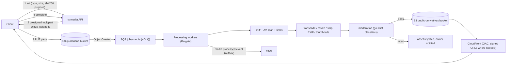

# Media architecture

As of 2026-10-03. Sources: `inventory.md` (media rows, compose `object-storage` SeaweedFS), the old monolith's `media` module (reference implementation), `apps/mobile/src/services/mediaUploadTransport.service.ts`, `docs/backendPlan.md` 2.4, 4.2. Labels: EXISTING, MOCK-ONLY, PROPOSED, OPTIONAL FUTURE.

## 1. What exists

| Item | Status | Evidence |
| --- | --- | --- |
| Chunked upload API in the legacy monolith: `POST /media/uploads`, `PUT /media/uploads/:id/chunks/:i` (raw bytes, `X-Chunk-Sha256`), `POST .../complete`, `GET /media/:id`; assembly, processing queue, maintenance job | EXISTING (reference only, never deployed) | the old monolith's `media` module |
| Purposes: `post, clip, story, avatar, banner, product, chat, kyc, voice`; MIME allow-list (jpeg, png, webp, heic, mp4, quicktime, pdf, audio types); `sizeBytes` validated only as positive integer | EXISTING | `media/models/mediaUpload.model.ts`, `validators/media.validator.ts` |
| Image processing with sharp: AVIF/WebP/JPEG variants, blurhash, auto-orient `.rotate()`, `MAX_INPUT_PIXELS` 100M; video: ffmpeg variants, poster, HLS master key | EXISTING (reference) | `sharpImageProcessor.service.ts`, `videoVariants.service.ts` |
| `kyc` purpose treated private (`isPrivatePurpose`); responses carry `nosniff` and immutable cache headers for public assets | EXISTING (reference) | `mediaProcessing.service.ts`, `mediaFiles.controller.ts` |
| Mobile chunked uploader with resume, `uploadQueue` store, mock mode | EXISTING (client) | `apps/mobile/src/services/media*.ts` |
| S3, CloudFront, presigned or multipart-to-S3, `ts.media` service, malware scan, EXIF-strip verification, moderation hook | **PROPOSED / ABSENT** | `infra/aws/README.md` `media` module |
| Local object storage (SeaweedFS S3 API) and queue `jobs-media` (+DLQ) | EXISTING (local) | compose, LocalStack script |

## 2. Target flow

Rules: the client uploads **only** to quarantine; nothing in quarantine is ever served. Derivatives are written by workers into a different bucket. Business objects (posts, products) reference `mediaId`, never URLs; accept URLs only from our own CDN during the transition (`backendPlan.md` 2.4).

## 3. Asset types

| Asset | Purpose key | Processing | Bucket / delivery | Notes |
| --- | --- | --- | --- | --- |
| Profile picture, banner | `avatar`, `banner` | square crop, AVIF/WebP/JPEG at 3 sizes, EXIF strip, blurhash | public derivatives, CloudFront, immutable content-hashed keys | moderation (nudity, minors) before public |
| Product images | `product` | AVIF/WebP at 4 widths (for example 320, 640, 1080, 1600), blurhash, EXIF strip | public derivatives | up to N per product; first is cover |
| Posts, stories | `post`, `story` | images as above; video to H.264 + HLS ladder, poster | public | up to 10 media per post |
| Clips / videos | `clip` | H.264/AAC MP4 + HLS (for example 240p-720p, 1080p optional), poster + thumbnails, loudness normalize, audio fingerprint via `/v1/audio/fingerprints` | public, signed URLs for private or paid content | duration and size caps per purpose |
| Live recordings | `live_recording` (new) | LiveKit Egress writes HLS/MP4 to S3, post-process to thumbnails; creator chooses to publish as a replay | quarantine skipped (server-produced) but still moderated and scanned | retention policy per plan |
| Gift animation assets | `gift_animation` | transparent video or Lottie/PAG, size cap, checksum, `previewAssetKey` static image | public immutable | admin-only upload; clients prefetch by catalogue version (`backendPlan.md` 4.2) |
| Chat media, voice | `chat`, `voice` | resize/transcode, strip metadata | **private** bucket, short signed URLs | only conversation members can fetch |
| Documents: KYC, dispute evidence | `kyc`, `dispute_evidence` | AV scan, PDF sanitize, image strip, no derivative public copy | **private bucket**, SSE-KMS with separate key, access only via go-trust/staff role with audit log, signed URL 60 s | retention and deletion rules; never in logs or search |

## 4. Upload security

| Control | Detail | Status |
| --- | --- | --- |
| Authentication | account id from verified JWT; upload sessions owned by account; chunk and complete only by owner | EXISTING (reference) |
| Declared vs real type | allow-list MIME at init; **sniff magic bytes** (first bytes, plus decode with sharp/ffprobe) and reject mismatch; ignore extension and client `Content-Type` | MIME allow-list EXISTING; sniffing PROPOSED |
| Size limits | per purpose caps (for example avatar 5 MB, product image 10 MB, clip 500 MB, KYC document 10 MB), enforced at init, in presigned `content-length-range`, and in worker. Today `sizeBytes` has no upper cap in the validator | PROPOSED (gap) |
| Pixel and duration limits | `MAX_INPUT_PIXELS` 100M (EXISTING); add max duration, max frame count, max bitrate | partly EXISTING |
| Integrity | per-chunk `X-Chunk-Sha256`, whole-file `sha256`; S3 checksum headers | EXISTING (chunks), PROPOSED (S3) |
| Malware scan | ClamAV (or a managed scanner) on every file before processing; infected quarantined and deleted | PROPOSED |
| EXIF/metadata | strip GPS and camera data from all public images (re-encode through sharp, which drops metadata unless kept); verify with a test that GPS is gone; strip video metadata via ffmpeg `-map_metadata -1` | re-encode EXISTING; verification test PROPOSED |
| Safe processing | ffmpeg and sharp in a sandboxed, no-network, low-privilege task with CPU/memory/time limits; output capped | partly EXISTING (output cap) |
| Moderation | image/video classifier (nudity, violence), audio fingerprint for copyright, hash-matching for known abuse; results via go-trust; borderline goes to human review | PROPOSED |
| Delivery | CloudFront Origin Access Control, buckets private, `nosniff`, `Content-Disposition` for downloads, immutable content-hashed keys, signed URLs for private | PROPOSED |
| Abuse | per-account upload rate and daily quota; pending uploads expire (maintenance job EXISTING in reference) | partly EXISTING |
| Privacy | private objects never on CDN public path; deletion on account deletion; no URL guessing (random ids) | PROPOSED |

## 5. Frontend implications

| Item | Detail |
| --- | --- |
| Optimistic previews | local URI shown immediately; swap to CDN variant on `media.processed` (realtime or poll) |
| Responsive images | `srcset` from variant list; `blurhash` placeholder; AVIF with WebP fallback |
| Resume | mobile queue resumes with `uploadedChunks` list (EXISTING); with S3 multipart use `ListParts` |
| Fetch only after ready | UI must tolerate `processing` state; posts referencing unprocessed media stay draft or show placeholder |

## 6. Recommendations

| # | Problem | Current | Why it matters | Recommendation | Complexity | Risk | Priority |
| --- | --- | --- | --- | --- | --- | --- | --- |
| M1 | KYC and dispute documents need a private, audited path | `kyc` purpose exists in reference only; no S3 | identity documents are the highest-impact leak | separate private bucket + KMS key, staff-only access with audit, 60 s signed URLs, no derivatives. **MVP** | Medium | High if skipped | P0: KYC data must not ship on the shared path |
| M2 | No upload size cap in validator; no magic-byte sniffing; no AV scan | `sizeBytes` min 1 only | storage cost abuse, polyglot files, malware hosting | per-purpose caps, sniffing, AV in worker before any derivative is public. **MVP** | Medium | High if skipped | P0: user-uploaded content is public-facing from day one |
| M3 | No moderation gate before publication | none | illegal or unsafe content served from our CDN | quarantine to derivatives promotion only after scan + classifier; report/takedown tooling. **MVP** | Medium | High | P1 |
| M4 | Chunk-through-API upload | bytes pass through API | API bandwidth and memory, cost | presigned multipart direct to S3 (API only signs). **MVP** | Medium | Low | P1 |
| M5 | Transcoding in app process | ffmpeg in monolith | does not scale, blocks | SQS-driven Fargate workers (or MediaConvert later). **MVP** workers, MediaConvert **Scale stage** | Medium | Low | P2 |
| M6 | Live recording and gift asset pipelines undefined | schema columns only | live replay and gift catalogue depend on it | add purposes `live_recording`, `gift_animation`; egress webhook creates asset record. **Near term** | Medium | Low | P2 |
| M7 | Media cost | none | video storage and egress dominate cost | lifecycle rules (quarantine 1 day, abandoned uploads 7 days), ladder cap, CloudFront cache hit ratio alarm. **Near term** | Low | Low | P3 |

## 7. Branded downloads (4 Oct 2026, [plans.md §57](../plans.md))

Saved copies of posts and clips carry the Zudomart logo and the owner's `@username`, like X and TikTok.

| Step | Detail |
| --- | --- |
| Client | `POST /api/v1/posts/:postId/media/:mediaId/download` (auth, gateway `mediaDownload` 40/min per account) → `{ status: ready\|processing, progress, url?, expiresAt?, fileName?, contentType?, sizeBytes?, retryAfterMs? }`. Clients poll while `processing`, then save the signed URL (mobile: expo-file-system download with byte progress, then expo-media-library `Asset.create`, share sheet if photo permission is refused; webapp: anchor download, `Content-Disposition: attachment`) |
| ts-social | Checks the viewer can see the post (`loadPostVisibleToViewer`: blocks either way → 404, private account, followers-only, age-gated, expired), then `decidePostDownloadPermission`: owner always allowed; others refused for stories, subscriber-only posts, private accounts, moderation-restricted posts and owners with `download_settings.allowDownloads = false` (default on, `GET/PUT /api/v1/me/download-settings`). `PostView.viewerCanDownload` tells clients to hide the button |
| ts-media | `POST /internal/v1/media/:mediaId/download-variant { requesterId, watermarkHandle, stripAudio? }` (internal token). Only `post`, `clip`, `story` images and videos in `ready` state. Cached in `media_download_variants` per `(assetId, cacheKey)` where `cacheKey = sha256(renderVersion, sourceKey, handle, stripAudio)`, so a username change, a re-render or a copyright mute produces a new copy |
| Images | Rendered inline with sharp: bottom-right badge (logo + `zudomart` + `@username`), 72% opacity, height 6% of the short side (24–120 px), JPEG q88, original size kept |
| Videos | Job `media.renderDownloadVariant` on `jobs-media`: one ffmpeg pass, watermark PNG (rendered by sharp from SVG, 7.5% of the short side, 78% opacity) moving TL → TR → BR → BL every 4 s so a single crop can't remove it, then a 1.8 s end card (brand blue, logo fading and rising in, `@username`). H.264 CRF 23 + AAC 128k, metadata stripped, `+faststart`. Up to 3 attempts; a failed copy retries after 15 minutes. Progress is estimated from render start and clip length |
| Audio | Copyright-muted clips (`muted/` variants) and `stripAudio` requests use a silent track; source audio is never read. Muting discards cached downloads |
| Storage | Always the private bucket under `p/<mediaId>/download/<cacheKey>.<ext>`, KMS-encrypted, 5-minute signed GET with an attachment file name `zudomart-<handle>-<id8>.<ext>`, every issue written to `media_access_logs` (`reason: branded_download`). Deleting the media deletes the copies |
| Runtime | Alpine image installs `fontconfig font-dejavu` so SVG text renders. Without ffmpeg the render fails, and after 3 attempts the request returns 422 `DOWNLOAD_RENDER_FAILED` for 15 minutes |

**Screenshots can't be branded.** iOS and Android give apps no way to change the screenshot image the OS saves. On mobile, `expo-screen-capture`'s screenshot listener (iOS, and Android 14+ through `DETECT_SCREEN_CAPTURE`) runs only while a post detail or the active clip is on screen and shows a non-blocking "Share this post?" card that offers the link or a branded copy. The screenshot itself stays unbranded, older Android versions get no event, and the webapp can't detect screenshots at all.

Not built: pre-rendering at publish (copies are made on the first request), real ffmpeg progress (`-progress` needs a streaming runner), and an animated logo asset beyond the fade and slide.
