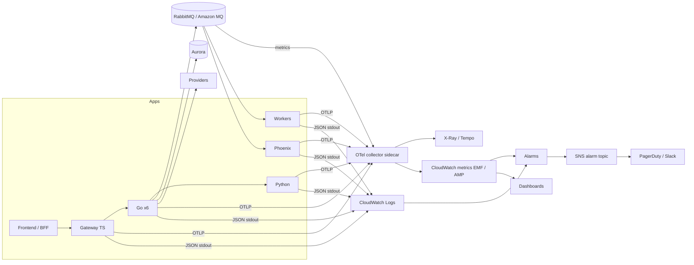

# Observability architecture

> **Dated design document.** The status labels below describe the repo when this was written; much that is marked PROPOSED or ABSENT has since been built. For the current system see [system.md](system.md); where the two disagree, the code wins.

As of 2026-10-03. Labels: **EXISTING** (cite path), **PROPOSED**, **OPTIONAL FUTURE**. Plan source: `docs/backendPlan.md` 5.10.

## 1. What exists today

| Item | Status | Evidence |
| --- | --- | --- |
| Go OTLP/gRPC trace export, opt-in by `OTEL_EXPORTER_OTLP_ENDPOINT`; per-request tracing middleware | EXISTING | `services/go/platform/telemetry` |
| Go request id middleware, panic recovery, request logging (slog) | EXISTING | `services/go/platform/httpserver`, `platform/logging` |
| Gateway forwards `x-request-id`, `x-forwarded-for`, `x-real-ip`; no tracing | EXISTING | `services/typescript/gateway/src` |
| Phoenix `telemetry.ex` metrics definitions only; no exporter | EXISTING | `services/elixir/realtime/lib/realtimeWeb/realtime.telemetry.ex` |
| Local OTel collector + Jaeger UI :16686 | EXISTING | `infra/local/otel/collector.yaml`, `infra/local/docker-compose.yml` |
| Python: no tracing; HMAC headers only | EXISTING | `services/python/intelligence` |
| Metrics backend, log shipping, dashboards, alerts, SLOs | ABSENT | `inventory.md` s6 |
| Health: Go readiness checks, realtime `GET /healthz` | EXISTING | `platform/health`, `router.ex` |
| Outbox publishes without trace context in event envelope | gap | `platform/events/event.envelope.go` |

## 2. Telemetry architecture

All PROPOSED except local OTLP from Go. Collector runs as a sidecar per task (`infra/aws` `observability/` module).

## 3. Correlation propagation

| Hop | Mechanism | Status |
| --- | --- | --- |
| Frontend / BFF | BFF generates `x-request-id` (UUID) if absent; sends W3C `traceparent`; mobile sends its own `x-request-id` per request | PROPOSED |
| Gateway | accepts a client id only if well-formed, else generates; forwards `x-request-id`, `traceparent`, `tracestate`; adds `x-correlation-id` = id of the originating user action (stays constant across async hops); returns `x-request-id` in the response | `x-request-id` EXISTING |
| Go / TS services | extract `traceparent` via OTel middleware (EXISTING for Go); put ids in `context.Context`; every log line includes `request_id`, `trace_id`, `span_id`, `correlation_id`, `account_id` (pseudonymous), `service`, `env`, `version` | tracing EXISTING (Go); log fields PROPOSED |
| Go to Python | HTTP headers plus HMAC (EXISTING signing); Python reads `traceparent` and `x-request-id`, logs them, includes `model_version` in the response | PROPOSED |
| Go to Phoenix | Phoenix does not get synchronous calls; it receives events | n/a |
| Outbox | store `trace_id`, `request_id`, `correlation_id` in the envelope (`event.envelope.go` adds `meta` object) | PROPOSED |
| RabbitMQ | AMQP properties `message_id` = event/job id, `correlation_id`, `type` = event type; headers `traceparent`/`tracestate` (W3C, injected by the Go publisher from the context), `x-nantty-subject`, `x-nantty-schema`, `x-nantty-attempt`, `x-nantty-last-error` on retries | EXISTING (Go publisher injects `traceparent`; TS/Python/Elixir carry ids and attempts) |
| Workers / Phoenix consumer | start a new span with a **link** to the producer span (async, not parent-child), carry correlation id into logs; Go consumer extracts `traceparent` into the handler context | Go EXISTING; others PROPOSED |
| Phoenix to client | server events carry `seq` per topic (plan 5.6) and an optional `correlationId` for acks | PROPOSED |
| DB | `application_name` = service; optional SQL comment with `trace_id` via `sqlcommenter`; slow-query log in Aurora with `log_min_duration_statement` | PROPOSED |
| External providers | provider idempotency key = our idempotency key; log provider request id, not payloads; span attributes for provider name and status | PROPOSED |

## 4. Logs

| Rule | Detail |
| --- | --- |
| Format | JSON on stdout, one event per line, ECS ships to CloudWatch Logs (log group per service, retention per env: dev 7 d, staging 14 d, prod 30 d hot then S3 archive via subscription filter, KMS encrypted) |
| Levels | `info` default; `debug` off in prod; sampling for high-volume `info` (feed requests) |
| Required fields | `ts`, `level`, `msg`, `service`, `env`, `version`, `request_id`, `trace_id`, `correlation_id`, `route`, `status`, `latency_ms` |
| Redaction | central redactor in Go `platform/logging`, TS logger, Python, Elixir `Logger` metadata filter. Deny-list keys: `password`, `token`, `accessToken`, `refreshToken`, `otp`, `code`, `authorization`, `cookie`, `set-cookie`, `card*`, `pan`, `cvv`, `bank*`, `account_number`, `bvn`, `nin`, `idNumber`, `secret`, `signature`. Mask emails (`a***@d.com`) and phones; never log request bodies on auth/payment routes; never log search terms or message content. Tests assert redaction (PROPOSED) |
| Audit | audit events go to the `AuditEvent` table, not only logs |
| Retention vs privacy | Logs are PII-light by design; see `privacy.md` class `security` |

Status: slog JSON with key-based redaction EXISTING in Go (`services/go/platform/logging/structured.logger.go`, `redactSensitiveAttribute`); extending the deny-list, email/phone masking, tests, and TS/Elixir/Python redaction are PROPOSED (the old monolith's log redactor is the reference).

## 5. Metrics

| Group | Metrics | Source |
| --- | --- | --- |
| RED per route | request rate, error rate, duration histogram (p50/p95/p99) | OTel HTTP middleware |
| Saturation | ECS CPU/memory, DB connections, Aurora CPU/replica lag, Valkey memory/evictions, Go goroutines | CloudWatch, runtime metrics |
| Queues (RabbitMQ adopted, owner, 2026-10-03) | per queue: ready + unacked depth (`rabbitmq_queue_messages_ready`, `rabbitmq_queue_messages_unacked`), consumer count (`rabbitmq_queue_consumers`), publish/deliver/ack/redeliver rates, consumer lag = ready depth ÷ ack rate (seconds to drain) and oldest-message age (`head_message_timestamp` via `/api/queues`); DLQ depth (`*.dlq` ready); `unrouted-events` depth; broker: memory/disk alarms, connections, channels, file descriptors, quorum leader/member health; outbox unpublished count and oldest age | RabbitMQ Prometheus plugin `rabbitmq_prometheus` (`:15692/metrics`, `/metrics/per-object` locally; `/metrics/detailed?family=queue_coarse_metrics&family=queue_consumer_count` in prod) scraped locally by the OTel collector; Amazon MQ manages plugins itself and does not expose port 15692 to us, so in AWS the same signals come from Amazon MQ CloudWatch metrics (`MessageCount`, `MessageReadyCount`, `ConsumerCount`, `RabbitMQMemUsed`, `RabbitMQDiskFree`, `RabbitMQFdUsed`) per queue/broker; custom outbox gauge |
| Realtime | sockets per node, join/leave rate, event fan-out latency, dropped frames | Phoenix telemetry (definitions EXISTING) |
| Python | inference latency by endpoint, fallback count, feature store misses, model version | FastAPI middleware |
| Business | ledger imbalance (must be 0), webhook failure rate, payout failures, settlement holds, gift send count, checkout success rate, signup to first session | go-money jobs, event consumers |
| Providers | per-provider success/latency, timeout count, circuit-breaker state | client wrappers |

Cardinality rule: no user id, order id or product id as a metric label. Queue name is an allowed label (bounded by `topology.json`).

### 5.1 RabbitMQ queue alerts (Prometheus plugin rules; mirrored as CloudWatch alarms on Amazon MQ)

| Alert | PromQL (local, `rabbitmq_prometheus` per-object metrics) | Amazon MQ CloudWatch equivalent | Severity |
| --- | --- | --- | --- |
| DLQ not empty (money) | `rabbitmq_queue_messages_ready{queue=~"(commerce-domain-events\|jobs-payouts\|money-domain-events)\.dlq"} > 0` | `MessageReadyCount` per DLQ queue > 0 for 1 period | SEV2 |
| DLQ not empty (other) | `rabbitmq_queue_messages_ready{queue=~".*\.dlq"} > 0` | same, other DLQs | Ticket |
| Queue depth | `sum by (queue) (rabbitmq_queue_messages_ready{queue!~".*\.(dlq\|retry\..*)"}) > 1000` for 10 m | `MessageReadyCount` > 1000, 2 of 2 periods | Ticket, SEV2 for money queues |
| Consumer lag | `rabbitmq_queue_messages_ready / clamp_min(rate(rabbitmq_global_messages_acknowledged_total[5m]), 0.1) > 60` (per queue with per-object metrics) | `MessageReadyCount` ÷ ack rate math expression > 60 s | SEV2 |
| No consumer | `rabbitmq_queue_consumers{queue!~".*\.(dlq\|retry\..*)\|unrouted-events"} == 0` for 5 m | `ConsumerCount` = 0 | SEV2 |
| Retry storm | `sum by (queue) (rabbitmq_queue_messages{queue=~".*\.retry\..*"}) > 1000` | `MessageCount` on retry queues | Ticket |
| Unrouted events | `increase(rabbitmq_queue_messages_published_total{queue="unrouted-events"}[1h]) > 0` | `MessageCount` on `unrouted-events` rising | Ticket |
| Broker resource alarm | `rabbitmq_alarms_memory_used_watermark == 1 or rabbitmq_alarms_free_disk_space_watermark == 1` | `RabbitMQMemUsed` / `RabbitMQMemLimit` > 0.8, `RabbitMQDiskFree` < 2x limit | SEV2 |
| Connections / channels | `rabbitmq_connections > 0.8 * <limit>` | `ConnectionCount`, `ChannelCount` | Ticket |
| Publisher confirm failures | app counter `events_publish_failures_total` (Go relay warning log metric filter) | log metric filter on `outbox relay batch failed` | SEV2 if > 0 for 5 m |

## 6. SLOs

Window 28 days, burn-rate alerts (fast 14.4x over 1 h and 5 min, slow 6x over 6 h and 30 min).

| SLO | SLI | Target | Source of target |
| --- | --- | --- | --- |
| Auth | login/refresh latency measured at gateway | p99 < 300 ms; availability 99.9% | `backendPlan.md` 5.10 |
| Feed | feed response p95 | < 400 ms; availability 99.9%; ranking fallback rate < 2% | plan |
| Gift send | request p99 | < 300 ms; fan-out to live viewers p95 < 500 ms; success 99.9% | plan |
| Checkout | availability of checkout create/confirm | 99.95% | plan |
| Event delivery (internal) | consumer lag (ready depth ÷ ack rate) and oldest message age, consumer queues | p99 < 30 s; DLQ depth 0 | PROPOSED |
| Payout | scheduled payouts completed on time | 99.5% | PROPOSED |

Targets are starting points to be confirmed after load tests.

## 7. Alerts and routing

| Severity | Examples | Route | Response |
| --- | --- | --- | --- |
| Page (SEV1) | ledger imbalance > 0; checkout availability burn fast; DB failover or writer down; payment webhook failure > 5% for 5 min; auth 5xx > 2%; refresh-token reuse spike (security) | PagerDuty primary on-call | ack 5 min |
| Page (SEV2) | gift p99 > 300 ms for 10 min; DLQ depth > 0 on money queues (`commerce-domain-events.dlq`, `jobs-payouts.dlq`, future `money-domain-events.dlq`); consumer count = 0 on any work queue for 5 min; consumer lag > 60 s for 10 min; RabbitMQ memory or disk alarm (publishers blocked); quorum queue without leader / broker down; outbox oldest age > 60 s; payout failures; Aurora CPU > 85% 15 min | PagerDuty, business hours escalation to Slack | ack 15 min |
| Ticket | disk/memory trends, cert expiry < 21 d, dependency CVE, cost anomaly, DLQ depth > 0 on non-money queues, `unrouted-events` growing (event published that no queue binds), retry queue depth > 1,000, connections or channels > 80% of the broker limit | Slack + issue tracker | next business day |
| Security | GuardDuty high, root login, CloudTrail disabled, secret read anomalies | security channel + page for high | per runbook |

Each alert links to a runbook in `docs/runbooks/` (PROPOSED; none exist). Alarm actions on go-money deploy also trigger CodeDeploy rollback (`devops.md`).

## 8. Dashboards (PROPOSED)

| Dashboard | Panels |
| --- | --- |
| Platform overview | RED per service, error budget, deploys marker |
| Auth | logins, failures, lockouts, refresh reuse, OTP sends, p99 |
| Money | ledger balance check, top-ups, gifts/s, payouts, webhook lag, provider latency |
| Live | concurrent lives, viewers, sockets/node, fan-out latency, LiveKit health |
| Events | outbox lag; per queue ready/unacked depth, consumer lag, consumers, publish vs ack rate, redelivery rate; retry tier depths; DLQ depth per queue; unrouted events; broker memory/disk/fd; publisher confirm failures |
| Intelligence | latency, fallbacks, model versions, feature freshness |
| Data tier | Aurora load, slow queries, connections, Valkey hit rate |
| Cost | per-service cost, NAT bytes, log volume |

## 9. Recommendations

### O1. Put trace and request ids into the event envelope and message headers
- **Problem:** async hops lose correlation.
- **Current:** `event.envelope.go` builds `{id,type,source,subject,version,occurredAt,data}`; the Go RabbitMQ publisher injects `traceparent` from the context, but the outbox relay runs on a background context, so relayed events carry no producer trace yet.
- **Why it matters:** a gift or order spanning API, outbox, RabbitMQ, Phoenix, and Python cannot be traced end to end during an incident.
- **Recommendation:** add optional `meta{traceId,requestId,correlationId}` to `envelope.v1.json`; publisher sets message attributes; consumers link spans.
- **Complexity:** S. **Risk:** low (additive schema). **Priority: P1**, the envelope is cheap to change now and breaking later.
- **Tag:** MVP.

### O2. Tracing and request id in gateway, Phoenix, Python
- **Problem:** only Go exports traces.
- **Recommendation:** OTel SDK in gateway (`@opentelemetry/sdk-node`), `opentelemetry_phoenix` + `opentelemetry_bandit` in Phoenix, `opentelemetry-instrumentation-fastapi` in Python; standardize on env `OTEL_*`.
- **Complexity:** M. **Risk:** low. **Priority: P1**, the gateway is the entry point of every trace.
- **Tag:** MVP.

### O3. Redaction library with tests
- **Problem:** only Go has key-based redaction (`platform/logging`); the gateway, Phoenix and Python have none, there are no redaction tests, and emails/phones aren't masked.
- **Recommendation:** shared deny-list in `services/contracts` consumed by each language's logger; unit test that logs a fixture with secrets and asserts masked output.
- **Complexity:** S. **Risk:** low. **Priority: P0**, auth already logs requests and OTP delivery is `log` in dev; must be done before any real traffic.
- **Tag:** MVP.

### O4. Outbox lag metric and dead-letter
- **Problem:** unpublished outbox rows can grow silently.
- **Recommendation:** gauge of unpublished count and oldest age per module; `attempts`, `dead_at` columns.
- **Complexity:** S. **Risk:** low. **Priority: P1**, outbox is the sole event path, and lost events break points, realtime, and money notifications.
- **Tag:** MVP.

### O5. Start with CloudWatch, defer a Prometheus/Grafana stack
- **Problem:** plan lists Prometheus/Grafana or CloudWatch.
- **Recommendation:** CloudWatch metrics (EMF) + X-Ray first; adopt Amazon Managed Prometheus/Grafana only when custom metric cost or cardinality exceeds CloudWatch limits (trigger: > 1,000 custom metric series or CloudWatch metrics bill > $500/month).
- **Complexity:** S. **Risk:** low. **Priority: P2.**
- **Tag:** Near term.
