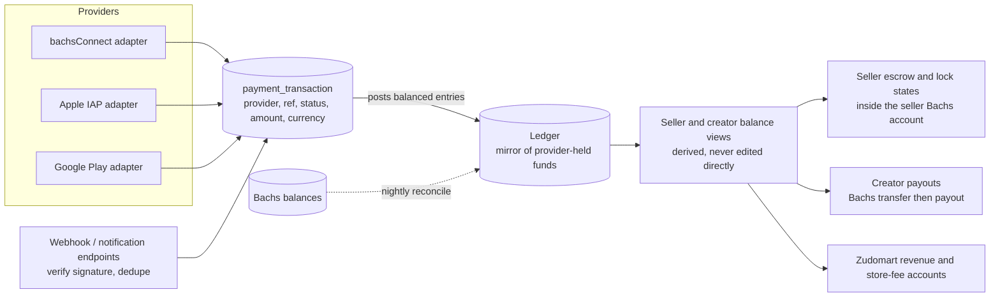
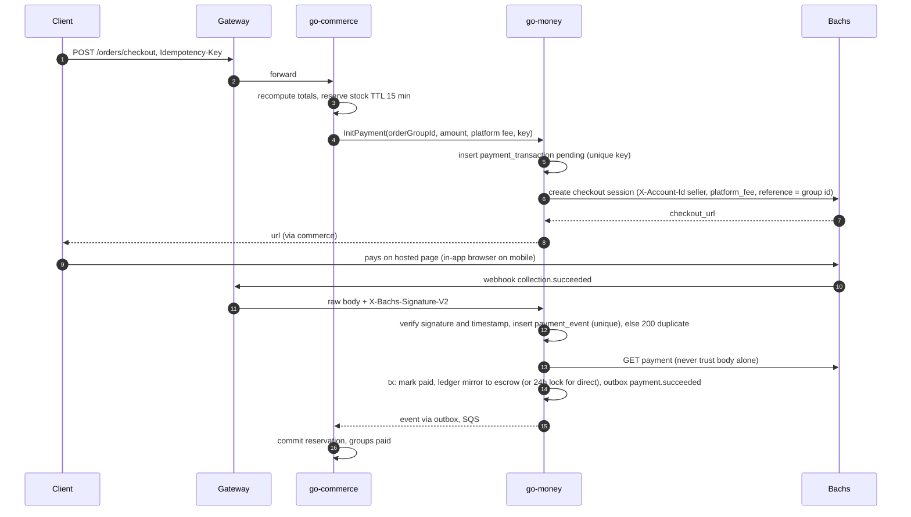
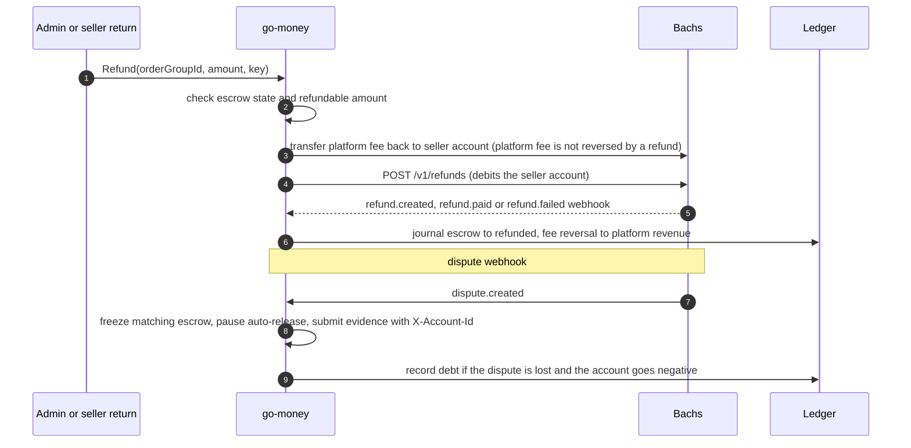
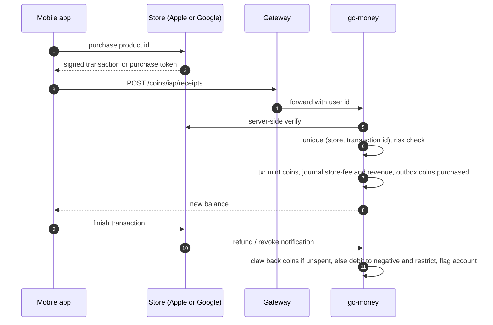
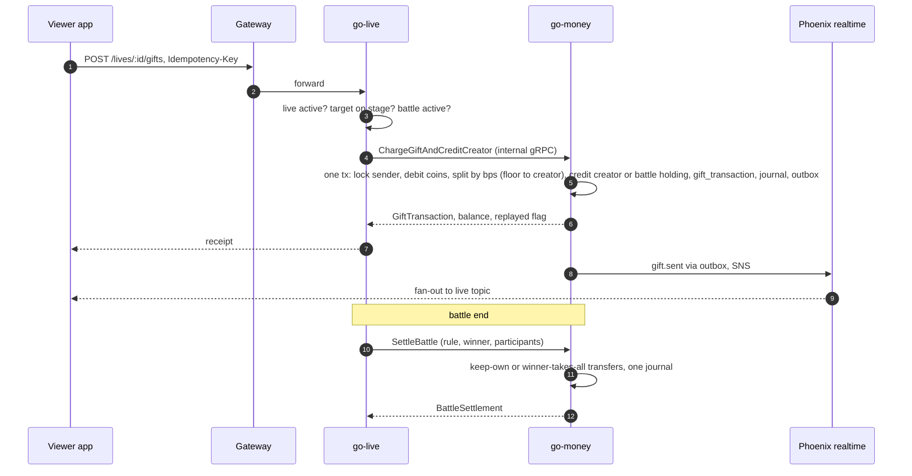
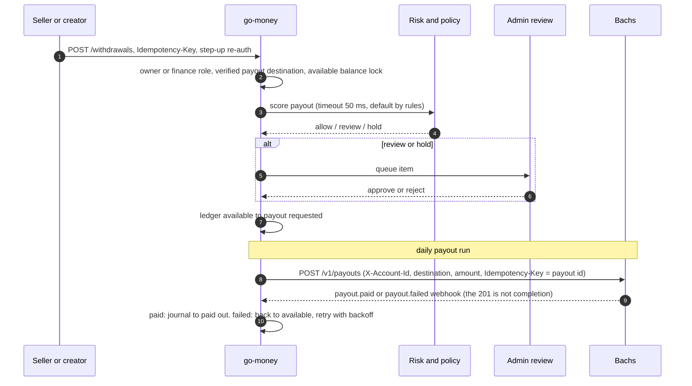

# Payments architecture

Status date: 2026-10-03. Labels: **EXISTING** (in code), **MOCK-ONLY** (frontend mocks), **PROPOSED**, **OPTIONAL FUTURE**.

## 1. What exists today

| Item | State | Evidence |
| --- | --- | --- |
| Go payments / wallet / ledger / escrow / subscriptions / creators modules | EXISTING as 11-line routeless skeletons, no ent, no migrations | `services/go/modules/{payments,wallet,ledger,escrow,subscriptions,creators,rewards}` |
| `go-money` deployable | EXISTING, compiles, routeless | `services/go/cmd/go-money` (inventory 2.4) |
| `LiveMoneyService` gRPC contract (`ChargeGiftAndCreditCreator`, `SettleBattle`, `GetBattleGiftTotals`, `GetCoinBalance`) | EXISTING proto, **no server or client implementation** | `services/contracts/proto/zudomart/money/v1/live_money.proto` |
| `Money` proto and Go money package (int64 minor units + currency) | EXISTING, tested | `services/contracts/proto/zudomart/common/v1/money.proto`, `services/go/platform/money` |
| Idempotency middleware (Redis) | EXISTING, wired to no route | `services/go/platform/idempotency` |
| Webhook signature verification in new services | **ABSENT** | inventory section 7 |
| Legacy Paystack / Flutterwave gateways (to be replaced by Bachs), double-entry ledger, escrow auto-release job, coin IAP receipt endpoint | EXISTING only in the reference monolith, which is never deployed | `apps/api/src/modules/payments/gateways/{paystack,flutterwave}.gateway.ts`, `modules/escrows/jobs/escrowAutoRelease.job.ts`, `modules/wallets/constants/monetizationLedgerAccounts.constant.ts` |
| Risk scoring subjects `order, payout, account_event, coin_purchase, coin_transfer, gift` | EXISTING in Python, not called by any Go/TS caller | `apps/intelligence/src/modules/risk/dtos/risk_scoring_dto.py` |
| Wallet, escrow, coin, payout screens in mobile, seller, admin | MOCK-ONLY | `apps/mobile/src/screens/{wallet,escrow}`, `apps/seller` wallet pages, `apps/admin` commerce pages |
| Everything below | PROPOSED | `docs/backendPlan.md` phases 5 and 6 |

## 2. Two economies

Rule: **the product being sold decides the rail, not the app it is sold from.**

| | Physical economy | Digital economy |
| --- | --- | --- |
| Goods | Marketplace products, shipping fees | ZudoCoins, gifts, premium, creator subscriptions, in-app boosts |
| Unit | Fiat `Money` (int64 minor + currency, store currency) | Coins (plain integer, own unit; **never money, never mixed with fiat**) |
| Rail | Bachs direct charge into the seller's connected account (hosted checkout, all clients) | Mobile apps: Apple IAP / Google Play Billing. Web: Bachs checkout on Zudomart's own account |
| Holding | Escrow per order group, locked **inside the seller's Bachs account** (never Zudomart's) until release | Spendable coins (bought) and earned coins (creator side) |
| Payee | Seller's Bachs account (commission goes to Zudomart's own account as `platform_fee`) | Creator share of gifts, paid by Bachs transfer from Zudomart's account to the creator's connected account |
| Owner | go-money (payments, escrow mirror, wallet mirror, payouts) + go-commerce (orders) | go-money (coins, gifts, subscriptions, creators) |
| Refund | Bachs refund debiting the seller account, per order group | Store refund notification: claw back coins or flag account |

### 2.1 App-store rules (owner-relevant, verify before launch)

Store policies change and differ by region. **Re-check Apple App Review Guidelines section 3.1 and Google Play Payments policy, plus any regional alternative-billing programs, before launch and again on each major release.** Treat the table as the working assumption, not legal advice.

| Rule | Consequence for design |
| --- | --- |
| Digital goods consumed inside the iOS/Android app (coins, gifts, premium, creator subscriptions, in-app boosts) must be sold with Apple IAP / Google Play Billing | Mobile coin store uses store products only. No Bachs checkout, no external payment link inside the apps |
| Store takes about 15 to 30 percent | 1 coin is not NGN 1. Each channel has its own price and coin amount so that the **net value per coin after the channel cost is the same**: `coins = floor(price x (1 - channelFee) / netValuePerCoin)`. App packs give fewer coins per naira (store cut 15 to 30 percent); web packs through Bachs give more (about 2 percent processing). `CoinPack` needs a `channel` (`app_ios`, `app_android`, `web`) and per-channel price and coin amount. Worked table: `checkoutPaymentFlowPlan.md` section 7.2 |
| Creator share must be computed after the store fee | Ledger records the store fee as an expense or contra account at purchase. The gift split applies to coins already minted, so the **coin-to-payout rate is a platform decision**: coins bought through stores must be backed at net-of-fee value. Finance sets the payout rate per coin; do not promise a rate in UI copy |
| Physical goods and services delivered outside the app must use external payment | Marketplace checkout stays on Bachs hosted checkout in the apps (in-app browser with deep-link return) |
| Web (webapp, ads., dashboard., web coin store) may use Bachs | Web coin pack is the better-value path for users. **In-app, never link to or mention the cheaper web price**, except in regions whose steering rules allow it (US and EU rules are the ones to check). **FLAG: re-check Apple 3.1, Google Play payments policy and each region's anti-steering rules before launch and on each major release.** Default is no steering anywhere |
| Seller dashboard plans (seller subscription tiers) | Safest to sell **only on web** (`apps/seller`), never as an in-app purchase prompt in the mobile app |
| Refunds are store-initiated | Server-side receipt verification plus App Store Server Notifications v2 and Google Real-Time Developer Notifications (RTDN) are mandatory, not optional |

## 3. Provider adapters to ledger

Owner direction (2026-10-03): **Zudomart holds no one's money.** Payments run on Bachs (https://docs.bachs.io) only. Full flows, balance mapping and Bachs citations: `checkoutPaymentFlowPlan.md`. This file keeps the architecture view.

One Go interface `PaymentProvider` in go-money (PROPOSED), modeled on `apps/api/src/modules/payments/gateways/paymentGateway.interface.ts`. Active adapters: `bachsConnect`, Apple IAP, Google Play. The interface leaves room for another provider later; none is planned.

The ledger is a **mirror and record** of balances Bachs holds (seller account `pending_balance` and `available_balance`), not custody. Bachs wins on mismatch, and that seller's payouts freeze.

| Adapter | Capabilities | Verification | Status |
| --- | --- | --- | --- |
| bachsConnect | create connected account, account link (hosted onboarding), checkout session (direct charge: `X-Account-Id`, `platform_fee`, `reference`), refund, transfer (platform to account), payout (`X-Account-Id`), balances, bank resolve, disputes (list, evidence, submit) | `X-Bachs-Signature-V2`: HMAC-SHA256 hex of `{timestamp}.{raw_body}`, 300 second tolerance, dedupe on event `id`, re-fetch before posting (https://docs.bachs.io/guides/webhooks/overview). `Idempotency-Key` on every POST (https://docs.bachs.io/guides/idempotency) | PROPOSED, replaces the Paystack and Flutterwave code in `services/go/modules/payments` and `wallet` |
| Apple IAP | verify transaction, receive refund/revoke/renewal notifications | StoreKit 2 signed JWS verified against Apple chain on the server; App Store Server API for status; Notifications v2 | PROPOSED, new work (monolith has `POST /coins/iap/receipts` as a contract only) |
| Google Play | verify purchase token, acknowledge, consume, RTDN via Pub/Sub push | Play Developer API `purchases.products/subscriptions` get; RTDN authenticated push | PROPOSED, new work |

Bachs facts that shape the model (all from https://docs.bachs.io/connect/*):

- Direct charge: the seller account is merchant of record, the sale lands in its balance, `platform_fee` settles to Zudomart's balance, refunds and lost disputes debit the seller account (split-payments/direct, refunds, disputes).
- Escrow lock: no native hold or reserve exists. The lock is a `manual` payout schedule plus the fact that connected accounts have no keys, so only Zudomart can call the payout API (payout-schedules, acting-as-an-account). Whether this is enough is UNCONFIRMED, ask Bachs.
- A platform fee is not reversed on refund, so the platform transfers the fee back to the seller account before refunding (platform-fees, refunds).
- NGN bank-transfer payments cannot be refunded through Bachs (https://docs.bachs.io/guides/refunds).
- Capabilities are enabled by review, not on request (capabilities, go-live).
- Control caveat: the Connect docs say the platform "holds and controls all funds", which a regulator may read as Zudomart controlling the escrow. Legal review is required (`checkoutPaymentFlowPlan.md` section 9).

### 3.1 Data model (PROPOSED, `money` schema owned by go-money)

Key constraints: unique `(provider, provider_ref)`, unique `(provider, provider_event_id)`, unique journal `idempotency_key`; a deferred constraint or a code-level check that entries per journal sum to zero per currency; index on `(account_id, created_at)`; balances in a materialized row updated in the same transaction with a `version` column (optimistic lock, plus `SELECT ... FOR UPDATE` on debit paths). Reconciliation target: trial balance equals zero per currency.

## 4. Payment flow (physical, hosted checkout)

One Bachs checkout per **seller group** (a direct charge targets one account), so a multi-seller cart means one payment step per seller. UNCONFIRMED: ask Bachs whether a single charge can split across sellers without the platform collecting.

| Concern | Control |
| --- | --- |
| Idempotency key | Required on every money-moving POST, scoped to actor, stored with the request hash; same key + different body returns `IDEMPOTENCY_KEY_REUSED`. Reuse `services/go/platform/idempotency` (EXISTING, unwired) but persist the durable record in Postgres, Redis is only the fast path |
| Webhook verification | Raw body HMAC-SHA256 over `{timestamp}.{raw_body}` before parsing; reject on mismatch with 401; always re-fetch from Bachs; amount, currency and `reference` must match the pending row; no ordering guarantee, so transitions are conditional |
| Duplicate protection | Unique `(provider, provider_event_id)` and `(provider, provider_ref)`; state transition is a conditional update (`WHERE status = 'pending'`), so replays are no-ops |
| Reconciliation | Scheduled job (`jobs-payouts` queue, EXISTING locally) compares each seller's ledger states with Bachs `pending + available` balances daily, and platform fee records with `GET /v1/platform_fees`; raises `recon_break` rows and freezes that seller's payouts on mismatch; admin ledger page shows breaks (`apps/admin` commerce/ledger, MOCK-ONLY) |
| Late or missed webhook | A sweeper verifies `pending` payments older than N minutes by API poll |
| Failed payment | Status `failed` (`collection.failed`, `checkout.expired`); reservation released at TTL; no ledger entry; retry creates a new checkout session with a new reference |
| Amount tampering | Amount comes from the server-computed checkout, never the client; provider amount compared before marking paid |

### 4.1 Refund and chargeback

Refund source: the seller account balance (escrow first). If it was already paid out and the account is short, Bachs rejects the refund (no overdraft), and Zudomart records seller debt and recovers it from future settlements. A negative account blocks all its payouts, in every currency. NGN bank-transfer payments cannot be refunded through Bachs, so Zudomart pays the buyer by payout from the seller account (UNCONFIRMED, ask Bachs). Chargebacks freeze remaining escrow, notify seller, feed risk signals (fraud.md). Sources: https://docs.bachs.io/connect/refunds, https://docs.bachs.io/connect/disputes, https://docs.bachs.io/guides/refunds.

## 5. Digital economy flows

### 5.1 Coin purchase in app (IAP)

| Case | Rule |
| --- | --- |
| Coins already spent when refund arrives | Balance may go negative; gifting and cash-out blocked until zero; repeated refunds raise a fraud flag (fraud.md IAP refund abuse) |
| Gifts already received by creators from refunded coins | Creator earned coins from refunded purchases are **not** clawed back by default; track `refunded_source_coins` per sender and hold payouts on high-refund senders; policy decision for owner |
| Unfinished or pending purchase | Verify on app start and via store notifications; mint is idempotent on transaction id |
| Never trust the client | No mint without server verification |

### 5.2 Gift charge and battle settlement (go-live to go-money, internal gRPC)

Contract EXISTING (`live_money.proto`), implementation PROPOSED. Phoenix only fans out events; it never decides money.

Errors per proto: `INSUFFICIENT_COINS`, `CANNOT_GIFT_SELF`, `BATTLE_ALREADY_SETTLED_DIFFERENTLY` (FAILED_PRECONDITION), `IDEMPOTENCY_KEY_REUSED` (ALREADY_EXISTS). Status `HELD_FOR_REVIEW` exists in the proto: the deterministic policy engine in go-money may hold a gift or settlement; Python only supplies an advisory score (fraud.md). Single Postgres transaction means no cross-service money saga.

### 5.3 Creator share after store fee

| Step | Account movement |
| --- | --- |
| Coin pack bought in app, price P | Cash/store receivable +P, store fee expense -fee, revenue (deferred coins liability) +(P - fee), coins minted to buyer |
| Gift of N coins | Buyer coins -N, creator earned coins +floor(N x share bps), platform coins +remainder |
| Creator cash-out | Earned coins converted at the finance-set rate (minimum payout enforced). Zudomart pays from its own Bachs balance: one `POST /v1/transfers` per creator (no batch endpoint, one `transfer_group` per run) to the creator's recipient account, then `POST /v1/payouts` with `X-Account-Id` (https://docs.bachs.io/connect/payout-networks). Needs the platform balance funded first (IAP money arrives in Zudomart's bank, not Bachs) |

Coin purchases (web via Bachs, app via the stores) and gifts are Zudomart revenue in Zudomart's own account, so only the creator share is owed to anyone. The rate must keep payout cost below net revenue after the **worst-channel** store fee. This is a finance decision; flag it before pricing UI is built.

## 6. Payout flow

| Rule | Value |
| --- | --- |
| Who can request | Owner and finance roles only; step-up auth; new payout destination triggers a cooling-off hold (hours configurable) |
| Limits | Daily and per-request limits in config tables, higher after KYC tier |
| Concurrency | Row lock plus version; concurrent withdrawals cannot overdraw (plan acceptance test) |
| Lock | Seller accounts use a `manual` payout schedule and only go-money holds the payout key. Money leaves a seller account only through this flow |
| Settlement | Escrow release is a ledger transition inside the seller account (no money moves), then `locked` for 24h, then `available`. Withdrawable = `min(ledger available, Bachs available_balance)` |
| Fee | Bachs payout fee is charged on top of the amount (NGN 50 flat for NGN bank transfers); the run pays `available - fee` |
| Debt | A negative Bachs balance blocks every payout for that account |
| First payout | Held for a one-time Bachs review, completes a few minutes later |
| Audit | Every release, refund, payout and ledger adjustment written to the audit log |

## 7. Settlement timeline and escrow release

See `marketplace.md` section 6 for the escrow state machine. Money rule: only go-money moves escrow; go-commerce requests transitions through events or an internal call and never writes ledger tables (read-only grants only). Escrow funds physically sit in the seller's Bachs account; `escrow` rows are the mirror that decides whether go-money may call the payout API.

## 8. Recommendations

| # | Problem | Current | Why it matters | Recommendation | Complexity | Risk | Priority |
| --- | --- | --- | --- | --- | --- | --- | --- |
| 1 | App-store rule not reflected in the model | `CoinPack` in the monolith has per-currency price, no channel | Selling coins via an external web checkout inside the iOS or Android app risks rejection or removal, and store fees make a single price lose money | Add `channel` to `CoinPack` and a separate IAP product catalogue before building the mobile coin store; remove any in-app web-checkout coin path | M | High if skipped | P0, blocks store approval and margin |
| 2 | No webhook verification or durable idempotency in new services | Redis idempotency unwired; no payments module | Replay or forged webhook credits money | Implement raw-body verification, `payment_event` unique key and Postgres idempotency records first, with tests | M | High | P0, first code in go-money |
| 3 | IAP verification and store notifications do not exist | Contract-only in plan | Refund abuse and unverified mints | Build Apple and Google adapters with Notifications v2 and RTDN before enabling the coin store; fail closed when verification is unavailable | L | High | P0 for any mobile coin sale |
| 4 | Payout economics undefined | Rate and minimum are config only | Creator payouts could exceed net revenue after store fees | Finance signs off coin-to-fiat rate and store-fee accounting before launch | S | High | P1, pricing launch gate |
| 5 | Single provider (Bachs) | One provider, interface kept honest | Bachs outage stops checkout, and Bachs also holds every seller balance | Keep the `PaymentProvider` interface free of Bachs-specific fields so another provider can be added later; outage mode hides the pay button and keeps browse and cart | M | Medium | P2, MVP optional, Near term |
| 6 | Reconciliation absent | No code | The ledger mirror can silently diverge from the balances Bachs holds | Daily per-seller mirror recon against Bachs balances and trial-balance check in CI e2e | M | Medium | P1, money integrity, MVP |
| 8 | Control of funds and licensing | Owner rule: Zudomart holds no money. Bachs docs say the platform controls funds | A regulator could still treat Zudomart as controlling escrow | Get Bachs's written licence position and a Nigerian fintech lawyer's review of escrow-in-seller-account before launch | S | High | P0, launch gate |
| 9 | Prepaid ad credit and unspent coins | Not modelled | Stored value held by Zudomart | Postpaid or threshold ads billing; lawyer review of coin terms | S | Medium | P1 |
| 7 | Ledger at scale | Single Aurora | Hot ledger rows (platform account) serialize writes | MVP: split platform accounts per shard key (per day or per creator bucket); Scale stage: only consider partitioning ledger entries when write p95 exceeds a defined budget. No sharding trigger is met today | M | Low | P3, Scale stage |

The money-module change checklist is `checkoutPaymentFlowPlan.md` section 11.

Store policy items are time-sensitive; schedule a pre-launch policy re-read as an explicit launch checklist item.
