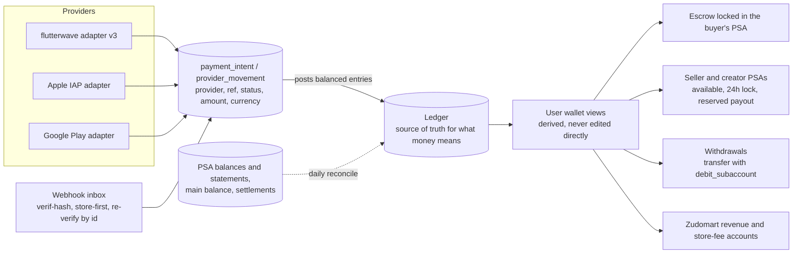
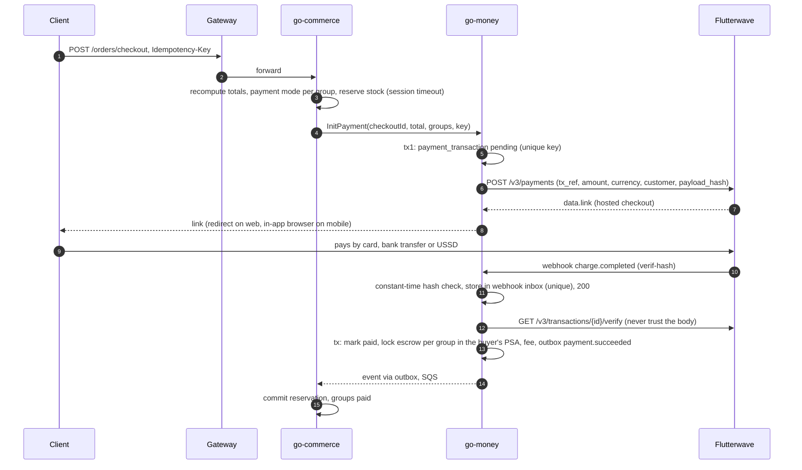
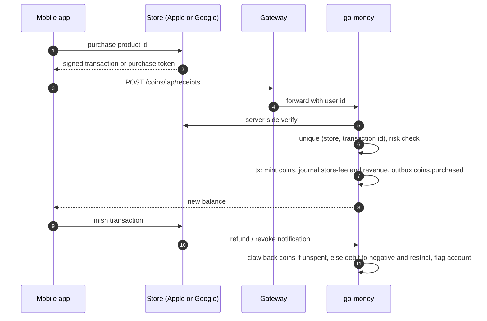
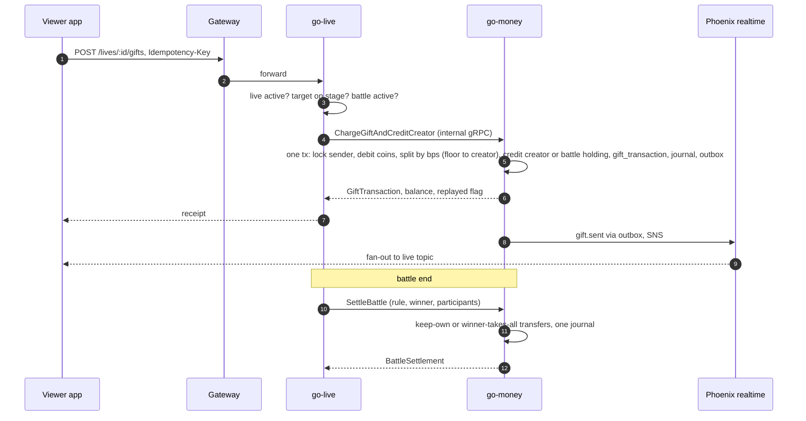
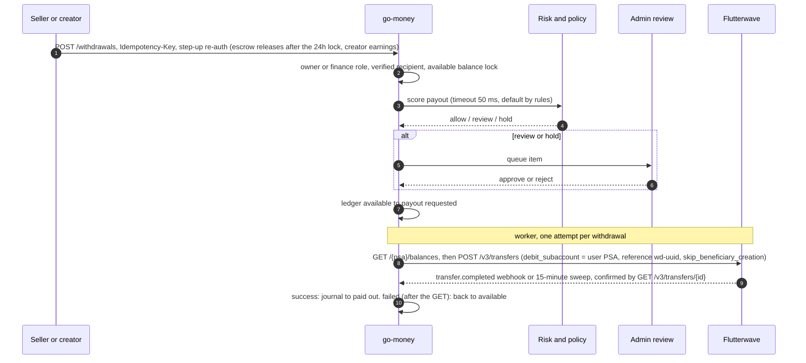

# Payments architecture

> **Provider (owner, 2026-10-11):** Flutterwave is the only payment provider. Each verified user's money sits in their own Flutterwave payout subaccount (PSA) and Zudomart never holds customer money. Detailed flows, ledger mapping, reconciliation and go-live checklist: [`flutterwaveMigration.md`](../integrations/flutterwaveMigration.md). This file keeps the architecture view.

Status date: 2026-10-11.

Labels: **EXISTING** (in code), **MOCK-ONLY** (frontend mocks), **PROPOSED**, **OPTIONAL FUTURE**.

## 1. What exists today

Updated 2026-10-11 from the code. Later sections still carry some PROPOSED labels from earlier drafts; where they disagree with this table, the table and the code win.

| Item | State | Evidence |
| --- | --- | --- |
| go-money deployable with the payments, wallet, ledger, escrow, subscriptions and creators modules, routed by the gateway | EXISTING | `services/go/deployables/goMoney/server.go`, `services/typescript/gateway/src/routes/upstream.routes.ts` |
| Flutterwave v3 adapter: Standard checkout, verify by id, refunds, disputes, PSAs (wallets), transfers, BVN consent, account resolve | EXISTING; the only provider | `services/go/modules/payments/src/integrations/flutterwave*.integration.go` |
| Apple App Store and Google Play receipts and server notifications | EXISTING | `payments/src/integrations/appleAppStore*.go`, `googlePlay*.go` |
| Webhooks: `POST /webhooks/flutterwave` through the gateway (raw body), `verif-hash` compared in constant time, stored in the webhook inbox, used only as a trigger | EXISTING | `payments/src/integrations/flutterwaveWebhooks.integration.go`, `webhookEvent.schema.go` |
| gRPC `LiveMoneyService`, `CheckoutMoneyService`, `AdsMoneyService` served by go-money and called by go-live, go-commerce and go-ads | EXISTING | `services/contracts/proto/zudomart/money/v1/*.proto`, `wallet`, `creators`, `escrow` `src/app.go` |
| Escrow locked in the buyer's own wallet (`CustodyBuyerWalletLock`), release, disputes, refunds, clawback and seller debt | EXISTING | `services/go/modules/escrow/src/modules/escrows/services/escrowWallet*.service.go` |
| Selling eligibility: outside the PSA countries (`WALLET_PSA_COUNTRIES`, default `NG`) a seller must be payout-verified; debt over the limit blocks selling | EXISTING | `payments/src/modules/gateway/services/sellingEligibility.service.go` |
| Idempotency: money requests stored in Postgres (`idempotentRequest.schema.go`); HTTP replay cache in Valkey | EXISTING | `payments/src/databases/schema`, `services/go/platform/idempotency` |
| Daily reconciliation against Flutterwave balances, statements and settlements | EXISTING | `payments/src/modules/reconciliation` |
| Wallet and balance screens in mobile, the seller dashboard and Studio | Read the wallet ledger in backend mode; mocks remain for mock mode | `apps/mobile/src/screens/{wallet,escrow}`, `apps/seller`, `apps/studio` |
| Flutterwave flow tests against a fake Flutterwave server | EXISTING | `services/go/deployables/flutterwaveFlows/*_test.go` |
| Production go-live | BLOCKED on live keys, the IP allowlist and Flutterwave's written answers | [flutterwaveMigration.md](../integrations/flutterwaveMigration.md) cutover status |

## 2. Two economies

Rule: **the product being sold decides the rail, not the app it is sold from.**

| | Physical economy | Digital economy |
| --- | --- | --- |
| Goods | Marketplace products, shipping fees | ZudoCoins, gifts, premium, creator subscriptions, in-app boosts |
| Unit | Fiat `Money` (int64 minor + currency, store currency) | Coins (plain integer, own unit; **never money, never mixed with fiat**) |
| Rail | Flutterwave Standard checkout (card, bank transfer, USSD) or the buyer's funded wallet (PSA), one intent per checkout | Mobile apps: Apple IAP / Google Play Billing. Web: Flutterwave checkout or wallet, into Zudomart's main balance |
| Holding | Escrow per order group, locked in our ledger inside the buyer's own PSA until release; release moves buyer PSA → seller PSA. Card money settles to main and is moved into the buyer's PSA. Outside NG (no PSA): direct payment, no escrow | Spendable coins (bought) and earned coins (creator side) |
| Payee | Seller's PSA, then a withdrawal transfer to their bank (`debit_subaccount`). Commission goes PSA → Zudomart's main balance | Creator share of gifts, paid main → creator PSA, then withdrawn |
| Owner | go-money (payments, escrow, seller balances, payouts) + go-commerce (orders) | go-money (coins, gifts, subscriptions, creators) |
| Refund | Before release: unlock in the buyer's PSA (or refund to the card on request). After release: refund only the amount released to the seller; Zudomart keeps the escrow and processing fees and any shortfall becomes seller debt | Store refund notification: claw back coins or flag account |

### 2.1 App-store rules (owner-relevant, verify before launch)

Store policies change and differ by region. **Re-check Apple App Review Guidelines section 3.1 and Google Play Payments policy, plus any regional alternative-billing programs, before launch and again on each major release.** Treat the table as the working assumption, not legal advice.

| Rule | Consequence for design |
| --- | --- |
| Digital goods consumed inside the iOS/Android app (coins, gifts, premium, creator subscriptions, in-app boosts) must be sold with Apple IAP / Google Play Billing | Mobile coin store uses store products only. No web checkout, no external payment link inside the apps |
| Store takes about 15 to 30 percent | 1 coin is not NGN 1. Each channel has its own price and coin amount so that the **net value per coin after the channel cost is the same**: `coins = floor(price x (1 - channelFee) / netValuePerCoin)`. App packs give fewer coins per naira (store cut 15 to 30 percent); web packs through Flutterwave give more (only the card processing fee). `CoinPack` needs a `channel` (`app_ios`, `app_android`, `web`) and per-channel price and coin amount. Rules: `docs/integrations/flutterwaveMigration.md` Appendix B |
| Creator share must be computed after the store fee | Ledger records the store fee as an expense or contra account at purchase. The gift split applies to coins already minted, so the **coin-to-payout rate is a platform decision**: coins bought through stores must be backed at net-of-fee value. Finance sets the payout rate per coin; do not promise a rate in UI copy |
| Physical goods and services delivered outside the app must use external payment | Marketplace checkout stays on Flutterwave Standard checkout in the apps (the hosted link in an in-app browser with universal-link return) |
| Web (webapp, ads., dashboard., web coin store) may use Flutterwave checkout | Web coin pack is the better-value path for users. **In-app, never link to or mention the cheaper web price**, except in regions whose steering rules allow it (US and EU rules are the ones to check). **FLAG: re-check Apple 3.1, Google Play payments policy and each region's anti-steering rules before launch and on each major release.** Default is no steering anywhere |
| Seller dashboard plans (seller subscription tiers) | Safest to sell **only on web** (`apps/seller`), never as an in-app purchase prompt in the mobile app |
| Refunds are store-initiated | Server-side receipt verification plus App Store Server Notifications v2 and Google Real-Time Developer Notifications (RTDN) are mandatory, not optional |

## 3. Provider adapters to ledger

Owner direction (2026-10-10): **Zudomart does not hold customer money.** Payments run on Flutterwave only. Full flows, ledger mapping and citations: `docs/integrations/flutterwaveMigration.md`. This file keeps the architecture view.

Go capability interfaces in go-money: `PaymentProvider` (collections), `WalletProvider` (PSAs), `PayoutProvider` (transfers, fees, balances, settlements), `IdentityVerifier` (BVN consent, account resolve), `DisputeProvider`, `SavedCardProvider`. Active adapters: `flutterwave` (v3), Apple IAP, Google Play. The interfaces carry no provider-specific types.



The ledger decides what every naira means; Flutterwave balances, statements and settlements are reconciliation evidence. A mismatch opens a case and freezes the affected wallet; corrections are compensating commands only.

| Adapter | Capabilities | Verification | Status |
| --- | --- | --- | --- |
| flutterwave (v3) | Standard checkout (`payload_hash`), verify by id and by `tx_ref`, tokenized charges, refunds, chargebacks, banks and account resolve, BVN consent, PSAs (create, static accounts, balance, statement, close), PSA↔PSA and PSA↔main moves, funding reversals, transfers with `debit_subaccount`, fees, balances, settlements | `verif-hash` (shared secret, not an HMAC) checked in constant time; the webhook is only a hint, every credit is re-fetched by id or from the PSA statement. Our `tx_ref` / `reference` is stored before the call and is the idempotency key; money-moving POSTs are sent once | EXISTING |
| Apple IAP | verify transaction, receive refund/revoke/renewal notifications | StoreKit 2 signed JWS verified against Apple chain on the server; App Store Server API for status; Notifications v2 | EXISTING verifier in go-money; notifications PROPOSED |
| Google Play | verify purchase token, acknowledge, consume, RTDN via Pub/Sub push | Play Developer API `purchases.products/subscriptions` get; RTDN authenticated push | EXISTING verifier in go-money; RTDN PROPOSED |

Flutterwave facts that shape the model (`docs/integrations/flutterwaveMigration.md` §1):

- PSAs exist only in v3 and hold NGN only; outside Nigeria sales use direct payment until a PSA exists in that currency.
- v3 webhooks are unsigned (`verif-hash` is a plain secret), so they are triggers only.
- PSAs cannot be frozen at Flutterwave; a freeze is enforced in our ledger.
- Transfers need "Transfer via API" enabled and our NAT IPs whitelisted.
- Fund ownership in a PSA is undocumented; counsel and Flutterwave's written answers must confirm it before launch.

### 3.1 Data model (PROPOSED, `money` schema owned by go-money)


Key constraints: unique `(provider, provider_ref)`, unique `(provider, provider_event_id)`, unique journal `idempotency_key`; a deferred constraint or a code-level check that entries per journal sum to zero per currency; index on `(account_id, created_at)`; balances in a materialized row updated in the same transaction with a `version` column (optimistic lock, plus `SELECT ... FOR UPDATE` on debit paths). Reconciliation target: trial balance equals zero per currency.

## 4. Payment flow (physical, Flutterwave checkout)

One payment intent per **checkout** (whole cart). Card money settles to the main balance and is moved into the buyer's PSA, where escrow is locked per group.



| Concern | Control |
| --- | --- |
| Idempotency key | Required on every money-moving POST, scoped to actor, stored with the request hash; same key + different body returns `IDEMPOTENCY_KEY_REUSED`. `services/go/platform/idempotency` is EXISTING and wired in orders, catalog, inventory, ads and live; payments keeps its durable `idempotentRequest` record in Postgres, with Valkey only as the replay cache |
| Webhook verification | `verif-hash` compared in constant time before parsing; reject on mismatch with 401; always re-fetch by id; status, `tx_ref`, amount, currency and customer email must match the pending row, and the charge id must be unused; no ordering guarantee, so transitions are conditional |
| Duplicate protection | Unique `(provider, provider_event_id)` and `(provider, provider_ref)`; state transition is a conditional update (`WHERE status = 'pending'`), so replays are no-ops |
| Reconciliation | Scheduled job (`jobs-payouts` queue, EXISTING locally) compares the ledger with Flutterwave daily: every PSA balance and statement, `GET /v3/balances`, `GET /v3/settlements`, pending transfers, refunds and chargebacks; opens reconciliation cases and freezes affected wallets on mismatch; admin ledger page shows breaks (`apps/admin` commerce/ledger, wired through the admin BFF to the ledger API; mocks are only the local default) |
| Late or missed webhook | A sweeper verifies `pending` payments older than N minutes by API poll |
| Failed payment | No successful charge before the session timeout; reservation released at TTL; no ledger entry; retry opens a new checkout with a new reference |
| Amount tampering | Amount comes from the server-computed checkout, never the client; provider amount compared before marking paid |

### 4.1 Refund and chargeback

```mermaid
sequenceDiagram
  autonumber
  participant A as Admin or seller return
  participant M as go-money
  participant P as Flutterwave
  participant L as Ledger
  A->>M: Refund(orderGroupId, amount, key)
  M->>M: check escrow state and refundable amount
  alt before release
    M->>L: unlock escrow in the buyer's PSA (no provider call)
  else buyer asks for a card refund
    M->>P: buyer PSA → main, then POST /v3/transactions/{id}/refund
  else after release
    M->>P: refund the seller-released portion; Zudomart keeps its fees; any shortfall is booked as seller debt
  end
  Note over P,M: chargeback (hourly poll + webhook)
  P->>M: chargeback initiated
  M->>M: freeze matching escrow, pause auto-release, submit evidence
  M->>L: recover buyer PSA, then seller PSA, then seller debt
```

Refund capacity counts succeeded refunds only; in-flight amounts are released if a refund fails. Chargebacks are withheld from main at `initiated`, freeze remaining escrow, notify the seller and feed risk signals (fraud.md). Source: `docs/integrations/flutterwaveMigration.md` §3.3 and §3.8.

### 4.2 Fee lines: direct vs escrow (4 Oct 2026)

Product commission is 0%. Buyers pay nothing extra. The seller sees two separate fee lines per order group:

| Line | Escrow group | Direct group (verified store only) |
|---|---|---|
| Escrow fee | 1.5% of the group total including shipping (1% for Business plan), deducted from the payout at release, none on refunded amounts | none |
| Flutterwave processing fee | allocated pro rata across the checkout and deducted from the payout | allocated pro rata and borne by the seller |

Unverified stores are escrow only. All amounts are int64 minor units. Detail: `docs/integrations/flutterwaveMigration.md` Appendix B.2.

### 4.3 Verification checkmark share refund

When an identity check is rejected, `subscriptions` emits `verificationCase.refundRequested`; go-money refunds on the original charge:

- Standalone Blue, Gold-only, Black and bundle tiers: the full charge, and the subscription is disabled.
- Seller Pro, Seller Business and Premium: the plan keeps running and only the checkmark share is refunded, capped at the amount paid. Share = the standalone checkmark price for the buyer's region, channel and interval (Blue for Premium, Gold-only for Pro and Business), `regionpricing.CheckmarkShareMinor`. Example (NG, web, monthly): Pro refunds 300000 of 500000 minor units.
- The ledger entry is posted first, under idempotency key `verification-share:{caseId}`, then a Flutterwave partial refund is requested. The subscription keeps renewing. Google Play and App Store purchases are flagged for manual review (no partial refund API wired).
- Outcome events carry `refundScope` (`full` or `checkmark_share`) and `refundAmount`. Code: `services/go/modules/subscriptions/src/modules/billing/services/verificationRefunds.service.go`, `checkmarkShare.service.go`. Test: `services/go/modules/payments/payments.checkmarkShareRefund_integration_test.go`. Product rules: `docs/pricing.md` section 2.1.

## 5. Digital economy flows

### 5.1 Coin purchase in app (IAP)



| Case | Rule |
| --- | --- |
| Coins already spent when refund arrives | Balance may go negative; gifting and cash-out blocked until zero; repeated refunds raise a fraud flag (fraud.md IAP refund abuse) |
| Gifts already received by creators from refunded coins | Creator earned coins from refunded purchases are **not** clawed back by default; track `refunded_source_coins` per sender and hold payouts on high-refund senders; policy decision for owner |
| Unfinished or pending purchase | Verify on app start and via store notifications; mint is idempotent on transaction id |
| Never trust the client | No mint without server verification |

### 5.2 Gift charge and battle settlement (go-live to go-money, internal gRPC)

Contract EXISTING (`live_money.proto`), implementation PROPOSED. Phoenix only fans out events; it never decides money.



Errors per proto: `INSUFFICIENT_COINS`, `CANNOT_GIFT_SELF`, `BATTLE_ALREADY_SETTLED_DIFFERENTLY` (FAILED_PRECONDITION), `IDEMPOTENCY_KEY_REUSED` (ALREADY_EXISTS). Status `HELD_FOR_REVIEW` exists in the proto: the deterministic policy engine in go-money may hold a gift or settlement; Python only supplies an advisory score (fraud.md). Single Postgres transaction means no cross-service money saga.

### 5.3 Creator share after store fee

| Step | Account movement |
| --- | --- |
| Coin pack bought in app, price P | Cash/store receivable +P, store fee expense -fee, revenue (deferred coins liability) +(P - fee), coins minted to buyer |
| Gift of N coins | Buyer coins -N, creator earned coins +floor(N x share bps), platform coins +remainder |
| Creator cash-out | Earned coins converted at the finance-set rate (minimum payout enforced). The payout run moves main → creator PSA (free wallet transfer), after which the creator withdraws. Needs the Flutterwave main balance funded first (IAP money arrives in Zudomart's bank, not Flutterwave) |

Coin purchases (web via Flutterwave, app via the stores) and gifts are Zudomart revenue in Zudomart's own account, so only the creator share is owed to anyone. The rate must keep payout cost below net revenue after the **worst-channel** store fee. This is a finance decision; flag it before pricing UI is built.

## 6. Payout flow



| Rule | Value |
| --- | --- |
| Who can request | Owner and finance roles only; step-up auth; a new bank account triggers a cooling-off hold (hours configurable) |
| Limits | Daily and per-request limits in config tables, higher after KYC tier |
| Concurrency | Row lock plus version; concurrent withdrawals cannot overdraw (plan acceptance test) |
| Control | Only go-money holds the Flutterwave secret key; NAT IPs whitelisted; `requires_approval` waits for a human, never auto-approved |
| Settlement | Escrow release is a ledger transition, then `locked24h`, then `available`, then a withdrawal transfer from the seller's PSA |
| Fee | Quoted per withdrawal with `GET /v3/transfers/fee` and shown before confirming |
| Debt | Open seller debt is netted from payouts and turns direct mode off |
| Audit | Every release, refund, payout and ledger adjustment written to the audit log |

## 7. Settlement timeline and escrow release

See `marketplace.md` section 6 for the escrow state machine. Money rule: only go-money moves escrow; go-commerce requests transitions through events or an internal call and never writes ledger tables (read-only grants only). Escrow funds stay in the buyer's PSA, locked by the ledger; the `escrow` rows decide when the release transfer may be sent.

## 8. Recommendations (checked 2026-10-21; resolved rows are kept for history)

| # | Problem | Current | Why it matters | Recommendation | Complexity | Risk | Priority |
| --- | --- | --- | --- | --- | --- | --- | --- |
| 1 | App-store rule not reflected in the model | `CoinPack` in the monolith has per-currency price, no channel | Selling coins via an external web checkout inside the iOS or Android app risks rejection or removal, and store fees make a single price lose money | Add `channel` to `CoinPack` and a separate IAP product catalogue before building the mobile coin store; remove any in-app web-checkout coin path | M | High if skipped | P0, blocks store approval and margin |
| 2 | Webhook verification and durable idempotency | **Done.** go-money verifies raw-body signatures, stores `payment_event` uniquely and keeps Postgres idempotency records; integration tests cover replay and amount mismatch | Replay or forged webhook credits money | Keep the fail-closed tests green; no new build needed | M | High | Done (2026-10) |
| 3 | IAP verification and store notifications | **Done.** Apple App Store, signed-data and Google Play adapters (including subscription revoke/RTDN) exist in go-money | Refund abuse and unverified mints | Keep store credentials current and test sandbox notifications before each release | L | High | Done (2026-10) |
| 4 | Payout economics undefined | Rate and minimum are config only | Creator payouts could exceed net revenue after store fees | Finance signs off coin-to-fiat rate and store-fee accounting before launch | S | High | P1, pricing launch gate |
| 5 | Single provider (Flutterwave) | One provider, capability interfaces | A Flutterwave outage stops checkout and payouts | Keep the capability interfaces free of provider-specific fields so another provider can be added later; outage mode hides the pay button and keeps browse and cart | M | Medium | P2, MVP optional, Near term |
| 6 | Reconciliation | Daily Flutterwave reconciliation in code (cases, wallet freezes, alerts) | The ledger can silently diverge from PSA balances, the main balance and settlements | Keep the daily per-PSA, main and settlement recon plus the trial-balance check in CI e2e | M | Medium | P1, money integrity, MVP |
| 8 | Control of funds and licensing | Owner rule: Zudomart holds no customer money. Escrow is locked in the buyer's own PSA | PSA fund ownership is undocumented; a regulator could still treat Zudomart as controlling buyer funds | Flutterwave's written answers (§8 of the spec) and a Nigerian fintech lawyer's review before launch | S | High | P0, launch gate |
| 9 | Prepaid ad credit and unspent coins | Not modelled | Stored value held by Zudomart | Postpaid or threshold ads billing; lawyer review of coin terms | S | Medium | P1 |
| 7 | Ledger at scale | Single Aurora | Hot ledger rows (platform account) serialize writes | MVP: split platform accounts per shard key (per day or per creator bucket); Scale stage: only consider partitioning ledger entries when write p95 exceeds a defined budget. No sharding trigger is met today | M | Low | P3, Scale stage |

The money-module task list is `docs/integrations/flutterwaveMigration.md` §10.

Store policy items are time-sensitive; schedule a pre-launch policy re-read as an explicit launch checklist item.
