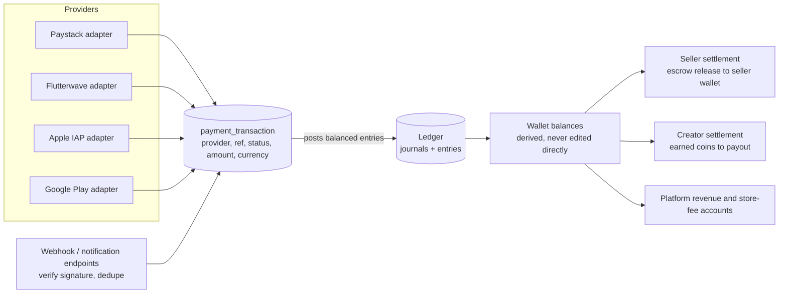
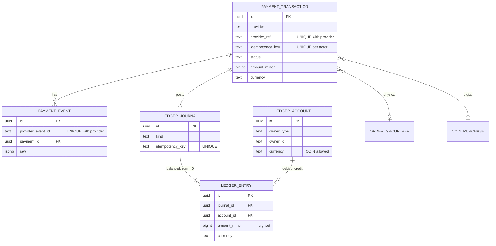
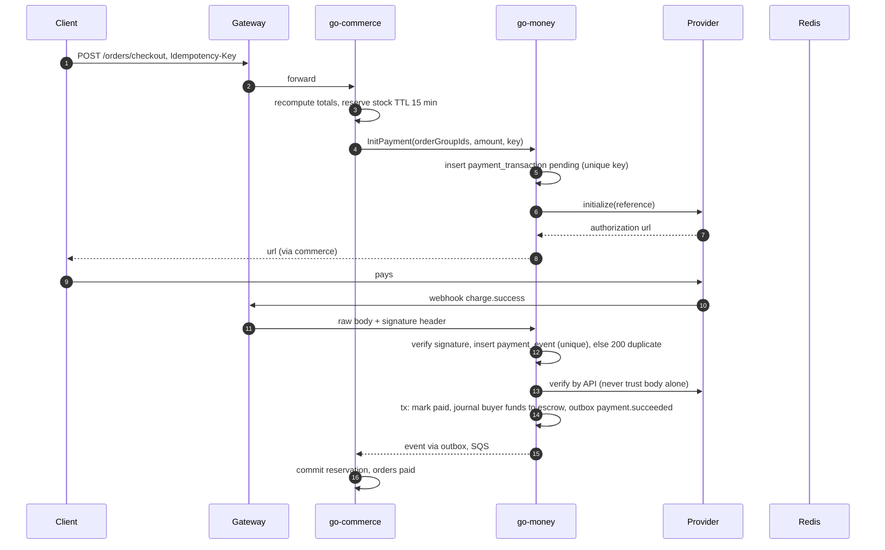
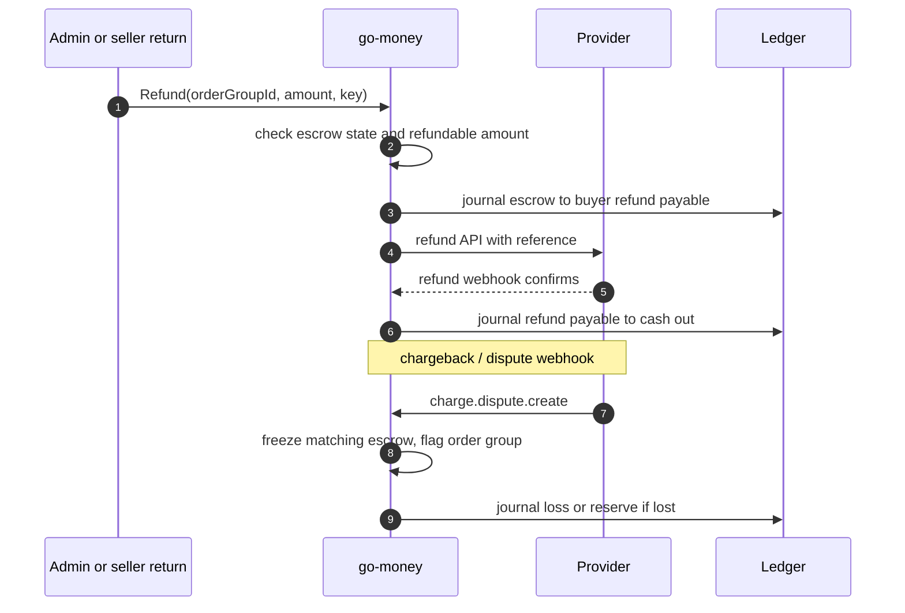
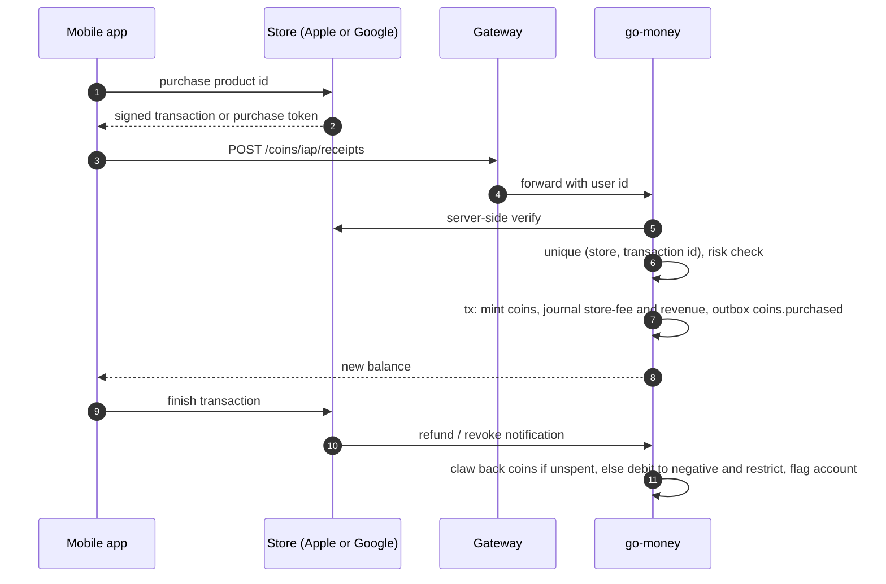
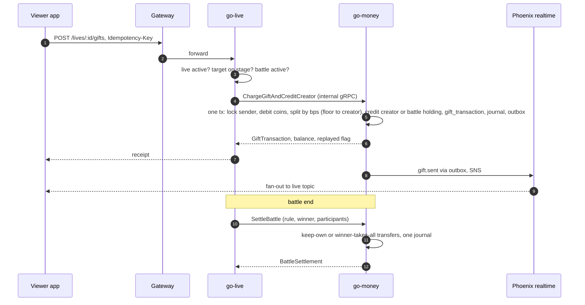
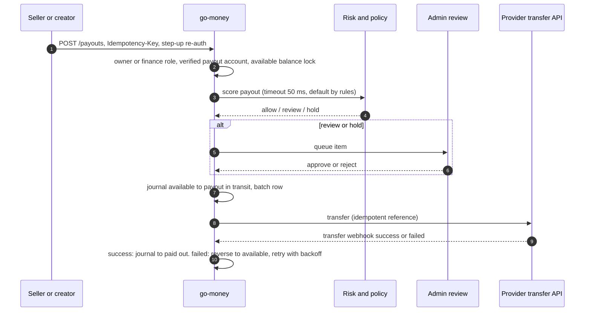

# Payments architecture

Status date: 2026-10-03. Labels: **EXISTING** (in code), **MOCK-ONLY** (frontend mocks), **PROPOSED**, **OPTIONAL FUTURE**.

## 1. What exists today

| Item | State | Evidence |
| --- | --- | --- |
| Go payments / wallet / ledger / escrow / subscriptions / creators / rewards modules | EXISTING as 11-line routeless skeletons, no ent, no migrations | `services/go/modules/{payments,wallet,ledger,escrow,subscriptions,creators,rewards}` |
| `go-money` deployable | EXISTING, compiles, routeless | `services/go/cmd/go-money` (inventory 2.4) |
| `LiveMoneyService` gRPC contract (`ChargeGiftAndCreditCreator`, `SettleBattle`, `GetBattleGiftTotals`, `GetCoinBalance`) | EXISTING proto, **no server or client implementation** | `services/contracts/proto/zudomart/money/v1/live_money.proto` |
| `Money` proto and Go money package (int64 minor units + currency) | EXISTING, tested | `services/contracts/proto/zudomart/common/v1/money.proto`, `services/go/platform/money` |
| Idempotency middleware (Redis) | EXISTING, wired to no route | `services/go/platform/idempotency` |
| Webhook signature verification in new services | **ABSENT** | inventory section 7 |
| Paystack / Flutterwave gateways, double-entry ledger, escrow auto-release job, coin IAP receipt endpoint | EXISTING only in the reference monolith, which is never deployed | `apps/api/src/modules/payments/gateways/{paystack,flutterwave}.gateway.ts`, `modules/escrows/jobs/escrowAutoRelease.job.ts`, `modules/wallets/constants/monetizationLedgerAccounts.constant.ts` |
| Risk scoring subjects `order, payout, account_event, coin_purchase, coin_transfer, gift, referral_reward, cashback` | EXISTING in Python, not called by any Go/TS caller | `apps/intelligence/src/modules/risk/dtos/risk_scoring_dto.py` |
| Wallet, escrow, coin, payout screens in mobile, seller, admin | MOCK-ONLY | `apps/mobile/src/screens/{wallet,escrow}`, `apps/seller` wallet pages, `apps/admin` commerce pages |
| Everything below | PROPOSED | `docs/backendPlan.md` phases 5 and 6 |

## 2. Two economies

Rule: **the product being sold decides the rail, not the app it is sold from.**

| | Physical economy | Digital economy |
| --- | --- | --- |
| Goods | Marketplace products, shipping fees | ZudoCoins, gifts, premium, creator subscriptions, in-app boosts |
| Unit | Fiat `Money` (int64 minor + currency, store currency) | Coins (plain integer, own unit; **never money, never mixed with fiat**) |
| Rail | Paystack or Flutterwave (external, all clients) | Mobile apps: Apple IAP / Google Play Billing. Web: Paystack |
| Holding | Escrow per order group until delivery | Spendable coins (bought) and earned coins (creator side) |
| Payee | Seller wallet, after commission | Creator share of gifts, after store fee where applicable |
| Owner | go-money (payments, escrow, wallet, payouts) + go-commerce (orders) | go-money (coins, gifts, subscriptions, creators) |
| Refund | Provider refund or ledger reversal, per order group | Store refund notification: claw back coins or flag account |

### 2.1 App-store rules (owner-relevant, verify before launch)

Store policies change and differ by region. **Re-check Apple App Review Guidelines section 3.1 and Google Play Payments policy, plus any regional alternative-billing programs, before launch and again on each major release.** Treat the table as the working assumption, not legal advice.

| Rule | Consequence for design |
| --- | --- |
| Digital goods consumed inside the iOS/Android app (coins, gifts, premium, creator subscriptions, in-app boosts) must be sold with Apple IAP / Google Play Billing | Mobile coin store uses store products only. No Paystack checkout, no external payment link inside the apps |
| Store takes about 15 to 30 percent | App coin packs are priced separately (higher coin price, fewer coins per currency unit) than web packs. `CoinPack` needs a `channel` (`app_ios`, `app_android`, `web`) and per-channel price or coin amount |
| Creator share must be computed after the store fee | Ledger records the store fee as an expense or contra account at purchase. The gift split applies to coins already minted, so the **coin-to-payout rate is a platform decision**: coins bought through stores must be backed at net-of-fee value. Finance sets the payout rate per coin; do not promise a rate in UI copy |
| Physical goods and services delivered outside the app must use external payment | Marketplace checkout stays on Paystack/Flutterwave in the apps |
| Web (webapp, ads., dashboard., web coin store) may use Paystack | Web coin pack is the cheaper path for users; do not steer users from inside the iOS app to the web store without checking current anti-steering rules |
| Seller dashboard plans (seller subscription tiers) | Safest to sell **only on web** (`apps/seller`), never as an in-app purchase prompt in the mobile app |
| Refunds are store-initiated | Server-side receipt verification plus App Store Server Notifications v2 and Google Real-Time Developer Notifications (RTDN) are mandatory, not optional |

## 3. Provider adapters to ledger

One Go interface `PaymentProvider` in go-money (PROPOSED), modeled on `apps/api/src/modules/payments/gateways/paymentGateway.interface.ts`. Four adapters, one internal transaction model.

| Adapter | Capabilities | Verification | Status |
| --- | --- | --- | --- |
| Paystack | initialize, verify, refund, transfer (payout), resolve bank | HMAC-SHA512 of raw body with the secret key, compared constant-time | PROPOSED (reference in `apps/api`) |
| Flutterwave | same | `verif-hash` header equals configured secret hash, then re-verify by API | PROPOSED (reference in `apps/api`) |
| Apple IAP | verify transaction, receive refund/revoke/renewal notifications | StoreKit 2 signed JWS verified against Apple chain on the server; App Store Server API for status; Notifications v2 | PROPOSED, new work (monolith has `POST /coins/iap/receipts` as a contract only) |
| Google Play | verify purchase token, acknowledge, consume, RTDN via Pub/Sub push | Play Developer API `purchases.products/subscriptions` get; RTDN authenticated push | PROPOSED, new work |

Provider is chosen by a currency/country routing table in config (Paystack default for NGN, Flutterwave fallback or other African corridors). Provider-specific fields never leave the adapter.

### 3.1 Data model (PROPOSED, `money` schema owned by go-money)

Key constraints: unique `(provider, provider_ref)`, unique `(provider, provider_event_id)`, unique journal `idempotency_key`; a deferred constraint or a code-level check that entries per journal sum to zero per currency; index on `(account_id, created_at)`; balances in a materialized row updated in the same transaction with a `version` column (optimistic lock, plus `SELECT ... FOR UPDATE` on debit paths). Reconciliation target: trial balance equals zero per currency.

## 4. Payment flow (physical, hosted checkout)

| Concern | Control |
| --- | --- |
| Idempotency key | Required on every money-moving POST, scoped to actor, stored with the request hash; same key + different body returns `IDEMPOTENCY_KEY_REUSED`. Reuse `services/go/platform/idempotency` (EXISTING, unwired) but persist the durable record in Postgres, Redis is only the fast path |
| Webhook verification | Raw body HMAC before parsing; reject on mismatch with 401; always re-fetch transaction from the provider; amount and currency must match the pending row |
| Duplicate protection | Unique `(provider, provider_event_id)` and `(provider, provider_ref)`; state transition is a conditional update (`WHERE status = 'pending'`), so replays are no-ops |
| Reconciliation | Scheduled job (`jobs-payouts` queue, EXISTING locally) fetches provider settlements daily, matches by reference, raises `recon_break` rows for missing, extra or mismatched amounts; admin ledger page shows breaks (`apps/admin` commerce/ledger, MOCK-ONLY) |
| Late or missed webhook | A sweeper verifies `pending` payments older than N minutes by API poll |
| Failed payment | Status `failed`; reservation released at TTL; no ledger entry; retry creates a new reference under the same checkout |
| Amount tampering | Amount comes from the server-computed checkout, never the client; provider amount compared before marking paid |

### 4.1 Refund and chargeback

Refund sources: escrow held funds first; if already released, recover from seller wallet (can go negative, blocks payouts until cleared). Chargebacks freeze remaining escrow, notify seller, feed risk signals (section fraud.md).

## 5. Digital economy flows

### 5.1 Coin purchase in app (IAP)

| Case | Rule |
| --- | --- |
| Coins already spent when refund arrives | Balance may go negative; gifting and cash-out blocked until zero; repeated refunds raise a fraud flag (fraud.md IAP refund abuse) |
| Gifts already received by creators from refunded coins | Creator earned coins from refunded purchases are **not** clawed back by default; track `refunded_source_coins` per sender and hold payouts on high-refund senders; policy decision for owner |
| Unfinished or pending purchase | Verify on app start and via store notifications; mint is idempotent on transaction id |
| Never trust the client | No mint without server verification |

### 5.2 Gift charge and battle settlement (go-live to go-money, internal gRPC)

Contract EXISTING (`live_money.proto`), implementation PROPOSED. Phoenix only fans out events; it never decides money.

Errors per proto: `INSUFFICIENT_COINS`, `CANNOT_GIFT_SELF`, `BATTLE_ALREADY_SETTLED_DIFFERENTLY` (FAILED_PRECONDITION), `IDEMPOTENCY_KEY_REUSED` (ALREADY_EXISTS). Status `HELD_FOR_REVIEW` exists in the proto: the deterministic policy engine in go-money may hold a gift or settlement; Python only supplies an advisory score (fraud.md). Single Postgres transaction means no cross-service money saga.

### 5.3 Creator share after store fee

| Step | Account movement |
| --- | --- |
| Coin pack bought in app, price P | Cash/store receivable +P, store fee expense -fee, revenue (deferred coins liability) +(P - fee), coins minted to buyer |
| Gift of N coins | Buyer coins -N, creator earned coins +floor(N x share bps), platform coins +remainder |
| Creator cash-out | Earned coins converted at the finance-set rate (minimum payout enforced) to fiat wallet, then payout flow |

The rate must keep payout cost below net revenue after the **worst-channel** store fee. This is a finance decision; flag it before pricing UI is built.

## 6. Payout flow

| Rule | Value |
| --- | --- |
| Who can request | Owner and finance roles only; step-up auth; new payout destination triggers a cooling-off hold (hours configurable) |
| Limits | Daily and per-request limits in config tables, higher after KYC tier |
| Concurrency | Row lock plus version; concurrent withdrawals cannot overdraw (plan acceptance test) |
| Settlement | Escrow release lands in seller wallet `pending`, becomes `available` after the hold window |
| Audit | Every release, refund, payout and ledger adjustment written to the audit log |

## 7. Settlement timeline and escrow release

See `marketplace.md` section 6 for the escrow state machine. Money rule: only go-money moves escrow; go-commerce requests transitions through events or an internal call and never writes ledger tables (read-only grants only).

## 8. Recommendations

| # | Problem | Current | Why it matters | Recommendation | Complexity | Risk | Priority |
| --- | --- | --- | --- | --- | --- | --- | --- |
| 1 | App-store rule not reflected in the model | `CoinPack` in the monolith has per-currency price, no channel | Selling coins via Paystack inside the iOS or Android app risks rejection or removal, and store fees make a single price lose money | Add `channel` to `CoinPack` and a separate IAP product catalogue before building the mobile coin store; remove any in-app Paystack coin path | M | High if skipped | P0, blocks store approval and margin |
| 2 | No webhook verification or durable idempotency in new services | Redis idempotency unwired; no payments module | Replay or forged webhook credits money | Implement raw-body verification, `payment_event` unique key and Postgres idempotency records first, with tests | M | High | P0, first code in go-money |
| 3 | IAP verification and store notifications do not exist | Contract-only in plan | Refund abuse and unverified mints | Build Apple and Google adapters with Notifications v2 and RTDN before enabling the coin store; fail closed when verification is unavailable | L | High | P0 for any mobile coin sale |
| 4 | Payout economics undefined | Rate and minimum are config only | Creator payouts could exceed net revenue after store fees | Finance signs off coin-to-fiat rate and store-fee accounting before launch | S | High | P1, pricing launch gate |
| 5 | Provider concentration | Paystack and Flutterwave behind one interface | Provider outage stops checkout | Keep the interface honest (no leaking fields); add health-based routing near term | M | Medium | P2, MVP optional, Near term |
| 6 | Reconciliation absent | No code | Balances can silently diverge from provider statements | Daily recon job and trial-balance check in CI e2e | M | Medium | P1, money integrity, MVP |
| 7 | Ledger at scale | Single Aurora | Hot ledger rows (platform account) serialize writes | MVP: split platform accounts per shard key (per day or per creator bucket); Scale stage: only consider partitioning ledger entries when write p95 exceeds a defined budget. No sharding trigger is met today | M | Low | P3, Scale stage |

Store policy items are time-sensitive; schedule a pre-launch policy re-read as an explicit launch checklist item.
