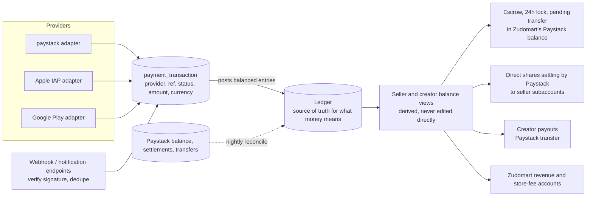
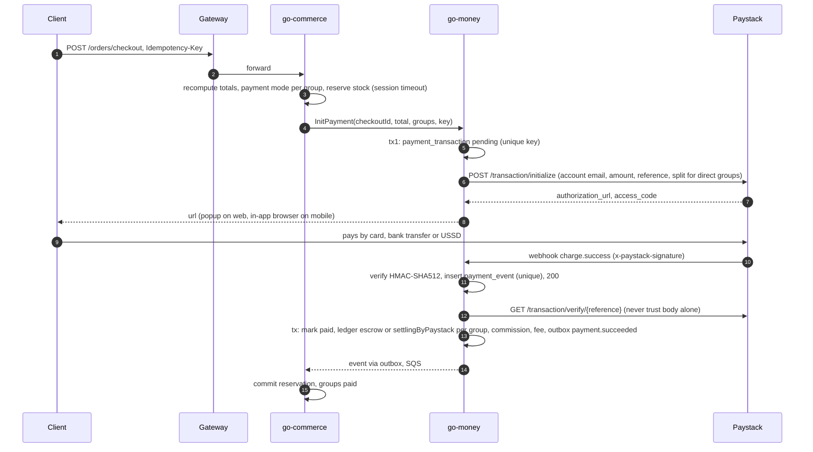
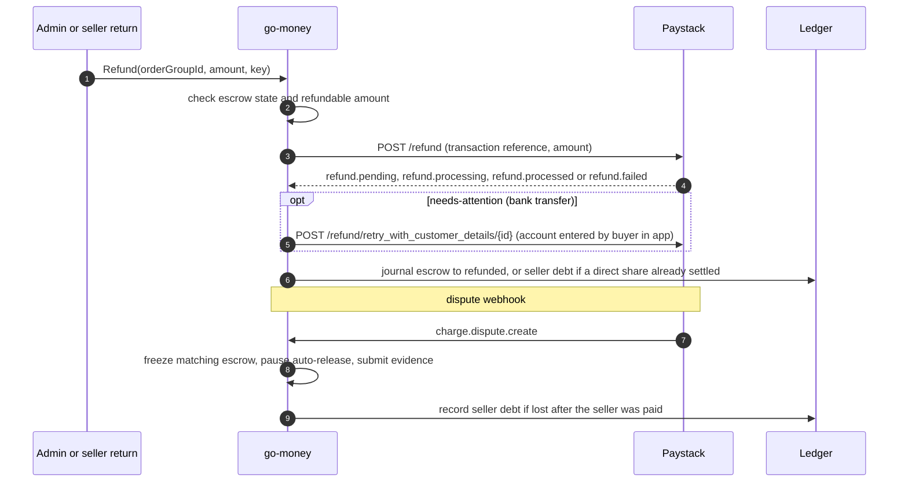
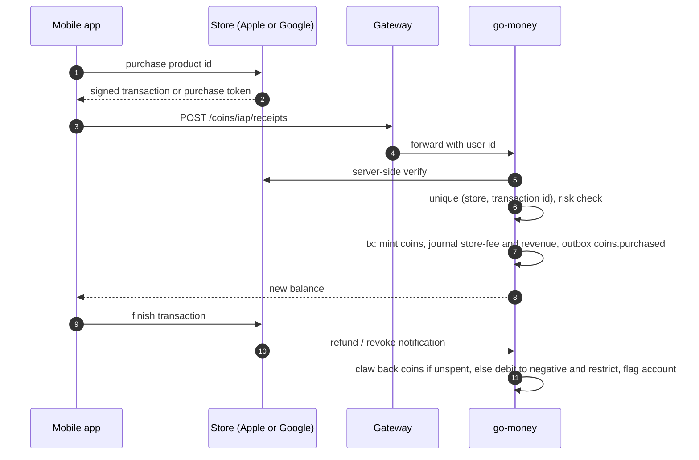
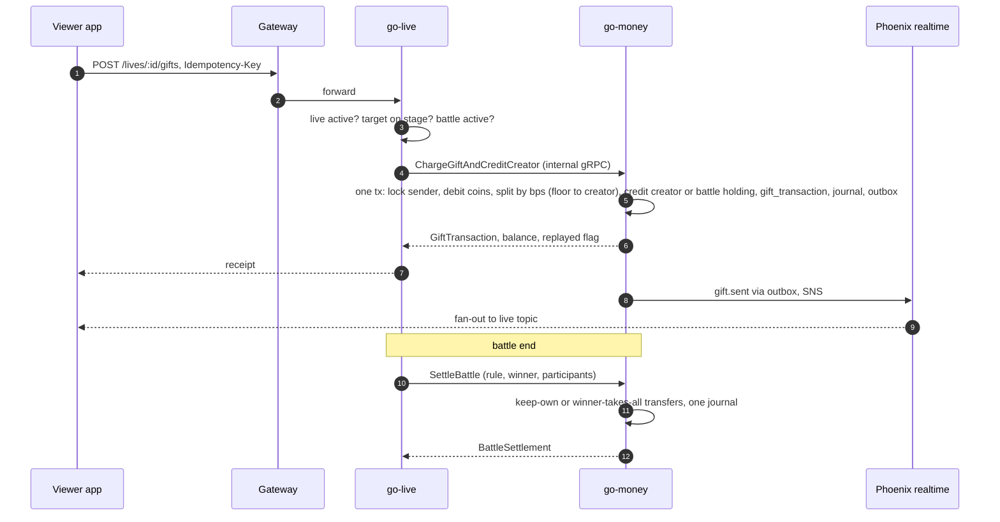
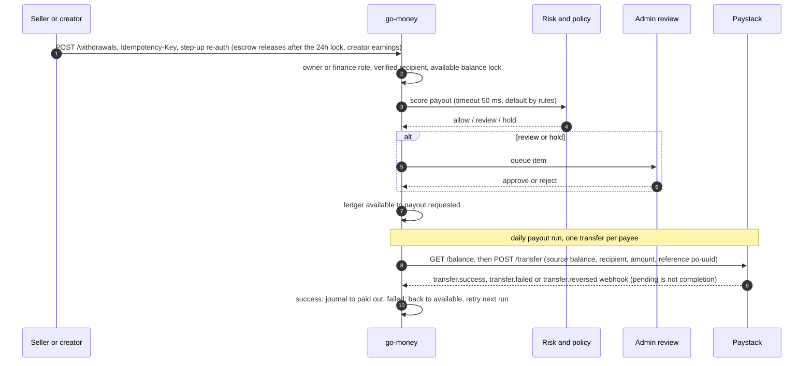

# Payments architecture

Status date: 2026-10-03.

> **Bachs and Anchor dropped; Paystack adopted (owner, 2026-10-03).** Paystack is the single provider. Provider facts: `docs/integrations/paystack.md`; flows and code changes: `docs/checkoutPaymentFlowPlan.md`. Code still contains the Bachs adapter until the plan's section 12 is implemented.

Labels: **EXISTING** (in code), **MOCK-ONLY** (frontend mocks), **PROPOSED**, **OPTIONAL FUTURE**.

## 1. What exists today

| Item | State | Evidence |
| --- | --- | --- |
| Go payments / wallet / ledger / escrow / creators modules | EXISTING with ent schemas, migrations and integration tests (subscriptions is still a skeleton; the rewards module was deleted) | `services/go/modules/{payments,wallet,ledger,escrow,creators}` |
| `go-money` deployable | EXISTING, compiles, routeless | `services/go/cmd/go-money` (inventory 2.4) |
| `LiveMoneyService` gRPC contract (`ChargeGiftAndCreditCreator`, `SettleBattle`, `GetBattleGiftTotals`, `GetCoinBalance`) | EXISTING proto, **no server or client implementation** | `services/contracts/proto/zudomart/money/v1/live_money.proto` |
| `Money` proto and Go money package (int64 minor units + currency) | EXISTING, tested | `services/contracts/proto/zudomart/common/v1/money.proto`, `services/go/platform/money` |
| Idempotency middleware (Redis) | EXISTING, wired to no route | `services/go/platform/idempotency` |
| Webhook signature verification in new services | EXISTING for Bachs (to be replaced). PROPOSED: `POST /webhooks/paystack`, HMAC-SHA512 of the raw body with the secret key (`x-paystack-signature`), IP allowlist, `event + data.id + status` dedupe | `services/go/modules/payments/src/integrations/bachsConnectWebhooks.integration.go` (to delete) |
| Legacy card gateways (to be replaced by the Paystack adapter in the new stack), double-entry ledger, escrow auto-release job, coin IAP receipt endpoint | EXISTING only in the reference monolith, which is never deployed | `apps/api/src/modules/payments/gateways/*.gateway.ts`, `modules/escrows/jobs/escrowAutoRelease.job.ts`, `modules/wallets/constants/monetizationLedgerAccounts.constant.ts` |
| Risk scoring subjects `order, payout, account_event, coin_purchase, coin_transfer, gift` | EXISTING in Python, not called by any Go/TS caller | `services/python/intelligence/src/modules/risk/dtos/risk_scoring_dto.py` |
| Wallet, escrow, coin, payout screens in mobile, seller, admin | MOCK-ONLY | `apps/mobile/src/screens/{wallet,escrow}`, `apps/seller` wallet pages, `apps/admin` commerce pages |
| Everything below | PROPOSED | `docs/backendPlan.md` phases 5 and 6 |

## 2. Two economies

Rule: **the product being sold decides the rail, not the app it is sold from.**

| | Physical economy | Digital economy |
| --- | --- | --- |
| Goods | Marketplace products, shipping fees | ZudoCoins, gifts, premium, creator subscriptions, in-app boosts |
| Unit | Fiat `Money` (int64 minor + currency, store currency) | Coins (plain integer, own unit; **never money, never mixed with fiat**) |
| Rail | Paystack checkout (card, bank transfer, USSD), one transaction per checkout; direct groups split to the seller's subaccount | Mobile apps: Apple IAP / Google Play Billing. Web: Paystack checkout on Zudomart's main account |
| Holding | Escrow per order group: launch path in Zudomart's Paystack balance until release + 24h lock (E2); manual-settlement seller subaccount if Paystack confirms (E1). Direct groups never touch Zudomart (T+1 subaccount settlement) | Spendable coins (bought) and earned coins (creator side) |
| Payee | Seller's bank: split settlement (direct) or Paystack transfer to the seller's recipient (escrow). Commission stays in Zudomart's main account | Creator share of gifts, paid by Paystack transfer from Zudomart's balance to the creator's recipient |
| Owner | go-money (payments, escrow, seller balances, payouts) + go-commerce (orders) | go-money (coins, gifts, subscriptions, creators) |
| Refund | Paystack refund from Zudomart's balance, per order group; seller debt if a direct share already settled | Store refund notification: claw back coins or flag account |

### 2.1 App-store rules (owner-relevant, verify before launch)

Store policies change and differ by region. **Re-check Apple App Review Guidelines section 3.1 and Google Play Payments policy, plus any regional alternative-billing programs, before launch and again on each major release.** Treat the table as the working assumption, not legal advice.

| Rule | Consequence for design |
| --- | --- |
| Digital goods consumed inside the iOS/Android app (coins, gifts, premium, creator subscriptions, in-app boosts) must be sold with Apple IAP / Google Play Billing | Mobile coin store uses store products only. No Paystack checkout, no external payment link inside the apps |
| Store takes about 15 to 30 percent | 1 coin is not NGN 1. Each channel has its own price and coin amount so that the **net value per coin after the channel cost is the same**: `coins = floor(price x (1 - channelFee) / netValuePerCoin)`. App packs give fewer coins per naira (store cut 15 to 30 percent); web packs through Paystack give more (1.5% + NGN 100, waived under NGN 2,500, capped NGN 2,000). `CoinPack` needs a `channel` (`app_ios`, `app_android`, `web`) and per-channel price and coin amount. Worked table: `checkoutPaymentFlowPlan.md` section 8.2 |
| Creator share must be computed after the store fee | Ledger records the store fee as an expense or contra account at purchase. The gift split applies to coins already minted, so the **coin-to-payout rate is a platform decision**: coins bought through stores must be backed at net-of-fee value. Finance sets the payout rate per coin; do not promise a rate in UI copy |
| Physical goods and services delivered outside the app must use external payment | Marketplace checkout stays on Paystack checkout in the apps (`authorization_url` in an in-app browser with universal-link return) |
| Web (webapp, ads., dashboard., web coin store) may use Paystack | Web coin pack is the better-value path for users. **In-app, never link to or mention the cheaper web price**, except in regions whose steering rules allow it (US and EU rules are the ones to check). **FLAG: re-check Apple 3.1, Google Play payments policy and each region's anti-steering rules before launch and on each major release.** Default is no steering anywhere |
| Seller dashboard plans (seller subscription tiers) | Safest to sell **only on web** (`apps/seller`), never as an in-app purchase prompt in the mobile app |
| Refunds are store-initiated | Server-side receipt verification plus App Store Server Notifications v2 and Google Real-Time Developer Notifications (RTDN) are mandatory, not optional |

## 3. Provider adapters to ledger

Owner direction (2026-10-03): **Zudomart holds as little user money as possible.** Payments run on Paystack only. Full flows, ledger mapping and citations: `checkoutPaymentFlowPlan.md` and `docs/integrations/paystack.md`. This file keeps the architecture view.

Go interfaces in go-money: `PaymentProvider`, `PayeeProvider` (recipients, subaccounts, account resolve), `MoneyMovementProvider` (transfers, balance), `DisputeProvider`, `SubscriptionProvider`, `SavedCardProvider`. Active adapters: `paystack` (PROPOSED, replaces `bachsConnect`), Apple IAP, Google Play. The interfaces carry no Paystack types, so another provider can be added later; none is planned.

The ledger decides what every naira means; Paystack balances, settlements and transfers are reconciliation evidence. A mismatch opens a break and freezes the affected payouts; corrections are reversal entries only.

| Adapter | Capabilities | Verification | Status |
| --- | --- | --- | --- |
| paystack | initialize and verify transaction (dynamic split), charge authorization, refunds (incl. retry with customer details), banks and account resolve, transfer recipients, transfers, balance, subaccounts (settlement schedule), settlements, disputes, plans and subscriptions, customer validation | `x-paystack-signature`: hex HMAC-SHA512 of the raw body with the secret key; IP allowlist (52.31.139.75, 52.49.173.169, 52.214.14.220); dedupe on `event + data.id + status`; re-fetch with `verify` before posting. Transaction and transfer `reference` are the idempotency keys | PROPOSED (replaces `bachsConnect*.integration.go`, which is deleted by the plan) |
| Apple IAP | verify transaction, receive refund/revoke/renewal notifications | StoreKit 2 signed JWS verified against Apple chain on the server; App Store Server API for status; Notifications v2 | EXISTING verifier in go-money; notifications PROPOSED |
| Google Play | verify purchase token, acknowledge, consume, RTDN via Pub/Sub push | Play Developer API `purchases.products/subscriptions` get; RTDN authenticated push | EXISTING verifier in go-money; RTDN PROPOSED |

Paystack facts that shape the model (`docs/integrations/paystack.md`):

- Direct mode: a dynamic `flat` split sends the seller share to the seller's subaccount, settled T+1 (`settlement_schedule: auto`). Commission is the remainder in Zudomart's main account.
- Escrow: no escrow product. Launch path E2 keeps escrow in Zudomart's balance and pays sellers by transfer after release + 24h. E1 (manual-settlement subaccount: "payout to the subaccount should only be made when requested") removes that holding if Paystack confirms a per-order settlement request. UNCONFIRMED, ask Paystack.
- Refunds debit Zudomart's balance; whether Paystack reverses a subaccount share is UNCONFIRMED, so settled direct shares become seller debt.
- Transfers draw only on the balance; OTP must be disabled for automation.
- Paystack does not KYC payees: seller and creator KYC is Zudomart's.
- Control caveat: E2 means Zudomart controls escrowed buyer money in its Paystack balance. Legal review is required (`checkoutPaymentFlowPlan.md` section 10).

### 3.1 Data model (PROPOSED, `money` schema owned by go-money)

Key constraints: unique `(provider, provider_ref)`, unique `(provider, provider_event_id)`, unique journal `idempotency_key`; a deferred constraint or a code-level check that entries per journal sum to zero per currency; index on `(account_id, created_at)`; balances in a materialized row updated in the same transaction with a `version` column (optimistic lock, plus `SELECT ... FOR UPDATE` on debit paths). Reconciliation target: trial balance equals zero per currency.

## 4. Payment flow (physical, Paystack checkout)

One Paystack transaction per **checkout** (whole cart). Direct groups appear in a dynamic split; escrow groups and commission stay with the main account.

| Concern | Control |
| --- | --- |
| Idempotency key | Required on every money-moving POST, scoped to actor, stored with the request hash; same key + different body returns `IDEMPOTENCY_KEY_REUSED`. Reuse `services/go/platform/idempotency` (EXISTING, unwired) but persist the durable record in Postgres, Redis is only the fast path |
| Webhook verification | Raw body hex HMAC-SHA512 with the secret key compared to `x-paystack-signature` before parsing; reject on mismatch with 401; always re-fetch with `verify`; amount, currency, `reference` and split must match the pending row; no ordering guarantee, so transitions are conditional |
| Duplicate protection | Unique `(provider, provider_event_id)` and `(provider, provider_ref)`; state transition is a conditional update (`WHERE status = 'pending'`), so replays are no-ops |
| Reconciliation | Scheduled job (`jobs-payouts` queue, EXISTING locally) compares the ledger with Paystack daily: `GET /transaction`, `GET /balance` and `/balance/ledger`, `GET /settlement` per subaccount, `GET /transfer`, `GET /refund`, `GET /dispute`; raises `recon_break` rows and freezes affected payouts on mismatch; admin ledger page shows breaks (`apps/admin` commerce/ledger, MOCK-ONLY) |
| Late or missed webhook | A sweeper verifies `pending` payments older than N minutes by API poll |
| Failed payment | No `charge.success` before the session timeout; reservation released at TTL; no ledger entry; retry initializes a new transaction with a new reference |
| Amount tampering | Amount comes from the server-computed checkout, never the client; provider amount compared before marking paid |

### 4.1 Refund and chargeback

Refund source: Zudomart's Paystack balance (escrow covers escrow groups). A direct share already settled to the seller becomes seller debt, recovered from later escrow payouts, and the store is escrow-only until it is repaid. Whether Paystack reverses a subaccount share on refund or chargeback is UNCONFIRMED. Chargebacks freeze remaining escrow, notify the seller and feed risk signals (fraud.md). Source: `docs/integrations/paystack.md` sections 6.5 and 11.

### 4.2 Fee lines: direct vs escrow (4 Oct 2026)

Product commission is 0%. Buyers pay nothing extra. The seller sees two separate fee lines per order group:

| Line | Escrow group | Direct group (verified store only) |
|---|---|---|
| Escrow fee | 1.5% of the group total including shipping (1% for Business plan), deducted from the payout at release, none on refunded amounts | none |
| Paystack processing fee | allocated pro rata across the checkout and deducted from the payout | borne by the seller: the dynamic split sends `groupTotal - allocatedPaystackFee`, `bearer_type: account` |

Unverified stores are escrow only. All amounts are int64 minor units. Detail: `checkoutPaymentFlowPlan.md` section 2.2.

### 4.3 Verification checkmark share refund

When an identity check is rejected, `subscriptions` emits `verificationCase.refundRequested`; go-money refunds on the original charge:

- Standalone Blue, Gold-only, Black and bundle tiers: the full charge, and the subscription is disabled.
- Seller Pro, Seller Business and Premium: the plan keeps running and only the checkmark share is refunded, capped at the amount paid. Share = the standalone checkmark price for the buyer's region, channel and interval (Blue for Premium, Gold-only for Pro and Business), `regionpricing.CheckmarkShareMinor`. Example (NG, web, monthly): Pro refunds 300000 of 500000 minor units.
- The ledger entry is posted first, under idempotency key `verification-share:{caseId}`, then a Paystack partial refund is requested. The Paystack subscription is not cancelled. Google Play and App Store purchases are flagged for manual review (no partial refund API wired).
- Outcome events carry `refundScope` (`full` or `checkmark_share`) and `refundAmount`. Code: `services/go/modules/subscriptions/src/modules/billing/services/verificationRefunds.service.go`, `checkmarkShare.service.go`. Test: `services/go/modules/payments/payments.checkmarkShareRefund_integration_test.go`. Product rules: `docs/pricing.md` section 2.1.

## 5. Digital economy flows

### 5.1 Coin purchase in app (IAP)

| Case | Rule |
| --- | --- |
| Coins already spent when refund arrives | Balance may go negative; gifting and cash-out blocked until zero; repeated refunds raise a fraud flag (fraud.md IAP refund abuse) |
| Gifts already received by creators from refunded coins | Creator earned coins from refunded purchases are **not** clawed back by default; track `refunded_source_coins` per sender and hold payouts on high-refund senders; policy decision for owner |
| Unfinished or pending purchase | Verify on app start and via store notifications; mint is idempotent on transaction id |
| Never trust the client | No mint without server verification |

### 5.2 Gift charge and battle settlement (go-live to go-money, internal gRPC)

Contract EXISTING (`live_money.proto`), implementation PROPOSED. Phoenix only fans out events; it never decides money.

Errors per proto: `INSUFFICIENT_COINS`, `CANNOT_GIFT_SELF`, `BATTLE_ALREADY_SETTLED_DIFFERENTLY` (FAILED_PRECONDITION), `IDEMPOTENCY_KEY_REUSED` (ALREADY_EXISTS). Status `HELD_FOR_REVIEW` exists in the proto: the deterministic policy engine in go-money may hold a gift or settlement; Python only supplies an advisory score (fraud.md). Single Postgres transaction means no cross-service money saga.

### 5.3 Creator share after store fee

| Step | Account movement |
| --- | --- |
| Coin pack bought in app, price P | Cash/store receivable +P, store fee expense -fee, revenue (deferred coins liability) +(P - fee), coins minted to buyer |
| Gift of N coins | Buyer coins -N, creator earned coins +floor(N x share bps), platform coins +remainder |
| Creator cash-out | Earned coins converted at the finance-set rate (minimum payout enforced). Zudomart pays from its Paystack balance: one `POST /transfer` per creator per run to the creator's transfer recipient (`reference = cr-<uuid>`), resolved by `transfer.success` / `transfer.failed`. Needs the Paystack balance funded first (IAP money arrives in Zudomart's bank, not Paystack) |

Coin purchases (web via Paystack, app via the stores) and gifts are Zudomart revenue in Zudomart's own account, so only the creator share is owed to anyone. The rate must keep payout cost below net revenue after the **worst-channel** store fee. This is a finance decision; flag it before pricing UI is built.

## 6. Payout flow

| Rule | Value |
| --- | --- |
| Who can request | Owner and finance roles only; step-up auth; a new bank account triggers a cooling-off hold (hours configurable) |
| Limits | Daily and per-request limits in config tables, higher after KYC tier |
| Concurrency | Row lock plus version; concurrent withdrawals cannot overdraw (plan acceptance test) |
| Control | Only go-money holds the Paystack secret key; transfer OTP disabled for the API; any `otp` response stops the run |
| Settlement | Escrow release is a ledger transition, then `locked24h`, then `available`, then a transfer. Direct shares settle to the seller's bank by Paystack T+1 and never enter this flow |
| Fee | Paystack transfer fee by band: NGN 10 (up to 5,000), NGN 25 (5,001 to 50,000), NGN 50 (above 50,000) |
| Debt | Open seller debt is netted from payouts and turns direct mode off |
| Audit | Every release, refund, payout and ledger adjustment written to the audit log |

## 7. Settlement timeline and escrow release

See `marketplace.md` section 6 for the escrow state machine. Money rule: only go-money moves escrow; go-commerce requests transitions through events or an internal call and never writes ledger tables (read-only grants only). With E2, escrow funds sit in Zudomart's Paystack balance and the `escrow` rows decide when a transfer may be sent; with E1 they sit unsettled in the seller's manual-settlement subaccount.

## 8. Recommendations

| # | Problem | Current | Why it matters | Recommendation | Complexity | Risk | Priority |
| --- | --- | --- | --- | --- | --- | --- | --- |
| 1 | App-store rule not reflected in the model | `CoinPack` in the monolith has per-currency price, no channel | Selling coins via an external web checkout inside the iOS or Android app risks rejection or removal, and store fees make a single price lose money | Add `channel` to `CoinPack` and a separate IAP product catalogue before building the mobile coin store; remove any in-app web-checkout coin path | M | High if skipped | P0, blocks store approval and margin |
| 2 | No webhook verification or durable idempotency in new services | Redis idempotency unwired; no payments module | Replay or forged webhook credits money | Implement raw-body verification, `payment_event` unique key and Postgres idempotency records first, with tests | M | High | P0, first code in go-money |
| 3 | IAP verification and store notifications do not exist | Contract-only in plan | Refund abuse and unverified mints | Build Apple and Google adapters with Notifications v2 and RTDN before enabling the coin store; fail closed when verification is unavailable | L | High | P0 for any mobile coin sale |
| 4 | Payout economics undefined | Rate and minimum are config only | Creator payouts could exceed net revenue after store fees | Finance signs off coin-to-fiat rate and store-fee accounting before launch | S | High | P1, pricing launch gate |
| 5 | Single provider (Paystack) | One provider, interface kept honest | Paystack outage stops checkout and payouts | Keep the provider interfaces free of Paystack-specific fields so another provider can be added later; outage mode hides the pay button and keeps browse and cart | M | Medium | P2, MVP optional, Near term |
| 6 | Reconciliation | Bachs mirror recon in code (to be replaced) | The ledger can silently diverge from the Paystack balance, settlements and transfers | Daily recon of transactions, balance, settlements per subaccount, transfers, refunds and disputes; trial-balance check in CI e2e | M | Medium | P1, money integrity, MVP |
| 8 | Control of funds and licensing | Owner rule: hold as little as possible. E2 escrow sits in Zudomart's Paystack balance | A regulator could treat Zudomart as holding buyer funds in escrow | Paystack's written approval of the escrow model, push for E1, and a Nigerian fintech lawyer's review before launch | S | High | P0, launch gate |
| 9 | Prepaid ad credit and unspent coins | Not modelled | Stored value held by Zudomart | Postpaid or threshold ads billing; lawyer review of coin terms | S | Medium | P1 |
| 7 | Ledger at scale | Single Aurora | Hot ledger rows (platform account) serialize writes | MVP: split platform accounts per shard key (per day or per creator bucket); Scale stage: only consider partitioning ledger entries when write p95 exceeds a defined budget. No sharding trigger is met today | M | Low | P3, Scale stage |

The money-module change checklist is `checkoutPaymentFlowPlan.md` section 12.

Store policy items are time-sensitive; schedule a pre-launch policy re-read as an explicit launch checklist item.
