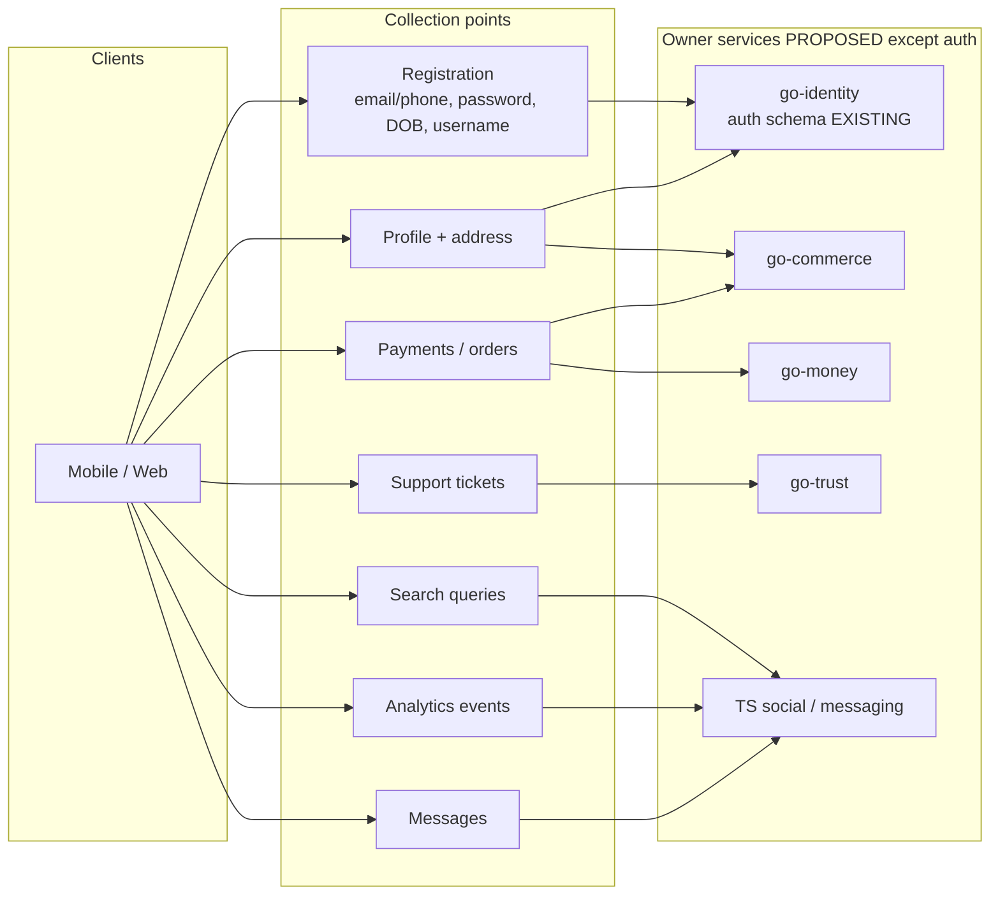
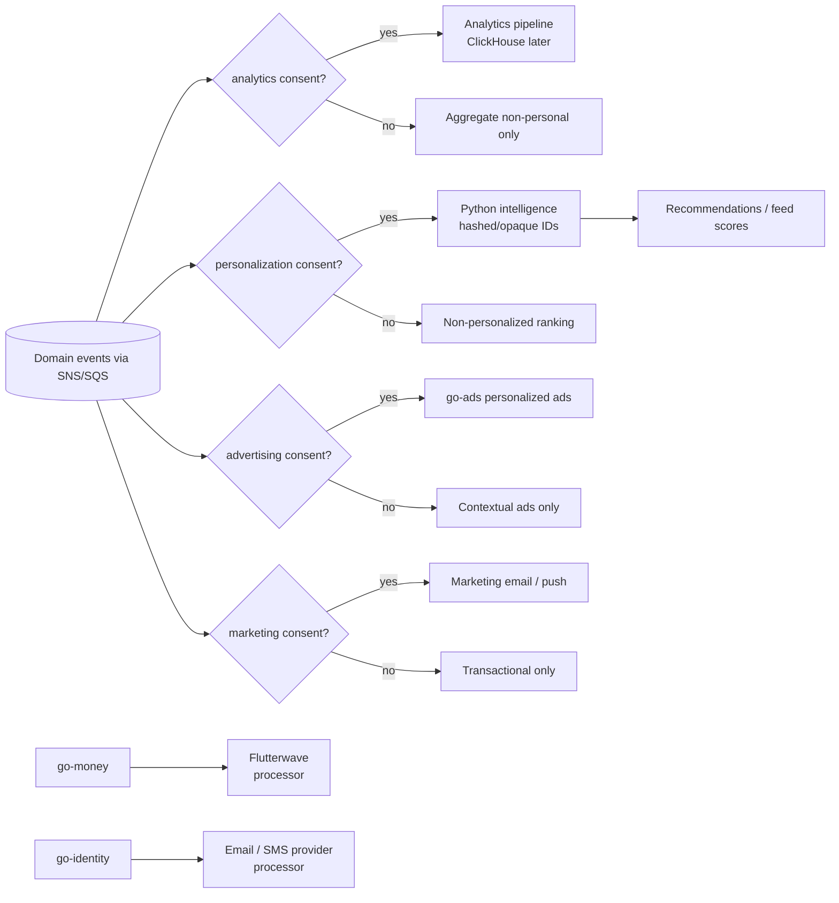
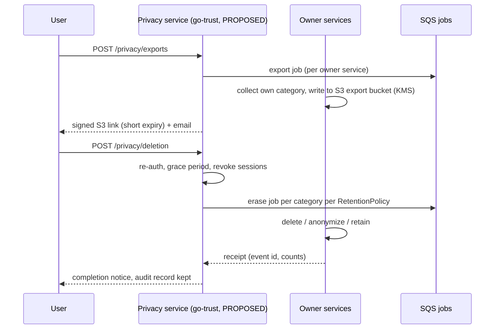

# Privacy architecture

> **Dated design document.** The status labels below describe the repo when this was written; much that is marked PROPOSED or ABSENT has since been built. For the current system see [system.md](system.md); where the two disagree, the code wins.

As of 2026-10-03. Designed to **support** GDPR where it applies and Nigeria's NDPA 2023. This document does **not** claim compliance with either. Legal basis, retention periods, cross-border transfer mechanisms, DPIAs, DPO/registration duties, breach notification timelines and policy text **require review by qualified counsel before launch**. No retention periods are set here; legal sets them (`docs/backendPlan.md` 4.7).

Labels: **EXISTING** / **MOCK-ONLY** / **PROPOSED** / **OPTIONAL FUTURE**.

## 1. What exists today

| Item | Status | Evidence |
| --- | --- | --- |
| Consent model (`UserConsent`, `TermsAcceptance`, `PolicyVersion`) | **ABSENT** in `services/**`; designed only | `backendPlan.md` 4.7, `inventory.md` s3 |
| Retention policy table and purge jobs | ABSENT | none |
| Data export / deletion endpoints | ABSENT in services; the old monolith has none verified | none |
| Privacy and terms pages | EXISTING static pages | `apps/web` (`/privacy`, `/terms`) |
| Consent banner | ABSENT | none |
| Log redaction | PROPOSED; the old monolith's log redactor | `SECURITY.md` |
| Python receives opaque IDs only | EXISTING contract | `services/python/intelligence/apiContract.md` |
| Auth events carry no password material | EXISTING | `services/go/modules/auth/src/events/outbox.event.go` |
| OTP delivery | `log` only, so no real email/SMS processor yet | `one_time_code.delivery.go` |

## 2. Personal-data flow

Diagram 1, collection to storage.

Diagram 2, secondary use and processors, gated by consent.

Flutterwave is the only payment processor (owner, 2026-10-11; [flutterwaveMigration.md](../integrations/flutterwaveMigration.md)). Data sent to Flutterwave as processor: buyer account email (receipts, never asked at checkout), name, amount and order metadata (no item details beyond ids); for wallet users, the BVN-verified name, an alias email (`u+{userId}@wallets.zudomart.com`) and phone to create their payout subaccount; BVN through Flutterwave's consent flow; sellers' and creators' bank account and legal name (account resolve, transfers). Card data is entered only on Flutterwave's hosted checkout; the server keeps only the Flutterwave card token, encrypted. Retention and the processor agreement need legal review.

Diagram 3, data subject requests.

## 3. Data classification

Retention policy key: `RetentionPolicy.categoryKey`, periods unset. Action: **D** delete, **A** anonymize, **R** retain (legal obligation, restricted access).

| Class | Category / key | Examples | Owner service | Storage | Deletion action | Notes |
| --- | --- | --- | --- | --- | --- | --- |
| PII | `identity` | email, phone, password hash, username, DOB, social ids | go-identity | Aurora `auth`, `users`; KMS | D after grace; keep tombstone for username block | `account`, `social_identity` ent tables EXISTING |
| PII | `profile` | display name, bio, avatar, links, interests | go-identity (users) | Aurora; S3 for avatar | D | private-profile flag honoured everywhere |
| PII | `address` | delivery addresses, geo | go-commerce | Aurora PostGIS; field encryption for street | D unless needed by open order; order snapshot A | order keeps snapshot until its retention ends |
| PII | `content` | posts, comments, clips, story | TS social / media | Aurora, S3 + CloudFront | D, or A (author to "deleted user") for threads others rely on | CDN purge on delete |
| PII | `messages` | DMs, attachments | TS/Phoenix messaging | Aurora, S3 | D own side; peer copy A | encryption keys PROPOSED (not designed) |
| PII | `device` | push tokens, device ids, IP, UA | go-identity | Aurora | D | sessions revoked on delete |
| Sensitive operational | `kyb` | KYB/KYC docs, selfie, ID numbers | go-trust | S3 (separate bucket, KMS key), Aurora | R per legal period then D | restricted role; access audited |
| Sensitive operational | `moderation` | reports, cases, decisions, suspensions | go-trust | Aurora | R then A | protects other users and platform |
| Sensitive operational | `support` | tickets, attachments | go-trust (support) | Aurora, S3 | A after period | redact PII in free text on request |
| Sensitive operational | `security` | login history, session reuse events, audit log | go-identity, audit | Aurora, CloudWatch | R (audit), D (login history) | audit actor ids pseudonymized on erasure, never deleted |
| Financial | `ledger` | journals, entries, balances | go-money | Aurora `ledger` | **R**, A the account holder link | never delete; immutability required |
| Financial | `payments` | provider refs, last4, status, refunds | go-money | Aurora | R then A | never store PAN or CVV |
| Financial | `bank` | payout bank account number, name | go-money | Aurora, field encryption | D when no pending payout and period over; else R | masked in responses |
| Financial | `orders` | order, groups, invoices, tax | go-commerce | Aurora | R (tax) then A buyer link | seller keeps needed fields |
| Analytics | `events` | views, taps, dwell, search terms | analytics pipeline | S3 Parquet, Valkey features, ClickHouse later | D or A (drop user id) | only with `analytics` consent; opaque ids |
| Analytics | `rankingProfile` | interests, embeddings, per-user features | Python intelligence | Valkey, Parquet | D | rebuilt only if `personalization` granted |
| Analytics | `adProfile` | audiences, hashed customer lists, attribution | go-ads | Aurora | D | only with `advertising` consent; advertiser lists are hashed |
| Consent | `consent` | `UserConsent`, `TermsAcceptance`, `PolicyVersion` | go-identity | Aurora (append-only) | **R** | proof of consent; user id kept, pseudonymous after erasure |

## 4. Consent model and enforcement points

Types: `essential`, `analytics`, `personalization`, `advertising`, `marketing`. Append-only rows, latest wins, each tied to a `policyVersionId`, kept separate from terms acceptance (PROPOSED).

| Enforcement point | Layer | Check | Failure behaviour |
| --- | --- | --- | --- |
| Web consent banner | Next apps, `apps/web` | no optional cookie/SDK until chosen; essential only (session, CSRF) | load nothing optional |
| Mobile SDKs | `apps/mobile` | init analytics/ads SDKs only after grant | skip init |
| Event ingestion | TS ingestion / `POST /v1/events` | drop events without `analytics` consent, or strip user id | drop silently, count metric |
| Ranking | TS feed orchestrator | pass `personalization` flag; Python returns non-personalized scores when false | generic ranking |
| Ad Decision Engine | go-ads | `advertising` required for personalized ads, age/region gate | contextual ads only |
| Messaging | notification service | `marketing` required for promo; transactional exempt | suppress send |
| Export to processors | outbox consumers | only consented categories leave the platform | skip |
| Consent cache | Valkey with short TTL, invalidated by `consent.changed` event | stale cache must not exceed TTL | fail to the more restrictive state |

Events: `consent.changed` is PROPOSED, no schema exists.

## 5. Data subject requests

| Request | Flow | Status |
| --- | --- | --- |
| Access / export | `POST /privacy/exports`, job per owner service, S3 link with short expiry, email; JSON plus media | PROPOSED |
| Rectification | normal profile edit endpoints | PROPOSED |
| Deletion | `POST /privacy/deletion`, re-auth, grace period, then per `RetentionPolicy` action; ledger, tax, KYB retained or anonymized | PROPOSED |
| Withdraw consent | `POST /privacy/consents`; propagates by event | PROPOSED |
| Restrict / object | per-consent toggles; `private profile`, `who can message me` | MOCK-ONLY settings UI |
| Backups | Deleted data persists in backups until they expire; restores must replay a deletion ledger. See `disaster-recovery.md` | PROPOSED |

## 6. Cross-cutting rules

| Rule | Detail |
| --- | --- |
| Minimization | A field without a documented purpose in the `DataCategoryRegister` is not collected |
| Pseudonymous IDs to Python | opaque or hashed ids only; no email, phone, address |
| Logs | PII redacted before shipping (`observability.md`); search terms never in access logs |
| Field encryption | bank, KYB, street addresses under envelope encryption with a KMS data key |
| Residency | Single region choice is a counsel decision (transfer mechanisms); S3 and Aurora region fixed per environment |
| Processors | List maintained: AWS, payment providers, email/SMS, push (APNs/FCM), LiveKit, any analytics. DPAs required |
| Minors | Age gate at registration; ads and DMs for minors are counsel decisions |
| Breach | Detection via GuardDuty, audit alerts; notification process is a counsel/runbook item |

## 7. Recommendations

### P1. Consent service and register before analytics or ads
- **Problem:** nothing records consent; analytics ingestion and ads cannot honour it.
- **Current:** `POST /v1/events` accepts events without a consent check; consent ABSENT.
- **Why it matters:** collecting without a recorded basis is the largest regulatory exposure, and retrofitting is costly.
- **Recommendation:** add `consent` schema in go-identity (3 ent entities, append-only), `consent.changed` event with JSON Schema, and a consent flag in the event envelope so ingestion can drop at the edge.
- **Complexity:** M. **Risk:** low. **Priority: P1**, must precede any real event collection or personalized ad.
- **Tag:** MVP.

### P2. Retention table and erasure jobs per owner
- **Problem:** no retention keys, no purge.
- **Recommendation:** shared `RetentionPolicy` in go-identity; each owner exposes an `Erase(accountId, mode)` consumer on a `privacy-jobs` SQS queue; receipts written to audit.
- **Complexity:** L. **Risk:** medium (cross-service). **Priority: P2**, needed before launch but after the first data owners exist.
- **Tag:** Near term.

### P3. Real OTP delivery with processor review
- **Problem:** OTP only logs; adding email/SMS adds a processor.
- **Recommendation:** pick provider with DPA; keep message bodies free of PII beyond code.
- **Complexity:** S. **Risk:** low. **Priority: P1**, registration cannot go live without it.
- **Tag:** MVP.

### P4. Deletion ledger for backup restores
- **Problem:** restoring a snapshot would resurrect erased users.
- **Recommendation:** store `(account_id, erased_at)` in a tiny separate table/bucket; DR runbook replays it after restore.
- **Complexity:** S. **Risk:** low. **Priority: P2**.
- **Tag:** Near term.

### P5. Counsel review checklist
Policies, retention periods per category, legal bases, transfer mechanisms, DPO/registration obligations, age rules, advertiser list handling, KYB retention. **Priority: P0 for launch, no code dependency.**
