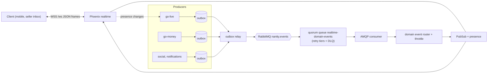
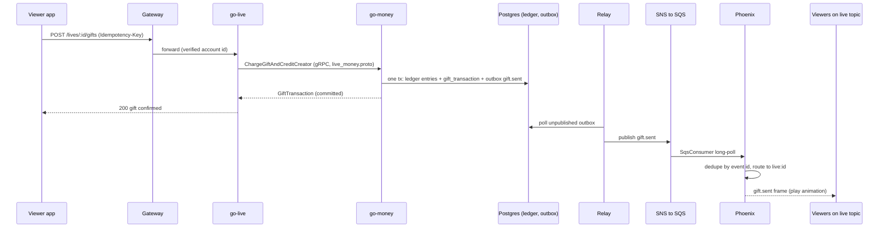
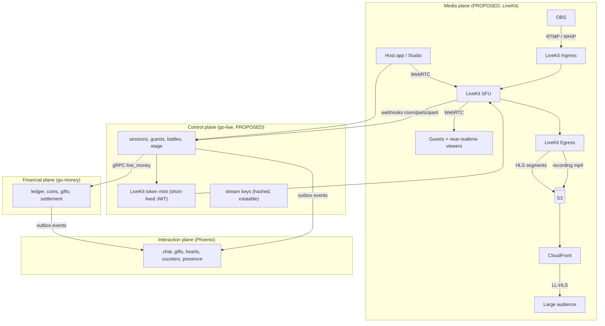

# Realtime and livestream architecture

Sections 1 and 2 were rewritten on 2026-10-11 from the code. Sections 3 to 7 are the design of 2026-10-03: their status labels are dated, and where they mention SNS or SQS, read RabbitMQ. The current overview is [system.md](system.md) section 9.

## 1. What exists

| Item | Evidence |
| --- | --- |
| Raw JSON WebSocket at `/ws` (a `Phoenix.Socket.Transport`, not Phoenix Channels), 16 KB maximum frame, origin check against `ALLOWED_ORIGINS`, `GET /healthz`, per-account limits (by default 5 connections and 120 frames a minute) | `lib/realtimeWeb/realtime.endpoint.ex`, `origin.policy.ex`, `lib/realtime/connections/connection.limiter.ex` |
| Auth: the first frame must be `{type: "auth", accessToken}` within 10 s, or the socket closes with 4401. The token is a realtime token (audience `nantty-realtime`, from `POST /api/v1/auth/realtime-token`), checked against go-identity's JWKS with a key cache and a revocation list | `lib/realtimeWeb/clientSocket.socket.ex`, `lib/realtime/auth/*` |
| Client frames: `ping`, `auth`, `subscribe`, `unsubscribe`, `typing`; at most 50 subscriptions per socket | `clientSocket.socket.ex` |
| Topics: `user:<id>` for the account itself only; `conversation:<id>` after a membership check with the social service; `live:<id>` and `battle:<id>` after an access check with go-live | `lib/realtime/topics/topic.authorizer.ex`, `conversationMembership.client.ex`, `liveAccess.client.ex` |
| Live presence: joins and leaves are batched and posted to go-live, which owns viewer counts | `lib/realtime/presence/livePresence.forwarder.ex`, `livePresence.client.ex` |
| RabbitMQ consumer of `realtime-domain-events`, deduplicating the last 10 000 event ids, with retry and dead-letter handling from the broker topology | `lib/realtime/events/amqp.consumer.ex`, `infra/local/rabbitmq/topology.json` |
| Event routing to topics with throttles for high-rate updates; account enforcement (suspension, ban or session revocation closes the affected sockets) | `lib/realtime/events/domainEvent.router.ex`, `conversationEvent.router.ex`, `accountEnforcement.router.ex`, `throttle.util.ex` |
| Clients: the mobile app (`apps/mobile/src/services/core/realtime.service.ts`, with a mock emitter in mock mode) and the seller inbox (`apps/seller/src/services/realtime/`, through its BFF) | |
| Live media: LiveKit rooms, tokens, RTMP and WHIP ingress, egress recordings, all driven by go-live | `services/go/modules/live/src/integrations/liveKit*.integration.go` |

## 2. Core flow

Rule: Phoenix only **fans out facts** it consumed from the bus. It never debits, credits, scores money or decides battle winners. Client-originated frames are limited to `auth`, `subscribe`, `unsubscribe`, `typing` and `ping`. Chat message bodies are end-to-end encrypted: realtime relays the ciphertext the social service stored and cannot read it.

## 3. Event catalogue by feature

| Feature | Path | Topic / event | Status |
| --- | --- | --- | --- |
| Messaging | client POST message to TS/Phoenix persistence, then `message.created` | `conversation:<id>` / `message.created` | router EXISTING, producer + membership PROPOSED |
| Typing | client frame `typing` relayed over PubSub | `conversation:<id>` / `typing` | EXISTING |
| Live chat | PROPOSED: comment via go-live API (moderation filter, rate limit) then event | `live:<id>` / `live.comment` (name not in router yet) | PROPOSED |
| Gift animations | `gift.sent` from go-live after money confirms | `live:<id>` / `gift.sent`, `gift.goal.progress`, `gift.goal.completed` | router EXISTING, producer ABSENT |
| Likes (post) | aggregated counter events, not per-like frames | `post:<id>` counter | PROPOSED, see section 6 |
| Likes (live hearts) | client sends via HTTP/batched frame; server aggregates to bursts | `live:<id>` / `live.hearts` | PROPOSED |
| Comments (post) | `comment.created` to post topic, only for open detail screens | PROPOSED | PROPOSED |
| Notifications | `notification.created` to `user:<accountId>` | `user:<id>` | router EXISTING, producer ABSENT |
| Presence / viewer count | `live.viewerCountChanged` throttled 2 s | `live:<id>` / `live.viewerCount` | router EXISTING |
| Stream rankings | `leaderboard.updated` throttled 1 s | `live:<id>` / `leaderboard.updated` | router EXISTING |
| Battles | `battle.created/started/scoreUpdated (500 ms)/ended/settled/cancelled/winnerCelebrated` | `live:<id>` | router EXISTING, producer ABSENT |
| Guests / stage | `guest.joined/left/removed/muted/reconnecting`, `stage.updated`; `guest.invited` to `user:*` | `live:<id>`, `user:<id>` | router EXISTING |
| Live safety | go-live emits `liveSafety.paused/resumed` (no reason, viewers blur) and `liveSafety.hostNotice` (reason, appeal) after go-trust decisions; see [liveSafety.md](liveSafety.md) | `live:<id>` / `live.safety.paused`, `live.safety.resumed`; `user:<hostId>` / `live.safety.hostNotice` | router EXISTING |

## 4. Gift sent: money first, then pixels

| Point | Detail |
| --- | --- |
| Proto | `ChargeGiftAndCreditCreator`, `SettleBattle`, `GetBattleGiftTotals`, `GetCoinBalance` in `live_money.proto`; **no server or client implementation exists** (EXISTING contract only) |
| Atomicity | Charge, credit, platform cut and outbox row commit in one go-money transaction. Animation is shown only after the committed event. The sender may show an optimistic local animation clearly marked pending and roll back on error |
| Idempotency | Client `Idempotency-Key` becomes the transaction idempotency key at go-money; a retry returns the same `GiftTransaction`. Phoenix also dedupes on event id (window 10 000, in memory, per node) |
| Failure | Relay failure only delays animation, never money. Relay has no attempt counter (retries forever, `outbox.relay.go`): add one (see R4) |
| Phoenix down | Money is already safe. Clients resync totals from `GET` (go-live read model) on reconnect |

## 5. Scaling

| Topic | Current | Recommendation |
| --- | --- | --- |
| Clustering | `dns_cluster` dep present; PubSub is local PG2 so cross-node broadcast needs the nodes connected | ECS service discovery DNS + `dns_cluster`, 2+ tasks. **MVP** |
| Fan-out of SQS events across nodes | Each node polling the **same** queue gets a random subset; a message processed on node A is broadcast only to node A's sockets unless PubSub spans the cluster | Keep nodes clustered so `Phoenix.PubSub.broadcast` reaches all nodes. Alternative if clustering is unwanted: one queue per node via SNS (fan-out), dedupe per node. Decide before 2nd node |
| Sticky sessions | Not needed: a socket stays on one task for life, and any node can serve any reconnect because state is rebuilt from `subscribe` + HTTP resync | ALB without stickiness; idle timeout above 60 s heartbeat interval. **MVP** |
| Connection capacity | no load test, no limits beyond 50 subs/socket and 64 KB frame | Load test (k6 websocket) to establish per-task connections; scale on connections and scheduler utilisation, not CPU. **Near term** |
| Big rooms | all `live:<id>` events go to every subscriber | Throttles exist for counters (0.5-2 s). Add: hearts aggregated into 500 ms bursts with counts; gift animations for `large/global` tiers prioritised, small gifts coalesced per sender per second; chat sampled above a rate (for example above 20 msg/s show a sampled subset plus "slow mode") **Scale stage** |
| Backpressure | `Throttle` for counters only; no per-socket queue cap | Cap per-socket mailbox (drop low-priority events when over a limit, close at a hard limit); metric on drops. **Near term** |
| Reconnect / resync | client backoff exists; **no sequence numbers or replay** | Add `seq` per topic in broadcast payloads; on reconnect client calls snapshot endpoint (viewer count, leaderboard, goal, stage, active battle, last N chat) then resumes; missed gifts are reconciled from go-live not replayed. **MVP for live** |
| Redis | not used by Phoenix (`phoenix_pubsub-redis` absent) | Do not add; use node clustering until a connection-count trigger (more than ~1 task of connections) forces a review |
| Auth expiry | token verified once at connect | Close socket at access token expiry or accept a re-`auth` frame; revoked sessions otherwise stay connected until reconnect |

## 6. Livestream architecture

| Plane | Responsibility | Status |
| --- | --- | --- |
| Media | LiveKit SFU for hosts and guests (up to ~10 publishers), RTMP/WHIP ingest for OBS, egress to HLS on S3/CloudFront for large audiences, recording to S3 | PROPOSED; `livekit` service in `infra/local/docker-compose.yml` EXISTING (local only) |
| Control | `live_sessions` (28 columns incl. `livekit_room`, `live_ad_settings`, `sponsorship_line`), guest slots, battles, products pinned, token minting (`POST /lives/:id/media-token` in `backendPlan.md`) | schema + migration EXISTING in `services/go/modules/live/internal/{ent,migrations}`; `live.module.go` is `RoutelessModule`, handlers ABSENT |
| Financial | Gifts, coin balances, battle settlement, creator share and holding account, points are never money | go-money PROPOSED; proto EXISTING |
| Interaction | Everything in sections 2-3 | Phoenix EXISTING (no producers) |

Viewer delivery rule (PROPOSED): below a threshold of concurrent viewers per room serve WebRTC from the SFU; above it, switch new viewers to LL-HLS from CloudFront. Pick the threshold from LiveKit node load tests. **Scale stage**.

Supporting concerns on the live path:

| Concern | Design | Status |
| --- | --- | --- |
| Moderation | chat text filter and rate limit in go-live before event publish; report/ban actions go to go-trust; host can mute/kick via LiveKit server API; frame sampling by a classifier on egress thumbnails | PROPOSED |
| Notifications | `live.started` to followers via notification worker (SQS job queue `jobs-email`/push), respecting per-user prefs | PROPOSED |
| Leaderboards | live board in Redis (`lb:live:{liveId}`), final board stored per stream; weekly/all-time from ClickHouse; `points_entry`, `live_leaderboard_entry` schemas EXISTING | schema EXISTING, logic PROPOSED |
| Analytics | `live.*` and `gift.*` events to the analytics pipeline, see `analytics.md` | PROPOSED |
| Live ads | only where `live_ad_settings` permit and `accepted_live_ad_terms_version` is set; selection by go-ads; sponsorship line shown to viewers | columns EXISTING, behaviour PROPOSED |
| Stream key security | store hash only, show once, rotate on demand, bind ingress to one room, never in logs | PROPOSED |

## 7. Recommendations

| # | Problem | Current | Why it matters | Recommendation | Complexity | Risk | Priority |
| --- | --- | --- | --- | --- | --- | --- | --- |
| R1 | Router handles events nobody emits | 21+ types, 3 schemas, 0 live producers | first live release cannot work end to end | Define JSON Schemas + AsyncAPI for `gift.sent`, `live.*`, `battle.*`, `message.created`, `notification.created` before building producers. **MVP** | Medium | Low | P0: nothing else in live can be tested without it |
| R2 | `conversation:*` denies everyone | membership checker default | chat cannot ship | membership source: ETS cache filled from a conversation-membership event or a read-only DB grant, with TTL. **MVP** | Medium | Medium | P1 |
| R3 | `live:*`/`battle:*` open to any authenticated user, including private or blocked users | `topic_authorizer.ex` | private lives and blocks leak | check visibility, blocks, and country gating via go-live callback or cached read model. **MVP** | Medium | Medium | P1 |
| R4 | Outbox relay retries forever, SNS filter policy absent | `outbox.relay.go`; local subscriptions without filter (inventory gaps 4) | poison event blocks a batch; every consumer receives all events | attempt counter + parked state; filter policies on `eventType` (requires message attributes, not raw delivery only). **MVP** | Low | Low | P1 |
| R5 | No resync after reconnect | no `seq`, no snapshot | missed counters and stage changes after network blips on mobile | `seq` per topic + snapshot endpoint. **MVP** | Medium | Low | P1 |
| R6 | Per-node in-memory dedupe and local PubSub | 10 000-id window | duplicate animations when a message redelivers to another node | keep clustering; dedupe window also by event id at consumer; idempotent client rendering by event id. **Near term** | Low | Low | P2 |
| R7 | Token not re-validated after connect | single auth frame | revoked sessions keep live sockets | expiry-bound sockets with `auth.refresh` frame. **Near term** | Low | Low | P2 |
| R8 | Kafka/MSK, Redis PubSub | not used | not justified now | Revisit only if SQS consumer lag (`ApproximateAgeOfOldestMessage`) exceeds 5 s sustained at peak, or event rate exceeds ~5k/s per queue | n/a | n/a | P3 |
