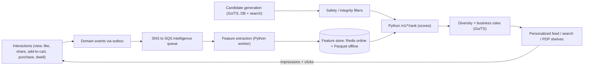

# Recommendations and personalization

As of 2026-10-04 (section 7 added: fair ranking, anti-manipulation, trends, Explore). Sources: `inventory.md` 2.6; `apps/intelligence/apiContract.md` (sections 4, 6, 7); `docs/backendPlan.md` (consent, ranking). Labels: EXISTING, PROPOSED, OPTIONAL FUTURE.

Principle: Python returns **scores and orderings**; Go/TS own candidate sets, eligibility, safety and the final decision. If Python is down, the request still succeeds with a deterministic ranking.

## 1. What exists

| Item | Status | Evidence |
| --- | --- | --- |
| FastAPI scoring service, 12 modules (feed, clips, recommendations, trending, search rerank, social proof, ads, risk, experiments, audio, events_ingestion, model_registry) | EXISTING | `apps/intelligence/src/modules/*` |
| Endpoints `POST /v1/events`, `/v1/feed/rank`, `/v1/clips/rank`, `/v1/recommendations/{products,accounts,clips}`, `/v1/trending`, `/v1/search/rerank`, `/v1/risk/score`, `/v1/ads/select` | EXISTING | `apiContract.md` section 7 |
| HMAC-signed requests (300 s skew, Redis nonce), Redis online features, Parquet feature logs, 15 pytest files | EXISTING | `apiContract.md` section 2 |
| Callers (Go/TS), SQS consumer (`intelligence-domain-events` queue exists in LocalStack, no consumer code), feature store job, seller recommendations | **ABSENT** | inventory gaps 3 |
| Consent model (`UserConsent`) and enforcement | ABSENT (plan only, `backendPlan.md` 4.7). Search rerank has a `personalization_weight` field but nothing reads consent | grep |

## 2. Pipeline

| Stage | Owner | Detail | Status |
| --- | --- | --- | --- |
| Events | all services | envelope `{eventId,eventType,occurredAt,actorId,country,context{surface,rankingRequestId,experimentAssignments}}`; `POST /v1/events` with 2 s timeout, kept in outbox, retried with same `eventId` | contract EXISTING, producers PROPOSED |
| Feature extraction | Python | consume SQS (not built); aggregate counts, recency, completion rate, affinity per topic/category/author | PROPOSED |
| Feature store | Redis (online), Parquet (offline) | `src/repositories`, `src/utils` | EXISTING (storage), pipeline PROPOSED |
| Candidate generation | Go/TS | up to 500 candidates from DB (following graph, topic, popularity, nearby via PostGIS); products also from OpenSearch (`search.md`) | PROPOSED |
| Safety / integrity | Go/TS (go-trust, blocks, reports) | drop blocked/muted/hidden/seen, sensitive, reported, AI-flagged where advertiser excludes, out-of-stock, unavailable in region, unverified sellers over risk threshold. **Before ranking**, so ranking can never resurrect an unsafe item | PROPOSED |
| Ranking | Python | feed: engagement x recency x affinity; `maximumProductPostShare` 0.4, `topicRepeatPenalty` 0.85 | EXISTING |
| Diversity | Python options + Go/TS enforcement | `maxConsecutiveSameAuthor` 1, `maxConsecutiveProductPosts` 2, topic window 3, social-proof gap 5 | EXISTING (options) |
| Serve | Go/TS | cursor-paginated feed with a stable `rankingRequestId` per page set; cache first page in Redis for seconds | PROPOSED |

## 3. Surfaces

| Surface | Candidates | Python endpoint | Notes |
| --- | --- | --- | --- |
| Feed (For You / Following) | followed + topic + trending + fresh posts (14-day window, 300 candidates) | `/v1/feed/rank` (250 ms, deterministic fallback) | Following = reverse chronological, no Python. See section 7 |
| Clips | recent, topic, creator-following | `/v1/clips/rank` | completion-rate driven |
| Products (PDP, home mart, cart) | same category, same store, co-purchase | `/v1/recommendations/products` (150 ms) | |
| Creators / accounts | mutual follows, topic | `/v1/recommendations/accounts` | |
| Sellers / stores | category fit, rating, fulfilment reliability | no endpoint yet | PROPOSED (add `/v1/recommendations/sellers`) |
| Search | OpenSearch top-K | `/v1/search/rerank` (100 ms) | relevance first, personalization weight default 0.2 |
| Trending | 24 h counts with distinct-user threshold, per country and category | `/v1/trending`, `/v1/trending/headlines` | manipulated items excluded, section 7 |
| Live discovery | live now, followed hosts, country | feed-like rank, PROPOSED | |

## 4. Deterministic fallback (Python down or slow)

Mandatory, implemented in Go/TS (PROPOSED), values from `apiContract.md` section 4. Circuit breaker: open after 5 consecutive failures or more than 50% errors in 10 s, half-open after 5 s.

| Surface | Timeout | Fallback ranking |
| --- | --- | --- |
| Feed For You | 250 ms (was 100 ms; section 7.5) | quality x integrity x capped boost: `(log1p(I) * (1 + 2*I/reach) + 0.5*log1p(I/sqrt(age)) + 0.1) * 0.5^(age/18h)`, `I = (likes + 2*saves + 3*comments + 4*(reposts+shares)) * trustedShare`; no consecutive author, max 3 per author in the first 30 (`deterministicFeedRanker.integration.ts`) |
| Clips | 100 ms | recency x historical completion rate |
| Products | 150 ms | same category or same store bestsellers, in stock only |
| Accounts | 150 ms | most mutual follows, then followers |
| Search | 100 ms | engine text relevance order |
| Trending | 150 ms | count over last 24 h |
| Risk | 120 ms | conservative rules, unknown means `review`; never auto-ban |
| Ads | 120 ms | no ads, or highest-bid eligible within budget |

Signals in fallback score (all deterministic): popularity, recency, text relevance, availability (stock > 0, seller active), location (same country/region boost, PostGIS distance for local), and history (only with consent, section 5).

## 5. Personalization consent

| Rule | Detail | Status |
| --- | --- | --- |
| Source of truth | versioned `UserConsent` rows, append-only, latest wins, separate from terms acceptance (`backendPlan.md` 4.7) | PROPOSED |
| No `personalization` consent | ranking ignores the viewer's interaction history and uses context + popularity only; stored events are aggregate and non-personal | PROPOSED |
| No `analytics` consent | event dropped at ingestion (`events_ingestion`) | PROPOSED |
| No `advertising` consent | contextual ads only | PROPOSED |
| Enforcement point | the **caller** (Go/TS) strips `viewer` history fields before calling Python and tags the request `personalized:false`; Python also treats missing history as cold start. Do not rely on Python alone | PROPOSED |
| Withdrawal | consent withdrawal event deletes or stops using the user's online features within a bounded time | PROPOSED |
| Claims | documents describe controls; they do not claim legal compliance | policy |

## 6. Recommendations (engineering)

| # | Problem | Current | Why it matters | Recommendation | Complexity | Risk | Priority |
| --- | --- | --- | --- | --- | --- | --- | --- |
| RC1 | No consent model, yet ranking and ads depend on it | ABSENT | personalization would run on everyone | build consent table and caller-side stripping before any personalized call. **MVP** | Medium | High if skipped | P0: privacy control must exist before personal data feeds ranking |
| RC2 | No caller or fallback code | none | feed outage if Python is slow | ship fallback ranker + breaker first, add Python later as an enhancement. **MVP** | Medium | Low | P1: availability of the home feed |
| RC3 | `intelligence-domain-events` has no consumer | queue exists, no code | features never update | SQS worker that batches to `/v1/events` or writes features directly. **Near term** | Medium | Low | P2 |
| RC4 | No offline eval or experiment loop wired | experiments endpoints exist | cannot prove a ranker beats the fallback | log `rankingRequestId` + impressions + outcomes; use `/v1/experiments/assign`, compare against fallback arm. **Near term** | Medium | Low | P2 |
| RC5 | Python in the request path | 100-150 ms budgets | tail latency | keep strict timeouts; cache rank results per (viewer, surface) for 30-60 s. **MVP** | Low | Low | P2 |
| RC6 | Seller recommendations undefined | no endpoint | seller discovery is a stated surface | add rule-based seller shelf first (rating, fulfilment, category) in Go. **Near term** | Low | Low | P3 |

## 7. Fair ranking, anti-manipulation and trends (2026-10-04)

Owner rules: the feed is not manipulable and favours nobody in secret; suggestions follow what is trending and what the viewer engages with; checkmark tiers and Official accounts get a **modest, capped, disclosed** boost; free accounts can go viral; all weights are admin-configurable within server-side caps and every change is audited; the rules are disclosed in the help article "How your feed works" and the terms. Status: EXISTING (built, tested, mock UI).

### 7.1 Pipeline

| Stage | Where | What |
| --- | --- | --- |
| Candidates | social `rankedFeed.service.ts` | recent public posts (following, interests via affinity, trending hashtags, fresh); country from the viewer profile or `?country` |
| Safety and integrity | social (before ranking) + Python (defence in depth) | age gate and sensitive labels (`isPostWithheldFromViewer`), blocked both ways, private and suspended authors, "Not interested"/hidden, spam hashtags; Python drops `ageRestricted`/`isSensitive` for non-adults |
| Integrity signals | social `engagementIntegritySignals.service.ts` + Python online counters | per post: engager count, new-account share (< 7 days), suspended engagers, reciprocal pods (author liked the engager in the last 7 days), 10-minute burst ratio, spam hashtags; Valkey adds clustered (same IP/device cluster key per hour) and low-trust engager counts written at ingestion |
| Ranking | Python `feed_ranking_service.py` (or the TS fallback) | engagement velocity normalised by reach, completion/dwell, replies/reposts/saves/shares, recency decay, author-quality prior, personalisation only with consent; engagement counts are multiplied by the trusted share **before** scoring; `author_is_verified` is neutralised so no model can learn a hidden checkmark boost |
| Capped boost | `ranking_boost_policy_service.py`, `rankingBoostPolicy.util.ts` | multiplier per tier, then x Official editorial boost, combined cap 1.25 |
| Diversity | Python `diversity_reranking_service.py`, TS `applyAuthorDiversity` | no consecutive same author, topic repeat penalty, product share cap, max 3 posts per author in the first 30 |
| Explanations | Python `feed_fairness_service.py`, TS `explainCandidate` | `explanations[]` on each item and `PostView.ranking`: following, trending_topic, similar_to_liked, popular_near_you, friends_engaged, popular, fresh, promoted, checkmark_boost / official_boost (with the boost percentage) |

### 7.2 Boost caps (hard, enforced in Go admin validation, Python and TS)

| Tier | Default | Hard cap |
| --- | --- | --- |
| Blue Essential | +2% | +5% |
| Blue Verified | +4% | +8% |
| Premium | +6% | +10% |
| Gold Business | +8% | +12% |
| Black / Official | +10% | +15% |
| Official editorial (admin-created + checkmark) | +10% | +15% |
| Combined | | +25% |

Order Black >= Gold >= Premium >= Blue Verified >= Blue Essential is enforced. Setting `feed.ranking` (Go admin platform settings, `config:rules`, versioned, reason required, audited, outbox `platformSetting.changed`); unknown fields are rejected, so there is no push or pin lever. Social reads it through `GET /api/v1/internal/platform-config/feed.ranking` (60 s cache, defaults on failure) and re-clamps. Tiers come from `users.profile_checkmarks` (black, gold, blue + Premium entitlement) and Official from `users.admin_created_accounts` (new read grant, migration `20261004160000`).

### 7.3 Anti-manipulation

| Signal | Effect |
| --- | --- |
| Suspended, new (< 7 days), low-trust engagers | discounted 100% / 75% / 75% of their share |
| Same IP/device cluster within an hour (`context.actorClusterKey`) | trending weight x0.1, counted as clustered |
| Low-trust actor (`context.actorTrust` new/low) | trending weight x0.25 |
| Per-actor velocity | more than 60 engagements an hour stop counting for trends |
| Bursts (> 60% of likes in 10 minutes, 20+ likes) | extra discount |
| Like pods (> 50% reciprocal) | discounted, flagged |
| Purchased engagement | trusted share <= 20%, flagged |
| Spam hashtags (follow4follow, repeated characters, long digit runs) | excluded from trends, penalised in ranking |

An item with 10+ engagers and >= 50% suspicious engagement is **manipulated**: excluded from trends and headlines, returned in `manipulatedItemIds`, and the author is sent to go-trust as an advisory suspension case (`source=engagement_integrity`, deduplicated per account per day). Admins see them under Trust & safety > Manipulation flags (`/admin/suspensions/cases?modelVersion=engagement_integrity`).

### 7.4 Trends, headlines, Explore

| Endpoint (social, guest-viewable GET) | Detail |
| --- | --- |
| `/api/v1/explore/trends?country&category&limit` | intelligence `/v1/trending` (hashtags per country, category filter) merged with the deterministic 24 h aggregate (>= 3 distinct authors, max 2 posts per author count, spam excluded, removals excluded) |
| `/api/v1/explore/headlines?country&category` | intelligence `/v1/trending/headlines` clusters public, non-sensitive, non-manipulated posts by hashtag, needs 3+ posts from 3+ authors, extractive neutral title (sensational words, mentions, links, emoji stripped; politics and religion use the template), template fallback "People are posting about #tag"; always `sourceLabel: "Summarised from posts"` with the post ids |
| `/api/v1/explore/who-to-follow` | mutuals, liked authors, popular in your region; excludes blocked, private, suspended and already-followed accounts; `isOfficial` label; no boost |
| `/api/v1/explore/posts-for-you?category` | the ranked feed filtered by category (hashtag taxonomy) or trending hashtags |
| `/api/v1/explore/categories` | For you, Trending, News, Sports, Entertainment, Music, Tech, Business, Fashion, Gaming, Comedy, Religion, Food, Politics, Lifestyle |

Politics trends need twice the distinct-actor threshold. Admins can only remove a trend or headline (`trending.moderation` setting, `PUT /api/v1/admin/trending/moderation`, `content:review` or `moderation:reports`, step-up, policy reason code + note + audit reason).

### 7.5 Latency and fallback

In-process the Python feed path is 3.7 ms for 100 candidates and 4-5 ms through HTTP with signing (measured 2026-10-04); the 119 ms p95 in `finalCheckReport.md` was queueing in a single uvicorn worker at 10 VUs with no think time. Changes: `INTELLIGENCE_SERVER_WORKERS` (default 1, 2 in AWS), the consent read now runs in the same parallel Valkey round trip as the other features, and social's client timeout is 250 ms (`FEED_RANK_TIMEOUT_MS`, above the measured p99 of 214 ms) with a circuit breaker (5 failures, 5 s open) and the deterministic fair ranker as fallback. Re-run the k6 feed scenario with 2 workers to confirm.
