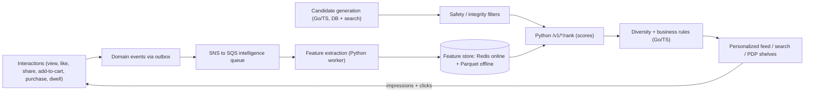

# Recommendations and personalization

As of 2026-10-03. Sources: `inventory.md` 2.6; `apps/intelligence/apiContract.md` (sections 4, 6, 7); `docs/backendPlan.md` (consent, ranking). Labels: EXISTING, PROPOSED, OPTIONAL FUTURE.

Principle: Python returns **scores and orderings**; Go/TS own candidate sets, eligibility, safety and the final decision. If Python is down, the request still succeeds with a deterministic ranking.

## 1. What exists

| Item | Status | Evidence |
| --- | --- | --- |
| FastAPI scoring service, 12 modules (feed, clips, recommendations, trending, search rerank, social proof, ads, risk, experiments, audio, events_ingestion, model_registry) | EXISTING | `apps/intelligence/src/modules/*` |
| Endpoints `POST /v1/events`, `/v1/feed/rank`, `/v1/clips/rank`, `/v1/recommendations/{products,accounts,clips}`, `/v1/trending`, `/v1/search/rerank`, `/v1/risk/score`, `/v1/ads/select` | EXISTING | `apiContract.md` section 7 |
| HMAC-signed requests (300 s skew, Redis nonce), Redis online features, Parquet feature logs, 15 pytest files | EXISTING | `apiContract.md` section 2 |
| Callers (Go/TS), SQS consumer (`intelligence-domain-events` queue exists in LocalStack, no consumer code), feature store job, seller recommendations | **ABSENT** | inventory gaps 3 |
| Consent model (`UserConsent`) and enforcement | ABSENT (plan only, `backendPlan.md` 4.7). Search rerank has a `personalization_weight` field but nothing reads consent | grep |

## 2. Pipeline

| Stage | Owner | Detail | Status |
| --- | --- | --- | --- |
| Events | all services | envelope `{eventId,eventType,occurredAt,actorId,country,context{surface,rankingRequestId,experimentAssignments}}`; `POST /v1/events` with 2 s timeout, kept in outbox, retried with same `eventId` | contract EXISTING, producers PROPOSED |
| Feature extraction | Python | consume SQS (not built); aggregate counts, recency, completion rate, affinity per topic/category/author | PROPOSED |
| Feature store | Redis (online), Parquet (offline) | `src/repositories`, `src/utils` | EXISTING (storage), pipeline PROPOSED |
| Candidate generation | Go/TS | up to 500 candidates from DB (following graph, topic, popularity, nearby via PostGIS); products also from OpenSearch (`search.md`) | PROPOSED |
| Safety / integrity | Go/TS (go-trust, blocks, reports) | drop blocked/muted/hidden/seen, sensitive, reported, AI-flagged where advertiser excludes, out-of-stock, unavailable in region, unverified sellers over risk threshold. **Before ranking**, so ranking can never resurrect an unsafe item | PROPOSED |
| Ranking | Python | feed: engagement x recency x affinity; `maximumProductPostShare` 0.4, `topicRepeatPenalty` 0.85 | EXISTING |
| Diversity | Python options + Go/TS enforcement | `maxConsecutiveSameAuthor` 1, `maxConsecutiveProductPosts` 2, topic window 3, social-proof gap 5 | EXISTING (options) |
| Serve | Go/TS | cursor-paginated feed with a stable `rankingRequestId` per page set; cache first page in Redis for seconds | PROPOSED |

## 3. Surfaces

| Surface | Candidates | Python endpoint | Notes |
| --- | --- | --- | --- |
| Feed (For You / Following) | followed + topic + trending posts | `/v1/feed/rank` (100 ms) | Following = reverse chronological, no Python |
| Clips | recent, topic, creator-following | `/v1/clips/rank` | completion-rate driven |
| Products (PDP, home mart, cart) | same category, same store, co-purchase | `/v1/recommendations/products` (150 ms) | |
| Creators / accounts | mutual follows, topic | `/v1/recommendations/accounts` | |
| Sellers / stores | category fit, rating, fulfilment reliability | no endpoint yet | PROPOSED (add `/v1/recommendations/sellers`) |
| Search | OpenSearch top-K | `/v1/search/rerank` (100 ms) | relevance first, personalization weight default 0.2 |
| Trending | 24 h counts with distinct-user threshold | `/v1/trending` | |
| Live discovery | live now, followed hosts, country | feed-like rank, PROPOSED | |

## 4. Deterministic fallback (Python down or slow)

Mandatory, implemented in Go/TS (PROPOSED), values from `apiContract.md` section 4. Circuit breaker: open after 5 consecutive failures or more than 50% errors in 10 s, half-open after 5 s.

| Surface | Timeout | Fallback ranking |
| --- | --- | --- |
| Feed For You | 100 ms | `(likes + 2*comments + 3*shares + 1) / (ageHours + 2)^1.5`, cap 1 consecutive post per author |
| Clips | 100 ms | recency x historical completion rate |
| Products | 150 ms | same category or same store bestsellers, in stock only |
| Accounts | 150 ms | most mutual follows, then followers |
| Search | 100 ms | engine text relevance order |
| Trending | 150 ms | count over last 24 h |
| Risk | 120 ms | conservative rules, unknown means `review`; never auto-ban |
| Ads | 120 ms | no ads, or highest-bid eligible within budget |

Signals in fallback score (all deterministic): popularity, recency, text relevance, availability (stock > 0, seller active), location (same country/region boost, PostGIS distance for local), and history (only with consent, section 5).

## 5. Personalization consent

| Rule | Detail | Status |
| --- | --- | --- |
| Source of truth | versioned `UserConsent` rows, append-only, latest wins, separate from terms acceptance (`backendPlan.md` 4.7) | PROPOSED |
| No `personalization` consent | ranking ignores the viewer's interaction history and uses context + popularity only; stored events are aggregate and non-personal | PROPOSED |
| No `analytics` consent | event dropped at ingestion (`events_ingestion`) | PROPOSED |
| No `advertising` consent | contextual ads only | PROPOSED |
| Enforcement point | the **caller** (Go/TS) strips `viewer` history fields before calling Python and tags the request `personalized:false`; Python also treats missing history as cold start. Do not rely on Python alone | PROPOSED |
| Withdrawal | consent withdrawal event deletes or stops using the user's online features within a bounded time | PROPOSED |
| Claims | documents describe controls; they do not claim legal compliance | policy |

## 6. Recommendations (engineering)

| # | Problem | Current | Why it matters | Recommendation | Complexity | Risk | Priority |
| --- | --- | --- | --- | --- | --- | --- | --- |
| RC1 | No consent model, yet ranking and ads depend on it | ABSENT | personalization would run on everyone | build consent table and caller-side stripping before any personalized call. **MVP** | Medium | High if skipped | P0: privacy control must exist before personal data feeds ranking |
| RC2 | No caller or fallback code | none | feed outage if Python is slow | ship fallback ranker + breaker first, add Python later as an enhancement. **MVP** | Medium | Low | P1: availability of the home feed |
| RC3 | `intelligence-domain-events` has no consumer | queue exists, no code | features never update | SQS worker that batches to `/v1/events` or writes features directly. **Near term** | Medium | Low | P2 |
| RC4 | No offline eval or experiment loop wired | experiments endpoints exist | cannot prove a ranker beats the fallback | log `rankingRequestId` + impressions + outcomes; use `/v1/experiments/assign`, compare against fallback arm. **Near term** | Medium | Low | P2 |
| RC5 | Python in the request path | 100-150 ms budgets | tail latency | keep strict timeouts; cache rank results per (viewer, surface) for 30-60 s. **MVP** | Low | Low | P2 |
| RC6 | Seller recommendations undefined | no endpoint | seller discovery is a stated surface | add rule-based seller shelf first (rating, fulfilment, category) in Go. **Near term** | Low | Low | P3 |
