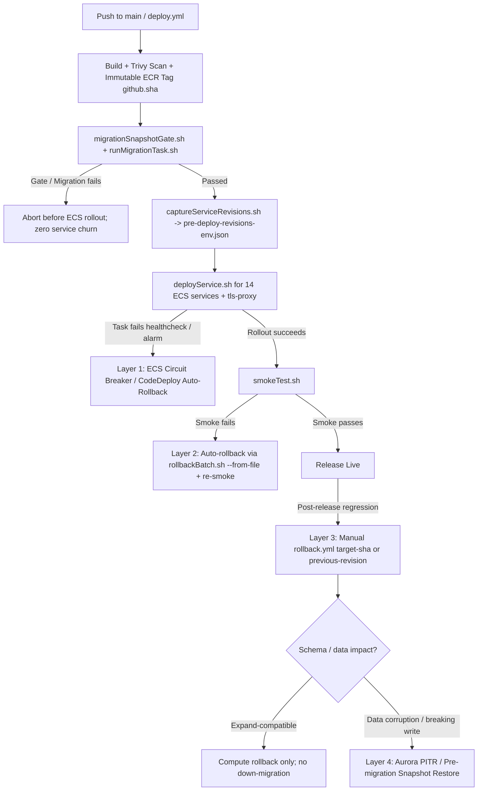

# Nantty Rollback Flow & Operational Runbook

This document defines Nantty's multi-layer rollback architecture, automated CI/CD recovery flows, manual rollback procedures, database safety rules, and surface-specific revert playbooks across AWS ECS, Aurora PostgreSQL, Cloudflare Pages, Next.js portals, and mobile apps.

---

## 1. Rollback Architecture Overview



### Design Invariants
1. **Immutable images paired with `tls-proxy`**: Every service deploys and rolls back alongside `nantty/tls-proxy:<same-tag>`. Both `deployService.sh` and `rollbackService.sh` refuse any task definition missing an essential `tls-proxy` container.
2. **Dependency-safe ordering (`go-money` first on rollback)**: Forward deploys roll out `go-money` last (`deploy.yml`). Rollbacks reverse that order — `rollbackBatch.sh` restores `go-money` first so ledger/wallet contracts revert before upstream callers (`gateway`, `go-commerce`, `go-live`, `go-ads`, etc.).
3. **Expand/Contract schema safety (no destructive down-migrations)**: Because `runMigrationTask.sh` enforces expand-compatible forward migrations (`docs/architecture/devops.md`), image rollbacks never execute SQL down-migrations. Schema cleanup only happens in `N+2` after old code is out of rotation.
4. **Key-rotation safety check**: Never roll back past a breaking secret/signing-key cutover without verifying dual-accept compatibility (`docs/security/INCIDENT_RESPONSE_PLAYBOOK.md`).

---

## 2. Layer 1 — Automatic In-Flight Rollback (ECS & CodeDeploy)

Configured in `infra/aws/modules/ecs-service/{main,codedeploy}.tf`:
- **Standard ECS rolling services (`blue_green = false`)**:
  - `deployment_circuit_breaker { enable = true, rollback = true }` automatically reverts tasks if new tasks fail container health checks or ALB target group health checks before reaching steady state.
  - `alarms { enable = true, rollback = true }` triggers rollback if attached CloudWatch alarms breach during rollout.
- **Blue/Green canary services (`blue_green = true`, `codedeploy.tf`)**:
  - `auto_rollback_configuration` reverts traffic on `DEPLOYMENT_FAILURE` or `DEPLOYMENT_STOP_ON_ALARM`.
  - Blue target instances remain warm for 30 minutes (`termination_wait_time_in_minutes = 30`) after cutover.

---

## 3. Layer 2 — Automatic Post-Deploy Rollback (`deploy.yml`)

`.github/workflows/deploy.yml` captures exact task definition ARNs **before** modifying any service and automatically reverts on rollout or smoke failure:

1. **Pre-deploy capture**: `.github/scripts/captureServiceRevisions.sh` records every service's `PRIMARY` task definition ARN into `pre-deploy-revisions-<env>.json` and uploads it as a 30-day GitHub Actions artifact.
2. **Staging (`rollback-staging` job)**:
   - Runs automatically whenever `deploy-staging` or `smoke-staging` fails **after** `capture_staging` succeeded.
   - Restores all 14 services to their captured pre-deploy task definition ARNs using `.github/scripts/rollbackBatch.sh staging --from-file pre-deploy-revisions-staging.json`.
   - Re-runs `.github/scripts/smokeTest.sh` to verify staging recovered.
   - If failure happened *before* `capture_staging` (e.g., `migrationSnapshotGate.sh` or `runMigrationTask.sh` failed), ECS is untouched and rollback is skipped cleanly.
3. **Production (`Auto-rollback production ECS services` step)**:
   - Runs inline inside `deploy-production` (`if: failure() && steps.capture_prod.outcome == 'success'`) immediately using the active OIDC session if either `Roll out services` or `smokeTest.sh` fails.
   - Restores pre-deploy ARNs via `rollbackBatch.sh prod --from-file pre-deploy-revisions-prod.json`, re-runs `smokeTest.sh`, and writes `rollback-summary-prod.json` to the job summary.

---

## 4. Layer 3 — Manual Post-Release Rollback (`rollback.yml` & CLI)

When an issue surfaces **after** a deployment passed smoke tests (e.g., elevated latency, business-logic regression, provider anomaly):

### Option A: GitHub Actions (`Actions -> Rollback -> Run workflow`)
Workflow file: `.github/workflows/rollback.yml`

Inputs:
- `environment`: `staging` or `production` (protected by GitHub Environment approval rules).
- `rollback_mode`:
  - `target-sha` *(recommended)* — restores exact immutable ECR tags `<service>:<target_sha>` and `tls-proxy:<target_sha>`, verifying both exist in ECR via `aws ecr batch-get-image` before mutating ECS, and cloning the latest task definition family (preserving current Terraform runtime env/secrets).
  - `previous-revision` — walks backward from each service's current active revision to the most recent differing `ACTIVE` task definition revision (skipping duplicate broken revisions).
- `target_sha`: 40-char commit SHA (or ECR tag) of the known-good release (required for `target-sha`).
- `services`: `all` (all 14 ECS services) or a comma-separated subset (e.g., `go-money,gateway`).
- `reason`: Incident ID / audit explanation (logged in `$GITHUB_STEP_SUMMARY` and artifact `rollback-audit-<env>-<run_id>`).
- `skip_smoke_test`: `false` by default; set `true` only if an upstream outage breaks smoke checks while compute rollback is still required.

### Option B: Local Operator CLI Fallback (with AWS SSO / OIDC credentials)
```bash
# 1. Roll back all 14 services in prod to a known-good SHA
bash .github/scripts/rollbackBatch.sh prod --target-sha <KNOWN_GOOD_SHA> <AWS_ACCOUNT_ID_PROD>.dkr.ecr.<REGION>.amazonaws.com

# 2. Or roll back specific services to their previous differing task definition revision
bash .github/scripts/rollbackBatch.sh prod --previous-revision --services go-money,gateway

# 3. Or roll back a single service using an exact pre-deploy snapshot file
bash .github/scripts/rollbackService.sh go-money prod --task-definition arn:aws:ecs:<region>:<acct>:task-definition/nantty-prod-go-money:<rev>

# 4. Verify API health
bash .github/scripts/smokeTest.sh "$PROD_API_URL"
```

### Required Post-Rollback Git Hygiene
After rolling back running containers, **prevent the next `main` push from re-deploying the broken code**:
1. Open and merge a `git revert <bad_commit_sha>` PR on `main` (never `git reset --hard` on `main`).
2. Confirm CI passes on the revert commit and allow `deploy.yml` to reconcile Git `main` with the running ECR tag.

---

## 5. Layer 4 — Database Rollback & Recovery (Aurora PostgreSQL)

### Case A: Expand-Compatible Schema Migration (Standard)
- **Action**: Roll back compute images only (Layers 2 or 3). Leave the newly added nullable columns, tables, or indexes in place; the previous version ignores them.
- **Follow-up**: Fix forward in a subsequent PR before any contract (`DROP`) release.

### Case B: Data Corruption or Non-Backward-Compatible Write
Because `migrationSnapshotGate.sh` creates an encrypted pre-migration snapshot (`nantty-<env>-pre-migration-...`) before every `go-money` migration and prod Aurora keeps 35-day PITR (`disaster-recovery.md`):
1. **Halt money writes immediately**: Scale `go-money` desired count to `0` (`aws ecs update-service --cluster nantty-prod --service go-money --desired-count 0`).
2. **Restore point-in-time or pre-migration snapshot** into a **new** Aurora cluster (`T-1` before bad migration/deploy or `nantty-<env>-pre-migration-...`).
3. **Compare & reconcile**: Inspect delta rows in `ledger`, `payments`, `webhook_events`, and `outbox` against provider (Flutterwave) settlement statements.
4. **Promote / repair**: Either perform targeted row repair or swap the Aurora endpoint / Secrets Manager connection target and update ECS tasks.
5. **Replay outbox & verify invariants**:
   - Confirm `SUM(debits) == SUM(credits)` (trial balance = `0`).
   - Confirm no negative wallet balances.
   - Replay unpublished outbox rows (`published_at IS NULL`) and verify RabbitMQ consumers resume cleanly.
   - Re-apply deletion ledger (`(account_id, erased_at)`) per `docs/architecture/disaster-recovery.md`.

---

## 6. Layer 5 — Frontend, Edge & Mobile Rollback

| Surface | Workflow / Host | Rollback Procedure |
| --- | --- | --- |
| **Marketing / Static Web (`apps/web`)** | `.github/workflows/pages-deploy.yml` -> Cloudflare Pages (`nantty-main`) | **Fastest (< 1 min)**: In Cloudflare Pages (`Workers & Pages -> nantty-main -> Deployments`), click **Rollback to this deployment** on the previous green deployment. Then `git revert` on `main` so `pages-deploy.yml` stays in sync. |
| **Next.js Apps (`webapp`, `admin`, `ads`, `developer`, `sandbox`, `seller`, `studio`)** | Node/Next build & deployment | Run `git revert <bad_sha>` on `main` and redeploy the prior artifact/container tag; purge CDN cache if static assets changed. |
| **Mobile Apps (`apps/mobile`, `apps/messenger`)** | App Store / Google Play (`androidApk.yml`) | Native store binaries cannot auto-downgrade already-installed users. Immediately **halt phased rollout** in Play Console / App Store Connect, toggle server-side feature flags or kill-switches via `admin` / backend config, and ship an expedited forward patch release. |

---

## 7. Script Reference & Local Verification

| File | Purpose | Local Mock Test |
| --- | --- | --- |
| `.github/scripts/captureServiceRevisions.sh` | Snapshot active `PRIMARY` ECS task definition ARNs before rollout | `.github/scripts/rollbackService.test.sh` |
| `.github/scripts/rollbackService.sh` | Roll back a single ECS or CodeDeploy service (`--task-definition`, `--target-sha`, `--previous-revision`) with `tls-proxy` enforcement | `.github/scripts/rollbackService.test.sh` |
| `.github/scripts/rollbackBatch.sh` | Orchestrate multi-service rollback (`go-money` first, remaining services concurrently) | `.github/scripts/rollbackService.test.sh` |
| `.github/workflows/deploy.yml` | Automated staging & prod rollback on rollout or `smokeTest.sh` failure | Actionlint / YAML validation |
| `.github/workflows/rollback.yml` | Manual `workflow_dispatch` rollback with ECR verification, audit artifacts, and smoke check | Actionlint / YAML validation |
