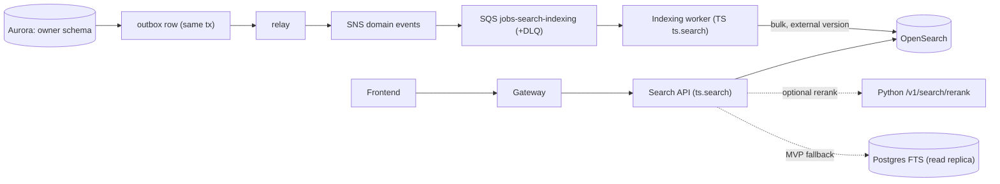

# Search architecture

> **Dated design document.** The status labels below describe the repo when this was written; much that is marked PROPOSED or ABSENT has since been built. For the current system see [system.md](system.md); where the two disagree, the code wins. Where this document says SNS or SQS, read RabbitMQ: the event bus is RabbitMQ (Amazon MQ in AWS), and the SNS/SQS adapters are unused.

As of 2026-10-03. Sources: `inventory.md` (compose profile `search`, `jobs-search-indexing` queue, the old monolith search module), `docs/backendPlan.md`. Labels: EXISTING, MOCK-ONLY, PROPOSED, OPTIONAL FUTURE.

## 1. What exists

| Item | Status | Evidence |
| --- | --- | --- |
| Legacy `GET /search?q&scope` (1 route, reference only, "never deployed") returning `{products,stores,people,brands?}` | EXISTING (reference) | the old monolith's `search` module |
| Frontend search services and mocks | MOCK-ONLY | `apps/webapp/src/services/search.service.ts`, `apps/mobile/src/services` |
| OpenSearch 3 in local compose (profile `search`) | EXISTING (local) | `infra/local/docker-compose.yml` |
| RabbitMQ job queue `jobs-search-indexing` (+retry tiers and `.dlq`, 5 attempts) | EXISTING (local topology) | `infra/local/rabbitmq/topology.json` |
| Indexing worker, mappings, search API, reindex job, Terraform `opensearch` module | **ABSENT / PROPOSED** (`infra/aws/README.md` lists `opensearch`) | |
| Python `/v1/search/rerank` | EXISTING (stateless) | `services/python/intelligence` |

## 2. Target pipeline

## 3. Indexes

| Index | Source events | Searchable fields | Filters / sort | Notes |
| --- | --- | --- | --- | --- |
| `products` | `product.created/updated/published/unpublished/deleted`, `inventory.changed`, `price.changed` | name, description, brand, category path, tags | category, price range (per currency), in stock, seller, location (geo_point), rating | only published, in-stock-visible, active-seller products; money as int minor units + currency |
| `sellers` (stores) | `store.updated`, `verification.changed` | name, handle, description | category, location, verified | |
| `users` | `profile.updated`, `username.changed` | username, display name | none | exclude blocked/suspended; respect privacy settings |
| `posts` | `post.created/deleted`, `visibility.changed` | text, hashtags | author, date | public audience only |
| `videos` (clips) | `clip.published/deleted`, `sound.updated` | caption, hashtags, sound | date, popularity | |
| `categories` | `category.updated` | name, synonyms | tree | small, can be cached in app instead |

Document shape: `{id, version, updatedAt, deletedAt?, visibility, ...}`. Visibility fields drive query-time filters; **never** put private data in an index.

## 4. Consistency

| Concern | Design |
| --- | --- |
| Model | Eventual. Target lag under 5 s p95; show lag as a metric |
| Ordering | `version` = monotonic source version (row version or event sequence) used as OpenSearch `external` version so an old event cannot overwrite a new one |
| Deletes | tombstone event; worker issues delete; `deletedAt` kept for 24 h in case of reordering |
| Idempotency | indexing by document id is idempotent; DLQ after 5 receives (SQS redrive) with replay tooling (ABSENT today) |
| Zero-result inventory drift | PDP and cart always re-read the DB; search results are only a pointer. A result that is no longer available shows as unavailable |
| Reindex | Build `products_v{N+1}` from a keyset-paginated DB scan (read replica), dual-write during the scan, swap alias, delete old. Reindex job runs as a Fargate task from a script, rate-limited |
| Mapping changes | new index version + alias swap, never in-place |
| Backfill | same scan job; also used after outage to repair drift (compare counts + checksum sample nightly) |
| Authorization | search API applies visibility, block, region and age filters server-side |

## 5. MVP: Postgres full-text before OpenSearch (PROPOSED)

| Item | Detail |
| --- | --- |
| Why | no extra infra; correct enough for tens of thousands of listings |
| How | `tsvector` generated column + GIN index on products, stores, users; `pg_trgm` GIN for typo and prefix tolerance on names and usernames; PostGIS for location; query on a **read replica**, never the primary |
| Interface | `SearchBackend` interface (`search(query, scope, filters, cursor)`) with `PostgresSearchBackend` and later `OpenSearchBackend`; the HTTP contract stays identical so the frontend does not change |
| Trigger to move | p95 search latency above 300 ms on the replica, or catalog above about 500k documents, or need for facets, synonyms, multilingual analyzers or typo ranking that FTS cannot do |
| Cutover | shadow query both, compare top-10 overlap, flip by flag per scope |

## 6. API and frontend

| Item | Detail |
| --- | --- |
| Endpoint | `GET /api/v1/search?q&scope=products|stores|people|posts|clips|all&cursor&limit` plus `GET /api/v1/search/suggest?q` (PROPOSED) |
| Pagination | opaque cursor (`search_after` values), page size at most 50 |
| Response | `{data:[...], nextCursor, facets?}` (common envelope) |
| Frontend | `search.service.ts` already exists (MOCK-ONLY); add debounce 250 ms, query-key by `(q,scope,filters)`, `placeholderData` previous results, recent searches kept locally |
| Ranking | text relevance + popularity + availability + location; optional Python rerank when personalization consent is present (`recommendations.md`) |
| Abuse | rate limit per IP/account, query length cap, no query logging with PII beyond what analytics consent allows |

## 7. Recommendations

| # | Problem | Current | Why it matters | Recommendation | Complexity | Risk | Priority |
| --- | --- | --- | --- | --- | --- | --- | --- |
| S1 | Search not built; domain events for catalog do not exist | queue + compose only | search is core to marketplace discovery | `SearchBackend` interface + Postgres FTS first. **MVP** | Medium | Low | P1: product discovery blocks buyer launch |
| S2 | No event schemas for catalog changes | 3 auth schemas total | indexing worker cannot be built reliably | define `product.*` events with `version` before OpenSearch. **MVP** | Low | Low | P1 |
| S3 | Indexing failures invisible | DLQ without replay tool | stale search silently | DLQ depth alarm + replay script; lag metric. **Near term** | Low | Low | P2 |
| S4 | Reindex strategy absent | none | mapping change means downtime | alias-swap reindex job from day one of OpenSearch. **Near term** | Medium | Medium | P2 |
| S5 | OpenSearch cost and ops | none | running a domain for a small catalog is premature | adopt only on triggers in section 5. **Scale stage** | Medium | Low | P3 |

## 8. MVP implementation and OpenSearch migration path (2026-10-04)

The MVP is `services/typescript/search` (`@zudomart/search`, port 8109, schema `search`, Prisma). Documents are built from domain events plus a read of the owning service (`SourceHydrator`), stored in `search.documents` with a `tsvector` column written by the indexer and a `pg_trgm` GIN index on the normalised title. Visibility (blocks, private profiles, suspended accounts, follower-only posts, availability) is applied at query time from small replica tables fed by `block.*`, `follow.*`, `profile.visibilityChanged`, `accountStatus.changed` and consent events. Ranking is deterministic (exact, prefix, trigram similarity, `ts_rank_cd`, popularity, region, kind bonus) with keyset cursors; the Python `/v1/search/rerank` call is optional, first page only, behind personalization consent, with a 100 ms timeout and a circuit breaker.

Migration to OpenSearch (no code written, per owner decision):

1. Add `OpenSearchSearchBackend` next to the Prisma query repository behind the existing `SearchQueryStore` interface; the HTTP contract does not change.
2. Add an `OpenSearchIndexStore` implementing `SearchIndexStore`; the event processor and builders are reused, `version` becomes the external version.
3. Mapping per kind from `SearchDocument` (title with edge-ngram and standard analyzers, tags keyword, summary stored not indexed, visibility/available/ownerAccountId/region as filters). Block, private and suspended filters stay in the application as a post-filter on a small over-fetch, or move to filter clauses using a per-viewer terms lookup.
4. Backfill by keyset scan of `search.documents` into `search_v{N}`, dual-write during the scan, swap the alias, drop the old index.
5. Shadow-query both backends, compare top-10 overlap per scope, flip per scope by flag. Keep Postgres as the fallback for one release.
6. Triggers: p95 above 300 ms on the replica, over about 500k documents, or a need for facets, synonyms or multilingual analyzers.

## 9. People search ownership (2026-10-05)

| Route | Owner | Use |
| --- | --- | --- |
| `GET /api/v1/search?type=people` (also `users`, `all`) | ts.search | The only discovery search for accounts: ranked, region-aware, consent-gated rerank, the same visibility rules as every other kind. New search screens use this. |
| `GET /api/v1/search/people` | ts.social | A picker for chat, live guests and mentions, not discovery. It returns `ConnectionEntry` rows with the viewer's follow state, drops blocked and inactive accounts, and ranks only by username match. |

The social route stays because the mobile and webapp chat and live pickers depend on its connection shape. It must not grow ranking, filters or new callers. If a picker ever needs ranking, it should call ts.search and add follow state on top. Retiring `/search/people` is not safe until those callers have moved.

Python rerank calls from ts.search send only HMAC ids (`u_` + 40 hex, `user:<id>`), using the same contract and secret derivation as ts.social (`INTELLIGENCE_ID_HASH_SECRET`, or derived from `INTELLIGENCE_SHARED_SECRET` when unset). Both services must therefore share the same values.
