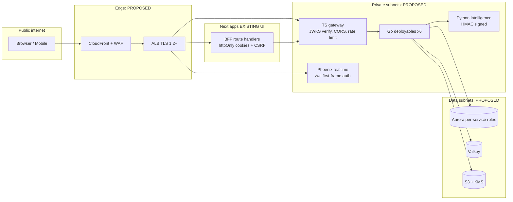

# Security architecture

> **Dated design document.** The status labels below describe the repo when this was written; much that is marked PROPOSED or ABSENT has since been built. For the current system see [system.md](system.md); where the two disagree, the code wins.

As of 2026-10-03. Labels: **EXISTING** (cite path), **MOCK-ONLY**, **PROPOSED**, **OPTIONAL FUTURE**. Sources: `inventory.md` section 7, `SECURITY.md` (current baseline), `docs/backendPlan.md` 5.4-5.8.
Privacy is in `privacy.md`; pipeline and network in `devops.md`; logging in `observability.md`.

## 1. Trust zones and request path



| Zone | Rule | Status |
| --- | --- | --- |
| Public | Only CloudFront, ALB, Route 53. Nothing else has a public IP or public security-group rule | PROPOSED (`infra/aws/README.md` not applied) |
| App tier | Fargate tasks in private subnets, security group allows inbound only from the ALB (gateway, realtime, BFFs) or the gateway (Go services, Python) | PROPOSED |
| Data tier | Aurora, Valkey: inbound only from the app-tier SG on 5432/6379. `publicly_accessible=false` | PROPOSED |
| Local | Postgres, Valkey, LocalStack bound to `127.0.0.1` | EXISTING `infra/local/docker-compose.yml` |

## 2. Authentication

```mermaid
sequenceDiagram
  participant C as Client / BFF
  participant G as Gateway
  participant A as go-identity auth
  participant D as Aurora auth schema
  C->>G: POST /api/v1/auth/login (stricter limit)
  G->>A: proxy
  A->>D: verify argon2id hash
  A->>D: new session + refresh hash + outbox event (one tx)
  A-->>C: EdDSA access (15 min) + opaque refresh
  C->>G: Bearer access token
  G->>G: verify via JWKS (jose), forward x-zudomart-account-id / session-id
  C->>A: POST /refresh (old refresh)
  A->>D: rotate; if old token reused revoke whole session
```

| Control | Detail | Status | Evidence |
| --- | --- | --- | --- |
| Password hashing | argon2id | EXISTING | `services/go/platform/passwordhash/argon2id.hasher.go` |
| Access token | EdDSA JWT, 15 min default, staff TTL 10 min config | EXISTING | `internal/signingkeys/access_token.issuer.go`, `internal/config/auth.config.go` |
| Signing keys | Private keys encrypted in DB (`AUTH_SIGNING_KEY_ENCRYPTION_KEY`), rotation every 30 days, JWKS at `GET /.well-known/jwks.json`, old keys stay published until tokens expire | EXISTING | `internal/signingkeys/signing_key.service.go` |
| Verifiers | Go `platform/jwtauth`, gateway `jose`, realtime `jose` with key cache | EXISTING | `platform/jwtauth`, `services/typescript/gateway/src`, `services/elixir/realtime/lib/realtimeWeb` |
| Refresh rotation | Stored as hash, rotated on use, reuse revokes session and emits `session.refreshTokenReuseDetected` | EXISTING, tested | `refresh_session_tokens.command.go`, `auth.module_integration_test.go` |
| OTP | 5 min, 5 attempts, 1 min resend cooldown, peppered hash. Delivery `log` only; production refuses `log` delivery | EXISTING, no real provider | `one_time_code.delivery.go` |
| Password reset / change | `POST /auth/password/reset`, `POST /auth/password/change` | EXISTING (added during audit window) | `internal/httpapi/auth.routes.go` |
| Sessions / devices | `GET/DELETE /auth/sessions`, `DELETE /auth/sessions/{id}` EXISTING; device registry, push tokens, "new device" alerts PROPOSED | EXISTING / PROPOSED | `auth.routes.go` |
| Social login | `POST /auth/google`, `/auth/apple`, ID-token verifier | EXISTING | `internal/socialidentity/identity_token.verifier.go` |
| Admin MFA / step-up | Frontend: enrollment, WebAuthn options, step-up, keep-alive BFF routes (MOCK-ONLY). Backend: separate admin audience, TOTP + WebAuthn, 5-min step-up token PROPOSED. `staffauth` guard and staff TTL config EXISTING, no staff login route | MOCK-ONLY / PROPOSED | `apps/admin/src/app/bff/auth/{mfa,step-up,keep-alive}`, `platform/staffauth` |
| Realtime auth | First frame `{type:"auth",accessToken}` within 10 s else close; browser tickets (60 s, `POST /realtime/tickets`) PROPOSED | EXISTING / PROPOSED | `client_socket.ex` |
| Service-to-service | Python: HMAC-SHA256 + nonce (Redis, fail closed) + 300 s skew EXISTING. Go-to-Go and gateway-to-Go: plain `x-zudomart-*` headers, trust rests on network isolation. Recommendation below | EXISTING (Python) / gap | `services/python/intelligence/apiContract.md` s2 |

## 3. Authorization

| Layer | Model | Status |
| --- | --- | --- |
| Gateway | Token validity, coarse scope, and header allow-listing only. Never fine-grained | EXISTING (validity) |
| Service | Each service checks fine permission **and** resource ownership; default deny (buyer: own orders/carts/addresses/wallet; store member: own store) | PROPOSED (`SECURITY.md`, `backendPlan.md` 5.4) |
| Platform admin roles | `SUPERADMIN`, `ADMIN`, `SUPPORT`; destructive and money actions need step-up | MOCK-ONLY (`apps/admin/src/types/admin.type.ts`, `apps/admin/src/config/apiAccess.config.ts`) |
| Store team roles | `owner`, `manager`, `inventory`, `sales`, `accountant`; 26 permissions; owner-only: `billing:manage`, `wallet:withdraw`, `developer:manage` | MOCK-ONLY (`apps/seller/src/config/rolePermissions.config.ts`). The server must be the source of truth; UI role sets are only a convenience |
| Ad-account roles | `admin`, `advertiser`, `analyst`, `billing` | MOCK-ONLY (`apps/ads/src/config/rolePermissions.config.ts`) |
| Creator gating | Creator Program membership gates gift payouts and monetization; non-members' gifts settle to the host. Enforced in go-money and go-live from a creator-status read, never from a client claim | PROPOSED (`backendPlan.md` s6, 4.2) |
| Realtime topics | `user:<id>` own only; `conversation:*` deny-all until a membership source exists; `live:*`/`battle:*` any authenticated user | EXISTING `topic_authorizer.ex` |
| Store-scoped data | Every query takes `store_id` from the session context, not from the request body; add row-level checks in the repository layer, and optional Postgres RLS later | PROPOSED |

## 4. Web, edge and transport controls

| Control | Detail | Status | Evidence |
| --- | --- | --- | --- |
| BFF cookies | `__Host-` prefixed in prod (`zd_at`, `zd_rt`, `zd_sid`, `zd_viewer`), `httpOnly`, `sameSite=lax`, 15 min access / 30 d refresh. Tokens never reach browser JS | EXISTING | `apps/webapp/src/config/sessionCookies.config.ts` |
| CSRF | Origin and `sec-fetch-site` check plus HMAC `x-csrf-token` bound to session id (webapp); origin guards in studio, seller, ads, admin | EXISTING | `apps/webapp/src/server/requestOriginGuard.service.ts`, `signedCookie.service.ts` |
| Mobile tokens | OS secure store, not AsyncStorage | EXISTING | `apps/mobile/src/utils/secureStorage.util.ts` |
| CORS | Gateway allow-list `CORS_ORIGINS`, `credentials:false`; realtime `check_origin` from `ALLOWED_ORIGINS`; Go services have no CORS (internal only) | EXISTING | gateway config, `endpoint.ex` |
| Security headers | Gateway: `nosniff`, `no-referrer`, HSTS. Next apps: CSP, frame, HSTS in `next.config.ts` (admin: dedicated CSP service). Go services none (internal) | EXISTING | `apps/*/next.config.ts`, `apps/admin/src/server/contentSecurityPolicy.service.ts` |
| Rate limiting | Gateway: in-memory, 600/min per instance (EXISTING). Go platform: none. Intelligence: token bucket (EXISTING). Per-route table in 5.5 (login/OTP 5/min, gift 20/s, message 30/min, uploads 20/h) with Redis buckets and `429 Retry-After` PROPOSED | EXISTING (weak) / PROPOSED | gateway `RATE_LIMIT_MAX_PER_MINUTE` |
| WAF | AWS WAF on CloudFront/ALB: managed core + bad-inputs + IP reputation rule groups, rate-based rules on `/auth/*`, bot control on signup/login (OPTIONAL FUTURE) | PROPOSED | none |
| Request limits | Gateway 1 MiB body; Go server read-header 5 s, read/write 30 s, 64 KB headers; realtime 64 KB frame; intelligence 1/4 MiB | EXISTING | `platform/httpserver` |
| TLS | TLS 1.2+ at ALB/CloudFront with ACM; HSTS preload after stabilization | PROPOSED | |

## 5. Data and application controls

| Control | Detail | Status |
| --- | --- | --- |
| Input validation | Go: strict JSON decode (`platform/httpserver`) plus `auth.validator.go`, `input.validation.go` (tested). TS services: schema validation at the edge of each handler. Python: pydantic. Reject unknown fields | EXISTING (auth) / PROPOSED (rest) |
| SQL injection | Go: ent builders and generated queries; any raw SQL needs review and parameters. TS: Prisma only; CI `check-no-raw-sql-in-typescript.sh` blocks raw SQL | EXISTING (`services/scripts/check-no-raw-sql-in-typescript.sh`, `backend.yml` job `conventions`) |
| Secrets | Env vars loaded from AWS Secrets Manager at task start (ECS `secrets:` mapping); never in source, images or Terraform state in plaintext. Only `*.example` committed. Per-environment keys. CI secret scan | PROPOSED in AWS; EXISTING `.gitignore` + `*.example`, fail-fast config reader (`platform/config`) |
| Encryption in transit | TLS everywhere; Aurora `rds.force_ssl=1`; Valkey in-transit encryption + AUTH | PROPOSED |
| Encryption at rest | Aurora, S3, EBS, SQS, SNS under customer-managed KMS keys, one key per data class (identity, money, media, logs). Application-level envelope encryption for bank account numbers and KYB documents (`DATA_ENCRYPTION_KEY` pattern). Auth signing keys already encrypted by app key | PROPOSED; signing-key encryption EXISTING |
| Money integrity | int64 minor units; server recomputes prices; payment paid only after provider verification; `Idempotency-Key` on money endpoints; ledger inside DB tx with row locks | PROPOSED (`platform/idempotency` and `platform/money` EXISTING, not wired to routes) |
| Audit log | Append-only `AuditEvent` (actor, actingAs, action, subject, before/after, reason, ip, UA, requestId). Required for escrow release, refunds, disputes, payouts, role/staff/plan changes, API keys, admin config. DB role for writers is INSERT only | PROPOSED (`backendPlan.md` 5.7); events via outbox EXISTING in auth |
| Inbound webhooks | Gateway forwards `/webhooks/*` to go-money byte-for-byte (WAF requires the `verif-hash` header on `/webhooks/flutterwave` and rate-limits it). Verify signature on raw body before parsing, unique provider event id, process once, ack fast, process async. Providers: Flutterwave, couriers, LiveKit, App Store/Play | Flutterwave is the only payment provider (owner, 2026-10-11). EXISTING in go-money (`POST /webhooks/flutterwave`): `verif-hash` (a shared secret, not an HMAC) compared in constant time, the event stored first in the webhook inbox (claimed with a lease, deduplicated), and every charge, transfer or funding re-fetched by id before any ledger posting, because v3 webhooks are unsigned. Couriers, LiveKit, stores ABSENT |
| Outbound webhooks | HMAC-SHA256 `X-Zudomart-Signature`, backoff for 24 h, replay, SSRF guard (deny private/link-local ranges, resolve then pin IP, no redirects) | PROPOSED |
| File uploads | Presigned S3 multipart URLs with size and content-type limits; server re-checks magic bytes; objects land in a quarantine prefix, malware scan, then moved to the processed bucket; processed media served by CloudFront with OAC and signed URLs; buckets block public access; strip EXIF GPS | PROPOSED (`backendPlan.md` media rows; the old monolith media module) |
| Logging | Central redaction (passwords, tokens, OTPs, card, bank). See `observability.md` | Go key-based redaction EXISTING (`platform/logging`); other stacks PROPOSED |
| Dependencies | pnpm 24 h release age block, frozen lockfile, `govulncheck` EXISTING in CI; `pnpm audit`, `pip-audit`, Trivy, SAST, secret scan PROPOSED | see `devops.md` |

## 6. Network and IAM least privilege (all PROPOSED)

| Item | Design |
| --- | --- |
| Subnets | 3 AZ x (public: ALB/NAT, private-app, private-data). Fargate tasks have no public IP |
| Egress | NAT for payment providers, LiveKit, email, push; VPC endpoints (S3 gateway, SQS, SNS, Secrets Manager, ECR, CloudWatch Logs, KMS) to keep AWS traffic off NAT |
| Security groups | SG per tier. Go services accept only from gateway SG and ALB (health). Python accepts only from Go/TS SGs. Aurora/Valkey accept only from app SG |
| Task roles | One IAM task role per service. go-identity: read its secrets, `kms:Decrypt` on identity key, `sns:Publish` to domain-events topic. go-money: money key, payout queue send/receive. realtime: receive from its queue only. intelligence: its queue, read-only feature bucket. No `*` resources; no shared role. Task execution role only pulls image and secrets |
| DB roles | `svc_<service>` owns its schema (EXISTING in `infra/local/postgres/create-databases.sh`), `zudomart_readers` read-only to others (EXISTING for auth, `20261003094100_grant_read_access_to_other_services`). Migration role separate from runtime role (runtime has no DDL) in prod. go-money ledger tables: runtime role gets INSERT/SELECT only, no UPDATE/DELETE |
| Humans | SSO into per-environment AWS accounts, MFA, no long-lived keys, break-glass role with CloudTrail alert. Prod DB access via SSM session, read-only by default |
| Org guardrails | SCPs deny disabling CloudTrail/GuardDuty, deny public S3, deny leaving the region allow-list |
| Detection | CloudTrail (org-wide, log-file validation), GuardDuty, Security Hub, AWS Config rules for public buckets and open SGs |

## 7. Threat table

| # | Threat | Likelihood / impact | Mitigation | Status |
| --- | --- | --- | --- | --- |
| 1 | Credential stuffing, OTP brute force | High / High | Per-identifier + IP limit 5/min, 20/h; OTP 5 tries lock (EXISTING); uniform responses; WAF bot rule; breached-password check; alert on spike | partial |
| 2 | Refresh token theft | Medium / High | Rotation + reuse detection (EXISTING); httpOnly cookies; device list; revoke-all on password change (EXISTING route) | EXISTING |
| 3 | IDOR / cross-tenant access (store, order, wallet) | High / High | Ownership check per resource in every service with the same 404 for "not yours" and "missing"; gateway probing detector, human check, auto-suspension, Security cases queue (section 10) | EXISTING (orders, conversations, messages, disputes, escrow); detector EXISTING |
| 4 | Payment webhook forgery or replay | Medium / Critical | Signature on raw body, unique event id, provider verify call before crediting, idempotent handler | PROPOSED, ABSENT in `services/**` |
| 5 | Double spend / negative balance via race | Medium / Critical | Ledger tx with row locks, idempotency keys, deferred balance constraint, property tests, reconciliation job and `ledger imbalance` page | PROPOSED |
| 6 | Gift/coin abuse and fraud (self-gifting, stolen cards, chargebacks) | High / High | Python risk score, Go thresholds, per-user rate limit, holds before payout, velocity rules | PROPOSED |
| 7 | Compromised admin account | Low / Critical | Separate audience, MFA/WebAuthn, 5-min step-up, SUPERADMIN count cap, audit, IP allow-list option, dual approval for payouts above a limit | MOCK-ONLY / PROPOSED |
| 8 | Internal service spoofing (forged `x-zudomart-*`) | Low / High | Private subnets + SG; recommended signed internal JWT (see below) | gap |
| 9 | Malicious upload (malware, polyglot, oversized) | Medium / Medium | Type/size limits, magic bytes, quarantine + scan, serve from separate domain, CSP | PROPOSED |
| 10 | SSRF via webhook URLs or link previews | Medium / High | Egress allow-list proxy, block metadata IP 169.254.169.254, IMDSv2 only, no redirects | PROPOSED |
| 11 | Secret leak (repo, logs, CI) | Medium / Critical | Secrets Manager, secret scan in CI and pre-commit, redaction, rotation runbook, OIDC to AWS in CI | PROPOSED |
| 12 | Supply chain (npm, Go, PyPI, base images) | Medium / High | Lockfiles, 24 h release age, govulncheck (EXISTING), audit, Trivy, pinned base digests, SBOM | partial |
| 13 | XSS / UGC injection | Medium / High | React escaping, CSP (EXISTING in Next apps), sanitize rich text server side, no HTML in UGC | EXISTING / PROPOSED |
| 14 | DoS on realtime or feed | Medium / Medium | WAF rate rules, 50 sub cap and 64 KB frame (EXISTING), autoscaling, load-shed in gateway | partial |
| 15 | Insider data access / PII exfiltration | Low / High | Per-service DB roles, read-only prod access, query audit, field encryption, export alerts | PROPOSED |
| 16 | Account takeover through social login mix-up | Low / High | Verify `iss`, `aud`, `nonce`, email verified before linking; no auto-link on unverified email | EXISTING verifier, review linking rules |

## 8. Recommendations

### R1. Redis-backed per-route rate limits
- **Problem:** login, OTP send and reset have no stricter limit; gateway limit is in-memory per instance.
- **Current:** `RATE_LIMIT_MAX_PER_MINUTE=600` per instance (`services/typescript/gateway`); `SECURITY.md` requires route limits; no limiter in Go platform.
- **Why it matters:** with N tasks the effective limit is 600xN; auth endpoints are open to brute force and OTP cost abuse.
- **Recommendation:** Redis token buckets in the gateway keyed by route class + identifier + IP; a small Go `platform/ratelimit` for defense in depth on auth routes.
- **Complexity:** S. **Risk:** low (fail open for non-auth, fail closed for auth). **Priority: P0**, because go-identity is the only live service and it is the one exposed.
- **Tag:** MVP.

### R2. Sign gateway-to-service identity
- **Problem:** `x-zudomart-account-id/session-id` are plain headers.
- **Current:** `upstreamProxy.service.ts` forwards them; Go services trust them via network isolation only.
- **Why it matters:** any SG misconfiguration or compromised task becomes full impersonation, including admin and money.
- **Recommendation:** gateway mints a 60 s internal JWT (EdDSA, audience per service) or forwards the user token for Go to verify with `platform/jwtauth`; Go ignores raw headers. Prefer the second (already built).
- **Complexity:** S. **Risk:** low. **Priority: P1**, before go-money handles real funds.
- **Tag:** MVP.

### R3. Webhook verification library before the payments module
- **Problem:** no verification code in `services/**`.
- **Why it matters:** forged "paid" events credit wallets.
- **Recommendation:** `platform/webhooks` with HMAC verify on raw body, constant-time compare, timestamp tolerance, `webhook_events` unique `(provider, event_id)`; port tests from the old monolith's security tests.
- **Complexity:** S. **Risk:** low. **Priority: P0**, a hard prerequisite for any payment endpoint.
- **Tag:** MVP.

### R4. Server-side roles as source of truth
- **Problem:** role and permission sets exist only in frontend config; seller UI still carries POS-era roles per `backendPlan.md`.
- **Why it matters:** UI checks are not authorization.
- **Recommendation:** permission catalog in `go-commerce` (store roles) and `go-identity` (admin, staff), delivered in token claims or `/seller/access`; contract tests assert frontend sets equal backend sets.
- **Complexity:** M. **Risk:** medium. **Priority: P1**, needed before store routes ship.
- **Tag:** MVP.

### R5. CI security gates
- **Problem:** only `govulncheck` runs; no secret scan, SAST, container scan, `pnpm audit`, `pip-audit`.
- **Recommendation:** see `devops.md` pipeline.
- **Complexity:** S. **Risk:** low (initial noise). **Priority: P1**, cheap and blocks regressions.
- **Tag:** MVP.

### R6. Outbox row hardening and audit immutability
- **Problem:** outbox has no attempt counter; audit table not yet designed.
- **Recommendation:** audit table INSERT-only role, hash chain per day optional (OPTIONAL FUTURE, `signed-audit-trails` pattern).
- **Complexity:** S. **Risk:** low. **Priority: P2**, becomes P1 when payouts launch.
- **Tag:** Near term.

## 9. Compliance statement

These controls are engineering measures. They do not constitute PCI DSS, GDPR, or NDPA compliance. Card data never touches Nantty systems (hosted provider checkout only), which keeps PCI scope minimal but still needs a qualified assessor's confirmation.

## 10. Abuse protection: access probing and bots

Owner rules (4 Oct 2026): a user who tries to reach endpoints or data that are not theirs is flagged and must pass a human check; repeated failures lead to a temporary suspension; deletion or a ban happens only after a person reviews the evidence. Accounts that look automated are challenged every time.

```
client ──► gateway ──► service (404 for other people's resources, 403 on role walls)
             │  classify the finished request (route template, resource type, status)
             │  Valkey sliding windows per account and per device (ZSET, fallback in memory)
             │  threshold crossed ─► POST /api/v1/internal/security/access-violations (go-trust)
             │                       also accepted as security.accessViolationDetected on trust-domain-events
             │  sensitive request + challenge state from go-trust (cached 15 s) ─► 428 HUMAN_VERIFICATION_REQUIRED
             └─ POST /api/v1/security/human-verification {token} ─► Turnstile siteverify ─► go-trust records pass/fail
go-trust (accessSecurity module): deterministic policy, security_account_states, security_events, security_cases
             └─ suspend ─► go-identity /internal/enforcement/actions (reason "Security: repeated unauthorised access attempts", 7 days, appealable)
intelligence /v1/trust/bot-score (advisory) ─► intelligence-trust-bot-scores ─► go-trust suspectedBot policy
admin ─► Trust & safety > Security cases (clear, keep restricted, suspend, ban, delete; step-up, audited)
```

### 10.1 Detection (gateway)

| Signal | Rule (defaults, env `SECURITY_PROBE_<KIND>_COUNT` / `_WINDOW_SECONDS`) |
| --- | --- |
| `privateNotFound` | 404 on another person's private resource family (orders, seller orders/stores, conversations, messages, disputes, wallets, payments, returns, support tickets, notifications, subscriptions, coins, ads, media): 15 in 10 min |
| `forbidden` | 403 on those families: 10 in 10 min. Public privacy walls (private profiles, followers-only posts) are not counted |
| `idEnumeration` | distinct resource ids that failed (404/403): 12 in 5 min |
| `adminRoute` | consumer token answered 401/403 on `/api/v1/admin/*`: 3 per hour |
| `internalPath` | any `/internal/` path (always 404 at the edge): 3 per hour |
| `tamperedToken` | unexpired consumer-audience JWT whose signature fails (expired and staff tokens are ignored): 5 in 10 min |
| `idempotencyMismatch` | `422 IDEMPOTENCY_KEY_REUSED` (same key, different body): 3 per hour |

Evidence sent to go-trust: route template (`/api/v1/orders/:id`), resource type, window count, distinct ids, threshold, device id, IP **prefix** (/24 or /48). Never query strings, bodies, tokens or resource ids. One report per kind and subject per 10 minutes.

**Consistent 404s.** Checked: orders (`getMyOrder` filters by buyer), seller orders, conversations and messages (non-member gets `CONVERSATION_NOT_FOUND`), disputes and escrow (non-party gets `*_NOT_FOUND`). Tests: `services/go/modules/orders/ordersOwnership.integration_test.go`, `services/typescript/social/tests/messages/conversationOwnership.service.test.ts`. Seller store routes answer 403 `NOT_STORE_MEMBER`; store existence is public, so this leaks nothing.

### 10.2 Policy (go-trust, deterministic, configurable)

| Situation | Outcome |
| --- | --- |
| Violation reported | Flag (`challenge_required`), open a security case, publish `security.challengeRequired` |
| Challenge passed while flagged | Flag cleared for `SECURITY_CHALLENGE_CLEARED_HOURS` (24) |
| Another violation after 3 challenges in 24 h (`SECURITY_CHALLENGES_BEFORE_PROBING_SUSPENSION`) | Temporary suspension |
| 5 failed challenges in 24 h (`SECURITY_FAILED_CHALLENGES_BEFORE_SUSPENSION`) | Temporary suspension |
| Bot score >= 0.85 with 2+ independent reasons, or >= 0.6 with a failed device attestation or a reported headless client | `suspectedBot` (sticky until a staff member clears it) |
| `suspectedBot` | Challenge at the start of every session (12 h session pass) and before **every** sensitive action (single-use action pass): posting, comments, follows, messages, likes in bursts (over 10 a minute), checkout, payments, wallet and payouts, gifts |

The automatic suspension goes through go-identity's existing suspension flow (`source=security`, reason code `SECURITY`, 7 days by default), so the person gets the normal notice, email and appeal. After that, automation stops: further violations and failures are recorded but trigger nothing.

**Automation never bans or deletes.** A ban or deletion is decided by a staff member with `users:ban` / `users:delete` in the Security cases queue, after step-up, and is audited. Why: probing signals have false positives (shared or recycled phones, stale links in group chats, buggy third-party clients, a family member on the same device, carrier-grade NAT), and deleting an account destroys content and anonymises financial records irreversibly. Fairness and consumer-protection law (NDPA 2023, GDPR art. 22) expect a human decision with a chance to respond before a final, significant decision.

### 10.3 Human verification

- Provider: Cloudflare Turnstile behind `HumanVerificationProvider` (`services/typescript/gateway/src/services/security/humanVerificationProvider.service.ts`); `HUMAN_VERIFICATION_PROVIDER=hcaptcha` switches to hCaptcha with the same flow.
- Server-side verification happens in the gateway (`POST /api/v1/security/human-verification`): token length check, `remoteip`, an idempotency key, optional hostname allow-list (`HUMAN_VERIFICATION_HOSTNAMES`). Rate limit 10 attempts a minute per account and 30 per IP. Tokens are never logged or forwarded.
- Web: Turnstile widget in a sheet when any request answers 428, then the request is retried once (`apps/webapp/src/components/security/`). CSP allows `challenges.cloudflare.com` for scripts and frames.
- Mobile: the in-app browser sheet opens `<webapp>/security-check`, which runs Turnstile and returns to `zudomart://security-check#token=…`; the app submits the token and retries (`apps/mobile/src/services/humanVerification.service.ts`). Concurrent 428s share one check.
- Staff are never challenged: admin routes are exempt and staff tokens are not consumer principals.
- Device integrity: clients may send `POST /api/v1/security/client-signals` with headless signals and a Play Integrity / App Attest token. go-trust verifies through `DeviceAttestationVerifier` (`PlayIntegrityVerifier`, `AppAttestVerifier` interfaces); until those are configured the verdict is `unavailable` and is ignored.

### 10.4 Data and retention

`security_events` keeps the evidence timeline (kinds, route templates, counts, device id, IP prefix, provider error codes). Events older than `SECURITY_EVENT_RETENTION_DAYS` (365) are purged every 6 hours unless the account has an open case. Disclosed in the privacy policy draft ("Security", "Who we share data with") and the help article `services/typescript/support/content/help/account-and-login/security-checks.md`.
