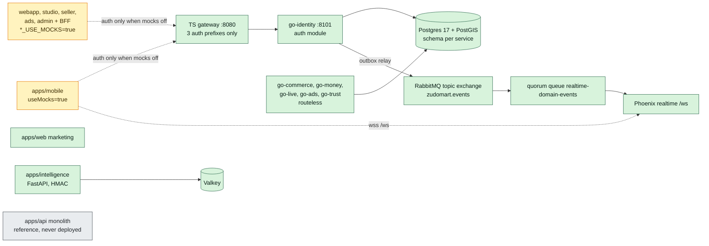
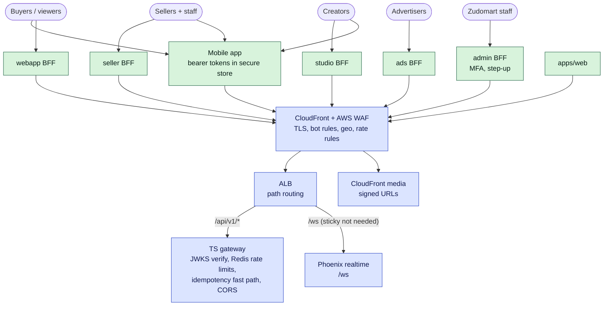
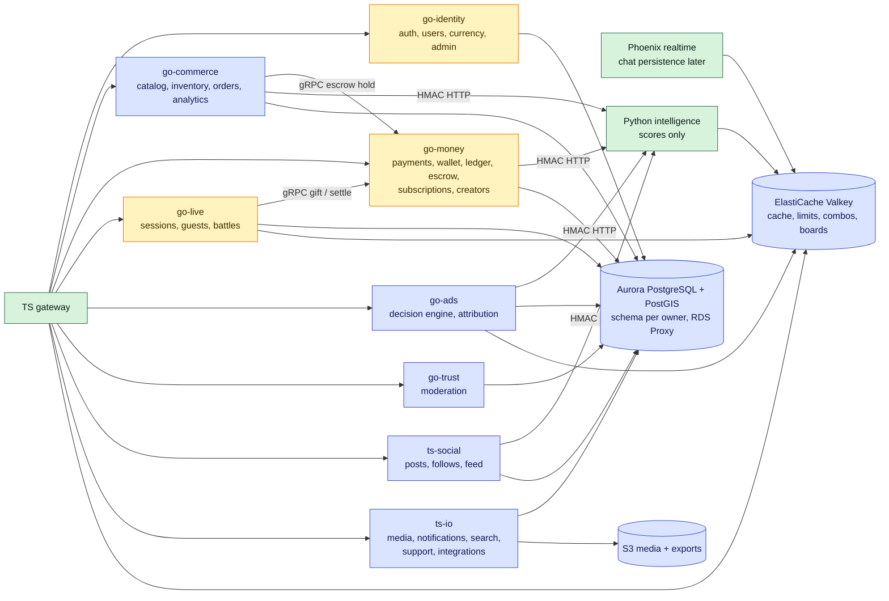
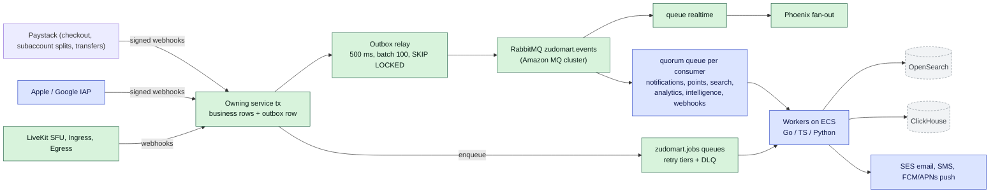

# System architecture

As of 2026-10-03. Facts come from [inventory.md](inventory.md) plus spot checks of the working tree. `services/**` is changing while this is written: `admin`, `currency`, `ledger`, `live` and `users` Go modules gained ent schemas and migrations during the audit window but still mount no routes. Treat module status as a snapshot.

Labels: **EXISTING** (code in the repo, path cited) · **MOCK-ONLY** (frontend mock contract, no backend) · **PROPOSED** (plan only: `docs/backendPlan.md`, `microservicesPlan.json`, `infra/aws/README.md`) · **OPTIONAL FUTURE** (add only when the stated trigger fires).

## 1. Current architecture (what actually runs)

| Fact | Evidence |
| --- | --- |
| Only auth is served end to end (8 routes) | `services/go/modules/auth/auth.routes.go`, `services/typescript/gateway/src/routes/upstream.routes.ts` |
| Frontends default to in-process mocks; env examples point at `:3000` (legacy port), not the gateway `:8080` | `apps/*/.env.example`, `apps/mobile/src/config/api.config.ts` |
| RabbitMQ adopted (owner, 2026-10-03): one topic exchange `zudomart.events`, 4 consumer queues, 7 job queues, each with 4 retry queues and a DLQ (5 attempts); one least-privilege user per service | `infra/local/rabbitmq/topology.json`, `definitions.json` |
| Consumers: Phoenix (`realtime-domain-events`), notifications, intelligence, orders, goTrust advisory, goAds reports | `realtime/events/amqp.consumer.ex`, `platform/events/rabbitmq.consumer.go` |
| Nothing is deployed to AWS | `infra/aws/README.md` ("Nothing here is applied") |

## 2. Recommended architecture

Split into three diagrams, one concern each.

### 2.1 Edge and clients

| Edge component | Status | Notes |
| --- | --- | --- |
| BFFs with `__Host-` httpOnly cookies, CSRF HMAC, origin guards | EXISTING | `apps/webapp/src/server/*`, `apps/*/src/app/bff/[...path]/route.ts` |
| Admin MFA / passkey / step-up BFF routes | EXISTING (UI + BFF), backend PROPOSED | `apps/admin/src/app/bff/auth/**`; no staff login route in Go yet |
| CloudFront + WAF, ALB | PROPOSED | `infra/aws/README.md` modules `alb`, `media` |
| Gateway Redis-backed rate limits, per-route login/OTP limits, idempotency fast path | PROPOSED | today: in-process 600/min per instance (`gateway.config.ts`) |
| Browser socket tickets `POST /realtime/tickets` | PROPOSED | `backendPlan.md` 5.4; mobile sends access token in first frame (EXISTING) |

### 2.2 Services and data

Yellow = module code partly present (ent schema/migrations), no routes yet. Only `auth` in go-identity serves traffic.

### 2.3 Async and external

Bachs and Anchor dropped; Paystack adopted (owner, 2026-10-03): Paystack is the only payment provider; its webhooks (`x-paystack-signature`, HMAC-SHA512) land on go-money (`docs/integrations/paystack.md`).

LiveKit is EXISTING only as a local compose container (`infra/local/docker-compose.yml`); no token minting code exists.

## 3. Component status table

| Layer | Component | Status | Path / source |
| --- | --- | --- | --- |
| Clients | mobile, webapp, studio, seller, ads, admin, web | EXISTING UI, MOCK-ONLY data (except auth) | `apps/*` |
| Edge | CloudFront, WAF, ALB | PROPOSED | `infra/aws/README.md` |
| Gateway | Zudojs proxy, JWKS, CORS, 1 MiB body, 10 s upstream timeout | EXISTING | `services/typescript/gateway/src` |
| Go | 6 deployables, platform libs | EXISTING (only auth routes) | `services/go/deployables/*`, `services/go/platform` |
| TS services | social, feed, notifications, media, search, support, integrations, campaigns | PROPOSED (reference logic in `apps/api`) | `microservicesPlan.json` `typescript` |
| Realtime | Phoenix raw WebSocket, AMQP consumer, topic authorizer | EXISTING | `services/elixir/realtime` |
| Intelligence | FastAPI scoring, 12 modules, AMQP domain event consumer + trust advisory producer | EXISTING, no callers | `apps/intelligence` |
| DB | Postgres 17 + PostGIS locally; 29 schemas and roles | EXISTING (local); Aurora PROPOSED | `infra/local/postgres/create-databases.sh` |
| Cache | Valkey 9 locally | EXISTING (local); ElastiCache PROPOSED | compose |
| Messaging | RabbitMQ 4 (RabbitMQ adopted, owner, 2026-10-03); Amazon MQ for RabbitMQ cluster in private subnets for AWS | EXISTING (local); Amazon MQ PROPOSED | `infra/local/rabbitmq/*` |
| Media | SeaweedFS (S3 API) locally | EXISTING (local); S3 + CloudFront PROPOSED | compose |
| Search / analytics | OpenSearch, ClickHouse compose profiles | OPTIONAL FUTURE | compose profiles `search`, `analytics` |
| Observability | OTLP traces from Go, collector, Jaeger | EXISTING (local, opt-in) | `services/go/platform/telemetry`, `infra/local/otel` |
| Payments, IAP, email/SMS/push | providers | PROPOSED (legacy reference in `apps/api`) | `apps/api/src/modules/payments` |

## 4. Recommendations

### 4.1 Wire one vertical slice through every layer before more modules

| Field | Value |
| --- | --- |
| Problem | 6 deployables compile, 1 serves traffic; frontends never leave mocks |
| Current | auth only; env examples target `:3000` |
| Why it matters | Edge, gateway routing, event, and contract bugs stay hidden until late |
| Recommendation | Fix env defaults to the gateway (`:8080`), add gateway routes per domain as modules land, start with live gifts (schema exists) end to end incl. go-money ledger |
| Complexity | M |
| Risk | Low |
| Priority | **P1**: every other domain depends on the same gateway/route/event plumbing |

### 4.2 Gateway trust boundary

| Field | Value |
| --- | --- |
| Problem | go-identity trusts plain `x-zudomart-account-id` headers from the gateway |
| Current | no signing; trust relies on network isolation (`upstreamProxy.service.ts`) |
| Why it matters | Any task in the VPC that can reach a Go service can impersonate any user |
| Recommendation | Go services verify the JWT themselves (`platform/jwtauth` already exists) and treat forwarded headers as hints; security groups allow only the gateway SG into Go services |
| Complexity | S |
| Risk | Low |
| Priority | **P0**: required before any money or account-mutating route ships |

### 4.3 Edge rate limiting is per instance

| Field | Value |
| --- | --- |
| Problem | 600/min in-process limit multiplies with task count; no login/OTP limit (SECURITY.md requires one) |
| Current | `RATE_LIMIT_MAX_PER_MINUTE` in gateway memory |
| Why it matters | Credential stuffing and OTP pumping (SMS cost) |
| Recommendation | WAF rate rule per IP at CloudFront + Redis token buckets in the gateway with the buckets from `backendPlan.md` 5.5 |
| Complexity | S |
| Risk | Low |
| Priority | **P0** before public launch of OTP delivery (SMS cost exposure) |

### 4.4 Performance and scale staging

| Item | Stage |
| --- | --- |
| RDS Proxy in front of Aurora (many Fargate tasks x pool size) | MVP |
| Redis-backed gateway limits and idempotency fast path | MVP |
| CloudFront caching of `GET /gifts`, categories, mart home with ETag | MVP |
| LL-HLS Egress for live rooms above a viewer threshold | Near term |
| Aurora read replica for seller/admin analytics | Near term (trigger: analytics queries > 10% writer CPU) |
| OpenSearch for search | Near term (trigger: Postgres trigram/FTS p95 > 300 ms or multilingual ranking needed) |
| ClickHouse for analytics | Scale stage (trigger: > ~5k orders/day or event tables > 100M rows) |
| MSK, EKS, service mesh | Not planned; triggers in [events.md](events.md) section 4 and [backend.md](backend.md) section 6 |
