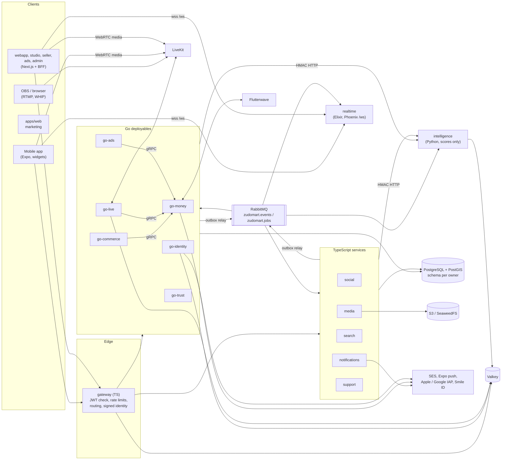
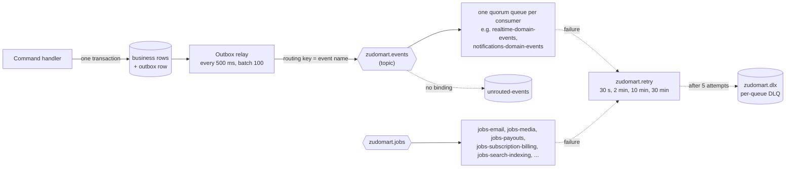
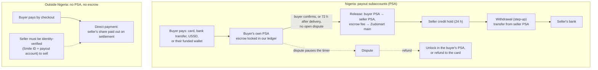
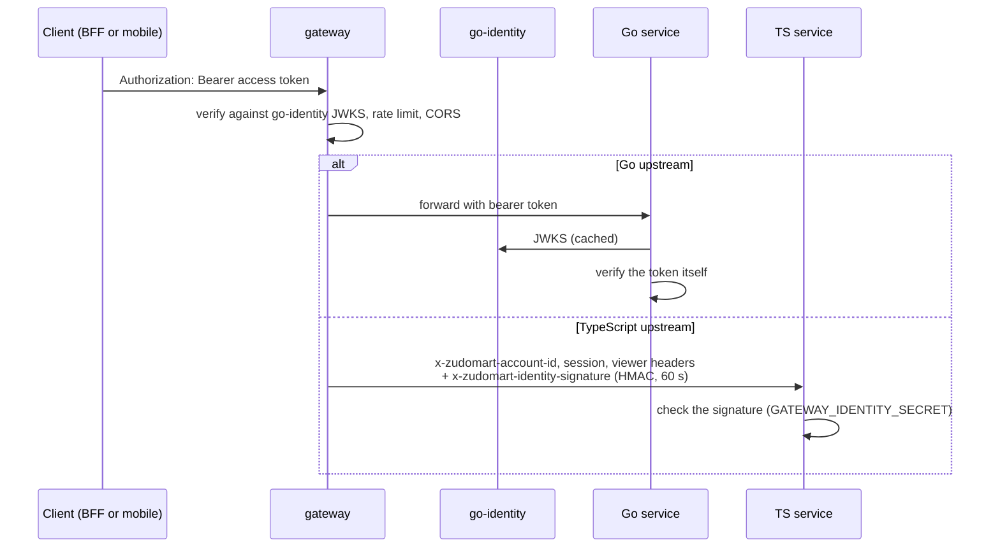
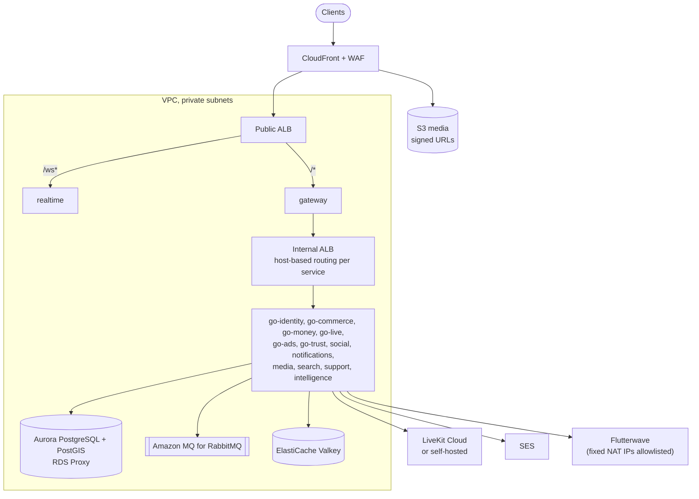

# System architecture

The whole system as the code stands on 2026-10-11, with seller-managed delivery and parcel metadata refreshed on 2026-10-21. Paths are given so you can check again. Topic documents in this folder go deeper, but several are dated design notes (see [README.md](README.md)); where they disagree with this file, this file and the code win.

Principle: **design boundaries for scale, deploy minimal infrastructure first.** One Postgres with a schema per owning service, a transactional outbox into RabbitMQ, ECS Fargate rather than Kubernetes, no Kafka.

## 1. System diagram

Clients only ever call two hosts: the gateway (`/api/v1/*`, `/webhooks/*`) and realtime (`/ws`). Media goes to LiveKit directly with a short-lived token minted by go-live, and uploads go to object storage with URLs issued by the media service.

## 2. Clients

| App | Path | Who it is for | Notes |
| --- | --- | --- | --- |
| Mobile | `apps/mobile` | Everyone | Expo SDK 57. LiveKit (`@livekit/react-native`) for going live and watching, which needs a dev or EAS build, not Expo Go. iOS WidgetKit widgets in `targets/widgets`, Android widgets in `src/widgets/android` |
| Web app | `apps/webapp` | Buyers and viewers | Also serves the embeddable web widget (`/embed/*`, `/oembed`), see [widgetsApiContract.md](widgetsApiContract.md). LiveKit viewer (`livekit-client`) |
| Studio | `apps/studio` | Creators | Lives, browser go-live over WHIP (`src/live/whipPublisher.ts`), OBS set-up, overlays, replays, comments, analytics |
| Seller dashboard | `apps/seller` | Sellers and their staff | E-commerce back office: products, inventory, orders, returns, money, staff, marketing, reports. No in-store register |
| Ads Manager | `apps/ads` | Advertisers | Campaigns, audiences, creatives, billing, reports |
| Admin | `apps/admin` | Zudomart staff | Trust and safety, money, legal, support, settings |
| Marketing site | `apps/web` | Public | Landing, sellers page, legal pages. No mocks |

The five product Next apps use a BFF (`src/app/bff/[...path]/route.ts`): the browser talks only to its own origin, the session lives in `__Host-` httpOnly cookies, and mutations carry a CSRF token. Each app can run on in-process mocks (`src/mocks`) or against the gateway; see section 10.

Shared packages: `@zudomart/chat-crypto` (E2EE), `@zudomart/contracts` and `@zudomart/shared-types` (API shapes), `@zudomart/design-tokens`, `@zudomart/web-kit`, `@zudomart/email-templates` (React Email), `@zudomart/eslint-config`.

## 3. Services and what each owns

Each Go deployable is a binary that mounts several modules (`services/go/deployables/<name>/server.go`). Modules never import each other; they talk through ports in `services/go/platform`, events or internal gRPC.

| Service | Port (local) | Owns (Postgres schemas) | Responsibilities |
| --- | --- | --- | --- |
| gateway | 8080 | none | Routing (`src/routes/upstream.routes.ts`), access-token checks, Valkey rate limits, strict CORS, request size limits, human verification (Turnstile), admin IP allowlist, policy-acceptance gate, widget tokens, signed identity headers |
| go-identity | 8101, gRPC 9101 | `auth`, `users`, `currency`, `admin` | Accounts, email-only sign-in, one-time codes, sessions, social sign-in, step-up, JWKS and signing keys, realtime and widget tokens; profiles and linked profiles, privacy, consents, data export and deletion, identity verification (Smile ID), creator program, checkmarks; exchange rates and locale; staff accounts, audit log, platform settings. gRPC `AccountDirectoryService` |
| go-commerce | 8107 | `catalog`, `inventory`, `orders` (`analytics` module is a skeleton) | Stores, brands, products, reviews, seller applications; stock levels, locations, transfers; carts, checkout, seller-managed delivery (rider, ETA, attempts), shipping, product parcel metadata, orders, returns, disputes, promotions, store rewards, seller reports, order widgets |
| go-money | 8103, gRPC 9103 | `payments`, `wallet`, `ledger`, `escrow`, `subscriptions`, `creators` | Flutterwave and IAP adapters, webhooks, reconciliation, payout onboarding, provider wallets; coins, payouts, ad balances; the double-entry ledger; escrow and disputes; subscriptions and billing; creator earnings, gifts money, affiliates, brand deals. gRPC `LiveMoneyService`, `CheckoutMoneyService`, `AdsMoneyService` |
| go-live | 8102 | `live` | Live sessions, stage and guests, battles, gifts, comments, overlays, ZudoPoints, Studio, live widgets; LiveKit tokens, ingress (RTMP, WHIP), egress recordings for replays; LiveKit webhooks |
| go-ads | 8110 | `ads` | Ad accounts, campaigns, audiences, creatives, review, the ad decision engine, tracking, reporting, billing, boosts |
| go-trust | 8106 | `moderation` | Content and chat reports, copyright and IP claims, strikes, suspensions and appeals, live safety, account health, automation rules |
| social | 8105 | `social` | Posts, comments, stories, clips, sounds, follows, blocks, mentions, saves, feeds and explore, conversations and encrypted messages, messaging keys, streaks, people search, social widgets |
| notifications | 8104 | `notifications` | In-app inbox, email through SES, push (Expo), digests, bulk campaigns, suppression and unsubscribe, widget refresh pushes |
| search | 8109 | `search` | Search index and queries on Postgres full-text (`tsvector`) and `pg_trgm`, fed by events; optional re-ranking by intelligence; recent searches |
| media | 8108 | `media` | Uploads to a quarantine bucket, malware scan (ClamAV), processing (ffmpeg), public and private buckets, branded downloads |
| support | 8111 | `support` | Help Centre content (`content/help`), tickets, automatic FAQ answers, account-erasure requests |
| realtime | 4000 | none | WebSocket fan-out of domain events, presence, typing; see section 9 |
| intelligence | 8090 | none (Valkey features, Parquet logs) | Feed, clip and search ranking, recommendations, trending, ads prediction, risk, bot, chat-spam and moderation scores, live-safety frame and audio checks (AWS Rekognition), experiments |

Python returns scores; Go and TypeScript make the allow, hold, review or reject decision and fall back to deterministic logic when intelligence is slow or down. Callers today: search, social, support, go-ads, go-trust and go-identity (users). Intelligence never reads the product database.

## 4. Data ownership

- **One PostgreSQL database** (21 schemas, with PostGIS locally; Aurora PostgreSQL in AWS). Each owning service has its own schema and login role, created by `infra/local/postgres/create-databases.sh`. Only the owner writes its schema; other roles read through `zudomart_readers` grants where a read model needs it.
- Grouped roles: `svc_money` is granted the payments, wallet, ledger, escrow, subscriptions and creators roles, so every balance change in go-money commits in one transaction. (The old `rewards` module is gone; ZudoPoints live in `live`.) `svc_commerce` likewise covers catalog, inventory and orders, so an order and its stock reservation commit together.
- **Go** persistence is ent with Atlas-generated migrations (`modules/<module>/src/migrations`), applied on service start locally and by a pre-deploy migrate task in AWS. **TypeScript** uses Prisma (`services/typescript/<service>/prisma`); `pnpm backend:lint` refuses raw SQL in TypeScript.
- **Valkey:** rate limits, the session denylist, widget tokens, live counters and intelligence features. It holds nothing that cannot be rebuilt.
- **Object storage:** SeaweedFS (S3 API) locally, S3 behind CloudFront in AWS.
- Money is always integer minor units with a currency (`{ amountMinor, currency }`); the currency comes from the server, never from a client header.

ERDs per domain: [database.md](database.md) and [../database/schema.md](../database/schema.md).

## 5. Events and jobs

- Every service that publishes writes the event row in the same transaction as the change (Go: `services/go/platform/events/outbox.relay.go`; the TS services have their own outbox tables). Delivery is at least once and consumers are idempotent on the event id.
- Envelope: `{ id, type, source, subject, schemaVersion, occurredAt, data }`. Names are `<entity>.<pastTense>` (`order.created`, `escrow.released`). Each event has a JSON Schema in `services/contracts/events/schemas` and an entry in `services/contracts/events/asyncapi.yaml`.
- The broker topology (which service publishes, which queues it consumes, the bindings) is `infra/local/rabbitmq/topology.json`; `pnpm backend:rabbitmq:definitions` generates `definitions.json` from it. Each service has its own least-privilege RabbitMQ user.
- Bus selection is `EVENT_BUS` (`rabbitmq` by default, and in Terraform). The older SNS/SQS adapters are still in the code behind `EVENT_BUS=sqs`. The only SQS queue in the AWS plan is the SES bounce and complaint feedback queue, because SES cannot publish to RabbitMQ.

Synchronous calls between services are kept few: internal gRPC to go-money and go-identity (`services/contracts/proto`), internal HTTP routes protected by per-service tokens, and HMAC-signed HTTP to intelligence.

More detail: [events.md](events.md).

## 6. Money flow

Flutterwave is the only payment provider (`PAYMENTS_PROVIDER=flutterwave`); Apple and Google in-app purchase cover digital goods bought inside the mobile apps. **Zudomart never holds customer money.** Full design: [../integrations/flutterwaveMigration.md](../integrations/flutterwaveMigration.md).

- **Wallets.** In the countries listed in `WALLET_PSA_COUNTRIES` (default `NG`), each user's money is in their own Flutterwave payout subaccount. The ledger mirrors every PSA and reconciles it against Flutterwave daily.
- **Escrow** is a lock on the buyer's own balance, recorded in the ledger (`escrow.CustodyBuyerWalletLock` in `modules/escrow`). A card payment settles to the main balance and is moved into the buyer's PSA before it is locked. On release the money moves buyer PSA to seller PSA; a refund before release just unlocks it.
- **Outside Nigeria** sales use direct payment with no escrow and no stored balance, and `ReadSellingEligibility` (`modules/payments/src/modules/gateway/services/sellingEligibility.service.go`) refuses selling until the seller is verified. In Nigeria an unverified seller can sell through escrow only, up to an admin-set cap, and cannot withdraw until verified.
- **Fees** (code defaults, admin-configurable): escrow fee `ESCROW_FEE_BPS=150` (1.5%), `ESCROW_FEE_BUSINESS_PLAN_BPS=100` on the Business plan, deducted from the seller at release. No commission on products and no buyer fee.
- **Ledger.** go-money's double-entry ledger is the single financial truth: append-only, balanced per currency, idempotency keys stored in Postgres. Flutterwave balances are reconciliation evidence. Webhooks (`verif-hash`) are hints; every credit is re-verified with Flutterwave by id.
- A refund after release that the seller's balance cannot cover becomes seller debt. Outstanding debt blocks withdrawals and ads spend, and debt above a per-level limit blocks selling.

More detail: [payments.md](payments.md).

## 7. Auth and the gateway

- Sign-in is by email only (password or one-time code, or Google and Apple). go-identity issues short-lived EdDSA access tokens and rotating refresh tokens, and publishes its keys at `/.well-known/jwks.json`.
- Go services verify the access token themselves (`services/go/platform/jwtauth`) and do not trust forwarded headers. TypeScript services accept identity only with a valid gateway HMAC signature (`src/middlewares/gatewayIdentity.middleware.ts`), with a previous secret allowed during rotation.
- Separate token audiences for staff (password + TOTP, step-up for sensitive actions), realtime (`zudomart-realtime`, from `POST /api/v1/auth/realtime-token`) and widgets (`zudomart-widgets`, read-only, from `POST /api/v1/auth/widget-token`).
- Provider webhooks enter through the gateway with the raw body untouched: `/webhooks/*` to go-money (Flutterwave), `/api/v1/webhooks/smile-id` to go-identity, `/api/v1/live/webhooks/*` to go-live (LiveKit).
- Admin routes are limited by an IP allowlist in the gateway and in each service.

## 8. Profiles

A personal account can own at most one store **or** one business page (never both), plus one brand: valid sets are store, business, brand, store + brand and business + brand. go-identity enforces it in `modules/users/src/modules/linkedProfiles` (`ErrProfileLimitStoreOrBusiness`), and a store can be converted to a business page only after it is closed. A business page has no shop; a brand can turn selling on or off (catalog migration `add_brand_selling_and_store_channel`). Creators are personal accounts upgraded through the creator program, not separate profiles.

## 9. Realtime, live and chat

**Realtime** (`services/elixir/realtime`) is a raw JSON WebSocket at `/ws`, not Phoenix Channels. The client must send `{type: "auth", accessToken}` with a realtime token within 10 seconds, then subscribes to topics (at most 50 per socket):

- `user:<accountId>`: own account only;
- `conversation:<id>`: membership checked with the social service;
- `live:<id>`, `battle:<id>`: access checked with go-live.

It consumes `realtime-domain-events` from RabbitMQ (`lib/realtime/events/amqp.consumer.ex`), routes each event to its topic, throttles high-rate updates (viewer counts, scores, leaderboards), and tracks presence. It only fans out facts; it never moves money or decides a battle.

**Live video** uses LiveKit (Cloud by default in Terraform, or self-hosted on ECS; a pinned container locally).

- go-live creates rooms and mints short-lived participant tokens.
- Hosts publish from the mobile app over WebRTC, from Studio in the browser over WHIP, or from OBS over RTMP or WHIP through a LiveKit ingress.
- Viewers watch over WebRTC; there is no HLS fallback at present. Egress records replays to object storage.
- Gifts are charged first: go-live calls `LiveMoneyService` on go-money, which debits coins and credits the creator in one ledger transaction; the `gift.sent` event then reaches viewers through realtime.

**Chat is end-to-end encrypted.** `packages/chatCrypto` implements X3DH, the Double Ratchet and sender keys for groups, with per-device keys; mobile, webapp and seller use it. The social service stores public key bundles (`modules/messagingKeys`) and ciphertext only, and refuses plaintext message bodies (`assertNoPlaintext`, `ENCRYPTION_REQUIRED`). There is no plaintext fallback.

More detail: [realtime.md](realtime.md), [liveSafety.md](liveSafety.md).

## 10. Widgets

- **Home-screen widgets** (iOS and Android): order tracking, seller sales today, live now, creator stats and stories. Each endpoint lives in the service that owns the data (`/api/v1/widgets/*` in `src/routes/widget.routes.ts`) and accepts the read-only widget token. Notifications sends silent pushes to refresh them.
- **Embeddable web widget:** `apps/webapp` serves a loader script, store, product and buy-button embeds, and oEmbed. These pages are the only ones that may be framed.

Contract: [widgetsApiContract.md](widgetsApiContract.md).

## 11. Running locally: mocks or the real backend

- `pnpm mode:mock` / `pnpm mode:backend` rewrite only the mode keys in each app's local env file (`scripts/localMode`), so every app either uses its in-process mocks or calls the gateway on `:8080`. `pnpm mode:status` shows where each app points.
- `pnpm backend:up` (`scripts/localStack/backend.sh`) starts the core infra (Postgres, Valkey, RabbitMQ, LocalStack for SES, SeaweedFS), applies the Prisma migrations, builds and starts the Go binaries and TS services on 127.0.0.1, starts realtime if Elixir is installed, waits for health and seeds demo data. `pnpm backend:down` stops only what it started.
- Locally, go-money talks to a fake Flutterwave server, and one-time codes are written to the go-identity log.
- Production builds never contain mocks: `pnpm check:no-mocks` checks the Next builds and the mobile export.

Details: [../runningLocally.md](../runningLocally.md).

## 12. Deployment

Terraform in `infra/aws` targets **ECS on Fargate**, one AWS account per environment. It is written and validated but has **never been applied**.

- Fourteen Fargate services (`infra/aws/modules/platform/services.tf`), each with its own task role and secrets in Secrets Manager, encrypted with per-purpose KMS keys.
- `.github/workflows/deploy.yml` deploys `main` to staging, then production behind a GitHub environment approval, running the migrate task first when it is configured. go-money uses CodeDeploy blue/green with a canary and automatic rollback on the ledger-imbalance and 5xx alarms; the other services use ECS rolling deploys with a circuit breaker.
- The WAF blocks `/internal` paths and requires the `verif-hash` header on the Flutterwave webhook path.

Bootstrap steps and variables: [../../infra/aws/README.md](../../infra/aws/README.md). CI, environments and DR: [devops.md](devops.md), [disaster-recovery.md](disaster-recovery.md).

## 13. Deliberately not built

These stay out until a stated trigger is reached; the triggers are in [devops.md](devops.md) and [events.md](events.md).

- **Kafka or MSK:** the outbox and RabbitMQ cover today's load.
- **OpenSearch:** search runs on Postgres. The OpenSearch container exists only in the full local compose profile and no code uses it.
- **ClickHouse:** the same applies; no code uses it, and analytics run on Postgres.
- **EKS or a service mesh.**
- **Read replicas.**
