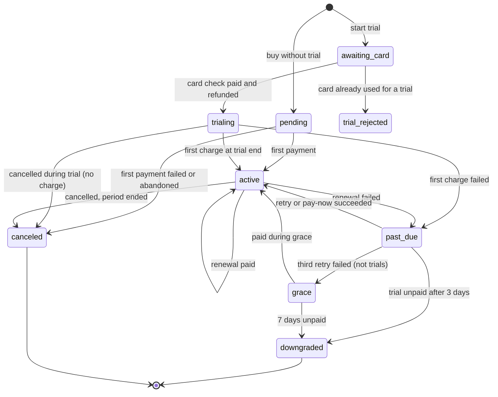

# Renewals and free trials

Status: built 4 October 2026 (go-money `subscriptions` and `payments` modules, notifications, email templates). This page explains, in plain words, how Zudomart charges plans on the web, how free trials turn into paid plans, and what happens when a payment fails. App Store and Google Play purchases are covered in section 8.

Prices below are Nigeria web prices from [pricing.md](../pricing.md). Every other region works the same way in its own currency (or in USD where Paystack can't charge the local currency).

## 1. The short version

- We keep the card the customer used (as a Paystack "authorization", encrypted on our side) and **we decide when and how much to charge**. Paystack only moves the money.
- Every billing period is a small invoice made of **line items**: the plan itself, plus the checkmark part of the plan, minus any discount or credit. The lines always add up to the full plan price (before discounts and credits).
- **Plans always renew at the full plan price** (owner decision, 4 Oct 2026). Pro, Business and Premium cost the same at renewal whether the checkmark is verified, in review or rejected. The checkmark line stays on the receipt so customers can see what it covers. The only money back is the one-time refund of the checkmark share for the current period when a verification is rejected (unchanged).
- If a renewal payment fails we try again **1, 3 and 5 days** later. Then the plan stays on for a **7-day grace period**. If it's still unpaid after that, the account moves to **Free**.
- Customers can cancel any time. They keep the plan until the end of the period they paid for. No partial refunds, except the existing rule for a rejected verification.
- Free trials are 7 days (or 1 month where an admin sets it). A ₦50 card check is taken and refunded straight away. Reminders go out **3 days** and **24 hours** before the trial ends. Cancel during the trial and you're never charged.

## 2. Why we run our own scheduler instead of Paystack Plans

Paystack Plans charge the same fixed amount every period. Our amount changes:

| Reason the amount changes | Example |
|---|---|
| Blue + Gold bundle starts or stops | Gold-only ₦3,000 becomes ₦2,550, and goes back up if Blue lapses |
| Credit from an upgrade | Upgrading leaves a credit that comes off the next charge |
| Downgrade at renewal | Business ₦15,000 becomes Pro ₦5,000 at the next renewal |
| Price change after notice | New price only from the first renewal at least 30 days after we emailed |
| Customer moved country | New region's price (USD where Paystack can't charge the currency) |

With Plans we'd have to cancel and recreate a Paystack subscription each time one of these happens. That's fragile and easy to double-charge. So we keep the schedule ourselves and charge each period with Paystack's `charge_authorization` for the exact amount. That also gives us:

- one **idempotency key per subscription and period** (`renewal:{subscriptionId}:{periodStart}`), so a period can never be charged twice, even if a job runs twice or Paystack times out;
- our own dunning dates, emails and grace rules (Paystack's are fixed);
- one ledger entry per paid period, matched to the payment.

Older subscriptions created on Paystack Plans before this change keep running on Plans until they end.

## 3. What a period's charge is made of

| Line | Pro (₦5,000) | Business (₦15,000) | Premium (₦4,500) | Gold only (₦3,000) | Blue (₦2,500) |
|---|---|---|---|---|---|
| Plan | ₦2,000 | ₦12,000 | ₦2,000 | – | – |
| Checkmark | ₦3,000 (Gold) | ₦3,000 (Gold) | ₦2,500 (Blue) | ₦3,000 | ₦2,500 |
| Bundle discount (Gold with Blue, monthly) | −₦750 | −₦2,250 | – | −₦450 | – |
| Credit from an upgrade | as available | as available | as available | as available | as available |

- The checkmark part is the standalone price of that checkmark in the same region (Gold-only for Pro and Business, Blue for Premium), capped at the plan price. It's the same number we refund when a verification is rejected.
- Yearly plans use the yearly price (20% off 12 months). The bundle discount doesn't stack with yearly.
- The price comes from the **price book at renewal time**. If the price went up, the current customer keeps the old price until 30 days' notice has passed (section 6).

**Examples**

- A Pro seller whose Gold checkmark is rejected gets **₦3,000** back once (the checkmark share of the period they already paid for). After that the plan keeps renewing at **₦5,000**. The receipt still shows "Plan ₦2,000 + Gold checkmark ₦3,000", with a note that the checkmark line is part of the plan price.
- A Premium member whose Blue check is still in review at renewal pays the full **₦4,500**.
- Standalone checkmarks (Blue, Gold-only, Black, bundle tiers) are unchanged: a rejected one is cancelled and fully refunded, so it never renews.

## 4. Renewal timeline (monthly Pro, card on file)

| Day | What happens | Customer sees |
|---|---|---|
| 1 Nov 09:00 | Charge ₦5,000 | Receipt email with line items |
| 1 Nov (fails) | Status "past due", plan still on | "We couldn't charge your card" + push |
| 2 Nov | Retry 1 | Same email, attempt 2 |
| 4 Nov | Retry 2 | Same email, attempt 3 |
| 6 Nov | Retry 3 fails → 7-day grace | "Last chance" email; plan still on |
| 11 Nov | – | "Your plan ends in 2 days" |
| 13 Nov | Grace ends unpaid → Free plan | "You're on the Free plan"; checkmark removed unless they also own it separately |

At any point the customer can tap **Pay now** (`POST /api/v1/subscriptions/{id}/pay-now`). That opens Paystack checkout for the unpaid period with any card. Paying restores the plan straight away.

**Yearly plans**: one charge per year. A reminder goes out **7 days before** with the exact amount and a cancel link (UK and EU consumer law requires it). Monthly plans get no reminder, except trials that are about to convert.

**Card expiring**: if the saved card expires before the next charge, we email up to 30 days before that charge.

## 5. Free trial timeline (Pro, 7 days)

| When | What happens |
|---|---|
| Day 0 | Seller starts the trial on the web. Paystack takes a **₦50 card check** (regional amount elsewhere). It's refunded straight away, and the card is saved for later charges |
| Day 0 | Trial starts, Pro features on, "Your trial has started" email |
| Day 4 | Reminder: "3 days left", with the exact first charge (₦5,000), date and a cancel link |
| Day 6 | Reminder: "ends tomorrow" (24 hours before) |
| Day 7 | First charge for the full first month through `charge_authorization` |
| Day 7 (fails) | Retries on day 8 and day 10. Features stay on for at most **3 days** after the trial ends. If day 10 fails, the seller moves to Free (no 7-day grace for trials) |

- **Cancelling during the trial means no charge, ever.** Features stay until the trial end, then the plan ends.
- **One trial per person.** We block a second trial by account, device, phone number and card (a keyed fingerprint of Paystack's card signature, so the same card on another account is caught).

## 6. Price changes

- An admin changes a price in Admin → Regional pricing.
- Once an hour we check live subscriptions. Anyone whose next renewal would cost more gets a **price change email** (a legal notice, always sent). It shows the old price, the new price and the date it starts.
- The new price applies from the first renewal at least **30 days** after that email. Until then they're charged the old price ("grandfathered").
- Price drops apply at the next renewal without notice.

## 7. Cancel, upgrade, downgrade

- **Cancel**: the plan stays on until the end of the paid period, then ends. No refund for unused days. The only refund is the existing one: a rejected verification refunds the checkmark share (seller plans and Premium) or the whole payment (standalone checkmarks). It's refunded from the **latest** charge, not the first one.
- **Upgrade** (e.g. Pro → Business, or monthly → yearly): we charge the difference now, minus a **credit for unused time** on the old plan. Example: halfway through a ₦5,000 Pro month, moving to Business (₦15,000) costs ₦7,500 − ₦2,500 = **₦5,000** today. Then it's ₦15,000 from the next renewal. Monthly → yearly starts a new yearly period today, with the unused month taken off.
- **Downgrade** (e.g. Business → Pro, or yearly → monthly): nothing is charged or refunded now. The new plan and price start at the next renewal.
- During a trial, changing plan just switches the plan. The first charge at trial end uses the new plan.

## 8. App Store and Google Play

The stores run their own trials (introductory offers), renewals, retries and grace periods. We don't charge those customers. We only listen to the stores' server notifications and keep the same subscription states:

| Store notification | Our status |
|---|---|
| Apple `DID_RENEW` / Google `SUBSCRIPTION_RENEWED` (2), `RECOVERED` (1), `RESTARTED` (7) | active, new end date |
| Apple `DID_FAIL_TO_RENEW` / Google `ON_HOLD` (5) | past due |
| Apple `DID_FAIL_TO_RENEW` + `GRACE_PERIOD` / Google `IN_GRACE_PERIOD` (6) | grace (plan still on) |
| Apple `EXPIRED`, `GRACE_PERIOD_EXPIRED` / Google `CANCELED` (12), `EXPIRED` (13) | downgraded to Free |
| Apple `REFUND`, `REVOKE` / Google voided purchase | cancelled, plan removed |

Owner to-dos for the stores:

- [ ] App Store Connect: subscription group with `com.zudomart.app.blue_essential.monthly|yearly`, `com.zudomart.app.blue.monthly|yearly`, `com.zudomart.app.premium.monthly|yearly`. Add a **7-day free introductory offer** to `premium.monthly` (Premium is the plan with a trial). Turn on **Billing Grace Period** (16 days is Apple's default; we follow whatever Apple sends).
- [ ] Google Play Console: same product ids with monthly and yearly base plans. Add a **7-day free trial offer** on the Premium monthly base plan. Turn on grace period and account hold.
- [ ] Set the Apple App Store Server Notifications V2 URL and the Google Real-time developer notifications topic to the money webhook endpoints (already used for refunds).
- [ ] Seller plans, Gold-only and Black are sold on the web only, so they need no store products.

## 9. State diagram (web card billing)

## 10. Edge cases

| Case | What we do |
|---|---|
| Job runs twice, or Paystack times out after charging | The period has one idempotency key. Each attempt has a fixed Paystack reference (`ren-…` derived from the key and attempt), so Paystack rejects a duplicate. The next run checks the earlier attempt before trying again |
| Bank asks for 3-D Secure on a renewal | Counted as a failed attempt. The email's button opens the bank's confirmation page. If the customer confirms later, the payment still settles and the plan is restored |
| Saved card deleted or no longer valid | Counted as a failed attempt. The customer pays with a new card through Pay now, and that card is saved for next time |
| Verification approved or still in review at renewal | Full plan price, as always |
| Verification rejected after a renewal | The checkmark share is refunded once, from the latest charge. Later renewals are at the full plan price |
| Customer cancels while past due | Retries stop and the plan ends now (the paid period is already over) |
| Customer cancels during grace | The plan ends at the grace end, no more retries |
| Seller plan lapses but they also have Gold-only | The plan ends but the Gold badge stays (we tell identity which subscription still covers it) |
| Upgrade credit bigger than the next charge | The rest carries over to the following period |
| Customer moves region | Next renewal uses the new region's price and currency. Credits in the old currency are dropped (rare; support can re-credit) |
| Region currency Paystack can't charge (GBP, EUR, and GHS/KES/ZAR for now) | Charged in USD at the US price, labelled "Billed in USD" |
| USD switched off for a region | The renewal can't be priced, so the job fails and retries, then lands in the dead-letter queue for support. Nothing is charged |
| Price raised twice before the notice runs out | The latest price gets its own 30-day notice. The customer is never charged a price they weren't told about 30 days ahead |
| Black (government) | Invoiced by admins, not charged by this engine. Its 14-day grace stays as before |

## 11. Where it lives (for engineers)

- `services/go/modules/subscriptions/src/models/`: line items, proration, dunning schedule, price grandfathering, idempotency keys (pure functions, unit tested).
- `.../modules/billing/services/renewalEngine.service.go` (scheduler and charge), `renewalSettlement.service.go` (Paystack outcome, ledger entry `subscription.periodBilled`: Dr payments awaiting application / Cr `revenue:planSubscriptions`), `dunning.service.go`, `planChange.service.go`, `billingNotices.service.go`, `billingJobs.service.go`.
- Table `subscriptions.subscription_periods` (one row per invoice, unique `idempotency_key`). New columns on `subscriptions` (`next_charge_at`, `dunning_attempts`, `credit_minor`, `pending_plan_code`, `price_effective_at`, …).
- `payments.billing_authorizations`: the Paystack authorization code sealed with AES-GCM (`DATA_ENCRYPTION_KEY`), with a keyed card fingerprint. Charges go through `PaymentGateway.ChargeBillingAuthorization`. Refunds of renewal payments go through `RefundSubscriptionPayment` (ledger first, under the caller's idempotency key).
- Jobs: every minute the module finds due subscriptions, takes a 15-minute lease, and puts one job per subscription on the RabbitMQ queue `jobs-subscription-billing` (`zudomart.jobs` exchange, retries at 30 s/2 m/10 m/30 m, then the `.dlq`). Without a broker (local tests) the job runs inline.
- Events → emails: `subscriptionTrial.ending`, `subscriptionRenewal.upcoming`, `subscriptionInvoice.paid`, `subscriptionPayment.failed`, `subscriptionGrace.ending`, `subscription.downgraded`, `subscriptionCard.expiring`, `subscriptionPrice.changeNotice` (templates in `packages/emailTemplates/src/templates/subscriptionBilling.template.tsx`).
- Endpoints: `POST /api/v1/subscriptions/{id}/change-plan`, `POST /api/v1/subscriptions/{id}/pay-now`, `GET /api/v1/subscriptions/{id}/periods`, `GET /api/v1/subscriptions/{id}/upcoming-charge`.
