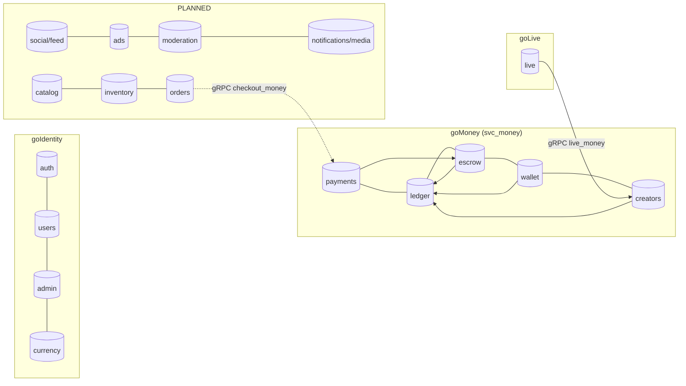

# Domain map and table ownership

> **Historical snapshot (2026-10-03).** The status column is stale: social graph, chat, marketplace, products, inventory, orders, cart, reviews, media, notifications, ads and moderation have shipped since. Use [system.md](../architecture/system.md) for current ownership and the per-module migrations for current tables.

> **Creator = personal account upgrade (owner, 2026-10-03).** A creator account is the user's personal account turned into a creator account, not a separate profile. Profile types are Personal, Business/Brand and Government; `creatorStatus` (`none|pending|approved|rejected`) lives on the Personal profile and is set to `approved` when the Creator Program application is approved. It unlocks Creator Studio, going live, monetisation and earnings. Blue applies to the Personal profile whether or not it is creator-enabled.

As of 2026-10-03. Labels: **EXISTING** (path cited) · **PARTIAL** (some tables exist, plan not met) · **PLANNED** (owner plan / `docs/architecture/*`, no Go tables) · **FUTURE** (after a trigger). Paths are relative to `services/go/modules/` unless noted. Scale is described with size classes, not user numbers (section 3).

## 1. Domain map

| # | Domain | Status | Schema | Owning module (deployable) | Evidence / plan | Notes |
| --- | --- | --- | --- | --- | --- | --- |
| 1 | Identity (accounts, sessions, OTP, social sign-in, signing keys) | EXISTING | `auth` | auth (goIdentity) | `auth/src/migrations/20261003094035_*`, `20261003100736_*` | Email/username normalised in app (`auth/src/utils/inputValidation.util.go`, `platform/usernames`) |
| 2 | Users (account-level settings, acting profile, usernames) | EXISTING | `users` | users (goIdentity) | `users/src/migrations/20261003101347_*` | `username_changes`, `username_holds`, `reserved_username_rules` |
| 3 | Profiles (personal / business; creator = status on personal) | EXISTING | `users` | users | `profiles`, `profile_categories`, `business_categories` | Partial unique: one personal profile per account; `creator_status` on the personal profile |
| 4 | Creators (program membership, tiers) | EXISTING | `creators` | creators (goMoney) | `creators/src/migrations/20261003112651_*` | Creator status lives on the personal row in `users.profiles` (`creator_status`) |
| 5 | Businesses (business profile, KYB, verified checkmark) | PARTIAL | `users` (+ `payments.connected_accounts` in ent only) | users; payments | business profile = `profiles.kind`; KYB/checkmark PLANNED (`docs/integrations/flutterwaveMigration.md` Appendix C §1) | No KYB/verification table yet |
| 6 | Social graph (follow, block, mute) | PLANNED | `social` | ts-social | `docs/architecture/database.md` §3; the old monolith's Prisma schema | No `blocks` table exists anywhere yet |
| 7 | Marketplace (stores, members) | PLANNED | `catalog` | catalog (goCommerce) | `catalog/catalog.module.go` stub; legacy `stores.prisma` | `escrow`/`payments` carry `store_id` as an unvalidated string |
| 8 | Products | PLANNED | `catalog` | catalog | legacy `products.prisma` | `live.live_products.product_id` is a dangling logical ref |
| 9 | Variants | PLANNED | `catalog` | catalog | legacy `ProductVariant` (stock column; replaced by inventory) | |
| 10 | Categories | PARTIAL | `users` (business) / `catalog` (product) | users; catalog | `users.business_categories` EXISTING; product taxonomy PLANNED | Two taxonomies; decide if shared |
| 11 | Inventory (locations, levels, movements, reservations) | PLANNED | `inventory` | inventory (goCommerce) | `docs/architecture/database.md` §4 | Absent even in legacy |
| 12 | Orders (checkout, order group, items, events) | PLANNED | `orders` | orders (goCommerce) | legacy `orders.prisma` | `payments.order_payables` is the money-side mirror (EXISTING) |
| 13 | Shipping (addresses, geo, fulfilment) | PARTIAL | `users` (addresses, geo), `escrow` (tracking fields) | users; escrow | `shipping_addresses`, `geo_*`; tracking columns on `escrow.escrows` | No shipment/courier table |
| 14 | Cart | PLANNED | `orders` | orders | legacy `carts.prisma` | |
| 15 | Payments (intents, refunds, webhooks, IAP, payout accounts) | EXISTING (+ent drift) | `payments` | payments (goMoney) | `payments/src/migrations/20261003111427_*`; ent adds `connected_accounts`, `provider_payout_destinations`, `provider_disputes`, `billing_subscriptions` (not migrated) | Flutterwave is the only provider (owner, 2026-10-11); payout subaccounts live in `provider_wallets` / `provider_wallet_numbers` (`docs/integrations/flutterwaveMigration.md` §10) |
| 16 | Wallet (coins, withdrawals, payout accounts) | EXISTING | `wallet` | wallet (goMoney) | `wallet/src/migrations/20261003111843_*` | Balances are ledger accounts, not wallet columns |
| 17 | Ledger (double entry, maturities, reconciliation) | EXISTING | `ledger` | ledger (goMoney) | `ledger/src/migrations/20261003110716_*` | Mirror of provider-held funds, not custody |
| 18 | Escrow (holds, disputes) | EXISTING | `escrow` | escrow (goMoney) | `escrow/src/migrations/*` | Escrow is locked (in the ledger) inside the buyer's own Flutterwave payout subaccount |
| 19 | Payouts (seller withdrawals, provider transfers) | EXISTING | `wallet` (`withdrawals`), `payments` (`payout_transfers`) | wallet; payments | `wallet/.../payoutRun.service.go` | Withdrawals by Flutterwave transfer from the user's payout subaccount (`debit_subaccount`) |
| 20 | Reviews | PLANNED | `catalog` or `orders` | catalog | legacy `reviews.prisma` | Owner to choose; plan suggests catalog |
| 21 | Messaging (DM, conversations) | PLANNED | `realtime` | ex-realtime (no DB code today) | legacy `messages.prisma` | Elixir has no Postgres dependency yet |
| 22 | Live (sessions, stage, viewers, battles) | EXISTING | `live` | live (goLive) | `live/src/migrations/20261003102843_*` | |
| 23 | Gifts (catalog, charges, combos, goals) | EXISTING | `live` (catalog, read models), `creators` (`gift_transactions`, money) | live; creators | | Money side in `creators`, display side in `live` |
| 24 | Nantty Points | PARTIAL | `live` (`points_entries`, `points_rules`) | live | plan: `rewards` schema (`docs/architecture/database.md` §7) | Points are never money; rewards module is a stub |
| 25 | Ads (accounts, campaigns, impressions, revenue share) | PLANNED | `ads` | ads (goAds) | `docs/architecture/database.md` §8; legacy 22 `Ad*` models | `live_sessions.live_ad_settings` jsonb EXISTING |
| 26 | Content (posts, comments, stories) | PLANNED | `social` | ts-social | legacy `posts.prisma` | |
| 27 | Media (uploads, assets, variants) | PLANNED | `media` | ts-io | legacy `media.prisma`; `users` stores `avatar_media_key` | `POST /users/me/media/upload-intents` exists (no table) |
| 28 | Recommendations / feed | PLANNED | `feed`, `intelligence` | ts-social, Python | legacy `feeds.prisma`, `intelligence.prisma` | Python uses Redis only today |
| 29 | Fraud | PARTIAL | `wallet` (`wallet_risk_flags`), `payments` (`provider_disputes` ent only) | wallet; goTrust PLANNED | `docs/architecture/fraud.md` | |
| 30 | Moderation | PLANNED | `moderation` | moderation (goTrust) | legacy `moderation.prisma` | |
| 31 | Notifications (inbox, device tokens) | PLANNED | `notifications` | ts-io | legacy `notifications.prisma` | |
| 32 | Analytics | PARTIAL | `analytics` (stub); ClickHouse FUTURE | analytics (goCommerce) | `live.points_entries` analytic indexes; outbox events | |
| 33 | Audit (staff actions) | EXISTING | `admin` | admin (goIdentity) | `admin.audit_events` (UPDATE/DELETE revoked from owner) | Money audit = ledger + `escrow_events` |
| 34 | Security (staff auth, MFA, sessions, signing keys) | EXISTING | `admin`, `auth` | admin; auth | `staff_*`, `signing_keys` | |
| 35 | Privacy (export, deletion, retention, settings) | EXISTING | `users` | users | `data_export_requests`, `deletion_requests`, `retention_policies`, `privacy_settings` | Retention periods carry `needs_legal_review` (LEGAL REVIEW) |
| 36 | Consent (terms, policy versions, consents) | EXISTING | `users` | users | `user_consents`, `terms_acceptances`, `policy_versions` | Device-level consent before login (`device_id`) |

## 2. Legend for the ownership table

- **Criticality**: C1 = financial truth or legal record (loss = money or compliance incident); C2 = core user state (loss = outage / user harm, recoverable from backup); C3 = derived or rebuildable (read models, counters, leaderboards); C4 = reference/config.
- **Tx needs**: `money-tx` = must be written inside `RunInMoneyTransaction` with the ledger posting (`ledger/src/databases/moneyTransaction.database.go`); `single-row` = autocommit or short tx; `with-outbox` = same tx as an `outbox_events` insert; `append-only` = INSERT only.
- **Readers**: what the owner's grant migration exposes to `nantty_readers` (column list abbreviated). "owner" = no grant.
- **Partition key** (FUTURE, trigger in [partitioning.md](partitioning.md)) / **Shard key** (FUTURE, shard-ready only; no physical sharding, see [sharding.md](sharding.md)). "none" = stays small or must stay global.

## 3. Size classes (assumption scenarios, no user counts)

| Class | Growth driver | Example |
| --- | --- | --- |
| XS | Admin/config; bounded | `gifts`, `coin_packages`, `geo_countries` |
| S | Bounded per user (≤ tens) | `profiles`, `shipping_addresses`, `payout_accounts` |
| M | Linear in users | `accounts`, `privacy_settings`, `creator_program_members` |
| L | Linear in transactions (orders, payments, gifts) | `payment_intents`, `escrows`, `gift_transactions`, `journal_entries` |
| XL | Multiple rows per transaction or per engagement event | `journal_lines`, `points_entries`, `outbox_events`, `live_viewers`, ad impressions |

## 4. Per-table ownership (EXISTING tables)

`outbox_events` exists in every schema (admin, auth, users, currency, ledger, escrow, payments, wallet, creators, live); `idempotent_requests` exists in escrow, payments, wallet. They are listed once.

### 4.1 Identity, users, admin, currency (goIdentity)

| Table | Domain | Owner (deployable) | Primary writer | Allowed readers (grant) | Crit. | Size | Tx needs | Future partition key | Future shard key |
| --- | --- | --- | --- | --- | --- | --- | --- | --- | --- |
| `auth.accounts` | Identity | auth (goIdentity) | registration, social sign-in, password commands | `id, username, name, email, status, created_at` (wallet, payments read `status`) | C2 | M | single-row + with-outbox | none | `id` |
| `auth.sessions` | Identity | auth | sessions module | owner | C2 | L | single-row | none (purge expired) | `account_id` |
| `auth.refresh_tokens` | Identity | auth | refresh rotation | owner | C2 | XL | single-row, reuse detection | RANGE `created_at` (drop old) | `session_id`→`account_id` |
| `auth.one_time_codes` | Identity | auth | OTP send/verify | owner | C3 | L | single-row | RANGE `created_at` (drop) | `destination` hash |
| `auth.signing_keys` | Security | auth | key rotation | owner (JWKS via HTTP) | C2 | XS | single-row | none | none (global) |
| `auth.social_identities` | Identity | auth | social sign-in | owner | C2 | M | single-row | none | `account_id` |
| `users.profiles` | Profiles | users | profiles, creator-application/business profile commands | `id, account_id, kind, creator_status, handle, display_name, avatar_*, is_private, verified, status, country_code` | C2 | M | single-row + with-outbox | none | `account_id` |
| `users.profile_categories` | Profiles | users | business profile | owner | C2 | M | single-row | none | `profile_id` |
| `users.business_categories` | Categories | users | admin seed / users | all columns | C4 | XS | single-row | none | none (replicate) |
| `users.acting_profiles` | Users | users | switchActingProfile | owner | C2 | M | single-row | none | `account_id` |
| `users.username_changes` | Users | users | changeUsername | owner | C1 (abuse/legal trail) | M | append-only | none | `account_id` |
| `users.username_holds` | Users | users | withhold/release, changeUsername | owner | C2 | S | single-row | none | none (global uniqueness) |
| `users.reserved_username_rules` | Users | users | admin | owner | C4 | XS | single-row | none | none (replicate) |
| `users.shipping_addresses` | Shipping | users | addresses | owner (orders will snapshot address at checkout) | C2 | S | single-row (default flag uses FOR UPDATE on all of a user's rows) | none | `account_id` |
| `users.geo_countries / geo_regions / geo_admin_areas / geo_cities` | Shipping | users | geo seed | all columns | C4 | XS–S | seed | none | none (replicate) |
| `users.privacy_settings` | Privacy | users | privacySettings | `account_id, analytics, personalization, personalized_ads, marketing, policy_version, updated_at` | C1 (consent) | M | single-row + with-outbox | none | `account_id` |
| `users.user_consents` | Consent | users | consents (incl. device merge) | owner | C1 (proof of consent, LEGAL REVIEW retention) | L | append-only | RANGE `created_at` | `account_id` / `device_id` |
| `users.terms_acceptances` | Consent | users | consents | owner | C1 | M | append-only | none | `account_id` |
| `users.policy_versions` | Consent | users | admin | all columns | C4 | XS | single-row | none | none |
| `users.data_export_requests` | Privacy | users | dataExport + worker | owner | C2 | S | single-row (FOR UPDATE cooldown check) | none | `account_id` |
| `users.deletion_requests` | Privacy | users | accountDeletion + executor job | owner | C1 | S | single-row + with-outbox | none | `account_id` |
| `users.retention_policies` | Privacy | users | admin | owner | C1 (LEGAL REVIEW) | XS | single-row (version) | none | none |
| `admin.staff_accounts` | Security | admin | staffAdmins, staffAuth | owner | C2 | XS | single-row (lockout counters) | none | none |
| `admin.staff_invitations / staff_login_challenges / staff_sessions` | Security | admin | staffAuth | owner | C2 | S | single-row | none | none |
| `admin.audit_events` | Audit | admin | `auditEvent.repository.go` (every staff mutation) | owner | C1 (UPDATE/DELETE/TRUNCATE revoked) | L | append-only, same tx as the audited change | RANGE `created_at` (monthly) | none (global, small) |
| `admin.platform_settings` | Config | admin | platformSettings | `key, value, version, updated_at` (money modules read via `platformSettings.loader.go`) | C4 | XS | optimistic `version` | none | none |
| `admin.platform_setting_revisions` | Audit | admin | platformSettings | owner | C1 (append-only, revoked) | S | append-only | none | none |
| `currency.exchange_rate_revisions` | Currency | currency | setExchangeRate, seed | all columns | C1 (price locks reference it) | S | append-only | none | none (replicate) |
| `*.outbox_events` | Events | each schema owner | same tx as the state change | owner | C1 in money schemas, C2 elsewhere | XL | with-outbox; relay `FOR UPDATE SKIP LOCKED` | RANGE `created_at` (daily/weekly, drop published) | follows schema owner |

### 4.2 Money (goMoney; one shared `svc_money` connection)

| Table | Domain | Owner | Primary writer | Allowed readers (grant) | Crit. | Size | Tx needs | Future partition key | Future shard key |
| --- | --- | --- | --- | --- | --- | --- | --- | --- | --- |
| `ledger.ledger_accounts` | Ledger | ledger | `ledgerPosting.service.go` only | `id, code, currency, kind, owner_type, owner_id, balance_minor, updated_at` | C1 | L (one account per escrow: `SellerEscrowAccount(seller, escrowId)`) | money-tx, `FOR UPDATE` + `version` | none | none (single writer; split cluster before sharding) |
| `ledger.journal_entries` | Ledger | ledger | `PostBalancedJournalEntry` | owner | C1 | L | money-tx, advisory lock on `reference` | RANGE `posted_at` (needs PK `(id, posted_at)`) | none |
| `ledger.journal_lines` | Ledger | ledger | `PostBalancedJournalEntry` | owner | C1 | XL | money-tx | RANGE `created_at` monthly | none |
| `ledger.seller_credit_maturities` | Ledger (24h lock) | ledger | `sellerBalances.service.go` | owner | C1 | L | money-tx, `FOR UPDATE SKIP LOCKED` sweep | none (partial index on unmatured) | `seller_user_id` |
| `ledger.reconciliation_runs / reconciliation_breaks` | Ledger | ledger | `providerReconciliation.service.go` | owner | C1 | S | single tx per run | none | none |
| `payments.payment_intents` | Payments | payments | `paymentIntentCreation`, `paymentSettlement` | `id, reference, purpose, subject_id, provider, amount_minor, currency, status, paid_at, created_at` | C1 | L | money-tx, `FOR UPDATE` + `version` | RANGE `created_at` | `owner_user_id` |
| `payments.order_payables` | Payments ↔ Orders | payments | `RegisterCheckoutPayables` (gRPC from goCommerce) | `id, checkout_id, order_id, amount_minor, currency` | C1 | L | money-tx | RANGE `created_at` | `buyer_user_id` |
| `payments.payment_refunds` | Payments | payments | `paymentRefunds.service.go` | owner | C1 | L | money-tx (intent `FOR UPDATE`) | none | via intent |
| `payments.payout_transfers` | Payouts | payments | `payoutTransfers` service | owner | C1 | L | money-tx | RANGE `created_at` | `subject_id` |
| `payments.store_purchases` | Payments (IAP) | payments | `storePurchases.service.go` | owner | C1 | L | money-tx, unique `(store, store_transaction_id)` | RANGE `created_at` | `user_id` |
| `payments.webhook_events` | Payments | payments | `webhookProcessing.service.go` | owner | C1 (dedupe proof) | L | claim tx (`ON CONFLICT DO NOTHING` + `FOR UPDATE`), then separate processing tx | RANGE `created_at` (retain per LEGAL REVIEW) | none |
| `payments.connected_accounts` (ent only) | Businesses / Payments | payments | `connectedAccounts.service.go` | owner | C1 | M | optimistic `version` | none | `user_id` |
| `payments.provider_payout_destinations` (ent only) | Payouts | payments | payouts | owner | C1 | S | single-row | none | `connected_account_id` |
| `payments.provider_disputes` (ent only) | Fraud / Payments | payments | dispute webhooks | owner | C1 | S | single-row | none | none |
| `payments.billing_subscriptions` (ent only) | Subscriptions | payments | seller plans | owner | C1 | M | money-tx | none | `owner_user_id` |
| `escrow.escrows` | Escrow | escrow | `escrowHolding`, `escrowSettlement`, `escrowFulfilment` | `id, order_id, status, amount_minor, currency, auto_release_at, released_at, refunded_at, delivered_at` | C1 | L | money-tx, `FOR UPDATE` + `version` | RANGE `created_at` | `seller_user_id` |
| `escrow.escrow_events` | Escrow / Audit | escrow | same tx as escrow change | owner | C1 | XL-ish (≈ 3–6 per escrow) | append-only | RANGE `created_at` | via escrow |
| `escrow.disputes / dispute_messages / dispute_status_events` | Escrow / Trust | escrow | disputes module | `disputes`: `id, escrow_id, order_id, status, created_at, resolved_at` | C1 | M | money-tx when resolving | none | via escrow |
| `wallet.coin_packages` | Wallet | wallet | `coinCatalog.service.go` seed/admin | `id, name, coins, bonus_coins, purchase_channel, prices, store_product_id, active, sort_order` | C4 | XS | single-row | none | none |
| `wallet.coin_purchases` | Wallet | wallet | `coinPurchases`, `coinStorePurchases` | owner | C1 | L | money-tx | RANGE `created_at` | `user_id` |
| `wallet.coin_transfers` | Wallet | wallet | `coinTransfers.service.go` | owner | C1 | L | money-tx + idempotent command | RANGE `created_at` | `sender_user_id` |
| `wallet.coin_conversions` | Wallet | wallet | `ConvertEarnedCoinsToCashInTransaction` | owner | C1 | M | money-tx + idempotent command | none | `user_id` |
| `wallet.payout_accounts` | Payouts | wallet | `payoutAccounts.service.go` | owner (account number encrypted, `fieldEncryption.util.go`) | C1 | S | single-row | none | `user_id` |
| `wallet.withdrawals` | Payouts | wallet | `withdrawals`, `payoutRun` | `id, user_id, status, amount_minor, currency, created_at, processed_at` | C1 | L | money-tx, `FOR UPDATE`, claim with `SKIP LOCKED` | RANGE `created_at` | `user_id` |
| `wallet.wallet_risk_flags` | Fraud | wallet | clawback on refunded coin purchases | owner | C1 | S | money-tx | none | `user_id` |
| `creators.gift_transactions` | Gifts | creators | `giftCharging.service.go` | `id, sender_user_id, receiver_user_id, live_id, battle_id, gift_id, quantity, total_coins, status, created_at` | C1 | L→XL (one per gift send) | money-tx, advisory lock `gift:<sender>:<key>` | RANGE `created_at` monthly | `sender_user_id` (or `live_id`) |
| `creators.battle_settlements` | Live / Gifts | creators | `battleSettlement.service.go` | `battle_id, rule_applied, winner_user_id, created_at` | C1 | M | money-tx, advisory lock `battle-settle:<id>` | none | `live_id` |
| `creators.creator_program_members` | Creators | creators | admin `PUT /admin/creators/{userId}/program` | `user_id, tier_id, status` | C2 | M | single-row | none | `user_id` |
| `creators.creator_tiers` | Creators | creators | admin | owner | C4 | XS | single-row | none | none |
| `*.idempotent_requests` (escrow, payments, wallet) | Idempotency | schema owner | `ledger/src/utils/idempotentCommand.util.go` | owner | C1 | L | same money-tx as the command | RANGE `created_at` (drop after retention) | follows owner |

### 4.3 Live (goLive)

| Table | Domain | Primary writer | Allowed readers (grant) | Crit. | Size | Tx needs | Future partition key | Future shard key |
| --- | --- | --- | --- | --- | --- | --- | --- | --- |
| `live.live_sessions` | Live | start/end/monetization, viewer counter, gift counters | `id, host_id, title, category, state, started_at, ended_at, peak_viewers, host_is_creator, store_id, created_at` | C2 | L | single-row; hot row during a live (viewers, gift counters) | none (archive ended) | `id` (= live_id) |
| `live.live_viewers` | Live | `viewerPresence.service.go` (upsert on join/leave) | owner | C3 | XL | single-row, upsert | RANGE `created_at` or move to Valkey | `live_id` |
| `live.guest_slots / join_requests` | Live | stage services | owner | C2 | L | tx with state machine | none | `live_id` |
| `live.live_products` | Live / Marketplace | liveProducts | owner | C2 | L | single-row | none | `live_id` |
| `live.battles / battle_participants / battle_gift_events` | Live | battle services, `advanceDueTimers` job | `battles`: `id, live_id, state, winner_takes_all, starts_at, ends_at, settled_at, created_at` | C2 (money settled in creators) | L / L / XL | tx with state machine | `battle_gift_events`: RANGE `created_at` | `live_id` |
| `live.gifts` | Gifts | admin gift catalog | `id, name, tier, price_coins, display_level, is_active` | C4 | XS | single-row | none | none |
| `live.gift_combos / gift_contributions / processed_gifts` | Gifts (read model) | `sendGiftRecording.service.go` after the money call | owner | C3 (rebuildable from `creators.gift_transactions`) | L / L / XL | tx; `processed_gifts` dedupes by gift tx id | `processed_gifts`: RANGE `created_at` (drop) | `live_id` |
| `live.gift_goals / goal_contributions` | Gifts | giftGoal services | owner | C3 | M | tx | none | `live_id` |
| `live.live_leaderboard_entries` | Gifts / Points | leaderboard service | owner | C3 | L | rewrite per live | none | `live_id` |
| `live.points_entries` | Nantty Points | `pointsRecording.service.go` (idempotency key unique) | `id, user_id, type, amount, source_type, live_id, category_id, country_code, created_at` | C2 (not money) | XL | single tx, advisory lock per user+action | RANGE `created_at` monthly | `user_id` |
| `live.points_rules` | Nantty Points | admin | owner | C4 | XS | single-row | none | none |

## 5. Per-table ownership (PLANNED tables, key ones)

| Table | Schema / owner | Primary writer | Readers | Crit. | Size | Tx needs | Future partition key | Future shard key |
| --- | --- | --- | --- | --- | --- | --- | --- | --- |
| `stores`, `store_members` | catalog / goCommerce | catalog | live, ads, social, search, orders | C2 | M | single-row + outbox | none | `store_id` |
| `products`, `variants` | catalog / goCommerce | catalog | live, ads, social, search, orders | C2 | L | single-row + outbox | none | `store_id` |
| `categories` | catalog | admin | all | C4 | XS | single-row | none | none |
| `stock_locations`, `stock_levels` | inventory / goCommerce | inventory | orders, catalog | C1 (oversell) | L | `FOR UPDATE` / conditional UPDATE with reservation | none | `store_id` |
| `stock_movements` | inventory | inventory | analytics | C1 | XL | append-only, same tx as level change | RANGE `created_at` | `store_id` |
| `stock_reservations` | inventory | orders/checkout | inventory | C1 | L | same tx as checkout creation | none (purge expired) | `checkout_id`→buyer |
| `carts`, `cart_items` | orders | orders | – | C3 | M | single-row | none | `account_id` |
| `checkouts`, `order_groups`, `order_items`, `order_events` | orders | orders | payments (via gRPC), analytics, sellers | C1 | L / L / XL / XL | checkout tx (reservation + order + outbox) | RANGE `created_at` | `buyer_account_id` (buyer views) with seller read model by `store_id` |
| `reviews` | catalog | catalog | social, search | C2 | L | single-row + outbox (rating rollup async) | none | `product_id` |
| `follows`, `blocks` | social / users | ts-social / users | feed, live, messaging | C2 | XL | single-row + outbox; counters async | none | `follower_id` (+ reverse table by `followee_id`) |
| `posts`, `comments`, `likes` | social | ts-social | feed, moderation, search | C2 | XL | single-row + outbox | RANGE `created_at` for likes | `author_profile_id` / `post_id` |
| `feed_items` | feed | fan-out worker | – | C3 | XL | append-only | RANGE `created_at` (drop old) | `owner_profile_id` |
| `conversations`, `messages` | realtime | ex-realtime | moderation | C2 | XL | single-row | RANGE `created_at` monthly | `conversation_id` |
| `notifications`, `device_tokens` | notifications / ts-io | consumers of domain events | – | C3 | XL | append-only | RANGE `created_at` (drop) | `recipient_account_id` |
| `media_assets`, `media_variants` | media / ts-io | upload pipeline | all | C2 | L | single-row | none | `owner_account_id` |
| `ad_accounts`, `campaigns`, `ad_sets`, `ads` | ads / goAds | ads | analytics | C2 | M | single-row | none | `ad_account_id` |
| `ad_impressions`, `ad_clicks`, `ad_conversions` | ads | ad serving | analytics (ClickHouse FUTURE) | C1 for billing | XL (highest) | append-only, idempotent client event id | RANGE `day` from day one | `ad_id` / `creator_id` |
| `creator_ad_earnings` | ads → ledger | daily rollup job | creators | C1 | M | money-tx (journal posting) | none | `creator_id` |
| `moderation_reports`, `moderation_cases`, `moderation_decisions` | moderation / goTrust | goTrust | social, catalog, live | C1 (legal) | L | single-row + outbox | none | none |
| `rewards.points_*` (move from live) | rewards / goMoney | rewards | social, live | C2 | XL | idempotent append | RANGE `created_at` | `user_id` |
