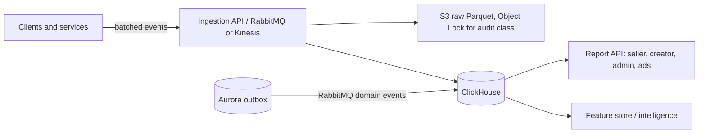

# Database performance, capacity and security

As of 2026-10-03. Labels: EXISTING (path), PLANNED, FUTURE. **No production data and no load test exist.** Every number below is either an EXISTING config value (cited), an AWS-documented default to verify, or a labelled assumption / target. Nothing here is a guarantee. EXPLAIN validation was not run (compose Postgres not running): follow-up F1.

## 1. Connection management

### 1.1 Audit of the current pool (EXISTING)

| Item | Finding | Evidence | Severity |
| --- | --- | --- | --- |
| Driver | `database/sql` over `pgx/v5/stdlib` (not `pgxpool`); ent wraps it with `entsql.OpenDB` | `platform/postgres/database.connector.go` | note; `database.md` line 806 says "pgxpool size 10": **doc does not match code** |
| Defaults | `MaxOpen=20, MaxIdle=5, ConnMaxLifetime=30m`; no `ConnMaxIdleTime` | `DefaultPoolSettings()` | P2 |
| Per-module pools | Each module opens its **own** pool: goIdentity = auth + users + currency + admin = 4 x 20 = **80 max per task**; goLive 20; goAds 20; goTrust 20; goCommerce (catalog, inventory, orders, analytics: PLANNED, no ent schemas yet) up to 80 | `deployables/*/server.go`, `modules/*/src/app.go` | **P1** |
| Money pool | go-money modules share one pool: 40 open / 10 idle, refcounted | `modules/ledger/src/databases/sharedPool.database.go` | ok (good pattern) |
| Worst case (all deployables, 1 task each) | 80 + 40 + 20 + 20 + 20 + 80 = **260** connections; with 2 HA tasks each = 520; autoscaling to 6 goIdentity tasks = 480 from goIdentity alone | arithmetic from the above | **P1** |
| Lifetime without jitter | `SetConnMaxLifetime(30m)` has no jitter: connections opened together at boot (up to 20 per module) all expire together, causing a synchronized reconnect burst every 30 minutes per task | `database.connector.go` | P2 |
| Timeouts | No `statement_timeout`, `lock_timeout`, `idle_in_transaction_session_timeout`, or `application_name` set anywhere (grep) | none found | **P1** |
| Readiness | `ReadinessCheckForDatabase` pings through the pool: if the pool is exhausted, readiness fails, ECS kills tasks, reconnect storm amplifies the incident | `database.connector.go` | P1 |
| Boot | A separate `sql.Open` for migrations at every start (closed after) plus 5 s ping at open | `migrations.runner.go` | see `migrations.md` |
| Search path | `search_path` is passed as a connection-URL query parameter (a startup parameter) per module | `platform/postgres/schema.scope.go` | matters for RDS Proxy (1.4) |
| Locks | Transaction-scoped advisory lock (`pg_advisory_xact_lock`) in ledger posting: compatible with transaction pooling. golang-migrate uses a **session** advisory lock: needs a direct (non-pooled) connection | `ledgerPosting.service.go:52`, golang-migrate | note |
| Outbox relay | Each module's relay holds a transaction open **while publishing to RabbitMQ** (`PublishPendingOutboxEventsInTransaction`), pinning one connection and row locks until the broker confirms | `modules/*/src/events/outbox.event.go` | P2: a slow or blocked broker holds the connection up to the confirm timeout (10 s); keep it short |

### 1.2 Budget model

Aurora PostgreSQL default `max_connections = LEAST(DBInstanceClassMemory/9531392, 5000)` (AWS default; verify with `SHOW max_connections` on the real class). Roughly 5-10 MB RAM per backend, so every 100 connections costs about 0.5-1 GB.

| Pool class | Rule | Starting value (TARGET to tune) |
| --- | --- | --- |
| Request pool per module | `MaxOpen = ceil(peak concurrent DB-bound requests per task)`, usually 5-10 | 8 (identity modules), 15 shared for money, 10 live/ads/trust |
| Idle | `MaxIdle = MaxOpen/2`; add `ConnMaxIdleTime=5m` | per above |
| Lifetime | 30 min **with jitter** (use `pgxpool` `MaxConnLifetimeJitter` via `stdlib.OpenDBFromPool`, or jittered recycle) | 30 min +/- 20% |
| Worker pool (outbox relay, sweepers, backfills) | **Separate** small pool per process so request traffic cannot starve workers and vice versa | 2-3 |
| Admin/ops | break-glass role limited with `ALTER ROLE ... CONNECTION LIMIT 3` | 3 |
| Migration | one-off task, direct connection, role limit | 2 |
| Per-role cap | `ALTER ROLE svc_x CONNECTION LIMIT N` = (max tasks x pool) x 1.2 | protects other services from one runaway service |

Budget rule: `sum over roles(max tasks x pool) <= 70% x (max_connections - 20 reserved)`; the remainder is for failover bursts and ops. With RDS Proxy the budget applies to the proxy-to-DB side, while client-side counts can be larger.

### 1.3 Preventing exhaustion, starvation and storms

| Risk | Control |
| --- | --- |
| Exhaustion | Per-role `CONNECTION LIMIT`; alarm at 70% of `max_connections`; RDS Proxy; load-shed (503 + `Retry-After`) when pool wait time > 200 ms (`sql.DB.Stats().WaitDuration`) |
| Starvation | Separate worker pool; `context` deadlines on every request; per-request DB budget; no long transactions around network calls (EXISTING: relay publishes inside a tx; avoid elsewhere) |
| Idle-in-transaction | `idle_in_transaction_session_timeout = 30s` for app roles |
| Runaway queries | `statement_timeout = 5s` OLTP default, overridden with `SET LOCAL` for known long jobs; `lock_timeout = 2s` |
| Reconnect storms | Jittered lifetime; exponential backoff with jitter on connect failure; readiness should not fail on a transient pool wait (ping with a dedicated connection or short timeout and N-of-M tolerance); stagger task starts; RDS Proxy absorbs failover reconnects |
| Deploy storms | N tasks x modules opening pools at once: cap `MaxOpen` and let `MinOpen` stay 0-2; pre-deploy migration task (no migration lock contention at boot) |
| Failover | Aurora failover about 30 s (AWS typical, verify): pools must evict dead connections quickly (`ConnMaxLifetime`, `HealthCheckPeriod 30s`, driver `connect_timeout 5s`, TCP keepalives) |

### 1.4 Pooler choice (PLANNED)

| Option | Pros | Cons / caveats |
| --- | --- | --- |
| RDS Proxy (recommended first, `database.md` line 805) | Managed, IAM/secrets integration, failover-aware | **Pinning**: sessions that use named prepared statements, session-level `SET`, or unsupported startup parameters get pinned and lose multiplexing. pgx `stdlib` defaults to `QueryExecModeCacheStatement` (named prepared statements) so by default **every connection pins**; startup parameter `search_path` may be rejected or pin. Extra per-query latency (validate, about 1 ms assumption). Costs per vCPU |
| PgBouncer in transaction mode (ECS sidecar/service) | Cheap, configurable (`max_client_conn`, `default_pool_size`), 1.21+ supports protocol-level prepared statements via `max_prepared_statements` | Operate it; HA; `ignore_startup_parameters=search_path` or role-level search_path; no session state (advisory session locks, `LISTEN`, `SET` without `LOCAL`, temp tables) |

Required app changes for any transaction pooler (**P1 before enabling a pooler**):

| Change | Detail |
| --- | --- |
| Query mode | Set pgx `default_query_exec_mode` to `cache_describe` or `exec` (no named prepared statements); benchmark the planning-cost difference with k6/pgbench |
| Search path | Replace the URL `search_path` startup parameter with `ALTER ROLE svc_x SET search_path = x` (role-level default; no client parameter). This is a grant-class statement for `create-databases.sh` |
| Session state | Use `SET LOCAL` only inside transactions; keep session advisory locks only on direct connections (migrations) |
| Direct endpoint | Migration task and admin tools bypass the pooler (cluster writer endpoint) |
| Test | Run the money integration tests (`liveMoney.integration_test.go`) through the pooler in staging; assert zero pinning (`DatabaseConnectionsCurrentlySessionPinned` metric for RDS Proxy) |

## 2. Read-replica routing rules (PLANNED)

Rule: the writer serves everything until a trigger fires (analytics > 10% writer CPU, or replica-tolerant read RPS above writer budget; `database.md` line 809). Aurora replicas share storage: lag is typically tens of ms but not zero.

| Route to replica (reader endpoint) | Always writer |
| --- | --- |
| Public catalog browse, storefront, product detail (stale <= 5 s OK) | Anything in a transaction that writes |
| Public profile, follower counts, feeds | Read-after-write paths: checkout, order status after payment, wallet balance, ledger, escrow, coin purchases |
| Seller/creator dashboards and reports (read-only roles) | Auth: login, refresh rotation (`FOR UPDATE`), OTP verify, session revoke |
| Admin lists and search | Idempotency lookups, outbox relay |
| Export jobs, reconciliation **reports** (not the posting path) | Inventory reservation |
| Heavy filters/aggregations | Anything checked immediately after the user's own mutation (use writer for N seconds via a "recently wrote" cookie/session flag) |

Implementation: separate `*sql.DB` per replica with a **read-only role** (`svc_x_ro`), selected by explicit repository methods (`Reader()` vs `Writer()`), never by automatic SQL sniffing. Reader lag guard: skip replica if `AuroraReplicaLag > 1 s`. Money schemas: replicas serve reports only. Fan-out of reads multiplies connection budget: budget readers separately.

## 3. Analytics separation (PLANNED, `docs/architecture/analytics.md`)

| Rule | Detail |
| --- | --- |
| No analytical query on the writer | Dashboards read ClickHouse; PG only serves point lookups and small aggregates |
| What stays in PG | Transactional facts (orders, ledger, budgets, conversions), small counters, config |
| What goes to ClickHouse | impressions, views, interactions, live chat/events, raw analytics events, search queries |
| Source of events | (1) domain events from the outbox (exactly the durable facts); (2) a **client-event ingestion path that bypasses PG** for high-volume best-effort events (events.md durability class B) |
| Idempotency | CH `ReplacingMergeTree`/dedupe on `event_id` (UUIDv7) |
| Backfill/replay | Outbox replay by id range (EXISTING mechanism, `events.md`); S3 raw as replay source for class-B |
| Deletion | Consent/erasure: keyed deletes or partition drop in CH: **LEGAL REVIEW** |

## 4. Observability

### 4.1 Signals

| Signal | Source | Why |
| --- | --- | --- |
| Slow queries | `pg_stat_statements` (`shared_preload_libraries`, `track_io_timing=on`), `log_min_duration_statement=250ms`, Performance Insights | top-N by total time, mean, calls, rows |
| Plans | `auto_explain` (`log_min_duration=500ms`, `sample_rate=0.1`, `log_analyze` off first) | regressions |
| Index usage | `pg_stat_user_indexes` (`idx_scan=0` over 30 d), `pg_stat_user_tables` seq-scan share, duplicate/overlapping index report | write amplification, size |
| Cache hit ratio | `blks_hit/(blks_hit+blks_read)` per DB, `BufferCacheHitRatio` (CloudWatch) | memory sizing |
| Locks / deadlocks | `pg_stat_database.deadlocks`, `log_lock_waits=on` with `deadlock_timeout=1s`, `pg_locks` blocked-chain query | contention |
| Connections | `DatabaseConnections`, per-role from `pg_stat_activity`, app-side `sql.DB.Stats()` (`InUse`, `WaitCount`, `WaitDuration`) exported via OTel | exhaustion |
| Host | CPU, freeable memory, read/write IOPS, `VolumeBytesUsed`, throughput, swap | capacity |
| Replication | `AuroraReplicaLag`, logical slot lag (CDC), `OldestReplicationSlotLag` | stale reads, WAL retention |
| Autovacuum / bloat | `pg_stat_user_tables.n_dead_tup`, `last_autovacuum`, `pg_stat_progress_vacuum`, bloat estimate query (pgstattuple on sample), `age(relfrozenxid)` per table, `MaximumUsedTransactionIDs` | wraparound and bloat |
| TPS | `xact_commit + xact_rollback` rate, rollback ratio, `TransactionLogsGeneration` | workload and anomalies |
| Outbox health | relay lag = `now() - min(created_at) WHERE published_at IS NULL` per schema; pending count; table size | EXISTING queue (no metric exists): P1 |
| App | RED metrics per endpoint, DB span duration (EXISTING OTel tracing in `platform/telemetry`) | attribution |

### 4.2 Dashboards (Grafana, PLANNED)

| Dashboard | Panels |
| --- | --- |
| DB overview | CPU, connections vs `max_connections`, IOPS, commit rate, cache hit, replica lag, free storage growth |
| Query performance | top 20 by total time / mean time / calls, p95 per `application_name`, slow-log rate |
| Locks and vacuum | blocked queries, deadlocks, dead tuples top tables, autovacuum duration, xid age |
| Pools | per service `InUse/Idle/WaitCount/WaitDuration`, RDS Proxy pinning |
| Outbox and events | lag per schema, pending, publish errors, DLQ depth |
| Capacity | table/index sizes top 20, growth per week, projected days to threshold |

### 4.3 Alerts (starting thresholds, TUNE with data)

| Alert | Threshold | Severity |
| --- | --- | --- |
| Writer CPU | > 70% for 15 min | warn; > 85% for 5 min page |
| Connections | > 70% of max for 10 min | warn; > 85% page |
| Pool wait | `WaitDuration` p95 > 200 ms for 5 min | warn |
| Replica lag | > 1 s for 5 min (warn), > 10 s page | |
| Free storage | Aurora auto-grows: alert on growth > 2x weekly baseline | warn |
| Deadlocks | > 0 per 5 min on money schemas, > 5 elsewhere | warn |
| Long transaction | > 5 min (idle in tx > 1 min) | warn |
| xid age | > 500M warn, > 1B page | |
| Autovacuum | any table dead-tuple ratio > 20% for 1 h | warn |
| Outbox lag | > 60 s (events.md), > 5 min page | |
| Slow-query rate | p95 of any top-20 statement > 2x its 7-day baseline | warn |
| Failed backups / restore drill | any failure | page |
| Cache hit | < 99% for 30 min on OLTP | warn |

## 5. Engineering performance targets

Labelled **TARGETS to validate with k6 load tests** at Base Y1 peak load (section 6) on a staging cluster of production class. They are not SLAs or guarantees. Server-side, excluding network and CDN.

| Operation | DB-level query p50 / p95 / p99 | Endpoint p50 / p95 / p99 |
| --- | --- | --- |
| Login (password check, session create) | 3 / 10 / 25 ms | 120 / 250 / 500 ms (hashing dominates) |
| Token refresh (rotation, `FOR UPDATE`) | 2 / 6 / 15 ms | 25 / 60 / 120 ms |
| Profile read by handle | 0.5 / 2 / 5 ms | 15 / 40 / 90 ms (cache hit < 5 ms) |
| Catalog product page | 1 / 4 / 10 ms | 30 / 80 / 150 ms |
| Catalog list / browse (cursor) | 3 / 12 / 30 ms | 60 / 150 / 300 ms |
| Create order + reserve stock | 8 / 25 / 60 ms | 120 / 300 / 600 ms (provider call excluded) |
| Ledger posting (journal entry + lines) | 5 / 15 / 40 ms | 40 / 100 / 250 ms |
| Wallet balance read | 1 / 3 / 8 ms | 15 / 40 / 80 ms |
| Gift send (go-live to go-money charge, EXISTING flow) | 6 / 20 / 50 ms (charge tx) | 60 / 150 / 350 ms |
| Message send | 1 / 4 / 10 ms | 20 / 50 / 120 ms |
| Conversation page (50 msgs) | 1 / 4 / 10 ms | 25 / 70 / 150 ms |
| Notification inbox | 1 / 5 / 12 ms | 25 / 70 / 150 ms |
| Feed read (precomputed) | 2 / 8 / 20 ms | 40 / 100 / 250 ms |
| Seller dashboard summary (replica or CH) | 10 / 40 / 120 ms | 100 / 300 / 700 ms |
| Outbox relay: commit to RabbitMQ publish confirm | n/a | p50 < 1 s, p99 < 5 s (alarm 60 s) |

Load profile for k6 (assumption): peak = 10x average of the Base Y1 daily rate; gift bursts of 100 sends/s for one live; soak 1 h; failover test during load; connection-pool saturation test at 2x tasks.

## 6. Capacity planning

### 6.1 Scenarios and assumptions (all ASSUMPTIONS, replace with real data)

| Driver | Current | Y1 Base | Y1 High (5x) | Y3 Base | Y3 High (5x) |
| --- | --- | --- | --- | --- | --- |
| Status | EXISTING: pre-production; only seed and reference data (geo, categories, policies) | assumed | assumed | assumed | assumed |
| Registered users | 0 real | 100k | 500k | 2M | 10M |
| MAU (20% of registered) | 0 | 20k | 100k | 400k | 2M |
| Sellers (2% of registered) x 25 products | 0 | 2k / 50k | 10k / 250k | 40k / 1M | 200k / 5M |
| Orders per MAU per month | 0 | 0.1 | 0.1 | 0.1 | 0.1 |
| Messages per MAU per day | 0 | 10 | 10 | 10 | 10 |
| Gift senders (% of MAU) x gifts/day | 0 | 2% x 10 | same | 2% x 10 | same |
| Analytics events per MAU per day | 0 | 60 | 60 | 60 | 60 |
| Video interactions per MAU per day | 0 | 30 | 30 | 30 | 30 |
| Ad impressions per MAU per day | 0 | 20 | 20 | 20 | 20 |
| Notifications per MAU per day | 0 | 5 | 5 | 5 | 5 |

Method: annual volume at that stage = MAU x rate x 365 (x 12 for monthly rates). Cumulative stored data assuming a linear ramp from 0: about 0.5 x annual at Y1 and about 1.5 x the Y3 annual at end of Y3. High = 5x Base for volume-driven rows. Peak load = 10x average (assumption).

### 6.2 Base-scenario volumes and storage

Row sizes are **estimates including indexes** (to replace with `pg_total_relation_size/reltuples`).

| Entity | Where | Row size (est.) | Y1 Base annual rows | Y1 stored | Y3 Base annual rows | Y3 stored (cumulative) |
| --- | --- | --- | --- | --- | --- | --- |
| Users (accounts, profiles, settings, consents) | PG | 3 KB per user | 100k | 0.3 GB | 2M | 6 GB |
| Products (+ variants, media refs) | PG | 4 KB | 50k | 0.2 GB | 1M | 4 GB |
| Orders (+ items, shipments) | PG | 3 KB | 24k | 0.04 GB | 480k | 2.2 GB |
| Messages | PG (partitioned) | 350 B | 73M | 13 GB | 1.46B | 767 GB |
| Transactions: journal entries + 4 lines (gift-dominated) | PG | 1.8 KB per posting | 1.55M | 1.4 GB | 31M | 80 GB |
| Gifts (read models, combos, goals) | PG | included above plus 0.3 KB | 1.46M | 0.3 GB | 29M | 13 GB |
| Notifications (90 d retention) | PG (partitioned) | 350 B | 36M | steady 3.2 GB | 730M | steady 64 GB |
| Outbox (7 d retention, all schemas) | PG | 700 B | 3.5M | < 0.1 GB steady | 62M | about 1 GB steady (about 43 GB/yr of churn) |
| Security / audit events | PG then S3 | 500 B | 0.2M | 0.1 GB | 4M | 3 GB |
| Analytics events | ClickHouse | about 40 B compressed | 438M | 17 GB (x0.5 = 9 GB) | 8.8B | about 525 GB cumulative |
| Video interactions | ClickHouse | about 30 B | 219M | 4 GB | 4.4B | about 200 GB |
| Ad impressions | ClickHouse (+ PG rollups) | about 40 B | 146M | 3 GB | 2.9B | about 175 GB |
| **Postgres total (rounded)** | | | | **about 20 GB** | | **about 940 GB** (messages = 80%; about 170 GB without) |

High scenario (5x): Y3 PG about 4.7 TB, of which messages about 3.8 TB: crosses the 3-5 TB "single schema" trigger. Conclusion (scenario-dependent): **messages are the first schema to leave the main cluster**, not orders, ledger or catalog.

### 6.3 Throughput sanity (Base Y3, 10x peak)

| Flow | Average | Peak (10x) | Comment |
| --- | --- | --- | --- |
| Messages inserts | 46/s | 460/s | fine for one writer |
| Gift postings | 1/s | 10/s average, burst 100/s in one live | per-reference advisory lock, no global lock; hot rows are combo/leaderboard upserts |
| Orders | 0.015/s | 0.15/s | negligible |
| Outbox inserts | 2/s | 20/s | trivial |
| Analytics events | 280/s | 2,800/s | must **not** hit PG |

### 6.4 Scale triggers (measurable; any one for 14 days)

| Trigger | Threshold | Action |
| --- | --- | --- |
| Writer CPU | > 60% p95 daytime | tune queries, add cache, then vertical scale |
| Reader need | read RPS tolerant to staleness > writer headroom, or analytics > 10% writer CPU | add replica, route per section 2 |
| Connections | > 70% max after pooler | add RDS Proxy / shrink pools |
| Storage | any single table > 100 GB or > 100M rows | partition (`partitioning.md`) |
| Cluster size | > 1 TB total or a schema > 500 GB | consider schema split |
| Vacuum | table vacuum > 6 h, or xid age > 500M | partition, tune autovacuum |
| Restore time | drill exceeds 50% of the RTO | split schema, tune backup strategy |
| Outbox | relay lag > 60 s p95 | partition outbox / more relay workers per schema |
| Replica lag | > 1 s sustained | reduce read-after-write routing |
| Phase 4 | see `sharding.md` s5 | |

## 7. Scaling roadmap

The owner's phase wording was not available to this audit beyond the brief (design for partitionable, then shard-ready, measurable Phase 4 triggers, no sharding now). Mapping below follows that and should be confirmed.

| Phase | Goal | Contents | Exit criteria |
| --- | --- | --- | --- |
| 1 Foundation | One Aurora cluster, correct and observable | pool fixes (1.1), timeouts, RDS Proxy readiness, `pg_stat_statements`, auto_explain, dashboards and alerts, outbox cleanup, migrations out of boot, role split, backups and restore drills, index review, k6 baseline | targets in section 5 met on staging; restore drill passed |
| 2 Partitionable | Large tables handled without redesign | partition notifications, security events, outbox (when triggered), messages at creation; ClickHouse for events, impressions, views; read replica(s) with routing rules | triggers in 6.4 stay green |
| 3 Shard-ready | No design decision blocks a split | checklist in `sharding.md` s4 done; cross-schema grants replaced by ports; router seam; hot schema (messages first by Scenario) moved to own cluster | per-schema independence proven by a failover/split drill |
| 4 Sharding (only if triggered) | Horizontal split of one domain | `sharding.md` s5 triggers, one domain at a time; never money first | measured triggers fire for 14 consecutive days |

## 8. Database security

| Control | Target | Status |
| --- | --- | --- |
| TLS | `rds.force_ssl=1`; clients `sslmode=verify-full` with RDS CA bundle; local uses `sslmode=disable` (EXISTING in `generateMigration` URL) | PLANNED |
| Encryption at rest | Aurora storage encrypted with a customer-managed KMS key; separate keys for prod vs DR region (multi-region key); snapshots inherit | PLANNED |
| Secrets | Credentials in Secrets Manager with rotation (30-90 d, multi-user rotation to avoid downtime) or IAM database auth; **local passwords like `svc_x_local_only` must never reach non-local envs** (EXISTING in `create-databases.sh`) | PLANNED |
| Least privilege roles | EXISTING: one login role per owning service (`svc_auth`, `svc_users`, ...), schema `AUTHORIZATION` to that role, `PUBLIC` revoked, shared `svc_money` granted membership of 7 money roles. Gaps: (a) app role == schema owner (can DDL/DROP): split owner/migrator vs app (`migrations.md`); (b) every `svc_*` is `IN ROLE zudomart_readers`, so reader grants apply to all services; (c) `svc_money` unions 7 roles, so a flaw in any money module has all money schema rights | **P1 (a)**, P2 (b, c) |
| Read-only roles | `svc_x_ro` per schema for replicas, reports, BI; `pg_read_all_data` is **not** granted to humans | PLANNED |
| Migration role | Per-schema `*_migrator`, used only by the pipeline task; short-lived credentials | PLANNED |
| Admin access | No standing human access: break-glass through SSM/IAM role with approval, time-boxed, session recorded, `pgaudit` logs reviewed; `rds_superuser` only for AWS operators; Query results containing PII must not be copied to chat/tickets | PLANNED |
| Network | Aurora in private subnets, security group allows only ECS service SGs and the migration task; no public endpoint | PLANNED |
| pgaudit | `pgaudit.log = 'ddl, role'` globally, `write` for money schemas and admin tables, `read` only for PII tables via object auditing; ship to CloudWatch then an immutable log-archive bucket | PLANNED |
| PII column access | EXISTING precedent: column-level `GRANT SELECT (id, account_id, handle, display_name, ...) ON profiles TO zudomart_readers`, which omits sensitive columns (`users/.../*_grant_read_access_*.up.sql`). Extend: every new cross-schema grant lists columns, never `SELECT *`-style table grants; sensitive columns (email, phone, DOB, address, KYC) have no reader grants. Application-level encryption for the most sensitive fields via `platform/secretbox` (EXISTING package) where required; **LEGAL REVIEW** of the field list |
| Row-level security | Optional defence in depth for multi-tenant seller data (`seller_id = current_setting(...)`): validate pooling interaction (needs `SET LOCAL`); not recommended before the pooler decision | FUTURE |
| Extensions | Allow-list only: `postgis`, `pg_stat_statements`, `pgaudit`, `pg_partman`, `pg_cron`; no `dblink`/`postgres_fdw` between schemas (would create hidden joins) | PLANNED |
| Backups | Encrypted, deletion protection, vault lock (`backup-recovery.md`) | PLANNED |
| Logging | `log_statement=none` for app roles (avoid logging bind values with PII); never enable `log_parameter` on PII tables; mask in `auto_explain` | PLANNED |

## 9. Findings and follow-ups

| # | Finding | Priority |
| --- | --- | --- |
| P1-1 | Pool config: 20 per module, no timeouts, no jitter; goIdentity worst case 80/task; doc/code mismatch (`database.md` says pgxpool 10) | P1 |
| P1-2 | Pooler incompatibility: pgx default named prepared statements + startup `search_path` | P1 (before RDS Proxy) |
| P1-3 | No outbox cleanup or relay-lag metric, and `outbox` pending index not partial | P1 |
| P1-4 | Services migrate on boot with schema-owner credentials | P1 (`migrations.md`) |
| P1-5 | Messages dominate PG storage in every scenario: decide store/partition before the module is built | P1 |
| P2-1 | Statement/lock/idle-in-tx timeouts and `application_name` per service | P2 |
| P2-2 | Relay holds a tx open during RabbitMQ publish | P2 |
| F1 | Run `EXPLAIN (ANALYZE, BUFFERS)` on seeded tables (needs compose Postgres): users profile handle lookup, `journal_lines (account_id, created_at)`, outbox pending scan, audit filters | follow-up |
| F2 | k6 baseline and pool saturation test | follow-up |
| F3 | Replace assumptions in 6.1 with real analytics after the first 30 days of traffic | follow-up |
