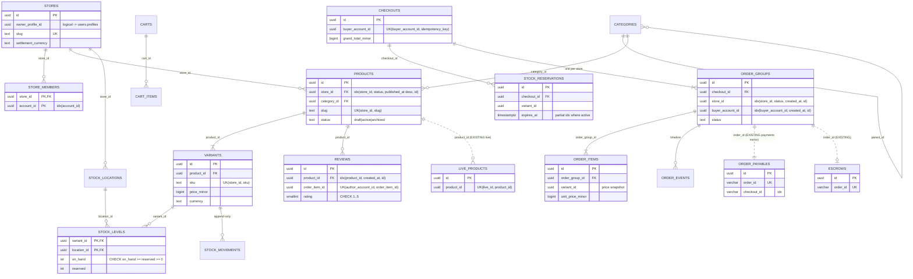
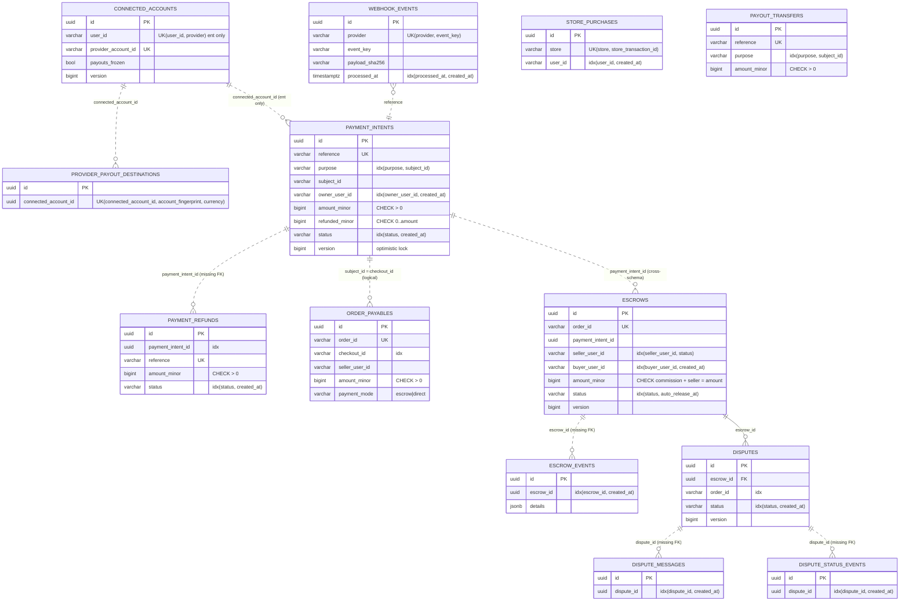
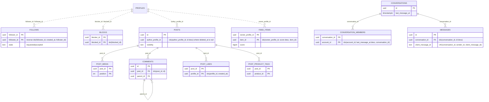
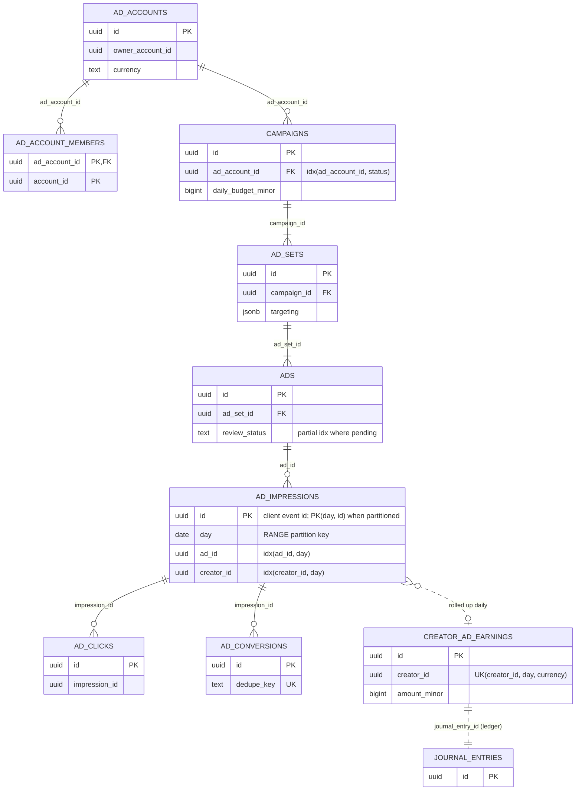
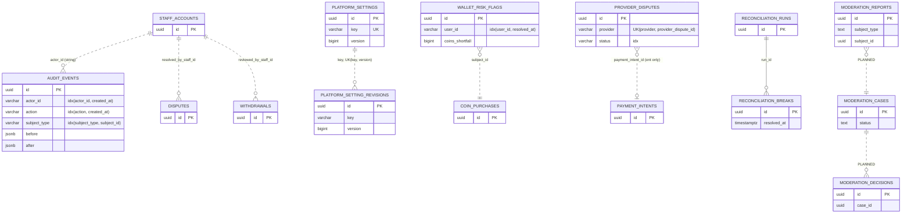
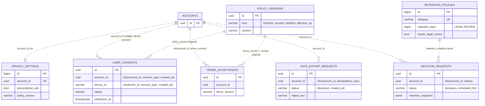
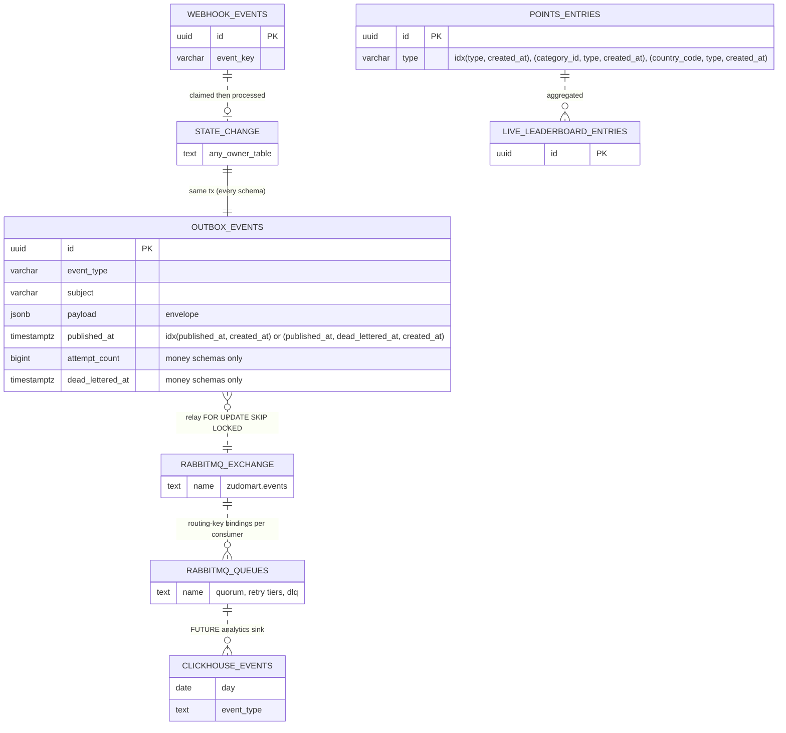

# Schema ERDs

> **Creator = personal account upgrade (owner, 2026-10-03).** A creator account is the user's personal account turned into a creator account, not a separate profile. Profile types are Personal, Business/Brand and Government; `creatorStatus` (`none|pending|approved|rejected`) lives on the Personal profile and is set to `approved` when the Creator Program application is approved. It unlocks Creator Studio, going live, monetisation and earnings. Blue applies to the Personal profile whether or not it is creator-enabled.

As of 2026-10-03. Source of truth for EXISTING tables: `services/go/modules/<m>/src/migrations/*.up.sql` (what the DB has) cross-checked against `<m>/src/databases/schema/*.schema.go` (what ent expects). PLANNED tables follow `docs/architecture/database.md` and the legacy spec `apps/api/prisma/schema/*.prisma`.

Conventions:

- `PK`, `FK`, `UK` markers; the quoted comment lists other unique indexes, CHECKs or notes.
- Solid line `--` = real FK constraint in the DB. Dashed line `..` = **logical reference only** (no constraint: either cross-schema by design, or a same-schema FK that is missing, see section 10).
- Every EXISTING table has `id uuid` (UUIDv7, generated in Go: `timeOrderedIdentifier.mixin.go`) and `created_at timestamptz`, except where noted (`acting_profiles`, `privacy_settings`, `retention_policies` use `bigint identity`; catalog tables `gifts`, `points_rules`, `coin_packages`, `creator_tiers`, `signing_keys` use string ids).
- Money: `bigint *_minor` + `currency` (ISO 4217 or `COIN`). Status columns are `varchar` with values enforced by ent enums in Go, not by DB CHECKs.
- Diagram titles carry the status. PLANNED diagrams show keys only.

## 1. Core: identity, users, profiles, staff (EXISTING)

```mermaid
erDiagram
  ACCOUNTS ||--o{ SESSIONS : "account_id"
  SESSIONS ||--o{ REFRESH_TOKENS : "session_id"
  ACCOUNTS ||--o{ SOCIAL_IDENTITIES : "account_id"
  ACCOUNTS ||..o{ PROFILES : "account_id (auth->users, logical)"
  ACCOUNTS ||..o| ACTING_PROFILES : "account_id (logical)"
  PROFILES ||..o| ACTING_PROFILES : "profile_id (missing FK)"
  PROFILES ||--o{ PROFILE_CATEGORIES : "profile_id, ON DELETE CASCADE"
  BUSINESS_CATEGORIES ||--o{ PROFILE_CATEGORIES : "business_category_id, CASCADE"
  BUSINESS_CATEGORIES ||..o{ BUSINESS_CATEGORIES : "parent_id (missing FK)"
  ACCOUNTS ||..o{ USERNAME_CHANGES : "account_id"
  ACCOUNTS ||..o{ USERNAME_HOLDS : "held_for_account_id"
  ACCOUNTS ||..o{ SHIPPING_ADDRESSES : "account_id"
  STAFF_ACCOUNTS ||--o{ STAFF_SESSIONS : "staff_id"
  STAFF_ACCOUNTS ||--o{ STAFF_INVITATIONS : "staff_id"
  STAFF_ACCOUNTS ||--o{ STAFF_LOGIN_CHALLENGES : "staff_id"

  ACCOUNTS {
    uuid id PK
    varchar email UK "nullable; normalised lower-case in Go"
    varchar username UK
    varchar password_hash "nullable (social-only)"
    jsonb roles
    varchar status "active|..."
  }
  SESSIONS {
    uuid id PK
    uuid account_id FK "idx(account_id, revoked_at)"
    timestamptz expires_at
    timestamptz revoked_at
  }
  REFRESH_TOKENS {
    uuid id PK
    uuid session_id FK "no index on session_id"
    varchar token_hash UK
    uuid replaced_by_id "self ref, no FK"
  }
  SOCIAL_IDENTITIES {
    uuid id PK
    uuid account_id FK
    varchar provider "UK(provider, subject)"
    varchar subject
  }
  ONE_TIME_CODES {
    uuid id PK
    varchar secret_hash UK
    varchar destination "idx(destination, purpose, consumed_at)"
  }
  SIGNING_KEYS {
    varchar id PK
    timestamptz published_until
    timestamptz retired_at
  }
  PROFILES {
    uuid id PK
    uuid account_id "partial UK one personal per account"
    varchar kind "personal|business"
    varchar creator_status "none|pending|approved|rejected"
    varchar handle UK
    bool verified
  }
  PROFILE_CATEGORIES {
    uuid profile_id PK,FK
    uuid business_category_id PK,FK
  }
  BUSINESS_CATEGORIES {
    uuid id PK
    uuid parent_id
    varchar slug UK
  }
  ACTING_PROFILES {
    bigint id PK
    uuid account_id UK
    uuid profile_id
  }
  USERNAME_CHANGES {
    uuid id PK
    uuid account_id "idx(account_id, created_at)"
  }
  USERNAME_HOLDS {
    uuid id PK
    varchar username UK
    timestamptz expires_at
  }
  SHIPPING_ADDRESSES {
    uuid id PK
    uuid account_id "idx(account_id, created_at)"
    varchar country_code
    uuid region_id "logical -> geo_regions"
    uuid city_id "logical -> geo_cities"
    bool is_default "no partial UK: one default not enforced in DB"
  }
  STAFF_ACCOUNTS {
    uuid id PK
    varchar email UK
    jsonb permissions
    bytea totp_secret_encrypted
  }
  STAFF_SESSIONS {
    uuid id PK
    uuid staff_id FK "idx(staff_id, revoked_at)"
    varchar refresh_hash UK
  }
  STAFF_INVITATIONS {
    uuid id PK
    uuid staff_id FK
    varchar token_hash UK
  }
  STAFF_LOGIN_CHALLENGES {
    uuid id PK
    uuid staff_id FK
    varchar token_hash UK
  }
```

Geo (EXISTING, `users`): `GEO_COUNTRIES (code UK)` → `GEO_REGIONS (country_id, UK(country_code, name))` → `GEO_ADMIN_AREAS (UK(region_id, name))` / `GEO_CITIES (UK(region_id, name), admin_area_id)`. All links logical (no FKs).

## 2. Marketplace (PLANNED; only the money-side mirrors exist)

## 3. Finance A: payments and escrow (EXISTING; `connected_accounts` etc. ent-only)

## 4. Finance B: ledger and wallet (EXISTING)

```mermaid
erDiagram
  LEDGER_ACCOUNTS ||--o{ JOURNAL_LINES : "account_id"
  JOURNAL_ENTRIES ||--|{ JOURNAL_LINES : "entry_id"
  JOURNAL_ENTRIES ||..o| JOURNAL_ENTRIES : "reverses_entry_id UK (no FK)"
  RECONCILIATION_RUNS ||--o{ RECONCILIATION_BREAKS : "run_id"
  JOURNAL_ENTRIES ||..o{ RECONCILIATION_BREAKS : "journal_entry_id (missing FK)"
  LEDGER_ACCOUNTS ||..o{ SELLER_CREDIT_MATURITIES : "seller_user_id + currency (logical)"
  PAYOUT_ACCOUNTS ||..o{ WITHDRAWALS : "payout_account_id (missing FK, no index)"
  COIN_PACKAGES ||..o{ COIN_PURCHASES : "package_id (missing FK)"
  COIN_PURCHASES }o..o| PAYMENT_INTENTS : "payment_intent_id (cross-schema)"
  JOURNAL_ENTRIES ||..o| WITHDRAWALS : "reference withdrawal-requested:<id>"

  LEDGER_ACCOUNTS {
    uuid id PK
    varchar code "UK(code, currency)"
    varchar currency
    varchar kind
    varchar owner_type "idx(owner_type, owner_id)"
    varchar owner_id
    bool allow_negative_balance
    bigint balance_minor "CHECK >= 0 unless allowed"
    bigint version "optimistic + FOR UPDATE"
  }
  JOURNAL_ENTRIES {
    uuid id PK
    varchar reference UK "idempotency key of the posting"
    varchar kind "idx(kind, posted_at)"
    varchar external_reference "idx (mostly empty string)"
    uuid reverses_entry_id UK
    jsonb metadata
  }
  JOURNAL_LINES {
    uuid id PK
    uuid entry_id FK "UK(entry_id, line_number)"
    uuid account_id FK "idx(account_id, created_at)"
    varchar direction "debit|credit"
    bigint amount_minor "CHECK > 0"
    bigint balance_after_minor
  }
  SELLER_CREDIT_MATURITIES {
    uuid id PK
    varchar source_reference UK
    varchar seller_user_id "idx(seller_user_id, currency, matured_at)"
    bigint remaining_amount_minor "CHECK 0..original"
    timestamptz available_at "idx(matured_at, available_at)"
  }
  RECONCILIATION_RUNS {
    uuid id PK
    varchar provider "idx(provider, window_starts_at)"
  }
  RECONCILIATION_BREAKS {
    uuid id PK
    uuid run_id FK
    varchar provider_reference "idx"
    timestamptz resolved_at "idx"
  }
  WITHDRAWALS {
    uuid id PK
    varchar reference UK
    varchar user_id "idx(user_id, created_at)"
    uuid payout_account_id
    bigint amount_minor "CHECK net + fee = amount"
    varchar status "idx(status, created_at)"
    bigint version
  }
  PAYOUT_ACCOUNTS {
    uuid id PK
    varchar user_id "idx(user_id, deleted_at)"
    bytea account_number_ciphertext
    varchar account_number_fingerprint "idx(user_id, fingerprint, bank_code) not unique"
  }
  COIN_PACKAGES {
    varchar id PK
    jsonb prices
    varchar purchase_channel "idx(channel, active, sort_order)"
  }
  COIN_PURCHASES {
    uuid id PK
    varchar reference UK
    varchar user_id "idx(user_id, created_at)"
    uuid payment_intent_id "no index"
  }
  COIN_TRANSFERS {
    uuid id PK
    varchar sender_user_id "idx(sender, created_at)"
    varchar recipient_user_id "idx(recipient, created_at)"
    bigint coins "CHECK net + fee = coins"
  }
  COIN_CONVERSIONS {
    uuid id PK
    varchar user_id "idx(user_id, created_at)"
  }
  IDEMPOTENT_REQUESTS {
    uuid id PK
    varchar scope "UK(scope, key)"
    varchar key
    varchar request_hash
    jsonb response_body
  }
```

Balances are never stored in wallet tables: coins = `ledger_accounts` rows with currency `COIN` (`UserSpendableCoinsAccount`, `CreatorEarnedCoinsAccount`); seller money = `SellerPending/Available/ReservedPayout/Debt/Escrow` accounts (`ledger/src/modules/journal/models`).

## 5. Social (PLANNED)

## 6. Creator and livestream (EXISTING)

```mermaid
erDiagram
  LIVE_SESSIONS ||..o{ LIVE_VIEWERS : "live_id"
  LIVE_SESSIONS ||..o{ GUEST_SLOTS : "live_id"
  LIVE_SESSIONS ||..o{ JOIN_REQUESTS : "live_id"
  LIVE_SESSIONS ||..o{ LIVE_PRODUCTS : "live_id"
  LIVE_SESSIONS ||..o{ BATTLES : "live_id (partial UK: one open battle)"
  BATTLES ||..o{ BATTLE_PARTICIPANTS : "battle_id"
  BATTLES ||..o{ BATTLE_GIFT_EVENTS : "battle_id"
  LIVE_SESSIONS ||..o{ GIFT_GOALS : "live_id"
  GIFT_GOALS ||..o{ GOAL_CONTRIBUTIONS : "goal_id"
  LIVE_SESSIONS ||..o{ GIFT_CONTRIBUTIONS : "live_id + scope_key"
  LIVE_SESSIONS ||..o{ LIVE_LEADERBOARD_ENTRIES : "live_id"
  GIFTS ||..o{ GIFT_TRANSACTIONS : "gift_id (cross-schema)"
  LIVE_SESSIONS ||..o{ GIFT_TRANSACTIONS : "live_id (cross-schema)"
  GIFT_TRANSACTIONS ||..|| PROCESSED_GIFTS : "id (live read-model dedupe)"
  BATTLES ||..o| BATTLE_SETTLEMENTS : "battle_id UK (cross-schema)"
  CREATOR_TIERS ||..o{ CREATOR_PROGRAM_MEMBERS : "tier_id (missing FK)"
  LIVE_SESSIONS ||..o{ POINTS_ENTRIES : "live_id"

  LIVE_SESSIONS {
    uuid id PK
    uuid host_id "idx(host_id, state)"
    varchar state "idx(state, created_at)"
    bigint viewers "hot counter"
    bigint total_coins "hot counter"
    jsonb live_ad_settings
  }
  LIVE_VIEWERS {
    uuid id PK
    uuid live_id "UK(live_id, user_id); idx(live_id, left_at)"
    timestamptz last_seen_at
  }
  GUEST_SLOTS {
    uuid id PK
    uuid live_id "partial UK(live_id, user_id) active states"
    varchar state
  }
  JOIN_REQUESTS {
    uuid id PK
    uuid live_id "partial UK(live_id, user_id) where pending"
  }
  BATTLES {
    uuid id PK
    uuid live_id "UK(live_id, idempotency_key)"
    varchar state "idx(state, ends_at), (state, starts_at), (state, proposal_expires_at)"
    jsonb settlement
  }
  BATTLE_PARTICIPANTS {
    uuid id PK
    uuid battle_id "UK(battle_id, user_id)"
    bigint score
  }
  BATTLE_GIFT_EVENTS {
    uuid id PK
    uuid battle_id "idx(battle_id, created_at)"
  }
  GIFTS {
    varchar id PK
    bigint price_coins
    bool is_active "idx(is_active, sort_order)"
  }
  GIFT_CONTRIBUTIONS {
    uuid id PK
    uuid live_id "UK(live_id, scope_key, receiver_id, sender_id)"
    varchar scope_key
  }
  GIFT_GOALS {
    uuid id PK
    uuid live_id "idx(live_id, status)"
  }
  GOAL_CONTRIBUTIONS {
    uuid id PK
    uuid goal_id "UK(goal_id, sender_id)"
  }
  LIVE_LEADERBOARD_ENTRIES {
    uuid id PK
    uuid live_id "UK(live_id, user_id); idx(live_id, rank)"
  }
  PROCESSED_GIFTS {
    uuid id PK
    uuid sender_id "idx(sender_id, created_at)"
  }
  GIFT_TRANSACTIONS {
    uuid id PK
    varchar sender_user_id "UK(sender_user_id, idempotency_key)"
    varchar live_id "idx(live_id, created_at)"
    varchar battle_id "idx(battle_id, receiver_user_id)"
    bigint total_coins "CHECK fee + creator = total"
    uuid ledger_entry_id
  }
  BATTLE_SETTLEMENTS {
    uuid id PK
    varchar battle_id UK
    jsonb payouts
    varchar request_hash
  }
  CREATOR_PROGRAM_MEMBERS {
    uuid id PK
    varchar user_id UK
    varchar tier_id
  }
  CREATOR_TIERS {
    varchar id PK
    bigint gift_share_bps "CHECK 0..7000"
  }
  POINTS_ENTRIES {
    uuid id PK
    varchar idempotency_key UK
    uuid user_id "idx(user_id, source_type, created_at)"
    bigint amount
  }
```

Other live tables: `gift_combos (UK(sender_id, live_id, combo_id))`, `live_products (UK(live_id, product_id))`, `points_rules (string PK)`.

## 7. Ads (PLANNED; only `live_sessions.live_ad_settings` exists)

## 8. Trust, fraud, audit (EXISTING parts + PLANNED moderation)

## 9. Privacy and consent (EXISTING)

## 10. Analytics and events

Two outbox shapes exist: non-money schemas (admin, auth, users, currency, live) have no retry columns; money schemas (ledger, escrow, payments, wallet, creators) add `attempt_count, next_attempt_at, last_error, dead_lettered_at` (`ledger/src/events/outbox.event.go`).

## 11. Gaps between ent schemas, migrations and plans

| # | Gap | Evidence | Severity | Fix |
| --- | --- | --- | --- | --- |
| G1 | **ent ahead of migrations in payments**: tables `connected_accounts`, `provider_payout_destinations`, `provider_disputes`, `billing_subscriptions` and new columns (`payment_intents.connected_account_id, beneficiary_user_id, platform_fee_minor, provider_checkout_id`; refund fee top-up fields; `payout_transfers.kind, connected_account_id, transfer_group, ...`) plus indexes `paymentintent_provider_checkout_id`, `paymentintent_provider_transaction_id`, `paymentrefund_provider_refund_id`, `payouttransfer_connected_account_id_status`, `payouttransfer_provider_transfer_code` exist in `payments/src/generated/ent/migrate/schema.go` but in no migration; same for `escrow.escrows.processing_fee_minor` | `payments/src/migrations` has only `20261003111427_*`; escrow has no migration after `20261003114152_*`; WIP in git status | **P0** (service fails at runtime on a migrated DB) | Generate the migration before merge; add a CI check: replay migrations into `atlas_dev`, `atlas migrate diff` must be empty |
| G2 | User/account id types differ: `uuid` in auth, users, live; `varchar` in payments, escrow, wallet, creators, ledger (`owner_id`, `seller_user_id`, ...) | migrations | P2 | Standardise on `uuid` for new tables; convert with expand/contract before tables grow (bigger indexes, no FK/join possible today) |
| G3 | Missing same-schema FKs (ent edges not declared): `escrow_events.escrow_id`, `dispute_messages/dispute_status_events.dispute_id`, `payment_refunds.payment_intent_id`, `withdrawals.payout_account_id`, `coin_purchases.package_id`, `reconciliation_breaks.journal_entry_id`, `journal_entries.reverses_entry_id`, all `live` children → `live_sessions`/`battles`/`gift_goals`, `acting_profiles.profile_id`, `business_categories.parent_id`, geo hierarchy, `creator_program_members.tier_id` | migrations | P2 (money tables P1) | Add ent edges (FK + index) for money tables first; live children can stay logical if rows are purged by time |
| G4 | Ledger and escrow tables are not protected like `admin.audit_events` (no `REVOKE UPDATE, DELETE`) | `ledger/src/migrations/20261003110816_*` vs `admin/src/migrations/20261003101500_*` | **P1** | See [transactions.md](transactions.md#4-ledger-immutability) |
| G5 | Bachs mirror model (`seller:<id>:providerHeld`, `refundsInFlight`, `debt`, `providerMirrorReconciliation.service.go`, `connected_accounts`) must be replaced. Bachs and Anchor dropped; Paystack adopted (owner, 2026-10-03): escrow in Zudomart's Paystack balance (E2) or manual-settlement subaccounts (E1), direct shares split to seller subaccounts, payouts by transfer | `ledger/src/modules/journal/models/chartOfAccounts.model.go`, `payments/.../paymentCollectionPosting.service.go`, `checkoutPaymentFlowPlan.md` §4 and §12 | P0 | New forward migrations: `payout_accounts` (recipient and subaccount codes), intent `split_snapshot`, transfer codes, `saved_card_signatures`; ledger accounts per plan §4; recon runs persisted as `reconciliation_breaks` |
| G6 | Checkout granularity: payment intent `subject_id` = checkout id with N `order_payables`. Paystack plan = **one transaction per checkout** (dynamic split for direct groups), so this matches the code | `orderPayables.service.go`, plan §6.1 | P1 | Keep `subject_id` = checkout id; store the split per order group in `split_snapshot` |
| G7 | ZudoPoints in `live.points_entries`; plan puts points in `rewards` (goMoney). Engagement idempotency key is random per call (`"engagement:"+action+":"+uuid.NewString()`), so retries are not deduplicated (caps still apply) | `live/src/services/awardEngagementPoints.service.go` | P2 | Client-supplied key or `(user, live, action, minute)` natural key |
| G8 | Social, marketplace, inventory, orders, cart, reviews, messaging, notifications, media, ads, moderation: no tables; legacy Prisma models are the only spec | `apps/api/prisma/schema` | Info | Build from §2, §5, §7 above |
| G9 | `shipping_addresses.is_default` has no partial unique index (one default per account enforced only in Go with `FOR UPDATE`) | `users/.../addressDefault.service.go` | P3 | `UNIQUE (account_id) WHERE is_default` |
| G10 | `payout_accounts (user_id, account_number_fingerprint, bank_code)` is not unique, so the same bank account can be added twice | wallet migration | P3 | Partial unique `WHERE deleted_at IS NULL` |
| G11 | Currency columns are unconstrained `varchar` (ent `MaxLen(3)` only in Go) | all money migrations | P3 | `CHECK (currency ~ '^[A-Z]{3}$' OR currency = 'COIN')` on new money tables |
| G12 | `docs/architecture/database.md` cites stale paths (`internal/ent/schema`) and says users/admin/currency/ledger/live have "no routes" | that file | Info | Point to this folder |
| G13 | Raw SQL exists beyond grants: money outbox and SQL idempotency store (`ledger/src/events/outbox.event.go`, `ledger/src/utils/idempotencyRecord.util.go`), cross-schema `auth.accounts` read (`wallet/src/repositories/accountDirectory.repository.go`), a SUM in `creators/.../giftShareTiers.service.go`, advisory locks | grep recipe in README §6 | Info (deviation from "ent only except grants") | Accept and list them; all are parameterised |
