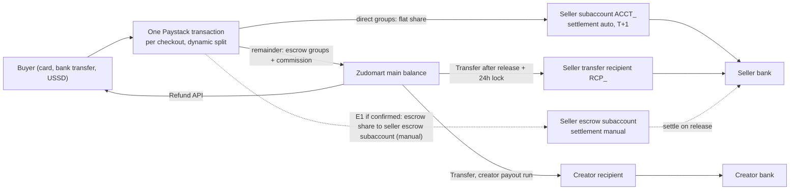
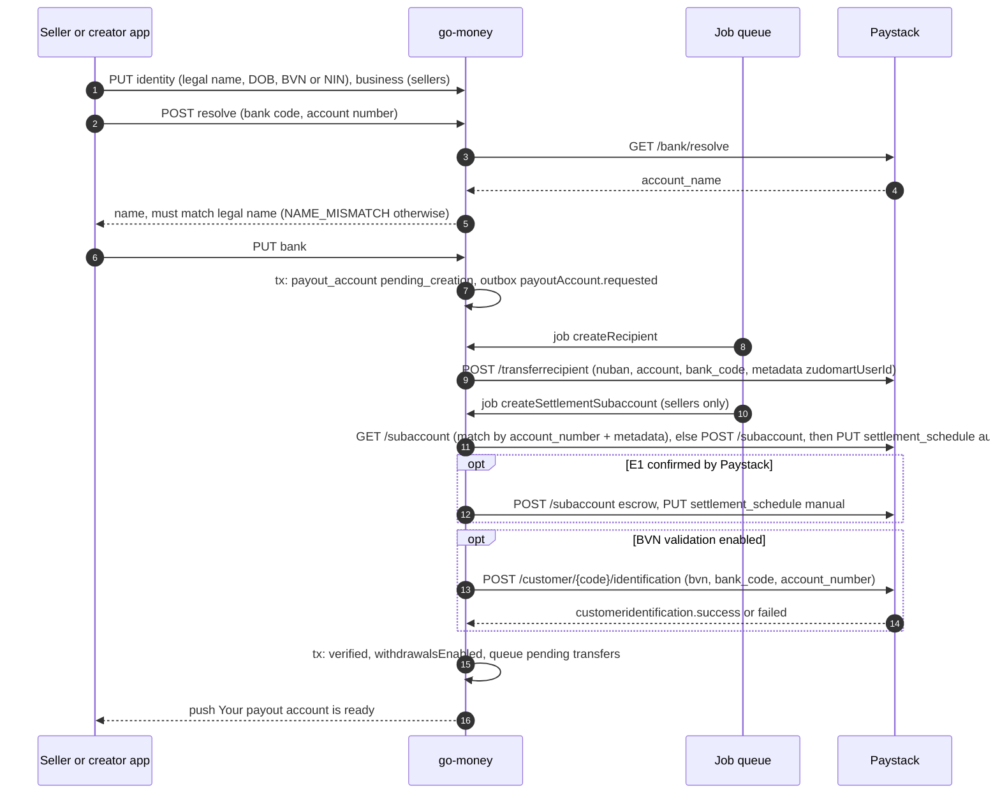
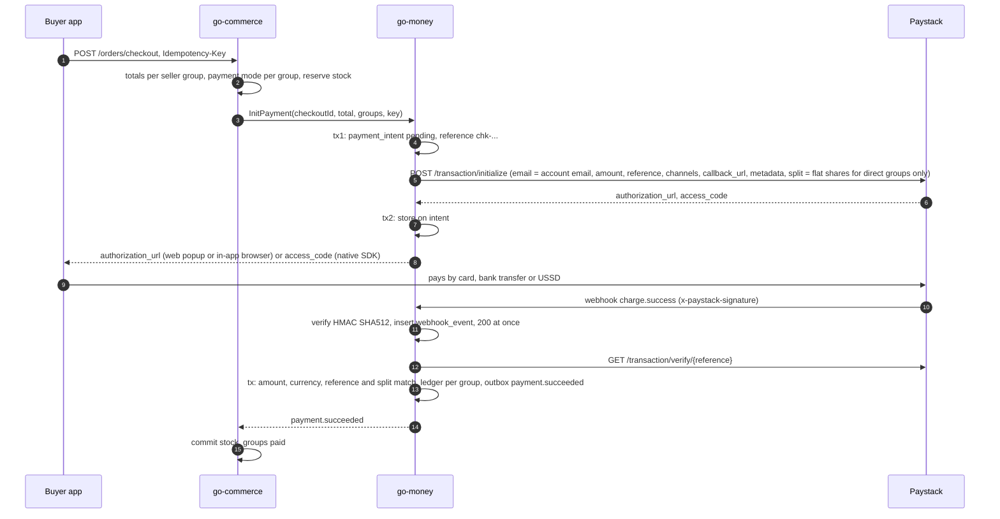
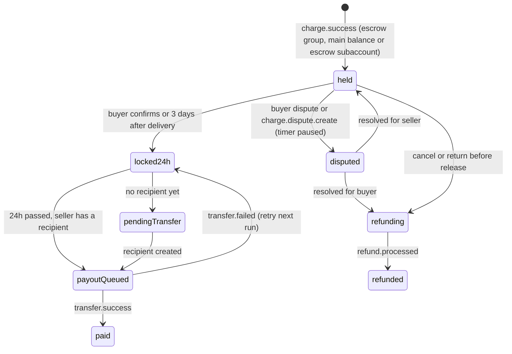
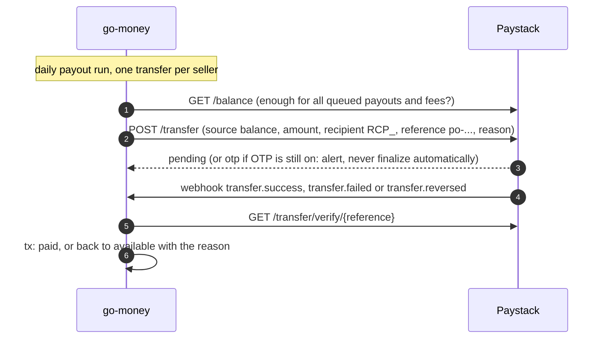
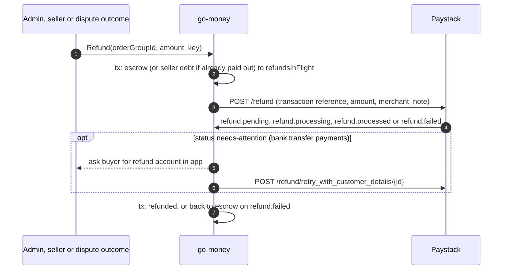
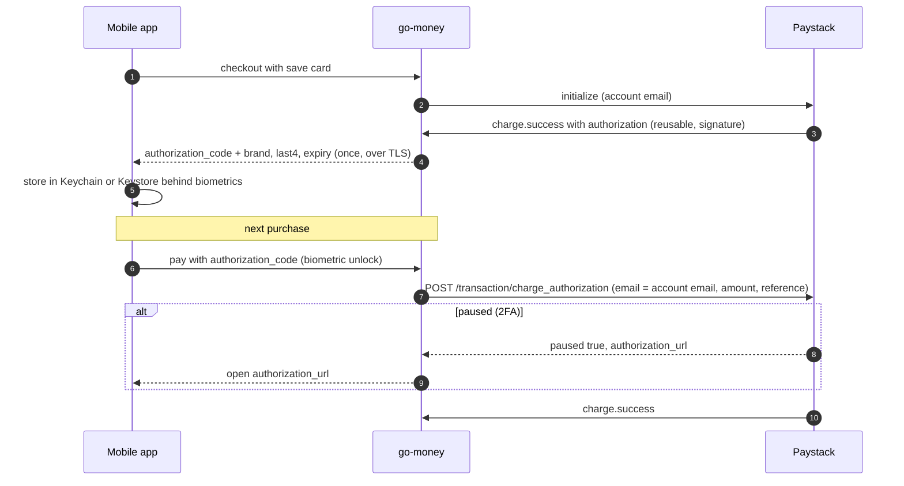
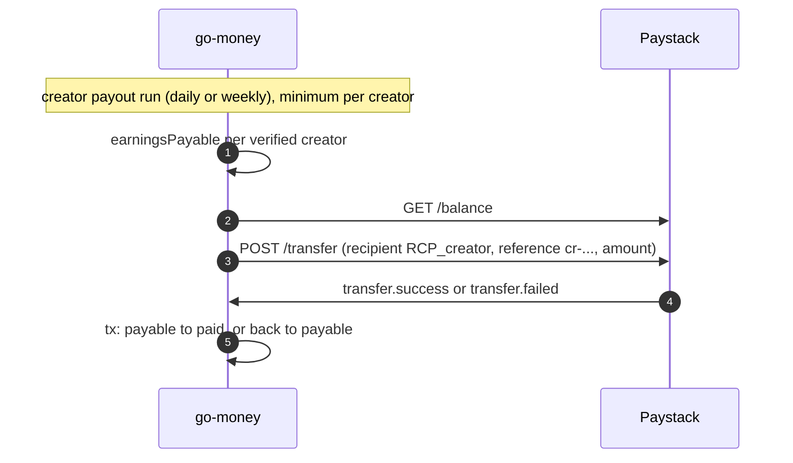
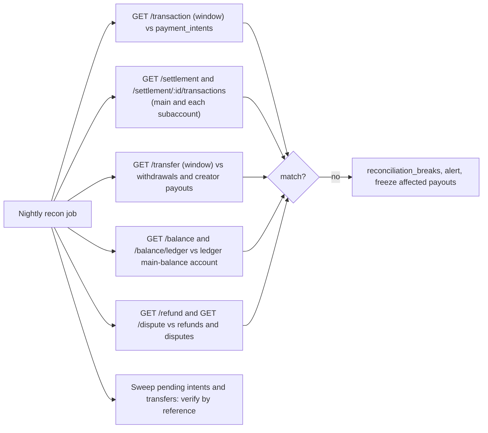

# Paystack integration review

> **Bachs and Anchor dropped; Paystack adopted (owner, 2026-10-03).** Paystack is the single payment provider: cards, bank transfer and USSD at checkout, Dedicated Virtual Accounts, transfers and payouts with account resolution, split payments with subaccounts, and multi-currency where Paystack supports it. This file replaces `docs/integrations/bachs.md` (deleted). The implementation plan and the code-change list are in [`docs/checkoutPaymentFlowPlan.md`](../checkoutPaymentFlowPlan.md).

Reviewed 2026-10-03. Not legal advice. Anything the docs do not state is marked **UNCONFIRMED — ask Paystack**. Confidence: **high** (stated plainly), **medium** (implied, or one confirmation needed), **low** (our inference).

**How the docs were read.** `paystack.com` serves a Cloudflare challenge to automated clients, so the pages were read from Internet Archive snapshots (snapshot date per page below) and from Paystack's official OpenAPI specification (`https://github.com/PaystackOSS/openapi`, `dist/paystack.yaml` and `dist/marketplace.yaml`, current `main`). Some snapshots are from 2023. **Re-read every cited page live in a browser before go-live**; anything older than 2025 is flagged in the table.

## 0. Source keys

All doc URLs are under `https://paystack.com`.

| Key | Page | Snapshot |
| --- | --- | --- |
| ACCEPT | /docs/payments/accept-payments/ | 2024-06-20 |
| VERIFY | /docs/payments/verify-payments/ | 2023-03-30 (old) |
| WEBHOOKS | /docs/payments/webhooks/ | 2025-07-18 |
| DVA | /docs/payments/dedicated-virtual-accounts/ | 2025-10-17 |
| SPLIT | /docs/payments/split-payments/ | 2023-03-27 (old) |
| MSPLIT | /docs/payments/multi-split-payments/ | 2023-03-29 (old) |
| REFUNDS | /docs/payments/refunds/ | 2023-03-29 (old) |
| RECUR | /docs/payments/recurring-charges/ | 2023-03-29 (old) |
| TRANSFERS | /docs/transfers/single-transfers/ | 2023-03-29 (old) |
| RECIPIENTS | /docs/transfers/creating-transfer-recipients/ | 2025-08-06 |
| RESOLVE | /docs/identity-verification/verify-account-number/ | 2023-03-29 (old) |
| API-SUBACCOUNT | /docs/api/subaccount/ | 2025-10-17 |
| API-SPLIT | /docs/api/split/ | 2023-03-28 (old) |
| API-REFUND | /docs/api/refund/ | 2025-10-17 |
| API-TRANSFER | /docs/api/transfer/ | 2023-06-01 (old) |
| API-SETTLEMENT | /docs/api/settlement/ | 2025-07-19 |
| API-SUBSCRIPTION | /docs/api/subscription/ | 2025-07-17 |
| API-PLAN | /docs/api/plan/ | 2025-07-19 |
| PRICING | /pricing/ (Nigeria) | 2026-02-05 |
| PAYCH | /docs/payments/payment-channels/ | 2023-12-12 (old) |
| SUBS | /docs/payments/subscriptions/ | 2025-09-15 |
| VALIDATE | /docs/identity-verification/validate-customer/ | 2023-03-29 (old) |
| API-DISPUTE | /docs/api/dispute/ | 2025-10-17 |
| OPENAPI | github.com/PaystackOSS/openapi `dist/paystack.yaml` | current |

## 1. Summary and control model

**Goal:** Zudomart holds as little user money as possible. Paystack (a licensed payment company, "a Stripe company", PRICING footer) holds funds in settlement until they reach a bank account.

**Recommended model (medium confidence, confirm items marked UNCONFIRMED):**

| Money | Where it goes | Who holds it until it reaches a bank | Confidence |
| --- | --- | --- | --- |
| Direct-mode order group (verified store, buyer chose direct) | Split at charge time: seller share to the **seller's subaccount**, commission stays with Zudomart's main account | Paystack, then T+1 automatic settlement to the seller's bank. Zudomart never holds the seller share | High (SPLIT, MSPLIT, API-SUBACCOUNT) |
| Escrow-mode order group (all unverified stores, verified stores when chosen) | **Launch path (E2):** stays in Zudomart's main Paystack balance, paid to the seller by **Transfer** after release + 24h lock | Paystack balance of Zudomart (Zudomart controls it) | High that it works (TRANSFERS); legal review needed |
| Escrow, preferred if Paystack confirms (E1) | Split to a per-seller **escrow subaccount** with `settlement_schedule: manual`; release = ask Paystack to settle | Paystack. Zudomart never holds it | Low: "manual means payout to the subaccount should only be made when requested" (API-SUBACCOUNT), but no API to request a per-order settlement is documented. **UNCONFIRMED — ask Paystack** |
| Commission, web coin packs, seller plans, Premium, creator subscriptions, ads | Main account | Zudomart's own revenue | High |
| Creator gift share | Payable in the Zudomart ledger, paid by **Transfer** to the creator's transfer recipient | Zudomart owes it until the payout run | High |
| Buyer refunds | Refund API on the original transaction | Paystack debits Zudomart's balance | High (REFUNDS) |

The **Zudomart ledger is the source of truth** for what money means (order payment, escrow, seller earnings, gift, refund, fee, payout). Paystack balances and settlements are evidence for reconciliation, never shown as anyone's wallet. Paystack ids (`ACCT_` subaccount, `SPL_` split, `RCP_` recipient, `TRF_` transfer, `AUTH_` authorization, transaction `id` and `reference`, `CUS_` customer) are stored next to Zudomart ids and never used as primary business ids.

Why not hold everything in the main balance: every naira of seller money in Zudomart's balance is money Zudomart controls, which is what the owner wants to avoid. Direct groups therefore never touch it, and E1 removes escrow from it too once Paystack confirms the manual settlement mechanics.

## 2. What Paystack documents (quotes)

| Topic | Quote or fact | Source |
| --- | --- | --- |
| Integration methods | Popup ("the easiest way to start accepting payments" on web), Redirect (Initialize Transaction returns an `authorization_url`; customer returns to `callback_url` with `reference`), Mobile SDKs ("Transactions are initiated on the server and completed in the SDK. The SDK requires an `access_code`"; Android `paystack-ui`, iOS via Swift Package Manager), Charge API (USSD, mobile money, OTP and PIN steps) | ACCEPT |
| Channels | `['card', 'bank', 'ussd', 'qr', 'mobile_money', 'bank_transfer']` | ACCEPT |
| Required fields | "The key, email and amount parameters are the only required parameters"; amount in the currency subunit | ACCEPT |
| Reference | "Unique case sensitive transaction reference. Only -, ., = and alphanumeric characters allowed" | ACCEPT, OPENAPI |
| `label` | "String that replaces customer email as shown on the checkout form" | ACCEPT |
| Never trust the return | "Just because the callback_url was visited doesn't prove that transaction was successful." Verify amount: "If the amount doesn't match, do not deliver value" | ACCEPT |
| Verify | `GET /transaction/verify/:reference`; `response.status` is the API call, `data.status` is the transaction | VERIFY |
| Secret key | "Never call the Paystack API directly from your frontend" | ACCEPT |
| Subaccount create | `POST /subaccount` with `business_name`, `bank_code`, `account_number`, `percentage_charge` ("The percentage the main account receives"), contact fields, `metadata` | API-SUBACCOUNT |
| Settlement schedule | "Any of auto, weekly, monthly, manual. Auto means payout is T+1 and manual means payout to the subaccount should only be made when requested. Defaults to auto" (Update Subaccount) | API-SUBACCOUNT |
| Bank details | "Paystack will not be liable for payouts to the wrong bank account." | SPLIT |
| Single split | `subaccount`, `transaction_charge` (flat amount to the main account, overrides the percentage), `bearer` (`account` default, or `subaccount`). "If the amount is insufficient, you'll get a 400 Bad Request error." | SPLIT, ACCEPT |
| Multi split | Split groups (`SPL_`), type `flat` or `percentage`, flat shares in kobo, "The sum of the flat splits should not be more than the transaction amount"; **dynamic split** object on initialize or popup: `type`, `bearer_type` (`all`, `all-proportional`, `account`, `subaccount`), `subaccounts` `[{subaccount, share}]`, `bearer_subaccount`, `reference`. `charge.success` carries a `split` object | MSPLIT, OPENAPI |
| Split currencies | `NGN`, `GHS`, `ZAR`, `USD` | OPENAPI (SplitCreate) |
| DVA | "only available to registered businesses in Nigeria and Ghana that have successfully completed the go-live process." Tied to a customer; account name "Product Name / Customer Name"; default limit 1,000; Betting, Financial services and General services must validate the customer first; consent required ("should only be used with a customer's express consent, not by default"); split by `subaccount` or `split_code`; requery once per 10 minutes; test with `preferred_bank: test-bank` | DVA |
| Inbound transfer approval | Paystack-Titan accounts only, for DVA and Pay with Transfer: Zudomart answers `ACCEPT` or `REJECT` within 5 seconds, otherwise "Paystack will automatically accept" | DVA |
| Recurring charges | First charge authenticates the card ("Local regulations require that users authenticate the card through 2FA in an initial transaction"); minimum recommended NGN 50; `authorization` object with `authorization_code`, `last4`, `exp_month`, `exp_year`, `bin`, `bank`, `card_type`, `signature`, `reusable`; "only the email used to create an authorization can be used to charge it"; charge with `POST /transaction/charge_authorization`; a challenged card returns `paused: true` and an `authorization_url` | RECUR, OPENAPI |
| Subscriptions | Plans with `interval` (hourly in list filter; daily, weekly, monthly, quarterly, biannually, annually), `send_invoices`, `invoice_limit`; `POST /subscription` with `customer`, `plan`, `authorization`, `start_date` ("Set the date for the first debit"); manage link to update the card | API-PLAN, API-SUBSCRIPTION, OPENAPI |
| Refunds | `POST /refund` with `transaction`, optional `amount` ("cannot be more than the original transaction amount"); statuses pending, processing, failed ("Your account is credited with refund amount"), processed ("may still take up to 10 business days"); `needs-attention` refunds are retried with customer bank details (`POST /refund/retry_with_customer_details/{id}`) | REFUNDS, API-REFUND, OPENAPI |
| Transfers | Recipient (`nuban`, `mobile_money`, `basa`, `ghipss`, `authorization`), then `POST /transfer` from `source: balance` ("Only balance for now"). Reference: "lowercase ... Only -, _ and alphanumeric characters", 16 to 100 characters recommended; "kindly retry the transaction with the same reference in order to avoid double crediting". Response `pending`; webhooks `transfer.success`, `transfer.failed`, `transfer.reversed`. Disable OTP for automation; bulk transfer needs OTP disabled. "Test transfers always return success" | TRANSFERS, RECIPIENTS, API-TRANSFER |
| Transfer currencies | `NGN`, `ZAR`, `KES`, `GHS` | OPENAPI |
| Account resolve | `GET /bank/resolve?account_number=&bank_code=` returns the account name | RESOLVE, OPENAPI |
| Customer validation | `POST /customer/{code}/identification` with name, `bvn`, `bank_code`, `account_number`; events `customeridentification.success` / `failed` | OPENAPI, WEBHOOKS |
| Settlements | `GET /settlement` (filter by `subaccount`, status success, processing, pending, failed), `GET /settlement/:id/transactions` | API-SETTLEMENT |
| Disputes | `charge.dispute.create`, `charge.dispute.remind`, `charge.dispute.resolve`; API: list, fetch, upload URL, add evidence, resolve (`merchant-accepted` or `declined`, `refund_amount`) | WEBHOOKS, OPENAPI |
| Webhook signature | "`x-paystack-signature` header. The value of this header is a HMAC SHA512 signature of the event payload signed using your secret key." | WEBHOOKS |
| Webhook IPs | 52.31.139.75, 52.49.173.169, 52.214.14.220 (test and live) | WEBHOOKS |
| Webhook retries | Live: "every 3 minutes for the first 4 tries, then retried hourly for the next 72 hours". Test: hourly for 10 hours, 30 s timeout. "return a 200 OK response immediately" | WEBHOOKS |
| Payment session timeout | `PUT /integration/payment_session_timeout` "Time in seconds before a transaction becomes invalid" | OPENAPI |
| Pay with Transfer | Temporary account "tied to the current customer's transaction"; via Charge API `bank_transfer.account_expires_at`: "Minimum time is 15 mins from the current time and maximum time is 8 hours". Events: `charge.success`; `bank.transfer.rejected` "when the customer either sent an incorrect amount or when the customer has been flagged by our fraud system" | PAYCH |
| Trials | `start_date` "lets you set the date for the first debit ... useful for situations where you'd like to give a customer a free period"; the customer "must have already done a transaction"; status `attention` when a renewal charge fails | SUBS |
| Customer validation scope | "only required if you're using the Dedicated Virtual Accounts feature" in Betting, Financial services, General services; needs "the customer's BVN and a bank account connected to that BVN"; live keys only; "A validated customer's name cannot be updated" | VALIDATE |
| Partial debit | `POST /transaction/partial_debit` with `authorization_code`, `at_least` | OPENAPI |
| Settlement timing | "automatically settled to your bank account the next working day (T+1)" | PRICING |

Not documented in what we could read: a marketplace escrow guide, an API to trigger a manual subaccount settlement for a given amount, how refunds and chargebacks on split transactions are shared with the subaccount, what happens to money from a rejected bank transfer (refund timing), KYC duties for subaccount owners, API rate limits, webhook event ids.

## 3. Rules on Paystack

| Owner rule | Paystack implementation |
| --- | --- |
| Unverified store: escrow only | Its order groups never get a subaccount entry in the split. Money stays in the main balance (E2) or goes to the seller's escrow subaccount (E1) |
| Verified store: escrow or direct | Direct → flat share to the seller's settlement subaccount (`auto`). Escrow → as above |
| 3-day auto-release after delivery, dispute pauses | go-money timer. Release posts the ledger and queues the payout (E2) or the settlement request (E1) |
| 24h lock after release | Ledger `locked24h`; the payout transfer is created only after `availableAt`. For direct groups the lock is Paystack's T+1 settlement itself (Zudomart cannot hold that money) |
| Account email for receipts, never ask for email | Every transaction needs `email` (ACCEPT): go-money sends the buyer's verified account email from go-identity. Clients never send one. No verified email → "Verify your email to continue" |
| Async onboarding with queued jobs and retries | Subaccount, recipient and customer validation are jobs with idempotent lookups (section 6.1) |
| Saved cards on the device as the authorization code only | Device keystore holds `authorization_code` + display fields; server forwards it to `charge_authorization` with the account email and keeps nothing but `signature` (section 6.6) |
| Subscriptions use Paystack-held authorizations | `POST /subscription` uses the customer's authorization stored by Paystack |
| Coins priced per channel; IAP in apps | Web coin packs on Paystack (fee about 1.5% + NGN 100, capped), apps through Apple and Google |

## 4. Fees (PRICING, Nigeria, snapshot 2026-02-05)

| Item | Fee |
| --- | --- |
| Local transactions (card, bank, USSD, bank transfer) | 1.5% + NGN 100, NGN 100 waived under NGN 2,500, capped at NGN 2,000 |
| International cards | 3.9% + NGN 100 (settled in NGN by default; USD settlement pilot to Zenith domiciliary accounts) |
| Transfers | NGN 10 (up to NGN 5,000), NGN 25 (NGN 5,001 to 50,000), NGN 50 (above NGN 50,000) |
| Dedicated Virtual Accounts | 1% per transaction, capped at NGN 300 |
| Settlement | T+1 (next working day), free |
| Volume discounts | Available on request |
| Split, subaccounts, refunds, disputes | No separate fee published. **UNCONFIRMED** whether the original fee is returned on refund |

Consequences: E2 escrow adds one transfer fee per seller payout (batch per seller per day to keep it to one). Direct splits add none. Who bears the transaction fee on a split is a finance setting (`bearer`, `bearer_type`); default recommendation `account` (Zudomart pays, priced into commission) so the seller's flat share is exact.

## 5. Limits and currencies

- Currencies: transactions and refunds `NGN`, `GHS`, `ZAR`, `KES`, `USD`; splits `NGN`, `GHS`, `ZAR`, `USD`; transfers `NGN`, `ZAR`, `KES`, `GHS` (OPENAPI). Zudomart launches NGN only; each store currency must be in all three lists before it is enabled.
- DVAs: 1,000 by default, raised on review (DVA).
- Bulk transfer: requires OTP disabled (API-TRANSFER).
- DVA requery: once per 10 minutes per account (DVA).
- Transaction, transfer and API rate limits: not documented. **UNCONFIRMED.**

## 6. Flows

### 6.1 Seller and creator onboarding ("Get paid")

Job rules: five attempts with exponential backoff, then dead letter and state `failed`; the user sees "Try again" (`POST payout-onboarding/me/retry`). Paystack documents no idempotency header for these calls, so each job first looks up an existing object (subaccounts and recipients by account number plus `metadata.zudomartUserId`) before creating one. Store only the last 4 digits of BVN or NIN; the full number lives in the encrypted job payload until the validation call returns.

### 6.2 Checkout (one transaction per checkout, dynamic split)

- Split object: `type: flat`, `bearer_type: account`, `subaccounts: [{subaccount: ACCT_seller, share: sellerNetKobo}]` for each direct group. Escrow groups and all commission stay with the main account as the remainder (MSPLIT). A cart with no direct groups has no split.
- Stock reservation equals the payment session timeout (`PUT /integration/payment_session_timeout`, admin setting, default 30 minutes).
- Bank transfer at checkout (Pay with Transfer): the account is tied to the transaction and expires between 15 minutes and 8 hours (PAYCH); a wrong amount raises `bank.transfer.rejected` instead of `charge.success` (PAYCH). go-money marks the intent `transfer_rejected`, shows "The amount didn't match, your bank will be refunded" and lets the buyer retry. How and when the rejected money returns to the buyer is **UNCONFIRMED — ask Paystack**. We still verify `amount` on every success; mismatch → no fulfilment, refund.

### 6.3 Escrow hold, release and the 24h lock

Direct groups skip this machine: the ledger records `settlingByPaystack` and moves to `settled` when the subaccount settlement shows up in `GET /settlement?subaccount=` (API-SETTLEMENT).

### 6.4 Payout (E2 escrow releases)

On a timeout, retry with the **same reference** (TRANSFERS). OTP must be disabled on the dashboard for automated transfers; only go-money holds the secret key.

### 6.5 Refund

Refunds are drawn from Zudomart's balance. For a direct group already settled to the seller, Zudomart pays the buyer and books **seller debt**, recovered from later releases (E2) or by reducing later direct shares. Whether Paystack claws back a subaccount's share on refund or chargeback is **UNCONFIRMED — ask Paystack**.

### 6.6 Saved cards

- The server never stores card data and does not persist the `authorization_code`; it stores the `signature` only to avoid duplicates (RECUR). Use only when `reusable` is true.
- "only the email used to create an authorization can be used to charge it" (RECUR): if the account email changes, saved cards stop working; the app removes them and asks the user to pay once by checkout.
- Subscriptions and trials use the authorization Paystack holds for the customer (`POST /subscription` with `authorization`), because renewals run while the app is closed.

### 6.7 Creator gift payout

IAP proceeds arrive from Apple and Google in Zudomart's bank, not Paystack: treasury must keep enough balance on Paystack for creator payouts. Funding method for the Paystack balance (top-up) is **UNCONFIRMED — ask Paystack**.

### 6.8 Subscriptions and trials

- Seller plans, Premium web, creator subscriptions and Gold or Black billing use Paystack Plans. First payment through checkout (`plan` on initialize) creates the authorization and subscription.
- Trials: Paystack documents no trial parameter, but `start_date` is documented for "a free period" (SUBS). The customer must already have a transaction, so run a NGN 50 to 100 verification charge (RECUR), refund it at once, then `POST /subscription` with `start_date` = trial end. A failed renewal sets status `attention` (SUBS). Cancel = `POST /subscription/disable`.
- Events: `subscription.create`, `invoice.create` (about 3 days before the due date), `invoice.update`, `invoice.payment_failed`, `subscription.not_renew`, `subscription.disable`, `subscription.expiring_cards` (WEBHOOKS). Card update by manage link (`GET /subscription/{code}/manage/link`).
- Sold on the web only; in the apps, digital subscriptions use IAP.

### 6.9 Reconciliation

The ledger account for Zudomart's Paystack main balance must equal escrow + pending transfers + creator payables + refunds in flight + Zudomart revenue not yet settled. Direct splits are checked per subaccount against settlements.

## 7. Webhooks

| Event | go-money action |
| --- | --- |
| `charge.success` | Verify transaction, match reference, amount, currency and split; ledger; payment, coin purchase or subscription handler |
| `transfer.success` / `transfer.failed` / `transfer.reversed` | Payouts and creator payouts |
| `refund.pending` / `refund.processing` / `refund.processed` / `refund.failed` | Refund state |
| `charge.dispute.create` / `charge.dispute.remind` / `charge.dispute.resolve` | Freeze escrow, evidence deadline alert, resolve |
| `subscription.create` / `subscription.disable` / `subscription.not_renew` / `subscription.expiring_cards` | Subscription state |
| `invoice.create` / `invoice.update` / `invoice.payment_failed` | Renewal state and dunning |
| `bank.transfer.rejected` | Pay with Transfer wrong amount or fraud flag: intent `transfer_rejected`, buyer may retry |
| `customeridentification.success` / `customeridentification.failed` | BVN validation step (only if Paystack allows it for payees) |
| `dedicatedaccount.assign.success` / `dedicatedaccount.assign.failed` | Only if DVAs are used (section 8) |
| `paymentrequest.*` | Not used |

Handling:

1. `POST /webhooks/paystack` in go-money, outside the gateway's JSON re-serialisation; allowlist the three Paystack IPs at the load balancer (WEBHOOKS).
2. Read the raw body; compute `hex(HMAC_SHA512(rawBody, PAYSTACK_SECRET_KEY))`; constant-time compare with `x-paystack-signature`. The signing key **is the secret key**, so rotating the secret key changes the webhook key: during rotation accept the old and new key for a short window.
3. No timestamp is signed and no event id is documented: the dedupe key is `event` + `data.id` + `data.status` (transfers and refunds: `data.reference` or `data.id` + `data.status`). Unique `(provider, event_key)` in `webhook_events`.
4. Store the raw event, return 200 at once, process in a job, re-fetch the resource (`verify` endpoints), post ledger and outbox in one transaction.
5. Retries last 72 hours in live (WEBHOOKS); sweepers cover longer outages.

Idempotency to Paystack: transaction `reference` (unique, `- . =` and alphanumerics) and transfer `reference` (lowercase, `- _` and alphanumerics, 16 to 100 characters) are the idempotency keys; always retry with the same reference and verify by reference after a timeout (ACCEPT, TRANSFERS). Formats: `chk-<uuid>`, `po-<uuid>`, `cr-<uuid>`, `rf-<uuid>`, `sub-<uuid>`. Postgres `idempotent_requests` stays the long-term guard.

## 8. Buyer wallet and DVAs

A buyer wallet funded by a DVA is possible (DVA) but is **not recommended at launch**: it is stored value Zudomart would hold, DVAs need customer consent and, in some business categories, BVN validation, and they cost 1% capped at NGN 300. Bank transfer at checkout already covers buyers who prefer transfers, and refunds go back to the original payment. Coins remain the only buyer balance. If the owner wants a wallet later, it needs counsel first. **Owner decision.**

## 9. Go-live checklist (what Paystack needs from Zudomart)

Paystack's go-live page was not readable (Cloudflare and no archive copy); items below come from the cited pages plus standard Paystack activation. **Confirm the current list in the dashboard.**

- [ ] Activate the business on the dashboard as a **registered business** (CAC documents, directors' identity, BVN, settlement bank account in the business name). DVAs require a registered business that "successfully completed the go-live process" (DVA).
- [ ] Business category: confirm with Paystack which category a marketplace with escrow and creator payouts falls under, and whether it triggers customer-validation rules (DVA lists Betting, Financial services, General services).
- [ ] Explain the marketplace model to Paystack compliance: subaccounts for sellers, escrow in balance (E2) or manual-settlement subaccounts (E1), transfers to sellers and creators. Get written approval.
- [ ] Live keys (`sk_live_`, `pk_live_`) in Secrets Manager; only go-money holds the secret key; test keys in non-production.
- [ ] Webhook URL (live and test) set on the dashboard, IPs allowlisted (WEBHOOKS).
- [ ] Callback URLs (test and live) set; universal links for the apps.
- [ ] Transfers: disable "Confirm transfers before sending" (OTP) for automation (TRANSFERS); set any transfer limits; decide how the balance is funded and whether main-account settlement must keep a float for escrow and payouts (**UNCONFIRMED**).
- [ ] Payment session timeout set (OPENAPI).
- [ ] Ask for volume pricing (PRICING).
- [ ] Subaccount settlement schedules confirmed (`auto` for direct, `manual` for E1).
- [ ] Policies published: terms (seller authorisation for refunds and debt recovery), privacy, refund policy.
- [ ] Rehearse in test mode: test cards, `test-bank` DVAs, transfers (always succeed in test), webhook retries (hourly for 10 hours in test).

## 10. Per seller and creator requirements and our "Get paid" screens

Paystack only needs a bank account for a subaccount or transfer recipient (API-SUBACCOUNT, RECIPIENTS). KYC of sellers and creators is therefore **Zudomart's** job (whether Paystack expects it for marketplaces is **UNCONFIRMED**). Our tiers stay: unverified (escrow only), verified (gold checkmark after Zudomart KYB).

| Need | Zudomart step (plans.md §38) | Mobile | Seller dashboard | Studio | Change |
| --- | --- | --- | --- | --- | --- |
| Legal name, DOB, address, BVN or NIN | 1 Who you are | `apps/mobile/src/screens/creator/creatorApplication.screen.tsx`, `seller/sellerApplication.screen.tsx` | Settings → Payouts | Earnings | BVN (if given) validated with `POST /customer/{code}/identification` against the bank account |
| CAC number, business type | 2 Business | `seller/businessDocuments.screen.tsx` | `settings/business-documents` | — | Reviewed by Zudomart (admin KYB), not Paystack |
| Bank account | 3 Bank | `wallet/payoutAccounts.screen.tsx` | Settings → Payouts | Earnings | Resolve with `GET /bank/resolve`; bank list `GET /bank?currency=NGN`; the subaccount uses the same account; name must match |
| ID document | 4 Verify your ID | in-app upload | same | same | No Paystack hosted link exists. Replace `document-link` with an in-app upload reviewed by Zudomart (or a KYC vendor) |
| Withdrawals | Withdraw | `wallet/withdraw.screen.tsx` | Wallet → Withdraw | Earnings | Shows the Paystack transfer fee band (NGN 10, 25, 50) from `GET payout-fees` |

## 11. Open questions for Paystack

1. **Manual settlement (E1):** for a subaccount with `settlement_schedule: manual`, how is a payout "requested"? Is there an API, and can it settle a specific amount or specific transactions (one order) rather than the whole balance? How long can funds stay unsettled?
2. **Escrow approval:** is a marketplace that holds buyer payments until delivery (E2: main balance; E1: manual subaccounts) acceptable under our agreement and your licence? Any limit on holding time?
3. **Main balance float:** can the main account keep escrow and payout funds in the Paystack balance instead of auto-settling T+1 to our bank? How is the balance topped up for creator payouts?
4. **Refunds and chargebacks on split transactions:** is the subaccount's share reversed, or is the main account debited in full? Is the Paystack fee returned on refund?
5. **Disputes:** is the main account always the liable party on split transactions? Can a dispute be raised after the subaccount has settled?
6. **Bank transfer at checkout:** after `bank.transfer.rejected`, how and when is the buyer's money returned? What happens to a transfer after the account expires? Is Paystack-Titan inbound approval available to us?
7. **KYC duties:** do you require KYC of subaccount owners and transfer recipients for a marketplace? Validate Customer is documented only for DVA use (VALIDATE): may we use it to check sellers' BVN against their payout account?
8. **Subaccount limits:** maximum number of subaccounts; can one person have two (settlement and escrow)? Is `percentage_charge` required when we always send flat dynamic splits?
9. **Webhooks:** is there an event id for deduplication? Can the webhook signing key be separate from the secret key?
10. **Rate limits** for initialize, verify, transfer, subaccount and resolve endpoints.
11. **Transfers:** daily and per-transfer limits; can OTP stay disabled for API only while staying on for the dashboard?
12. **Recipients:** does creating a recipient with the same account return the existing one?
13. **Mobile:** recommended path for a React Native (Expo) app: authorization URL in an in-app browser, `React-Native-Paystack-WebView`, or the native iOS and Android SDKs?
14. **Multi-currency:** which currencies can a Nigerian integration collect, split and transfer in today?

## 12. Implementation status (go-money, 2026-10-03)

Built and covered by fixture tests (no network) and Postgres integration tests (Paystack faked at the HTTP layer):

| Area | Code | Notes |
| --- | --- | --- |
| Adapter | `services/go/modules/payments/src/integrations/paystack*.integration.go` | initialize (channels, subaccount split, `bearer: subaccount` for direct orders, plan), verify (`abandoned` stays pending), charge_authorization (paused → 2FA URL), refunds and `retry_with_customer_details`, banks and resolve, recipients and subaccounts (look up before create), transfers (lowercase reference, OTP surfaced, low balance), balance, settlements, plans, subscriptions, disputes |
| Webhooks | `paystackWebhooks.integration.go`, `POST /webhooks/paystack` | HMAC-SHA512 of the raw body with the secret key (previous key during rotation), optional `PAYSTACK_WEBHOOK_IP_ALLOWLIST`, dedupe key `event:data.id:data.status`, re-fetch before posting |
| Fees | escrow and payments | No commission. Escrow fee 1.5% of the seller-group total (1% on Business, via the subscriptions seller plan), plus Paystack's fee, both paid by the seller as separate ledger lines. Direct: only Paystack's fee, borne by the seller subaccount |
| Escrow | E2 | money in the main balance, released after delivery, transfer after the 24h lock; E1 behind `ESCROW_MODE=e1` (creates manual-settlement escrow subaccounts; release by settlement request is still UNCONFIRMED) |
| Payout accounts | `connected_accounts`, `connected_account_jobs`, plans §38 routes | queued `createRecipient` / `createSettlementSubaccount`, 5 retries then dead letter, "Try again", daily requeue; withdrawals refused until verified; no Paystack ID step (document link returns `ACCOUNT_NOT_READY`) |
| Refunds | `paymentRefunds.service.go`, `refundBankPayouts.service.go` | from the main balance; settled direct shares become seller debt; `needs-attention` asks the buyer for an account |
| Saved cards | `savedCards.service.go`, `savedCardCharges.service.go` | NGN 50 verification charge refunded at once; the `authorization_code` goes to the device once and is never stored (integration test scans every column) |
| Subscriptions | `modules/subscriptions` | Paystack plans per price; trials = verification charge + `POST /subscription` with `start_date`; bundle lapse = disable + new subscription at full price from the next renewal |
| Reconciliation | `paystackReconciliation.service.go` | pending intents and transfers verified by reference, `GET /balance` vs ledger, direct settlements mirrored |

Open (needs Paystack answers or other teams): one transaction per checkout with a dynamic multi-split (today one per seller order), BVN validation for payees (§11 Q7), E1 settlement API (Q1), refund/chargeback treatment of split shares (Q4), and the Paystack balance top-up for creator payouts (Q3).

Additional open questions from the owner's ID-document rules: whether Paystack (or a KYC vendor) provides hosted ID links, whether such links expire or are single-use, the typical review time, and whether a deep-link return works in an in-app browser. Today the ID step is an in-app upload reviewed by Zudomart.
