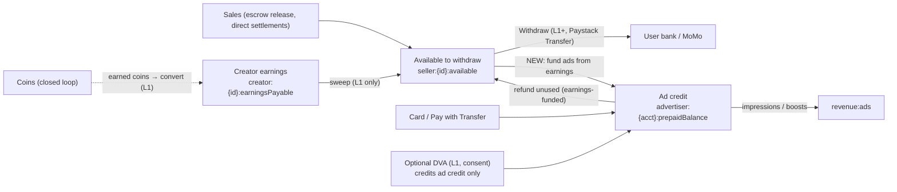
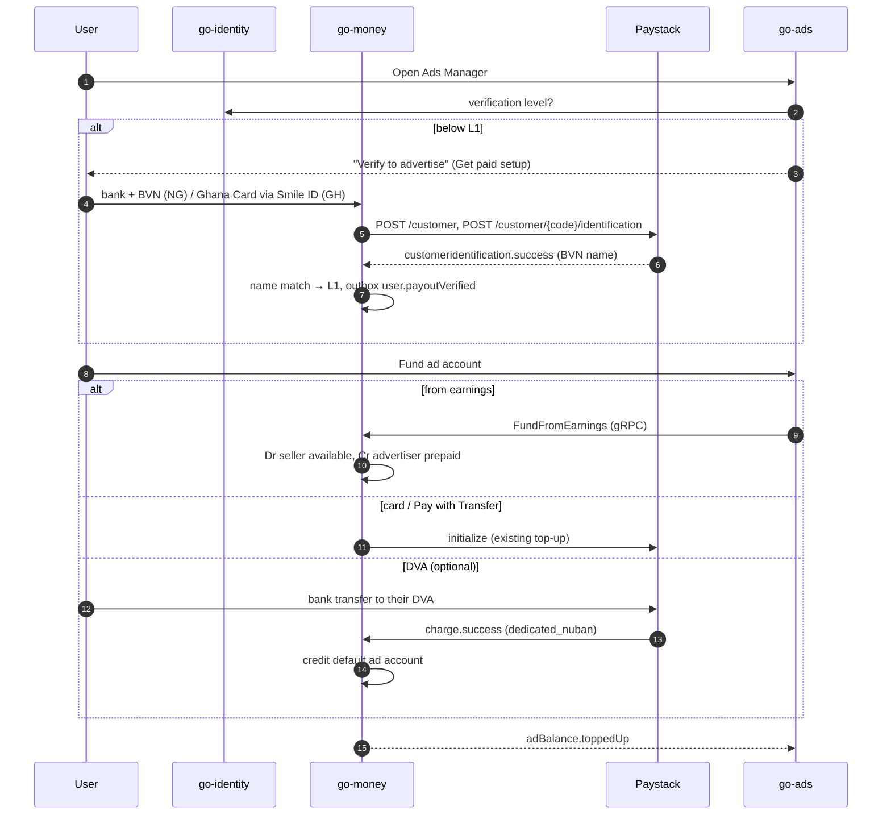

# Wallet, KYC and Ghana plan on Paystack

Assessment of six owner ideas: one wallet everywhere, a DVA behind every wallet, Paystack-first verification, ads for verified users only, rules for unverified users, and Ghana. Written 2026-10-10. **Not legal advice.** Each claim names its source. Where a source is secondary (a law firm, a vendor blog or the press), it says so; confirm those items with counsel or the regulator.

Related: [`paystack.md`](paystack.md) (integration review, fees, escrow modes E1/E2), [`smileId.md`](smileId.md) (checkmark identity), [`../checkoutPaymentFlowPlan.md`](../checkoutPaymentFlowPlan.md).

**Owner decision (2026-10-10): no forfeiture.** An unverified user's money belongs to that user. Section 6 is written on that basis.

## 0. Sources

`paystack.com` blocks automated clients, so Paystack pages were read from Internet Archive snapshots (`web.archive.org/web/<date>id_/<url>`). Each snapshot date is listed. **Re-read them live before go-live.**

| Key | URL | Read |
| --- | --- | --- |
| DVA | https://paystack.com/docs/payments/dedicated-virtual-accounts/ | snapshot 2025-10-17 |
| VALIDATE | https://paystack.com/docs/identity-verification/validate-customer/ | snapshot 2023-03-29 (old) |
| RESOLVE | https://paystack.com/docs/identity-verification/verify-account-number/ | snapshot 2023-03-29 (old) |
| API-CUSTOMER | https://paystack.com/docs/api/customer/ | snapshot 2023-03-28 (old) |
| API-DVA | https://paystack.com/docs/api/dedicated-virtual-account/ | snapshot 2023-03-28 (old) |
| CHANGELOG | https://docs-v2.production.paystack.co/docs/changelog/api/ (mirror of https://paystack.com/docs/changelog/api/) | live 2026-10-10 |
| PRICING-NG | https://paystack.com/pricing | snapshot 2026-02-05 |
| PRICING-GH | https://paystack.com/gh/pricing | snapshot 2025-11-01 |
| TERMS-NG | https://paystack.com/terms (Merchant Service Agreement and Acceptable Use Policy) | snapshot 2026-08-29 |
| TERMS-GH | https://paystack.com/gh/terms | snapshot 2026-08-19 |
| PS-GH-KYB | https://support.paystack.com/en/articles/2123842 (Compliance requirements for Ghana) | live 2026-10-10 |
| ZAP-FINE | https://techpoint.africa/news/paystack-fined-250m/ (press, 2025-04-30) | live |
| HOLDING | https://www.balogunharold.com/insights/paystack-and-the-holding-funds-rule-implications-for-a-pssp (law firm, 2025-05-20, updated 2025-11-14) | live |
| PAYSTACK-LIC | https://paystack.com/compliance (page says Paystack holds a CBN PSSP licence; quoted via search result, page itself blocked) | search |
| CBN-LIC-2020 | CBN circular PSM/DIR/CON/CWD/14/152, 9 Dec 2020, licence categories (mirror https://regalert.today/document/c2d794d4-0fed-44ef-8105-71d382222e40/text; summary https://www.aelex.com/wp-content/uploads/2021/05/Central-Bank-of-Nigeria-issues-new-framework-for-payment-system-providers.pdf) | secondary |
| CBN-MMS-2021 | CBN Regulatory Framework and Guidelines for Mobile Money Services, 9 Jul 2021 (summary https://aelex.com/wp-content/uploads/2021/07/EXPLORING-THE-NEW-FRAMEWORK-FOR-MOBILE-MONEY-SERVICES-IN-NIGERIA-1.pdf) | secondary |
| CBN-KYC | CBN three-tiered KYC circular, 18 Jan 2013 (https://regalert.today/document/dd4ad2f4-a6b0-459d-bf22-7300c72f9fa8), 2016 review (https://regalert.today/document/0ed61b66-7c6d-4145-a3cb-d23dd1ea1d78/text), 2017 mobile money limits (https://investdata.com.ng/mobile-money-cbn-raises-limits-three-tiered-kyc-requirements/, https://www.mfw4a.org/news/nigeria-cbn-reviews-limits-mobile-money-transaction-balance) | secondary |
| CBN-KYC-VENDOR | https://youverify.co/en/blogs/cbn-kyc-aml-requirements-2026 (vendor blog that attributes limits to the CDD Regulations 2023) | secondary, conflicting |
| CBN-BVN-2023 | CBN circular PSM/DIR/PUB/CIR/001/053, 1 Dec 2023 (https://regalert.today/document/166ea1dd-cb9a-4b57-8070-8c016181b5eb/text) | secondary |
| CBN-DORMANT | CBN Guidelines on Dormant Accounts, Unclaimed Balances and Other Financial Assets, 19 Jul 2024 (https://www.thecable.ng/understanding-cbn-guidelines-on-dormant-accounts-and-unclaimed-assets/, https://lawpavilion.com/blog/understanding-the-cbn-2024-guidelines-on-dormant-accounts-and-unclaimed-assets-a-compliance-conundrum/) | secondary |
| UFTF | Finance Act 2020 s.77, Unclaimed Funds Trust Fund (https://nairametrics.com/2021/01/06/finance-act-2020-fg-can-borrow-from-unclaimed-dividends-and-dormant-account-balances/) | secondary |
| FCCPA | Federal Competition and Consumer Protection Act 2018, https://fccpc.gov.ng/wp-content/uploads/2022/07/FCCPA-2018.pdf | primary (ss.127–129, 155, definitions read) |
| NDPA | Nigeria Data Protection Act 2023, https://assets.kpmg.com/content/dam/kpmg/ng/pdf/nigeria-data-protection-act2023.pdf (s.30 sensitive data, ss.41–43 transfers) | primary copy, read via summaries |
| SMILE-NG | https://docs.usesmileid.com/id-coverage/verify-with-id-number/nigeria.md | live |
| SMILE-GH | https://docs.usesmileid.com/id-coverage/verify-with-id-number/ghana.md, https://usesmileid.com/countries/ghana | live; snapshot 2026-03-07 |
| SMILE-BIO | https://docs.usesmileid.com/products/onboarding-with-biometrics/biometric-kyc.md | live |
| BOG-PSSA | Payment Systems and Services Act, 2019 (Act 987), https://ghalii.org/akn/gh/act/2019/987; licence categories https://ukgcc.com.gh/bfd_download/a-practical-guide-to-acquiring-a-psp-licence-in-ghana | primary / secondary |
| BOG-LIMITS | BoG mobile money limits from 1 Mar 2024 (https://www.pulse.com.gh/story/bank-of-ghana-increases-momo-wallet-limits-effective-march-1-2024072416081832622, https://www.ghanaweb.com/GhanaHomePage/NewsArchive/MoMo-Transactions-BoG-adjusts-customer-wallet-caps-effective-March-1-1919005); 2015 E-Money Issuer Guidelines https://dfsobservatory.com/sites/default/files/Bank%20of%20Ghana%20-%20Guidelines%20for%20E-Money%20Issuers%20in%20Ghana.pdf | press / primary (old) |
| BOG-GHCARD | BoG notice BG/GOV/SEC/2022/01 (https://3news.com/wp-content/uploads/2022/01/BOG-Notice-BG-GOV-SEC-2022-01-Notice-on-Use-of-Ghana-Card-for-all-Financial-Transactions.pdf); Jan 2026 guidance (https://gna.org.gh/2026/01/bog-sets-strict-ghana-card-rule-for-financial-transactions/) | primary / press |
| GH-DPA | Data Protection Act, 2012 (Act 843); DPC guidance https://dataprotection.org.gh/wp-content/uploads/2025/07/GUIDELINES-TO-DEMONSTRATE-DATA-PROTECTION-COMPLIANCE.pdf | primary |
| GH-VAT | VAT Act, 2025 (Act 1151), effective 1 Jan 2026 (https://trykintsugi.com/sales-tax-guides/africa/ghana, https://www.fonoa.com/resources/blog/ghana-e-vat-e-invoicing-2026) | secondary |
| GH-ELEVY | E-Levy repealed by Act 1128, effective 2 Apr 2025 (https://www.ey.com/en_gl/technical/tax-alerts/ghanas-parliament-amends-tax-laws-following-the-2025-budget-statement-presentation) | secondary (EY) |

## 1. Executive answers

| Question | Answer | Confidence |
| --- | --- | --- |
| Do DVA payments settle into Zudomart's balance? | **Yes.** A DVA is "tied to a customer", and "all bank transfers to that account will automatically be recorded as transactions from that customer" on **your** integration (DVA). Unless a subaccount or split is attached, the money lands in the main account; removing a split means "subsequent transactions received are fully settled into the main settlement account" (DVA). So a DVA-funded user wallet means **Zudomart holds user money**. | High |
| Does a pooled multi-user stored-value wallet need a CBN licence? | **Very likely yes.** Under the 2020 licence categories, holding customer funds and issuing wallets is a Mobile Money Operator activity ("wallet creation and management; e-money issuing; pool account management") (CBN-LIC-2020, CBN-MMS-2021). Secondary sources agree that PSSPs "cannot hold customer funds or issue wallets" (HOLDING). The CBN reportedly fined Paystack ₦250m for running the Zap wallet without the right licence (ZAP-FINE). If Paystack's own wallet needed a licensed partner, Zudomart's would too. | Medium-high (the regulator's text was read only through secondary sources) |
| What does Paystack's own policy allow? | The Acceptable Use Policy bans "unlicensed financial services" and requires that you "refrain from acting as a payment service provider and providing any form of payment aggregation services" (TERMS-NG; the same wording is in TERMS-GH). An unlicensed general wallet breaches both. | High |
| How can Zudomart avoid holding anybody's money? | (a) **Split to seller subaccounts** at charge time (already built for direct orders). (b) **Ledger-only ad credit**: money a user owes nobody but Zudomart, spent only on Zudomart's own ads, never sent to another user. (c) **Spend-from-earnings**: Zudomart sets off what it owes a seller or creator against ads they buy, with no new money coming in. (d) A **licensed wallet partner** (an MMO, or a bank or MFB BaaS) if a true wallet is ever wanted. | High that (a)–(c) avoid stored value; counsel must confirm (b) |
| Paystack identity vs Smile ID | Paystack's only identity check is **bank-account validation**: BVN + account number + bank code, with the result naming the customer after the BVN. "Only bank_account is supported", country `NG` (API-CUSTOMER). The standalone BVN type was deprecated in Oct 2021 (CHANGELOG). There is **no selfie, liveness, photo, date of birth or document check**. Account resolve only returns the account name and works in Nigeria and Ghana (RESOLVE). It **cannot replace Smile ID for checkmarks**. Smile ID Biometric KYC does an "ID authority lookup with biometric face matching" and liveness (SMILE-BIO), and BVN and NIN lookups return a photo (SMILE-NG). | High |
| Forfeiting an unverified user's earnings | **Superseded by the owner's decision, and it would have been unlawful anyway.** A forfeiture term is "excessively one-sided" and "so adverse to the consumer as to be inequitable" (FCCPA s.127(2)). Sellers and creators count as consumers ("to whom a service is rendered", FCCPA s.1 definitions). Such a term is void to the extent it defeats the Act (s.129). A body corporate faces a fine of at least ₦100m or 10% of turnover (s.155). Keeping a buyer's payment for goods the seller delivered is also unjust enrichment under general contract law. | High (statute read directly) |
| Ghana | Feasible as a **separate market**. It needs a Ghana entity on Paystack Ghana (a GH company or a registered "External company", PS-GH-KYB). Payments are in GHS with mobile money (TERMS-GH, PRICING-GH). KYC is Smile ID with the Ghana Card, because Paystack customer validation is Nigeria-only. **DVAs exist in Ghana since June 2025** (CHANGELOG) but have the same stored-value problem. VAT is 20% effective under Act 1151 (GH-VAT). Register with Ghana's Data Protection Commission (GH-DPA). Do not sell across the NG and GH markets at launch. | Medium |

## 2. Recommendation table

| # | Idea as stated | Feasible as stated? | Compliant alternative | Effort |
| --- | --- | --- | --- | --- |
| 1 | One wallet everywhere: sales, creator earnings, coins and ads share one balance | **Partly.** One *view* is fine. One *fungible pool* that can be topped up, sent to others or spent at other sellers is stored value | One **"Zudomart balance" screen** built from separate ledger accounts: *Available to withdraw* (sales + creator earnings), *Pending*, *Ad credit* (Zudomart services only), *Coins* (closed-loop, never cash). Allow **one-way moves from earnings to ad credit**. No user-to-user cash transfers and no cash top-up of the withdrawable balance | **S–M** (section 5) |
| 2 | Every user wallet backed by a Paystack DVA | **No.** The money settles into Zudomart's balance (DVA), which is stored value without a licence (sections 1 and 4). There is also a 1,000-DVA default limit (DVA), consent is required ("not by default", DVA), and each inbound transfer costs 1% capped at ₦300 (PRICING-NG) | **DVA only as an ad-credit top-up channel** for verified advertisers, created on request with consent. Buyers keep Pay with Transfer at checkout. For a true per-user wallet, use a **licensed partner** where the partner's bank holds the funds | **M** (DVA for ads); **L+** with legal work (partner wallet) |
| 3 | Verify through Paystack (BVN) instead of Smile ID; Smile ID for non-Nigerians | **Partly.** Paystack BVN validation proves *this bank account belongs to the person whose BVN name is X*. That suffices for payouts and ad billing. It is **not** identity proofing (no liveness, no face) | **Two levels.** *Payout-verified*: Paystack bank-account validation (NG); Paystack resolve + Smile ID Ghana Card (GH); Smile ID elsewhere. *Identity-verified* (checkmarks, high limits): Smile ID **Biometric KYC** against the BVN or NIN photo (cheaper than document capture in NG) | **M** |
| 4 | Only verified users can use ads; verifying creates the Paystack customer and DVA; they fund their wallet | **Yes**, except "fund their wallet" | At payout-verification: create the Paystack customer and validate it (needed anyway for DVAs). Ads open only to payout-verified users. Fund ads by card or Pay with Transfer (existing), from earnings (new), or by an optional DVA that credits **ad credit only** | **S** (gate) + **M** (DVA) |
| 5 | Unverified users can't hold a wallet or earn; earnings forfeited to Zudomart | **No** (owner withdrew forfeiture; FCCPA ss.127, 129) | **Sales:** allowed in escrow-only mode, proceeds accrue to the seller and are withdrawable after verification, with a cap. **Creator cash earnings** (gift cash-out, subscriptions, ad share): switched on only after payout-verification. **Dormant balances:** never forfeited (section 6) | **S** (mostly built already) |
| 6 | Ghana users | **Yes**, as a separate GHS market | Section 8 checklist: Ghana entity, Paystack GH, MoMo, Smile ID Ghana Card, GHS ledger, VAT, DPC | **L** (legal and entity) + **M** (code) |

S = days, M = 1–3 weeks, L = a month or more, mostly non-engineering.

## 3. What exists in the code today

| Concept | Where | Notes |
| --- | --- | --- |
| Double-entry ledger | `services/go/modules/ledger/src/modules/journal/models/chartOfAccounts.model.go` | Per-user liability accounts. Source of truth; Paystack balances are only for reconciliation |
| Seller balances | `SellerAvailableAccount`, `SellerPendingAccount`, `SellerEscrowAccount`, `SellerReservedPayoutAccount`, `SellerSettlingByPaystackAccount`, `SellerDebtAccount` | Escrow → locked 24h → available → withdrawal. All are `OwnerTypeProviderHeldSellerFunds` liabilities |
| Creator earnings | `CreatorEarningsPayableAccount` → `creatorEarnings.madeWithdrawable` moves them into `SellerAvailableAccount` (`wallet/src/modules/payouts/services/creatorEarningsTransfers.service.go`) | The sweep **skips** creators who are monetisation-paused or not `RequirePayoutAccountVerified`. Their earnings **wait in `earningsPayable` and are not forfeited** |
| "Wallet" API | `wallet/src/modules/payouts/services/walletOverview.service.go` | Available = withdrawable minus debts; Pending = locked + escrow + creator payable. Lists seller available and pending lines only. **There is no general personal wallet and no buyer cash balance** |
| Withdrawals | `withdrawals.service.go`; test `wallet.unverifiedSellerWithdrawals_integration_test.go` | Unverified sellers get `403 SELLER_VERIFICATION_REQUIRED` (fails closed with 503 if the status is unreadable). Non-seller creators need only a verified payout account |
| Coins | `wallet/src/modules/coins/*`, `UserSpendableCoinsAccount`, `CreatorEarnedCoinsAccount` | Closed loop. Earned coins convert to creator cash earnings (`INSUFFICIENT_EARNED_COINS`). Coins are the only buyer-side balance |
| Ad balances | `wallet/src/modules/adBalances/services/adTopUps.service.go`, `adSpend.service.go`, `boostFunding.service.go` | Prepaid `AdvertiserPrepaidBalanceAccount(adAccountId)`, funded **only by a Paystack payment intent** (`PurposeAdBalanceTopUp`). Spend is recognised as `revenue:ads`. Boosts use the account `user-<id>`. Unused balance is refundable only if `ADS_PREPAID_REFUNDS_ENABLED=true` (default **false**: "Unused ad balance is not refundable") |
| Ads billing | `ads/src/modules/billing/*` | Funding mode is `prepaid` only ("Card funding needs a saved card"). Top-up limits come from the minimum daily budget. VAT map has `GHS: 1500` bps |
| Seller finance view | `wallet/src/modules/sellerMoney/services/sellerFinanceTotals.service.go`, `sellerLedgerViews.service.go` | **Already** reports "Ads Manager charges paid from your wallet" for entry kinds `adBalance.*` / `adBoost.*` on the seller's available account. Nothing posts such a line yet, so the view is ready for spend-from-earnings |
| Paystack customer validation | `payments/src/integrations/paystackWebhooks.integration.go` (`customeridentification.*` → `WebhookKindIdentification`); payout onboarding accepts `idType: bvn \| nin` | The validation call itself is not wired (open item §11 Q7 in `paystack.md`). No DVA code exists (`grep dedicated_account` finds nothing) |
| Smile ID | `users/src/modules/identityVerification/*`; `documentTypes.service.go` has NG and GH (`GHANA_CARD`, `Enhanced: true`) | Used for paid checkmarks only. Uses Document Verification / Enhanced DocV, not Biometric KYC |

**Bottom line:** the codebase already treats unverified money as the user's (accrue, then gate withdrawal). It already separates ad credit from withdrawable money. Spend-from-earnings is the one missing piece.

## 4. Licence and Paystack policy analysis

1. **What a DVA is.** A Paystack account number pointing at a Paystack customer on Zudomart's integration. Funds become a `charge.success` on Zudomart's account (channel `dedicated_nuban`) and settle T+1 to Zudomart's bank unless split (DVA, TERMS-NG "Payout Schedule"). Nigerian DVAs come from partner banks: Wema, Titan-Paystack, Access in older docs (API-DVA, DVA).
2. **Holding funds.** If Zudomart keeps a per-user balance from those funds that the user can spend later, withdraw or send to others, Zudomart is issuing stored value. CBN puts wallet and e-money issuing under the MMO licence (₦2bn capital per secondary sources) with nominee settlement accounts and NDIC pass-through cover (CBN-LIC-2020, CBN-MMS-2021). A PSSP licence does not cover it, and Paystack itself is a PSSP (PAYSTACK-LIC; HOLDING; ZAP-FINE). Paystack's Zap now has its wallet "offered and delivered exclusively by duly licensed third-party financial institutions" such as Fidelity Bank (https://paystack.com/zap-terms, via search).
3. **Paystack terms.** "Unlicensed financial services" is a prohibited category, and acting as a payment service provider or aggregator is "a material breach" (TERMS-NG). The same wording appears in TERMS-GH. DVA validation is compulsory for the categories "Betting, Financial services, and General services" (DVA). A wallet business would be "Financial services" and would face Paystack's licence questions at go-live.
4. **What stays outside stored value** (strongest to weakest; counsel to confirm):
   - **Split at charge time** to the seller's subaccount: Paystack settles the seller directly; Zudomart never holds it (already built for direct orders).
   - **Spend-from-earnings**: Zudomart owes a seller or creator money (escrow release, earnings) and the user tells Zudomart to apply part of it to Zudomart's own ad services. No new money enters; this is set-off of a debt the merchant already owes.
   - **Prepaid ad credit** bought by card, transfer or DVA and spendable **only on Zudomart's ads**: payment in advance for the merchant's own service, like a gift card for one merchant. Not transferable, not withdrawable, refundable on request or on closure (section 6.4).
   - **Coins**: closed-loop virtual items, the same reasoning as ad credit, plus app-store rules.
   - **Escrow E2** (buyer money in Zudomart's main balance until delivery) is the existing grey area already flagged in `paystack.md` §11 Q2. A lawyer must sign it off, or Zudomart moves to E1 manual-settlement subaccounts.
5. **What would cross the line:** cash top-ups that become withdrawable; user-to-user cash transfers; paying other sellers from a balance funded by top-ups; interest; a DVA per user crediting a general balance.

## 5. Target design

### 5.1 Verification levels

| Level | Who | How (NG) | How (GH) | How (elsewhere) | Unlocks |
| --- | --- | --- | --- | --- | --- |
| L0 Account | Everyone | Verified email (email-only login) | same | same | Browse, buy, coins, gifts sent, sell **escrow-only** with the accrual cap (6.2) |
| L1 Payout-verified | Sellers, creators, advertisers | Paystack customer created; `POST /customer/{code}/identification` (`type: bank_account`, BVN, account, bank code) → `customeridentification.success`. The customer name becomes the BVN name and must match the profile's legal name (VALIDATE). Plus `GET /bank/resolve` | Paystack resolve of the bank account (GH supported, RESOLVE) or MoMo recipient, **plus Smile ID Enhanced or Biometric KYC with `GHANA_CARD`** (SMILE-GH; Ghana must be enabled on request), name match | Smile ID Biometric KYC or Document Verification; payout rail where Paystack supports the currency | Withdrawals, creator monetisation, **ads**, DVA for ad credit |
| L2 Identity-verified | Blue/Gold checkmarks; anyone above the L1 limits | Smile ID **Biometric KYC with BVN or NIN** (liveness + face match against the government photo, SMILE-BIO, SMILE-NG). Document Verification as a fallback | Smile ID Biometric KYC with Ghana Card (NIA). BoG's Jan 2026 guidance requires NIA onboarding with liveness for licensed institutions (BOG-GHCARD) | Smile ID Document Verification + SmartSelfie | Checkmarks; higher payout and ad limits |
| KYB | Gold business | Existing business-documents review | GH equivalents (Registrar-General) | — | Gold; direct (non-escrow) payments |

**Where the line is.** Paystack validation answers "does this bank account belong to the BVN holder, and what is their legal name?" It is never "is this person present and the owner of that BVN?" A stolen BVN plus a mule account in the same name passes Paystack. It fails Smile ID's liveness and face match. So:

- payout and ads use Paystack (cheap, already required for DVAs);
- checkmarks and high limits use Smile ID.

Paystack publishes no price for validation or resolve (PRICING-NG lists none). Ask.

**Why not "Paystack instead of Smile ID" for checkmarks:** no liveness, no face, no document, Nigeria only, and the docs scope it to DVA use (VALIDATE: "only required if you're using the Dedicated Virtual Accounts feature"). Using it for general KYC is **UNCONFIRMED — ask Paystack** (Q2).

### 5.2 Zudomart limits (internal, modelled on the CBN tiers)

Zudomart is not a wallet issuer, so CBN tier limits do not bind it directly. They bind banks and MMOs, and therefore a licensed wallet partner. Mirroring them keeps Zudomart's AML posture defensible and future-proof. All values are admin settings.

| Zudomart level | Unwithdrawn accrued balance cap | Withdrawals | Ad credit |
| --- | --- | --- | --- |
| L0 | ₦300,000 (= CBN Tier 1 max balance). New escrow orders are refused above it with "Verify to keep selling" | none | none |
| L1 | none | ≤ ₦500,000 per day (CBN Tier 2 daily, high-end figure) | top-up ≤ the existing `TopUpLimits` maximum |
| L2 | none | ≤ ₦5,000,000 per day (CBN Tier 3 daily); above that, manual review | as L1 |

**CBN KYC tiers for reference.** Figures conflict between sources, so **confirm the current CDD Regulations text**.

| Tier | Identity | Single / daily limit | Max balance | Source |
| --- | --- | --- | --- | --- |
| 1 | Name, DOB, address, phone, photo; BVN **or** NIN mandatory since Dec 2023 | ₦50,000 single deposit / daily (2016–2017); one vendor says ₦30,000 | ₦300,000 | CBN-KYC; CBN-BVN-2023; CBN-KYC-VENDOR |
| 2 | BVN **and** NIN, verified ID | ₦200,000 daily (mobile money, 2017); some sources cite ₦500,000 | ₦500,000 | CBN-KYC |
| 3 | Full KYC (ID, address verification, BVN and NIN) | ₦5,000,000 daily | Unlimited | CBN-KYC |

The CBN Dec 2023 circular: "no new Tier1 accounts and wallets should be opened without BVN or NIN", and funded accounts without one go on "Post No Debit or Credit" (CBN-BVN-2023). **DVA limits** are set by Paystack and its partner banks and are not documented. **UNCONFIRMED — ask Paystack** (Q5).

### 5.3 Wallet model: one balance on screen, separate accounts in the ledger

Rules:

1. **One-way to ads.** Available → ad credit is allowed. Ad credit never becomes withdrawable, except that a refund of **earnings-funded** credit goes back to Available (it was the user's money). Card-funded credit refunds to the card via the Paystack refund API.
2. **Same currency only.** NGN earnings fund NGN ad accounts; no FX.
3. **Only matured money.** Spend only `WithdrawableMinor()` after debts (`Withdrawals.ReadOutstandingDebts`), never escrow or locked funds. This keeps refunds and chargebacks safe.
4. **Same person or business.** The ad account must belong to the earner, or the earner must hold `PermissionBillingManage` on it **and** be the business owner. No funding third-party ad accounts, which would be a user-to-user transfer.
5. **App stores.** Boosts bought inside the iOS or Android apps are IAP today. Spending earnings on a boost in-app may count as unlocking digital functionality without IAP. Offer spend-from-earnings on web and the seller dashboard first; confirm app rules before enabling it in-app.

**Minimal code change** (in `wallet` and `ads`; no Paystack call):

- `wallet/src/modules/adBalances/services/earningsFunding.service.go` (new, ≤ 300 lines): `FundFromEarnings(userId, adAccountId, amount, idempotencyKey)`, inside `RunInMoneyTransaction`:
  - take the advisory locks `wallet:{userId}` and `ad-balance:{adAccountId}`;
  - require `RequirePayoutAccountVerified`;
  - check ad-account permission through the ads gRPC;
  - check `WithdrawableMinor ≥ amount`;
  - post `adBalance.fundedFromEarnings`: Dr `SellerAvailableAccount(user)`, Cr `AdvertiserPrepaidBalanceAccount(adAccount)`;
  - enqueue `adBalance.toppedUp` (so `ads/.../topUpEvents.service.go` credits the account as today).
  
  The kind prefix `adBalance.` already maps to `ads_charge` in `SellerTransactionKindOf`.
- Schema: a new table `ad_balance_earnings_transfers` (id, ad_account_id, user_id, idempotency_key unique, amount_minor, currency, refunded_minor). `AdBalanceTopUp.payment_intent_id` is immutable and required, so do not overload it. `ReadBalance`'s "funded" check must also look at the new table.
- Refund path: `RefundUnusedBalance` returns earnings-funded credit to `SellerAvailableAccount` whatever `ADS_PREPAID_REFUNDS_ENABLED` says. Refund LIFO by funding source.
- `walletOverview.service.go`: add `adCredit` (sum of the user's ad accounts' prepaid balances) and `coins` to the summary DTO. Update `apps/*` wallet screens and the API contract docs.
- Tests: the integration harness must cover an unverified user (403), insufficient withdrawable, debts first, idempotent replay, a concurrent withdrawal racing the funding, refund to Available, and ledger balanced.

### 5.4 Optional DVA for ad credit

Create on request only (consent, DVA) for L1 users:

1. `POST /customer` (or reuse);
2. validation (already done at L1);
3. `POST /dedicated_account` (`preferred_bank` from `GET /dedicated_account/available_providers`);
4. on `charge.success` with `channel: dedicated_nuban`, credit the user's **default ad account**, never a general balance.

Use Inbound Transfer Approval (Titan only) to `REJECT` transfers from accounts whose name does not match the validated name, and transfers from users who lost L1. Respond in 5 seconds, otherwise Paystack accepts (DVA). Fee: 1% capped at ₦300 (PRICING-NG), below the checkout fee (1.5% + ₦100, capped at ₦2,000) at every amount. Plan to ask Paystack to raise the 1,000-account limit (DVA).

## 6. Unverified-user rules (no forfeiture)

### 6.1 Options compared

| Option | What happens | Compliance | UX | Verdict |
| --- | --- | --- | --- | --- |
| A. Earn, accrue, withdraw after verifying | Money is credited and visible as "Waiting for verification" | Compliant if disclosed (FCCPA s.128 notice). Zudomart holds third-party money longer; balances can go dormant | Seller can start at once | **Use for store sales** (already built), with the L0 cap |
| B. Earning features off until verified | Monetisation toggles unavailable until L1 | Cleanest: no money owed to an unknown person, no dormant cash | One more step before earning | **Use for creator cash monetisation**: gift cash-out, creator subscriptions, ads revenue share |
| C. Hold X days, then refund the payer | Money returned to the buyer or gifter | **Wrong for delivered goods:** the buyer got value, so refunding them takes the seller's money (unjust enrichment the other way). OK only when nothing was delivered | Confusing | Use **only** for undelivered orders, which escrow already refunds |
| D. Forfeit to Zudomart | — | Void and an offence risk (FCCPA ss.127, 129, 155); breach of Paystack's "deceptive, unfair or predatory" restriction (TERMS-NG) | — | **Rejected by the owner** |

**Recommendation: A for sales, B for creator cash, coins stay coins.** An unverified creator can still *receive* gifts as earned coins (closed loop, no cash owed). Converting coins to cash needs L1. If the creator never verifies, the coins remain; there is no cash liability to escheat. Paid creator subscriptions and the ads revenue share are not offered to unverified creators. For ad share, the code already sends a paused creator's share to the platform (plans.md §accountHealth); for never-verified creators, not enrolling them avoids that question entirely.

### 6.2 Concrete rules

1. Unverified seller: escrow-only orders (existing). Proceeds go escrow → locked → available as today, shown as "Ready once you verify". Withdrawal returns `SELLER_VERIFICATION_REQUIRED` (existing).
2. Accrual cap: when the unwithdrawn balance reaches the L0 cap (default ₦300,000), new checkouts for that store are refused with "This store is finishing verification". Existing orders complete normally.
3. Reminders: push, email and in-app at first sale, at 50% and 90% of the cap, then monthly. Each carries a deep link to "Get paid" setup.
4. Terms (FCCPA s.128): state plainly before the first sale that money is kept for the seller, what verification needs, and that nothing is forfeited.
5. Refunds and disputes keep working against an unverified seller's balance as for anyone.

### 6.3 If they never verify (dormant balances)

| Step | Rule |
| --- | --- |
| 0–12 months | Balance stays a liability (`seller:{id}:available`). No fees deducted. Monthly reminders |
| 12 months with no login and no verification | Mark the account `dormant` in the ledger view (reporting only; the money does not move). Final notice by email and in-app |
| Account deletion or suspension (120-day rule) | Financial records are anonymised but kept (existing policy). The **balance stays payable**: the user can verify within the retention period and withdraw. Admin can pay out to a validated account after manual identity proof |
| Owner cannot be found after the retention period | **Counsel decides.** Do not credit revenue. Keep the liability, or pay to a statutory fund if counsel says one applies |

**Unclaimed funds law in Nigeria (to confirm with counsel):**

- The **CBN July 2024 dormant-accounts guidelines** cover banks, MFBs and "other financial service providers", including "prepaid card accounts and wallets". Balances dormant for **10 years** move to the CBN **Unclaimed Balances Trust Fund** pool account (CBN-DORMANT). Zudomart is not a CBN licensee, so they probably do not bind it directly. They would bind a licensed wallet partner.
- **Finance Act 2020 s.77** sends balances unutilised for **6 years** in **deposit money bank** accounts, and unclaimed dividends, to the DMO-supervised **Unclaimed Funds Trust Fund** (UFTF). Its applicability to a non-bank's ledger liabilities is doubtful. Check whether the 2025 tax-law consolidation (Nigeria Tax Act 2025) kept it.
- The general rule is that money owed stays owed. A limitation defence (6 years for simple contract claims) is a defence to a lawsuit, not a right to book the money as income. Counsel should advise whether a written policy ("after N years we transfer to X") is needed.

### 6.4 Prepaid ad credit refunds

Today `ADS_PREPAID_REFUNDS_ENABLED=false` makes all unused ad credit non-refundable. For card- or DVA-funded credit this sits uneasily with FCCPA s.127 (one-sided terms) once the ad account closes. Recommendation: refund unused credit on **account closure** or on request after 30 days of inactivity. Card-funded credit refunds to source within Paystack's refund window. Earnings-funded credit goes back to Available. Paystack does not return its processing fee on refunds ("No Processing Fee Refunds", TERMS-NG), so deduct it, disclosed.

## 7. Ads flow with verification

## 8. Ghana launch checklist

**Entity and Paystack**

- [ ] Form a Ghana company, or register Zudomart's Nigerian company as an **External company** (Forms 20 and 21, Certificate of Registration, TIN) (PS-GH-KYB).
- [ ] Open Paystack Ghana (Paystack Payments Limited, Ghana, BoG-licensed PSP, TERMS-GH). Settlement goes to a GH bank (minimum GHS 50) or MoMo (no minimum), T+1 (PRICING-GH).
- [ ] Separate keys, webhooks and ledger currency (`GHS`). go-money needs a provider account per country (`PlatformProviderBalanceAccount("paystack-gh", "GHS")`).

**Payments**

- [ ] Channels: card, mobile money (MTN MoMo, Telecel, AirtelTigo per TERMS-GH), bank. Never ask for a MoMo PIN (TERMS-GH).
- [ ] Fees: 1.95% local and international; transfers GHS 1 to MoMo, GHS 8 to bank (PRICING-GH). Update the fee estimator (`paystackSplit.integration.go` assumes the NG fee formula).
- [ ] Splits and transfers support GHS (Paystack OpenAPI, per `paystack.md` §5). Subaccounts for GH direct orders.
- [ ] Payouts to MoMo recipients (`mobile_money` recipient type). Resolve accounts before creating recipients.
- [ ] **DVAs**: Ghana supported since June 2025 (CHANGELOG). Same rule as Nigeria: ad credit only. GH DVA providers are **UNCONFIRMED**.
- [ ] Mobile money limits: payments above wallet thresholds may fail (TERMS-GH, "certain thresholds ... in the Payment Systems and Services Acts"). BoG limits since 1 Mar 2024: minimum KYC GHS 3,000 daily / 10,000 monthly / 5,000 balance; medium 15,000 / 20,000 / 40,000; enhanced 25,000 / 50,000 / 75,000 (BOG-LIMITS, press). Show a hint when a GHS cart total is above the minimum-KYC daily limit.
- [ ] **No cross-border NG↔GH orders at launch.** A GHS charge settles to the GH entity, and Paystack transfers go out of the local balance only. Paying a Nigerian seller would need FX and cross-border transfer approval.

**KYC**

- [ ] Smile ID: ask for Ghana to be enabled ("available upon request", SMILE-GH). Use `GHANA_CARD` with a selfie for L1 and L2; L2 adds Biometric KYC with liveness (BOG-GHCARD: NIA plus liveness is the BoG standard for licensed institutions). Avoid Voter ID for high-risk checks (secondary sources report restrictions).
- [ ] Paystack customer validation is **not** available for GH (`country: NG`, API-CUSTOMER), so GH L1 = resolve + Smile ID.
- [ ] Zudomart levels for Ghana: L0 cap ≈ GHS 5,000 (BoG minimum-KYC max balance), L1 daily withdrawal ≈ GHS 15,000, L2 ≈ GHS 25,000. Admin-editable.

**Tax**

- [ ] VAT Act 2025 (Act 1151): 15% VAT + 2.5% NHIL + 2.5% GETFund = **20%** effective from 1 Jan 2026; COVID levy abolished; monthly returns; E-VAT e-invoicing through a certified invoicing system (GH-VAT). A non-resident supplying marketplace or online-advertising services must register "regardless of turnover" (GH-VAT, secondary). **Code flag:** `ValueAddedTaxBasisPointsByCurrency["GHS"] = 1500` in `ads/src/modules/billing/services/billingRules.service.go` covers VAT only; check with a Ghana tax adviser whether NHIL and GETFund go on ad invoices.
- [ ] E-Levy repealed from 2 Apr 2025 (GH-ELEVY): nothing to collect.
- [ ] Corporate income tax and withholding on payouts: Ghana tax adviser (not researched here).

**Data**

- [ ] Register with Ghana's **Data Protection Commission** as a data controller (Act 843 s.27). The form asks which countries data is processed in (GH-DPA). Sources conflict on Act 843's cross-border rules, so ask counsel.
- [ ] NDPA ss.41–43 for data leaving Nigeria (AWS region, Smile ID, Paystack GH) (NDPA). Record the transfer basis.
- [ ] Biometric data is sensitive under NDPA s.30 and needs explicit consent (existing consent screen; add the GH text).
- [ ] Privacy policy and terms with a GH section and the Paystack Ghana processor listed.

**Product**

- [ ] Country picked at sign-up drives currency and catalogue (email-only login unchanged).
- [ ] Browsing is global; buying is limited to same-country stores at launch.
- [ ] Coins web packs in GHS only if `WEB_CURRENCY_NOT_ENABLED` is lifted for GHS; app stores handle their own.

## 9. Questions for Paystack (sales and support)

1. **DVA and wallets:** we would issue DVAs only to credit prepaid **ad credit** for our own ads platform (no withdrawals, no P2P). Is that acceptable under your AUP and licence, and which business category do we fall in? Is customer validation then required (DVA lists Betting, Financial services, General services)?
2. **Validate Customer beyond DVAs:** may we call `POST /customer/{code}/identification` to verify payees (sellers and creators) who will never get a DVA? Price per call? Rate limits? Is a BVN-only or NIN check available again (deprecated Oct 2021, CHANGELOG)?
3. **Account resolve:** price, rate limits, and whether `/bank/resolve` covers MoMo numbers in Ghana.
4. **DVA limits:** raising the 1,000 default; per-account inbound limits by tier; behaviour when a transfer exceeds a limit; refund path for rejected inbound transfers (Inbound Transfer Approval).
5. **DVA providers:** current `preferred_bank` list for NG and GH; is Inbound Transfer Approval available on GH DVAs?
6. **Ghana:** can our Nigerian company onboard as an External company? Can one dashboard manage NG and GH, or are separate integrations required? Which currencies can a GH integration charge, split and transfer?
7. **Holding funds:** is our E2 escrow (buyer funds in our main balance until delivery, then a Transfer) acceptable to your compliance team, and is there a maximum holding period? (Repeats `paystack.md` §11 Q2.)
8. **Manual-settlement subaccounts (E1):** an API to settle a specific amount, so escrow never touches our balance?
9. **Refund of fees:** confirm "No Processing Fee Refunds" applies to DVA charges and to partial refunds.

## 10. Questions for a Nigerian fintech lawyer

1. Does a non-licensed marketplace that **sets off** seller or creator earnings against its own ad services ("spend from earnings") carry on mobile money or e-money business under the CBN 2020 licence categories and the 2021 MMS Guidelines?
2. Is **prepaid ad credit**, bought by card, transfer or DVA, usable only for the merchant's own services, not transferable or withdrawable, outside "e-money" in Nigeria? Is there a limited-network exemption in practice? Same question for coins.
3. Does **E2 escrow** (buyer funds in our Paystack balance until delivery, then paid out) need a licence or a licensed escrow partner? How long may we hold?
4. Which **KYC/AML** duties apply to us as a marketplace? Are we a DNFBP requiring SCUML registration? Must we apply CBN tier limits to payouts? Do NFIU reporting duties apply?
5. **Unverified users' balances:** the right disclosure and terms under FCCPA ss.127–128. Can a dormancy policy move balances anywhere (CBN UBTF, Finance Act 2020 s.77 UFTF, or neither)? How long must we keep the liability? Can we ever recognise it as income?
6. **Ad credit refunds:** is a "non-refundable prepaid balance" enforceable under FCCPA s.127, and on what notice?
7. **Data:** NDPA s.30 explicit consent for Smile ID biometrics; ss.41–43 basis for transfers to Smile ID, Paystack Ghana and AWS; our DPIA and registration with the NDPC (data controller of major importance?).
8. **Ghana (local counsel):** an External company vs a subsidiary; whether our model needs a BoG PSP or PFTSP licence or registration under Act 987; DPC registration and cross-border rules under Act 843; VAT Act 1151 for marketplace commission and ads.
9. **Licensed wallet partner:** if we ever want a real wallet, what structure (MMO partner, MFB BaaS, sub-wallets in the partner's name) keeps us outside regulated activity, and who owns the customer KYC?

## 11. Next steps (no code was changed for this document)

1. Owner: approve the levels (L0/L1/L2), the caps and recommendation A+B in section 6.
2. Send the section 9 questions to Paystack and the section 10 questions to counsel. Block DVA work on answers to Q1–Q2 and lawyer Q1–Q2.
3. Engineering, after approval: spend-from-earnings (5.3) → L1 gate on ads → wire Paystack customer validation for payout onboarding → wallet summary DTO → optional DVA (5.4) → Ghana (section 8).
