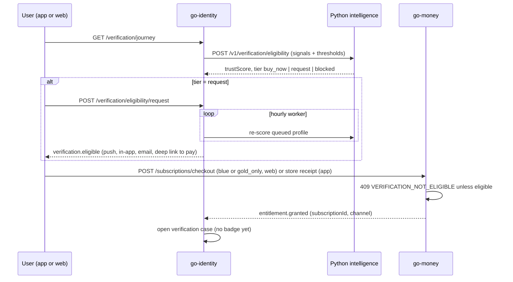
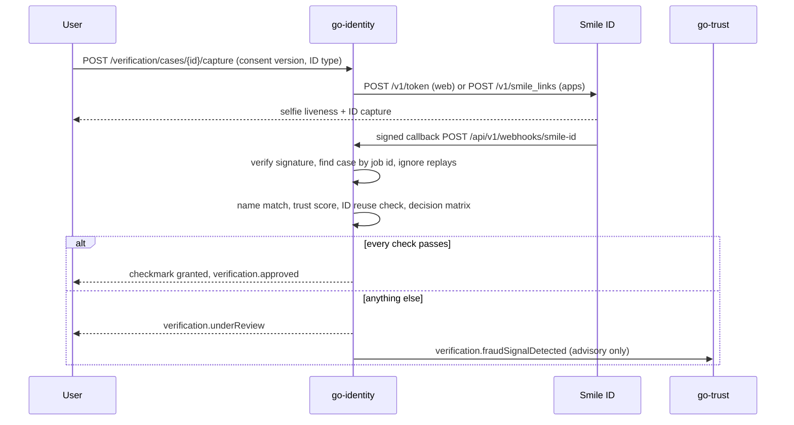
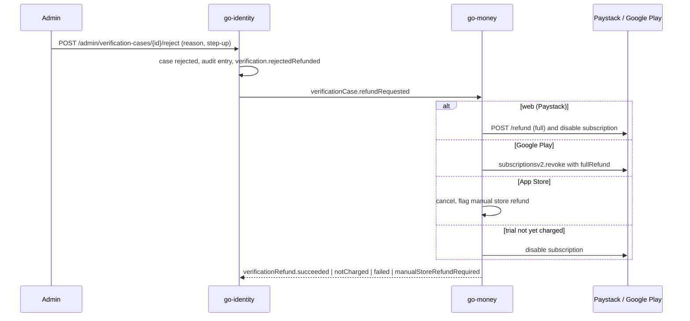

# Smile ID: checkmark identity verification

Owner decision (2026-10-04): Smile ID verifies the person behind every paid Blue or Gold checkmark. Product rules live in [plans.md §53](../plans.md); this page covers the integration, data handling and where the keys go.

## What Smile ID does for us

| Check | Smile ID product | Notes |
| --- | --- | --- |
| Selfie liveness (SmartSelfie) | part of every job | A short selfie video; a failed liveness check is treated as a possible spoof |
| Photo ID capture and document checks | Document Verification (job type 6) | Passport, driver's licence, national ID and similar |
| Face match against the ID photo | included | `Selfie_To_ID_Card_Compare` |
| Government database lookup | Enhanced Document Verification (job type 11) | Used where Smile ID supports it: NG (NIN slip, NIN card, passport, driver's licence, voter's card), GH, KE, ZA |

Accepted IDs per country are in `services/go/modules/users/src/modules/identityVerification/services/documentTypes.service.go` and served at `GET /api/v1/verification/document-types?country=NG`. Confirm the `id_type` codes against Smile ID's supported-documents list before go-live.

## How each app captures

- **Webapp**: Smile ID's hosted web integration (`https://cdn.smileidentity.com/inline/v10/js/script.min.js`) opened over `/settings/verification` with a server-issued web token. Only that page allows the Smile ID script, frames and the camera (`next.config.ts`); the rest of the webapp keeps `camera=()`.
- **Mobile (Expo)**: a single-use **Smile Link** opened with `expo-web-browser` (`openAuthSessionAsync`, SFSafariViewController / Chrome Custom Tabs, which allow camera access). This needs no native module and works in Expo Go and production builds. The Smile ID React Native SDK would give a fully native capture but needs a dev build and new native dependencies; `react-native-webview` is the middle option if we ever want the flow inside the app chrome (needs camera permission delegation with `mediaCapturePermissionGrantType`).
- The browser never reports the result. Only the signed server callback changes a case.

## Flows

Case states: `awaiting_consent` (paid) → `awaiting_capture` (consented, session open) → `processing` → `under_review` or `approved`; `rejected` only by a person. Admins can approve from any open state (manual pass).

## Callback security and idempotency

- Smile ID signs callbacks with `signature = base64(HMAC-SHA256(api_key, timestamp + partner_id + "sid_request"))`. go-identity recomputes it with constant-time comparison before reading anything else, and rejects unsigned or forged bodies with 401. Bodies are capped at 256 KB.
- Our `job_id` (UUIDv7, unique column) is created at consent time and travels as `PartnerParams.job_id`. Unknown jobs are acknowledged and ignored.
- The case row is locked `FOR UPDATE`; once a case has a result, later callbacks only increment `callback_count`. Payment events are idempotent on the subscription id (unique), refunds on the subscription row's refund marker.

## Data handling

Stored in `users.verification_cases` (go-identity):

- check results (`liveness_result`, `document_result`, `face_match_result`, `database_result`), face-match confidence, name-match score, trust score;
- ID type, issuing country, Smile job reference and result code, verification and decision dates;
- `document_fingerprint`: HMAC-SHA256 of country + ID type + ID number with `VERIFICATION_DOCUMENT_FINGERPRINT_KEY`, used only to spot one ID on several accounts;
- consent version and time.

Never stored: selfies, ID images, `ImageLinks`, face templates or embeddings, the full name or ID number from the ID, date of birth or address. The callback parser does not even decode those fields (except the name and ID number, which live in memory until reduced to a score and a fingerprint). A unit test fails if a schema field looks like biometric or raw identity data. Admins who need to see images open the job in the Smile ID portal, which keeps Smile ID's own access controls and retention.

Retention: set Smile ID's image retention to the shortest period the contract allows. Our case rows follow the account deletion and retention policies (financial references to the subscription stay with go-money's records).

## Legal notes (needs counsel review)

- Biometric data is **sensitive personal data** under the Nigeria Data Protection Act 2023. The hub shows an explicit consent screen (what is captured, who processes it, what we keep, how to withdraw) and the API refuses to start a capture without the current consent version (`VERIFICATION_BIOMETRIC_CONSENT_VERSION`). Bump the version whenever the text changes.
- Smile ID is a data processor: sign a DPA, record the cross-border transfer basis, and list Smile ID in the Privacy Policy's processors section. Apply GDPR equivalents for UK/EU users.
- A rejection is a human decision; automated processing only approves. Users are told why and can try again after 30 days.
- Never claim compliance in user-facing copy until counsel signs off.

## Where the owner puts the keys

| Setting | Where | Notes |
| --- | --- | --- |
| `SMILE_ID_PARTNER_ID` | Secrets Manager `zudomart/<env>/go-identity/app` | Smile ID portal, Account settings |
| `SMILE_ID_API_KEY` | Secrets Manager `zudomart/<env>/go-identity/app` | Generate in the portal; sandbox and production keys differ. Also used to verify callbacks |
| `VERIFICATION_DOCUMENT_FINGERPRINT_KEY` | Secrets Manager `zudomart/<env>/go-identity/app` | 32+ random bytes; never rotate without re-fingerprinting |
| `INTELLIGENCE_SHARED_SECRET` | Secrets Manager `zudomart/<env>/go-identity/app` | Same value as the intelligence service |
| `SMILE_ID_ENVIRONMENT` | Terraform `wiring.tf` | `production` in prod, `sandbox` elsewhere |
| `SMILE_ID_CALLBACK_URL` | Terraform `wiring.tf` | `https://api.<domain>/api/v1/webhooks/smile-id`; also set it as the callback URL in the Smile ID portal |
| `PAYMENT_RETURN_URLS` | Terraform `wiring.tf` (go-money) | includes `<webapp>/settings/verification` for the Paystack return |

Local development: see `services/go/.env.example`. Without Smile ID keys the capture endpoint answers `503 IDENTITY_CHECK_UNAVAILABLE`; without the intelligence URL every profile is offered "Request verification".

## Go-live checklist

- [ ] Production partner ID and API key in Secrets Manager; callback URL set in the portal.
- [ ] Sandbox end-to-end run on web and both apps (approve, review, reject + refund on each payment channel).
- [ ] Document `id_type` codes confirmed per country; Enhanced Document Verification enabled for NG, GH, KE, ZA.
- [ ] Smile ID image retention set to the minimum; DPA signed; Privacy Policy updated.
- [ ] Consent text approved by counsel and its version set.
- [ ] Alerts on `ALERT card verification refund failed`, `ALERT verification refund rejected`, and the `money-domain-events` DLQ.
