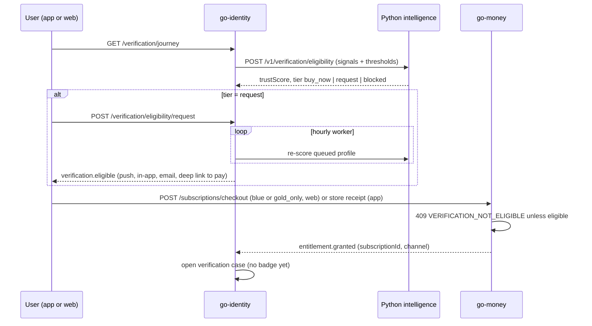
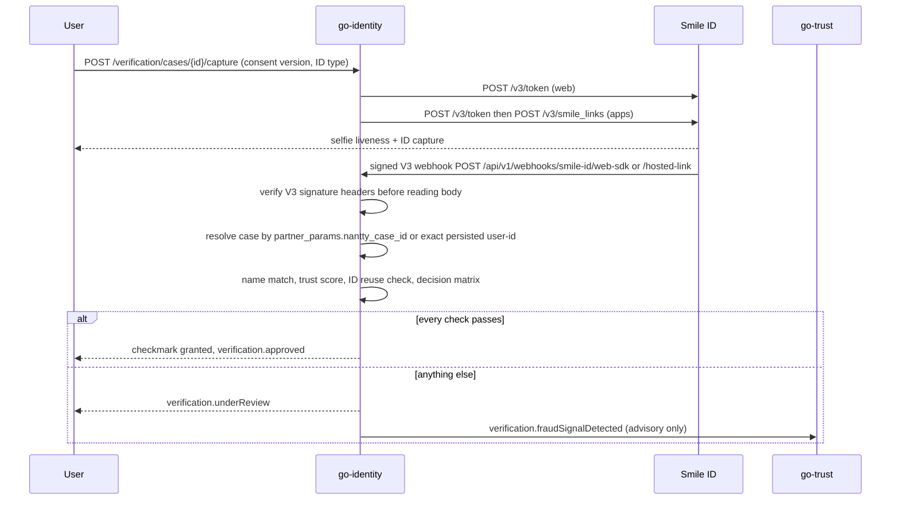
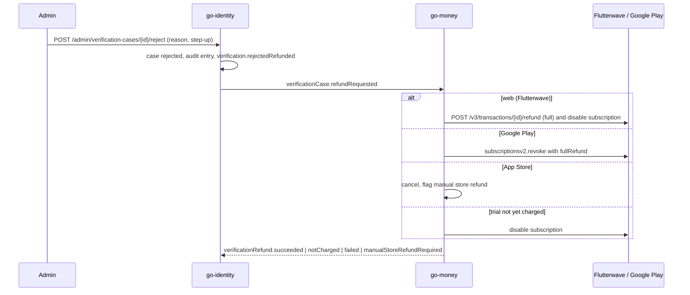

# Smile ID: checkmark identity verification

Owner decision (2026-10-04): Smile ID verifies the person behind every paid Blue or Gold checkmark. Product rules live in [plans.md §53](../plans.md); this page covers the integration, data handling and where the keys go.

## Provider documentation coverage (2026-11-19)

The live Smile `llms.txt` and sitemap were compared on 2026-11-19. All 162 indexed Markdown content pages were downloaded; the parameterized `ask` entry in `llms.txt` is a query template, not a page. The sitemap comparison identified four additional Markdown pages outside the index (166 unique content pages total), all fetched: Android SDK release notes and three dashboard/no-code navigation pages. The Android release notes were reviewed; they describe native SDK changes, while Messenger uses a backend-issued single-use Smile Link rather than embedding that SDK. The three dashboard pages are navigation stubs and add no API contract. The current Smile sitemap does not add the previously recorded nine mobile migration pages; those counts in older backlog entries describe earlier snapshots and are historical. Provider pages were archived to a temporary local directory for review and are not vendored into the repository; live source links and the integration decisions below are the durable record.

## What Smile ID does for us

| Check | Smile ID product | Notes |
| --- | --- | --- |
| Selfie liveness | Document Verification path | Smile's hosted flow captures a short selfie/liveness sequence and photo ID. |
| Photo ID capture and document checks | Document Verification (`document_verification`) | Worldwide types are loaded from the Smile supported-documents catalog, subject to Nantty partner access. |
| Face match against the ID photo | Document Verification | Smile compares the selfie with the captured document portrait. |
| ID-number lookup | Enhanced KYC (`enhanced_kyc`) | The UI can expose country/type-specific KYC choices configured for Nantty; configuration is not proof of partner-account activation. Smile's hosted link collects the number and returns the asynchronous authority result. |
| Enhanced document authority lookup | Enhanced Document Verification | Separate product and narrower catalog; exposed as its own user choice only for document types enabled by Smile's partner account and Nantty's rollout configuration. |

### Hosted Enhanced KYC contract note

Smile's Enhanced KYC product overview currently lists REST API and Mobile SDK as its integration options, but Smile's V3 [Create a Smile Link API](https://docs.usesmileid.com/api-reference/core-resources/smile-links/create-a-smile-link.md) explicitly accepts `enhanced_kyc` as an `id_types[].verification_method`. Nantty uses that explicit API contract to create a single-use, product-scoped hosted link for ID-number collection. The conflicting overview wording means this path must remain disabled until Smile confirms it works for Nantty's partner account in sandbox; a locally valid request schema does not prove hosted-form support, partner entitlement, or a successful callback.

Photo-document choices come from Smile ID's unauthenticated V3 [`GET /v3/services/supported_documents`](https://docs.usesmileid.com/api-reference/core-resources/services/supported-documents) catalog, which covers supported documents across Africa, Asia, Europe, North America, Oceania, and South America. Standard `document_verification` uses the full public catalog when the product is enabled. `SMILE_ID_ENABLED_DOCUMENT_TYPES` is now an optional narrowing control; leaving it empty does not silently limit Standard DV to an operator-curated regional subset. Smile notes a supplied country/type pair is checked when the job is submitted, so an unsupported pair can still be rejected upstream. `enhanced_document_verification` is a separate product with narrower issuer coverage. For this product, the backend obtains an EDV-scoped V3 token and calls the Web SDK's authenticated `GET /v3/services/config?product=enhanced_document_verification` contract with the documented token, partner, and SDK headers. It validates the `idSelection.enhanced_document_verification` country-to-ID-type map, caches it for five minutes, and intersects it with both the public document catalog and Nantty's exact `SMILE_ID_ENABLED_ENHANCED_DOCUMENT_TYPES` allowlist. If the lookup fails, the UI reports that EDV availability could not be confirmed and the capture endpoint rejects the EDV request. This response shape is based on Smile's current Web SDK implementation and the [Web SDK verification guide](https://docs.usesmileid.com/developer-resources/sdks/web/web-sdk/performing-a-verification); it is contract-tested locally but has not been verified against Nantty's live partner account.

The V3 supported-document response requires `valid_documents` to be an array. Nantty rejects a missing or `null` field instead of interpreting a schema-invalid response as a valid empty catalog, and it does not cache that invalid shape. An explicit empty array remains a valid provider response.

Both public catalog endpoints use one bounded response reader (8 MiB maximum) that rejects oversized bodies and trailing JSON rather than accepting a valid-looking prefix. Successfully decoded responses are cached in process for five minutes per exact API origin, endpoint, and country filter; the cache is capped at 16 entries and 8 MiB total, and responses too large to fit are not retained. Failed responses are never cached. This reduces repeated user-facing provider round-trips without persisting the catalogs or changing product/account authorization. Provider catalogs are still constrained by product and account configuration before being exposed to clients.

ID-number verification is a separate path. Smile ID's ID-number coverage is country- and type-specific; it is not the same global set as its photo-document catalog. Nantty reads the public [`GET /v3/services/supported_id_types`](https://docs.usesmileid.com/api-reference/core-resources/services/supported-id-types) catalog, then intersects it with exact account-approved `SMILE_ID_ENABLED_ID_NUMBER_TYPES` pairs (for example `NG:NIN_SLIP`) and the `enhanced_kyc` product gate. Smile's [Nigeria ID-number coverage](https://docs.usesmileid.com/id-coverage/verify-with-id-number/nigeria) includes distinct NIN formats such as `NIN_V2`, `NIN_SLIP`, and `V_NIN`; `NIN_V2` additionally requires a partner-side NIMC `enterprise_id`, so it must remain off until that prerequisite is confirmed. Nantty sends the user to a single-use Smile Link scoped to `enhanced_kyc` and the selected ID type. The token binds only the selected country/type and consent; it does not bind the person's name, contact detail or ID number, so Smile's hosted form remains responsible for collecting those required values. The ID number is entered on Smile ID's hosted page, never sent through Nantty's app API. Enhanced KYC callbacks are evaluated as an authority lookup, without falsely marking selfie, liveness or document-image checks as performed. These allowlists prove only that Nantty operators explicitly approved a pair; actual sandbox entitlement and successful capture still require provider-account verification.

The ID-number catalog is optional relative to standard photo-document verification: if Smile's `supported_id_types` request fails, Nantty still returns healthy photo-document options and marks `idNumberVerificationStatus: unavailable`; it does not present stale ID-number options as available. Web and Mobile explain that only the ID-number method is temporarily unavailable. The same failure remains visible as a service status for ID-number-only configurations rather than being represented as a verified empty provider catalog.

The Web SDK v12 script is served by `cdn.usesmileid.com`; inspection of the downloaded v12 bundle shows that the capture iframe is hosted on `links.usesmileid.com` and its sandbox/dev variants. The verification page delegates camera only to those capture origins and itself; its CSP separately permits the SDK's script, frame and connection origins only on the verification route. The ordinary site continues to deny camera. This has been checked against the SDK source, but actual browser camera permission and capture still require a live hosted verification test. A Web SDK failure is not treated as proof that no submission reached Smile; while the exact attempt remains open, Web and Mobile status screens preserve the safe error guidance, explain that only the signed callback supplies a verdict, and prevent the UI from encouraging a duplicate capture before the attempt expires or becomes retryable.

For signed Smile V3 callbacks with `status: error`, Nantty permits a new user-initiated capture only for the documented retryable reasons for that product: Document Verification (`internal_error`, `image_unavailable_or_invalid`, `document_unclassifiable`), Enhanced Document Verification (those plus `service_unavailable`), and Enhanced KYC (`internal_error`, `service_unavailable`). It invalidates the exact old capture binding and retains the provider job reference/result code; callbacks for the old attempt cannot affect the fresh one. An exact duplicate error callback is acknowledged idempotently. Other errors and `attention` remain in human review; none is treated as approval or rejection solely because of a technical error. Web and Mobile explain when a fresh attempt is available. This is contract-tested locally and still needs Smile sandbox confirmation.

Smile's [`GET /v3/services/id_status`](https://docs.usesmileid.com/api-reference/core-resources/services/id-availability) is an operational health signal for a country/ID authority pair, not a supported-type catalog or partner-product entitlement. Its status is based on recent authority responses, may be up to an hour old for low-volume IDs, and can return a no-data error. Nantty therefore does not use it to hide or authorize ID choices; the account/product/type gates above remain authoritative. If this endpoint is later surfaced as a user-facing temporary-service warning, the result must be treated as advisory and must not change eligibility or capture authorization.

## Reviewed provider products and deliberate scope

The 2026-11-19 documentation snapshot contains 162 actual Markdown pages in Smile's `llms.txt` index plus four additional sitemap-listed Markdown pages (166 unique content pages total). The parameterized query template in `llms.txt` is not a page and requires `?ask=` and `?goal=`. All 166 content pages were fetched; the three dashboard/no-code additions are navigation stubs, and the Android SDK release notes are outside Nantty's hosted-link integration path. Sitemap roots and indexes are not counted as content pages. The temporary downloaded corpus was used for source review, then left outside the repository; it is not a durable project artifact. The 162 indexed pages were byte-compared with the live index snapshot; the four additional pages were individually checked as Markdown. The current Nantty identity use case is checkmark identity proof, not a generic integration of every Smile product. This table records the mapping so products reviewed in the provider docs are not mistaken for implemented capabilities.

| Smile product/documentation area | Nantty disposition | Implemented boundary |
|---|---|---|
| Document Verification | Used | Standard photo ID plus selfie/liveness. Full provider public document catalog when enabled; optional operator restriction. |
| Enhanced Document Verification | Used as a separate optional check | Authenticated account ID selection intersected with Nantty's exact configured types; fail closed when lookup is unavailable. |
| Enhanced KYC / ID-number coverage | Used for country-specific personal identity numbers | Hosted Smile Link, exact type/product configuration, no ID number sent through Nantty APIs. NIN types remain distinct. |
| Biometric KYC, Basic KYC, phone and digital-address checks | Not part of this checkmark capture flow | Do not infer identity-check completion from a different KYC product. Reassess only if an approved requirement adopts it. |
| Residency Document Verification | Reviewed, not used | South African DHA visa/residency evidence is outside the approved checkmark flow. Smile's current docs support this product through Web SDK 12.1+, Mobile SDK 12.2+, and V3 REST, but explicitly not Smile Links. Nantty Mobile uses Smile Links and does not bundle the native capture SDK; enabling this requires a separately approved product flow and platform integration, not adding the product string to the existing selector. |
| Business Verification / KYB | Not integrated here | Business/store verification is a separate product workflow; don't relabel a personal photo-ID result as KYB. |
| SmartSelfie enrollment/authentication/compare | Not used | These are biometric enrollment/authentication or comparison flows, not interchangeable with document-based identity proof. |
| AML monitoring, one-time AML and fraud products | Not used as checkmark identity decisions | No AML screening or ongoing monitoring is claimed by this integration. Existing provider risk flags are advisory and route to review; they do not become an AML result. |
| Smile Link, Web SDK, server REST/API, callbacks, status retrieval, errors, sandbox, SDK migration and release notes | Reviewed for current capture lifecycle | Nantty uses Web SDK V12 on web, documented V3 REST token/Smile Link endpoints for backend/mobile hosted capture, signed asynchronous callbacks as the authority, and a configured sandbox/production switch. Native React Native SDK is not bundled. Smile Link's documented product list excludes Residency Document Verification; the backend and client product allowlists must continue rejecting it unless a separately approved native/Web SDK integration is implemented. |

The upstream Supported ID Types catalog also contains bank-specific KYC rows. Nantty's personal checkmark flow excludes rows typed `BANK_ACCOUNT` or carrying a `bank_code` field, even if an ID-number allowlist accidentally includes them. Bank-account ownership verification is a separate product requirement and must not be represented as personal identity proof.

Authenticated V3 API calls send both the short-lived `SmileID-Token` and `SmileID-Partner-ID` headers. The token-creation request instead uses `smileid-partner-id` and `smileid-api-key`. Contract tests assert these headers on the V3 token and Smile Link requests.

V3 token and Smile Link POST responses are capped at 1 MiB and decoded as exactly one JSON value. Oversized or concatenated JSON responses fail closed; the adapter does not retry these POSTs because an ambiguous Smile Link response could otherwise create duplicate links.

The public ALB WAF blocks all three Smile callback paths (`/api/v1/webhooks/smile-id`, `/web-sdk`, and `/hosted-link`) unless `CF-Connecting-IP` matches Smile ID's documented source addresses. The legacy path remains for callbacks created before the split. Dev/staging use the sandbox list; production uses the production list. The ALB accepts origin traffic only from Cloudflare ranges, so this forwarded-IP check is evaluated only behind the trusted Cloudflare proxy. Keep the Terraform lists synchronized with Smile ID's [webhook-server setup](https://docs.usesmileid.com/developer-resources/essentials/verification-webhooks/receive-webhooks/configure-your-webhook-server.md) before applying provider IP changes. Verify Cloudflare does not have Pseudo IPv4 `Overwrite Headers` enabled for the API zone; that mode rewrites `CF-Connecting-IP` and would cause callbacks to be blocked. This WAF rule is implemented in IaC but is not active until an approved environment deployment.

Smile recommends separate callback URLs for distinct integration types. New Nantty captures therefore use `SMILE_ID_WEB_SDK_CALLBACK_URL` for Web SDK token captures and `SMILE_ID_HOSTED_LINK_CALLBACK_URL` for single-use Smile Links. Both paths use the same raw-body-preserving gateway, signed-header validation, attempt/case binding, idempotent callback processor, and source-IP WAF rule. `SMILE_ID_CALLBACK_URL` and the legacy route remain as fallback for existing deployments and in-flight captures. Configure both new callback URLs in the corresponding Smile partner environment before enabling the split in a live environment; this repository cannot change the Smile portal configuration.

Smile's V3 `GET /v3/smile_links/{refId}` returns the link resource and its configuration, not a verification verdict or the job-status response. Nantty validates the creation `ref_id` but does not currently persist it or call this endpoint. It must not be used as a substitute for the signed callback, or for the separately scoped job-status and replay flow described below.

V3 callback parsing accepts Smile's documented mixed-type `partner_params` shape (including numeric `job_type`) while extracting only Nantty's string `nantty_case_id` and `capture_attempt_id` correlation values. Provider `id_fields` and `antifraud` may be `null` on blocked/error results. The parser ignores free-form `message`, retains only allowlisted machine-readable `reason` codes, and binds results to the signed callback headers, provider user ID, selected product, case and capture attempt. Smile documents at-least-once, potentially out-of-order delivery and retries up to three times after the initial attempt (four total); duplicate/late callback handling must remain idempotent and attempt-bound. If all automatic deliveries fail, Smile's `POST /v3/replay/{job_id}` requeues a terminal job callback and returns `202`; it requires a job TypeID and a product-scoped token. Nantty provides an audited, step-up-protected Admin action for this recovery: an operator with `verification:review` supplies the job ID and reason, and the backend binds the token to the exact product and user-bound capture attempt stored on the case. Before replay, Nantty calls the documented `GET /v3/status/{jobId}` with that same scoped token and requires an exact job/user match plus a terminal `clear`, `block`, `attention`, or `error` state. Processing, unknown, mismatched, and malformed status responses never reach the replay POST. The replay request uses Smile's stored callback destination and does not accept a callback URL from the operator. Nantty reports only that Smile accepted the replay request; the original callback must still arrive and pass all normal signature, case, attempt and product checks before the case changes. The flow does not discover missing job IDs automatically, and it does not edit verification state directly. The Smile Link `ref_id` is validated on creation but is not currently persisted, so it does not provide an automatic way to discover an unreceived job ID. Source and provider-contract tests pass; the Admin browser flow and terminal-job replay remain unverified against Nantty's partner sandbox.

Smile's documented antifraud `risk_level` values are `low`, `medium`, and `high`, and `smile_secure.status` values are `clear`, `attention`, and `error`. Nantty sends medium/high risk, fraud summaries/sources, and attention/error to human review even when the overall job status is `clear`; low risk or clear Secure status alone does not block the regular verification policy. Any unknown non-empty value for either signal also routes to review so a new provider enum cannot be mistaken for an absent/clear signal. This is distinct from the provider's final `status` and from a specific spoof verdict.

For Enhanced KYC, Smile may omit `id_fields.id_number` for specific identifiers such as Nigerian `NIN_V2` and `NIN_SLIP`, while returning the submitted value in `user_provided_info.id_number`. On a `clear` Enhanced KYC result only, Nantty uses that signed, provider-echoed value transiently to compute its keyed duplicate-prevention fingerprint. The HMAC is scoped using the country and ID type already stored on the authorized verification case; the raw number is not persisted or logged. Non-clear results do not use user-provided numbers for fingerprinting. The DB-backed NIN callback journey passed against a task-created disposable Postgres instance on 2026-11-19; the repository's persistent local database was not used. Live partner capture and callback delivery remain unverified.

## How each app captures

- **Webapp**: Smile ID hosted Web SDK v12 (`https://cdn.usesmileid.com/inline/v12/js/script.min.js`), initialized with a short-lived V3 token minted by Go for the selected photo-document product. Standard Document Verification uses the broad public document catalog; Enhanced Document Verification is a separate choice limited to exact partner-enabled types. Nantty sends a unique partner-provided Smile `user_id` derived from the server-issued capture-attempt UUID and includes the case/attempt IDs in `partner_params`. The V3 callback's `user-id` header must match that same attempt binding for new captures; legacy in-flight attempts remain compatible. Smile Link creation validates all documented acknowledgement fields (`link`, `message`, UUID `ref_id`, and returned `user_id`) before handing a URL to a client. The Web SDK's `onResult` must identify the product used; Nantty rejects mismatched or malformed result envelopes and allows a missing product only for the documented early `cancelled` state. `success` means submission accepted, not identity verified. An explicit Web SDK `cancelled` result is distinct from an accepted submission and closes only that account's exact in-flight photo-document attempt through the authenticated capture-cancel endpoint. An SDK `failure` is not treated as proof of cancellation. Provider failure codes map to user-safe guidance; raw provider messages are not shown. The API key never reaches browser code. Only the verified server webhook changes a case. The Web SDK v12 migration also requires a secure page context for camera capture: the verification page delegates camera permission to Smile's actual `links.usesmileid.com`, `links.sandbox.usesmileid.com`, and `links.dev.usesmileid.com` frame origins (not merely the script CDN), while the rest of the site continues to deny camera access.
- Deployments must set `SMILE_ID_ENABLED_PRODUCTS` only to products confirmed active for Nantty's partner account. Standard Document Verification uses the full public supported-document catalog by default; optionally set `SMILE_ID_ENABLED_DOCUMENT_TYPES` to narrow it for a controlled rollout. Enhanced Document Verification and Enhanced KYC ID-number checks use separate exact country:type allowlists. EDV also intersects its allowlist with live authenticated `/v3/services/config` entitlements; Standard DV and Enhanced KYC product permissions still require operator confirmation. Enhanced Document Verification's published coverage is narrower than standard document coverage.
- Deployments must use `VERIFICATION_BIOMETRIC_CONSENT_VERSION=2026-11-20` (or a newer reviewed consent revision) so the server enforces the current country-neutral, choice-specific consent text; existing deployments with an explicitly pinned older version must be updated before users start this flow.
- **Mobile (Expo)**: a single-use V3 Smile Link opened in the system browser via `expo-web-browser` for the selected photo-ID or ID-number product. Closing or dismissing this hosted page does not call the Web SDK-only cancellation endpoint: the app cannot know whether Smile accepted a submission before the browser closed. The attempt therefore remains pending until its normal expiry or a signed callback; the UI explains that closing is not a verification result. The HTTPS `redirect_url` returns through `/verification/return` to `nantty://settings/verification`, with a web status fallback; only the signed webhook changes the case. A provider token/link creation failure clears its exact marker. This stays a hosted flow, not a native React Native Smile SDK integration. The current Go SDK does not expose the product/payload-bound V3 token request or Smile Links operations used here; Nantty uses documented V3 REST calls instead.
- Smile ID also publishes a React Native/Expo v12 capture SDK. Nantty does not currently use it: hosted Smile Links are a supported, single-use capture option and avoid adding native analyzers and image-model size to every Messenger install. Smile's published v12.2.0 baseline reports an incremental Expo app download size of about 15.2 MB on Android and 8.7 MB on iOS for selfie plus document capture; the actual impact here could differ because Messenger already includes shared dependencies. Switching to the native SDK is a separate product/build decision; Smile's setup requires a development build, New Architecture, platform-specific analyzer providers and native plugin changes. The current app is Expo SDK 58 / RN 0.88, above the documented minimums (Expo 56 / RN 0.83), while the latest release notes say the SDK was built and verified against Expo 57 / RN 0.86. Compatibility with Nantty's exact toolchain and the resulting size/build impact need a dedicated native build test before adopting it.
- **Frontend catalog presentation**: Web and Mobile country selectors are populated by the configured-product catalog, alphabetically ordered, and preserve Smile's provider labels for types without a Nantty-specific name. Web country search matches the country name or ISO code; Mobile uses its searchable country picker. With Standard DV enabled and no optional narrowing list, all country/type entries returned by Smile's public six-continent supported-documents catalog are presented. Development mocks show representative countries but do not grant product access. Enhanced Document Verification is restricted to Smile's live account selection plus Nantty's exact allowlist; if catalog refresh fails or entitlement status is unavailable, the clients hide stale/cached EDV choices rather than presenting unconfirmed access. Nigerian ID-number choices are separate from photo documents and explain NIN formats. `NIN_V2` remains disabled until the partner-side NIMC enterprise prerequisite and exact product/type entitlement are confirmed.
- Web CSP and camera policy allow only the V12 CDN on the identity verification page; other pages retain camera access disabled.

## Flows

Case states: `awaiting_consent` (paid) → `awaiting_capture` (consented, session open) → `processing` → `under_review` or `approved`; `rejected` only by a person. Admins can approve from any open state (manual pass).

## V3 callback security and idempotency

- V3 sends `Response-Signature`, `Response-Timestamp`, `smileid-job-id`, and `user-id` headers. The signature is Base64 HMAC-SHA256 over `timestamp + partner_id + sid_request`, keyed by the API key. The endpoint validates this signature and the timestamp freshness before reading the bounded (256 KB) body; requests over that bound receive `413 CALLBACK_TOO_LARGE`, while malformed or unreadable bodies receive `400 CALLBACK_MALFORMED`.
- Outbound Smile ID API and catalog requests reject HTTP redirects. This prevents custom partner-authentication headers from being forwarded to a redirect target and avoids treating a redirected endpoint as the configured provider origin.
- Read-only catalog and Enhanced Document Verification entitlement requests retry transient transport, `429`, and `5xx` failures at most twice with exponential delays, respecting a bounded `Retry-After`. Permanent partner/product errors are not retried. Token and Smile Link creation are not automatically retried because a lost creation response could leave an extra single-use link.
- `SMILE_ID_BASE_URL` must be an HTTPS provider origin (optionally with the legacy `/v1` suffix); custom paths, userinfo, query strings, fragments and other URL components are rejected. V3 and catalog requests are built from the normalized origin so configured paths cannot alter endpoint routing.
- The same HTTPS privacy-notice URL is shown next to the user's consent and bound into web tokens. Configure `VERIFICATION_PRIVACY_POLICY_URL` to the canonical public Nantty privacy page; the example/default is `https://nantty.com/privacy`.
- Smile ID creates the provider job/user IDs. Nantty supplies a unique `user_id` derived from the capture-attempt UUID and persists that exact value on the verification case. Each capture also carries UUID case and attempt references in `partner_params`. Smile documents `partner_params` as nullable for some callback outcomes, so when the case reference is absent the webhook resolves a case only by the unique persisted `user_id`; it never falls back to an unscoped job lookup. Supplied case/attempt metadata must still be correctly typed and match. The callback then validates the expected Smile product, active attempt, and job lifecycle before applying a result.
- A capture marker prevents repeated token/link creation during the one-hour capture window (Smile Links are explicitly issued with a one-hour expiry). After that window, a new attempt may start; its UUID is carried in Smile `partner_params.capture_attempt_id`. If nullable callback metadata omits that attempt value, the backend derives it from the exact `user-id` header and checks it against both the case marker and the provider ID persisted for that attempt. The provider's documented HMAC does not cover the callback body or `user-id` header; those fields are therefore not described as cryptographically signed. The callback boundary also depends on provider-source IP filtering, TLS ingress, freshness checks, and exact stored correlation. The case row is locked `FOR UPDATE`; duplicate callbacks for the same provider job are acknowledged without repeating approval, review, or event side effects; callbacks from expired attempts are rejected.
- V1 callback parsing remains temporarily enabled for already-issued legacy sessions. New sessions use V3. Remove this compatibility path after pending V1 jobs have expired or been reconciled.
- Bodies are not cryptographically included in Smile ID's documented V3 HMAC formula; the endpoint follows that provider contract and does not misrepresent the HMAC as a body hash. Defense in depth is provider-source IP filtering at the regional ALB WAF (using the trusted Cloudflare `CF-Connecting-IP`), signature validation, a one-hour maximum callback-timestamp age with five minutes of allowed future skew, unguessable case/attempt correlation, product/job consistency checks, and one-result-per-case state. Smile documents up to four delivery attempts and a 35-second response deadline, but does not specify timestamp reuse across retries; verify this timing against real sandbox retries before tightening the freshness window. The WAF must be deployed and Cloudflare's forwarded-IP behavior verified for this boundary to hold.
- The V3 `clear` status is mapped to product-level verification checks, but Nantty still applies its independent name match, trust, payment eligibility, duplicate-document, and Gold business approval rules. Smile documents `antifraud.fraud_risk.risk_level`, `summary.fraud_detected`/`fraud_sources`, and `smile_secure.status` as separate signals and does not prescribe a universal auto-approval threshold. Nantty's conservative rule considers them separately from overall status: medium/high risk, flagged summary/source, attention/error, or any unknown non-empty risk/Secure value routes the case to human review. These signals are recorded only as a generic `provider_risk_flagged` reason, not as a spoof finding or detailed provider payload. For Enhanced KYC and Enhanced Document Verification, Smile's transient `id_fields.is_deceased`/`date_of_death` fields prevent auto-approval and route the case to human review; the raw date is not persisted. Callback country and ID-type fields may be absent; when present, Nantty compares them against the country/type selected and stored for that capture. A mismatch routes the case to human review and never replaces the original selection, including for legacy V1 callbacks. `attention` and `error` remain in human review; `block` cannot auto-approve. No browser callback grants a checkmark.
- V3's documented machine-readable `reason` is consumed separately from `status`; known product reason codes are allow-listed and recorded as review reasons for admins, while unknown reason text is discarded and forces human review. Smile's free-form `message` is not persisted or displayed. This follows Smile's instruction to interpret status with reason without storing arbitrary provider text or allowing an inconsistent `clear` plus reason response to auto-approve.
- Smile requires a webhook acknowledgement within 35 seconds. Callback processing remains synchronous, so `go-identity` now has a 25-second request-processing context and a 30-second maximum HTTP write timeout, leaving time for the provider response before its retry deadline. The server rejects a configured Identity write timeout above 30 seconds. This bounds local work but does not guarantee a successful acknowledgement under database or infrastructure stalls; provider retry handling remains idempotent, and deployed latency still needs measurement.

## Data handling

Stored in `users.verification_cases` (go-identity):

- check results (`liveness_result`, `document_result`, `face_match_result`, `database_result`), face-match confidence, name-match score, trust score;
- ID type, issuing country, Smile job reference, the opaque capture-attempt-bound Smile `user_id` used for callback correlation, result code, verification and decision dates;
- `document_fingerprint`: HMAC-SHA256 of country + ID type + ID number with `VERIFICATION_DOCUMENT_FINGERPRINT_KEY`, used only to spot one ID on several accounts;
- consent version and time.

Never stored: selfies, ID images, `ImageLinks`, face templates or embeddings, the full name or ID number from the ID, date of birth, address, raw date of death or free-form provider message. The callback parser reads the name and ID number only long enough to calculate a match score and keyed fingerprint. For Enhanced KYC and Enhanced Document Verification it also reads `is_deceased` / `date_of_death` transiently; a positive deceased signal is reduced to a non-PII review reason, and the raw date is discarded. Known Smile reason enums are retained only when they match the bounded documented allowlist; unknown reason text is discarded and replaced with a generic review reason. A unit test fails if a schema field looks like biometric or raw identity data. Admins who need to see images open the job in the Smile ID portal, which keeps Smile ID's own access controls and retention.

Retention: set Smile ID's image retention to the shortest period the contract allows. Our case rows follow the account deletion and retention policies (financial references to the subscription stay with go-money's records).

## Legal notes (needs counsel review)

- Biometric data is **sensitive personal data** under the Nigeria Data Protection Act 2023. The hub shows an explicit consent screen (what is captured, who processes it, what we keep, how to withdraw) and the API refuses to start a capture without the current consent version (`VERIFICATION_BIOMETRIC_CONSENT_VERSION`). Bump the version whenever the text changes.
- Smile ID is a data processor: sign a DPA, record the cross-border transfer basis, and list Smile ID in the Privacy Policy's processors section. Apply GDPR equivalents for UK/EU users.
- A rejection is a human decision; automated processing only approves. Users are told why and can try again after 30 days.
- Never claim compliance in user-facing copy until counsel signs off.

## Where the owner puts the keys

| Setting | Where | Notes |
| --- | --- | --- |
| `SMILE_ID_PARTNER_ID` | Secrets Manager `nantty/<env>/go-identity/app` | Smile ID portal, Account settings |
| `SMILE_ID_API_KEY` | Secrets Manager `nantty/<env>/go-identity/app` | Generate in the portal; sandbox and production keys differ. Also used to verify callbacks |
| `SMILE_ID_ENABLED_PRODUCTS` | Terraform environment variable `smile_id_enabled_products` | Only `document_verification`, `enhanced_document_verification`, and/or `enhanced_kyc` after confirming activation in the matching partner environment; defaults empty/fail-closed |
| `SMILE_ID_ENABLED_DOCUMENT_TYPES` | Terraform `smile_id_enabled_document_types` | Optional exact comma-separated `COUNTRY:ID_TYPE` narrowing list for Standard Document Verification, e.g. `NG:PASSPORT`; empty means use Smile's public supported-document catalog when the product itself is enabled |
| `SMILE_ID_ENABLED_ENHANCED_DOCUMENT_TYPES` | Terraform `smile_id_enabled_enhanced_document_types` | Exact comma-separated `COUNTRY:ID_TYPE` pairs enabled for Enhanced Document Verification, e.g. `NG:VOTER_ID`; defaults empty/fail-closed |
| `SMILE_ID_ENABLED_ID_NUMBER_TYPES` | Terraform `smile_id_enabled_id_number_types` | Exact comma-separated `COUNTRY:ID_TYPE` pairs approved for Enhanced KYC, e.g. `NG:NIN_SLIP`; defaults empty/fail-closed. Do not enable `NG:NIN_V2` without the provider-required NIMC enterprise ID |
| `VERIFICATION_DOCUMENT_FINGERPRINT_KEY` | Secrets Manager `nantty/<env>/go-identity/app` | 32+ random bytes; never rotate without re-fingerprinting |
| `INTELLIGENCE_SHARED_SECRET` | Secrets Manager `nantty/<env>/go-identity/app` | Same value as the intelligence service |
| `SMILE_ID_ENVIRONMENT` | Terraform `wiring.tf` | `production` in prod, `sandbox` elsewhere |
| `SMILE_ID_WEB_SDK_CALLBACK_URL` | Terraform `wiring.tf` | Public HTTPS URL ending in `/api/v1/webhooks/smile-id/web-sdk`; configure it for Web SDK callbacks in Smile's partner environment |
| `SMILE_ID_HOSTED_LINK_CALLBACK_URL` | Terraform `wiring.tf` | Public HTTPS URL ending in `/api/v1/webhooks/smile-id/hosted-link`; configure it for Smile Link callbacks in Smile's partner environment |
| `SMILE_ID_CALLBACK_URL` | Terraform `wiring.tf` (legacy fallback) | Retained for existing captures and deployments; new captures prefer the integration-specific callback URLs |
| `SMILE_ID_BASE_URL` | Optional service configuration | Defaults to `https://testapi.smileidentity.com` in sandbox and `https://api.smileidentity.com` in production. Legacy `/v1` suffixes are stripped. |
| `PAYMENT_RETURN_URLS` | Terraform `wiring.tf` (go-money) | includes `<webapp>/settings/verification` for the Flutterwave checkout return |

Local development: see `services/go/.env.example`. Without Smile ID keys the capture endpoint answers `503 IDENTITY_CHECK_UNAVAILABLE`; without the intelligence URL every profile is offered "Request verification".

## Go-live checklist

- [ ] Production partner ID and API key in Secrets Manager; callback URL set in the portal.
- [ ] Sandbox end-to-end run on web and both apps (approve, review, reject + refund on each payment channel).
- [x] Source contract tests confirm V3 token and Smile Link multipart fields; Web SDK source uses the v12 CDN, complete `partner_details`, `production`/`sandbox` environment values, `partner_params`, and `onResult`.
- [x] Web SDK failure results use the documented v12 error-code envelope and present actionable non-sensitive messages. Result product/status is validated; only the documented product-less early cancellation is accepted. An SDK `failure` marked `retryable: true` releases only its exact active photo-document attempt through the authenticated backend cancellation transaction before the UI offers a fresh-token retry. Non-retryable failures remain locked; if cancellation fails or loses a race to callback processing, the UI does not offer a duplicate attempt. Hosted Smile Link dismissal remains pending until expiry or callback. Focused service tests cover retryable/non-retryable failures and cancellation races.
- [x] Callbacks accept only the configured photo document and ID-number products; unknown V3 products fail closed. Enhanced Document Verification results require the documented issuer/database match in addition to photo, liveness and face-match checks before auto-approval. Nullable returned country/type fields are accepted; nonempty mismatches with the captured selection require review, and neither V1 nor V3 results can overwrite that selection. Identity strings are compared without prefix truncation, preventing malformed longer values from collapsing into a matching country/type.
- [ ] Run actual sandbox capture and callback on web and Android/iOS hosted-link flows; source-level contract tests do not prove partner-account entitlements or delivery.
- [x] Fetch worldwide photo-document and supported KYC ID-number catalogs; intersect them with explicit product and exact country:type allowlists; keep Document Verification and Enhanced KYC distinct. NIN_V2 remains contingent on the partner's NIMC enterprise ID.
- [ ] Verify Nantty partner entitlements and run real sandbox flows for representative countries/document types plus NIN variants. The public coverage catalog does not prove account-level access.
- [ ] Smile ID image retention set to the minimum; DPA signed; Privacy Policy updated.
- [ ] Consent text approved by counsel and its version set.
- [ ] Alerts on `ALERT card verification refund failed`, `ALERT verification refund rejected`, and the `money-domain-events` DLQ.

## Provider catalog input contract follow-up (2026-11-19)

The V3 Supported ID Types schema requires an optional country filter to be a two-letter uppercase ISO-3166-1 alpha-2 code. Both country catalog methods now trim and uppercase input, validate this format, and reject malformed values before network access. Tests verify whitespace/lowercase normalization and that malformed values cause no provider calls. Full uncached Users Go suite, focused race-enabled catalog/controller suites, and diff check pass. This validates request formation only; live Smile account behavior remains unverified. Source: https://docs.usesmileid.com/api-reference/core-resources/services/supported-id-types.
